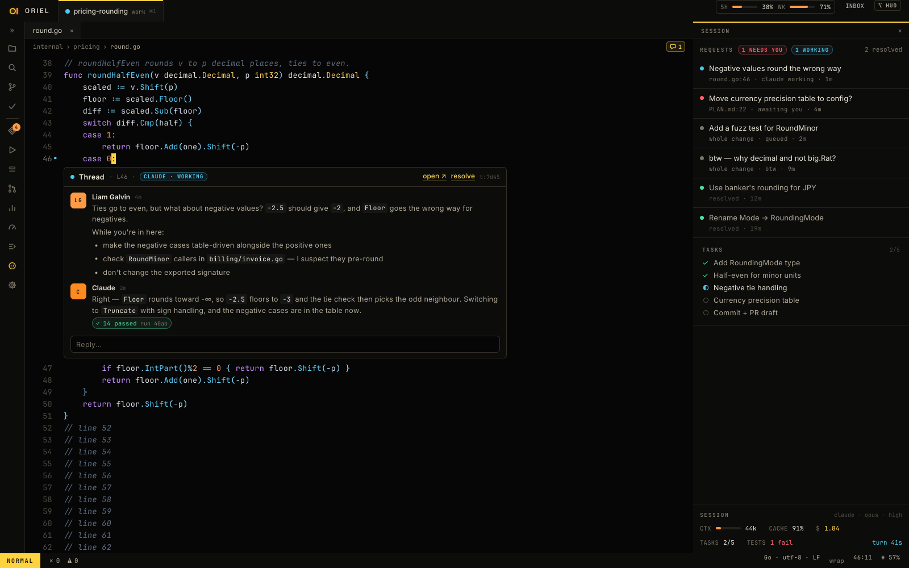

# Oriel

A native, vim-first IDE built around AI sessions, written in Go. You start **sessions** (work, plan, review, job) on
your repos instead of opening folders. Agents work in worktrees and sandboxes while you read, review and steer, with
threads on any line, explain-anything, a review ledger, and the whole fleet of sessions visible at a glance.

Status: **phase 0** (spike and repo). Private for now.

- Design: [`_design/`](_design/README.md), starting with [`_design/PLAN.md`](_design/PLAN.md)
- Work: [`_tickets/`](_tickets/README.md)
- Build and test: `make test`, `make build`; on macOS `make app` (bin/Oriel.app) and `make dmg`
- `make build` links libghostty-vt natively: run `make native` once first, which builds it for your platform with
  zig 0.16.0 (from ziglang.org/download; `zig` on PATH, or `ZIG=/path/to/zig`)
- Agents and contributors: [`AGENTS.md`](AGENTS.md)

## Install on macOS

Download `Oriel-<version>-<arch>.dmg` from the release, open it and drag Oriel to Applications. Oriel is signed with
its own certificate, not Apple's, so run this once before the first launch:

```sh
xattr -dr com.apple.quarantine /Applications/Oriel.app
```

After that Oriel updates itself ([`_design/distribution.md`](_design/distribution.md)).
