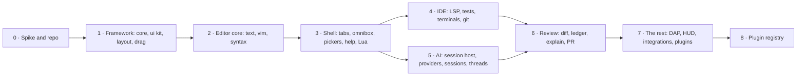

# Oriel: an AI-first IDE

A native, vim-first IDE built around AI sessions.
Half professional editor, half agent harness: all of crit's practical power,
none of the room.

*Mockups of every screen are in `ui.md`.*

## Goal

- **Extensible by construction.** Everything is built on proper, general APIs that plugins can use too. Built-in
  features are themselves plugins, and nothing is hacked in for one use case (`plugins.md`, `AGENTS.md`).
- **Reuse before you build.** One component per job, used everywhere: a widget, a registry helper, a git query, a
  test harness. A second copy of something is the cue to extract it, and a fix goes where every user gets it (the
  toolkit, the shared package), not into one screen or one caller.
- An IDE you'd use with no agent at all: real vim, LSP, debugger, terminals, git.
- An AI harness where the agent's work is **planned, visible, reviewed and owned**:
  plan → work → review → verify → PR, with threads on any line.
- Every session's state visible at a glance, and switching between them takes one keystroke.
- crit's control-room telemetry folded into the IDE as small, live "indicators".
- Fast: under 8 ms from keypress to screen, and beautiful text.
- Go throughout, in modules you can swap.
- Claude and Codex from day one, with more providers behind one interface.

## Decisions (one per doc)

| Doc | Decision |
|---|---|
| `shell.md` | Native Go GPU app on **Gio**, behind our own `render`/`ui` seams. Electron is the fallback if the spike fails. Wails ruled out (WebKitGTK). |
| `editor.md` | **Decided: our own vim engine in Go, all the way** (no embedded neovim), held to vim behaviour by differential tests against headless neovim. |
| `rendering.md` | Own immediate-mode `ui` toolkit, HarfBuzz-grade shaping, glyph atlas, a handful of shader effects for the look. |
| `sessions.md` | **Sessions, not folders.** You start work (plan, work, review, tour, job, new repo) on repos, and Oriel creates worktrees on a branch. Also a `direct` mode for editing a checkout in place, and `scratch`. The app opens on mission control, not a file dialog. |
| `architecture.md` | One process per machine: the Oriel window hosts its sessions itself (the `host` package). No per-session servers, no sockets, no browser. |
| `agents.md` | `agent.Provider` interface. Claude runs as an interactive PTY session driven by the Oriel mod's hooks (subscription billing, not `-p`); Codex via `app-server`. Nothing calls `claude -p`. |
| `plugins.md` | Vim-level extensibility: every action a command, every event hookable (observe / veto / rewrite / decide), every surface replaceable. Tiers: Lua, process (JSON-RPC), WASM, built-in Go, all using the same registry. |
| `scripting.md` | **Lua** config and plugins (gopher-lua first, LuaJIT if the benchmarks need it), with a neovim-shaped API, agent tools and gates defined in script, and full introspection. |
| `theming.md` | Layered tokens (palette → semantic → component and syntax, plus effects and type) in TOML themes that `extends` a base and hold only overrides. A `:Theme` editor where you click anything to edit the token behind it. Imports VS Code, base16, nvim and terminal themes. |
| `features.md` | **The feature inventory**: every capability in the mockups mapped to a module, a phase and a testable "done when". It also defines what Start work does (phase 0 only). |
| `security.md` | Plugins are **deny by default**: they declare capabilities, each explained (optionally with the author's reason), and you install **all or nothing**. Secrets are bound to a host and never seen by the plugin. WASM and Lua are enforced in-VM. Process plugins are OS-sandboxed. Native plugins are full trust and labelled as such. Plugins that touch code run **inside the session's sandbox**. |
| `distribution.md` | DMG once, then silent self-updates. A stable signing identity (self-signed now, Developer ID when public) avoids TCC and keychain re-prompts. Releases are verified with ed25519. |
| `help.md` | **Help on everything**: right-click → Help, `K`/F1, `⌘?` help mode, `:help`. Markdown pages with live "right now" blocks and generated key, option and API sections. CI fails if an interactive element has no help. |
| `testing.md` | **Test-first.** Every behaviour test cites a vendored spec (`:help` tag, LSP/DAP spec, xterm ctlseqs, Unicode) with a verbatim quote that CI checks. Vim expectations are also checked against headless nvim, plus differential fuzzing and mined vim tests. |
| `deps.md` | Dependency policy: stdlib and `x/` are free, large accountable companies are allowed, **everything else needs approval first**. CI allowlist, vendored source, and WASM built from pinned source. Audits every dependency the plan names. |
| `ide.md` | Full LSP and DAP clients; the agent gets LSP and debugger tools too. |
| `ui.md` | Session tabs with status, ⌘K omnibox, mission control, HUD indicators, and every screen mocked up. |
| `crit-reference.md` | What crit does today, with source paths. Tickets that say "port from crit" mean this. |
| `migration.md` | New repo, crit frozen then retired; what we port, rewrite and drop. |

## Keep, rewrite, drop

**Keep (port the logic)**
- Plan / work / review / tour / job sessions, multi-repo workspaces and worktrees.
- Threads on lines, ranges, files and whole changes; btw side questions; urgent comments.
- Explain: crit's hunk `?` cards become **explain by code unit** (function, block, condition) plus **Explain this** on any selection; the "Explain this change" walkthrough, tours with their 7 kinds.
- AI review, Git page, PR page, GitHub review mirroring ("Forward to GitHub"), PR template drafts.
- Commit and PR drafts written when the agent goes idle.
- Verify (an optional quiz about the change; a PR never waits for it), the slop gate, trusted-orgs redaction.
- Tasks rail, subagents box, permission and question cards.
- Sandbox, gateway MCP, egress approvals, ssh-agent grants.
- agentbus (questions, review requests, auto-answer), Linear. Slack PTAL is company-specific: an external plugin, not in oriel.
- The assistant: it moves from the room into a drawer.
- Usage windows, session stats, stats, this machine's CPU/mem, logs, agentbus log.
- Editable prompts page and coding style. Voice dictation.

**Rewrite**
- The whole UI (native), the editor (own vim), LSP (a full client), terminals (native).
- Session servers, the worker and the manager/dashboard, which become the app and its in-process session host.
- The Claude mod and hooks, which become provider-neutral session-host logic plus MCP.

**Drop**
- 3D room, scenes, sea and coast, black hole, lights, floor and wall coverings, post-its.
- Cinema, YouTube, IPTV, CCTV, Spotify and music, the camera.
- Chess puzzles. The wake word stays optional, since dictation is useful.

## Phases

- **Order comes from per-ticket dependencies** (`features.md` → After). `_tickets/README.md` lists what's **ready now**
  and a full topological order. Phases are just a coarse grouping of that.
- **What Start work does**: phase 0 only (`features.md` → "What Start work does").
- **0. Spike and repo.** Prove Gio meets the `shell.md` budgets and can match the mockups. Repo skeleton, CI, `vimtest` and the nvim oracle.
- **1. Framework.** How everything hangs together: the core store and events, registries, the `ui` toolkit
  with hover, focus and press states and springs, widgets, theme tokens, the headless snapshot backend, and the layout
  tree with drag-any-pane-anywhere. It has to look and feel right before features land on it.
- **2. Editor core.** `text`, then `vim` test-first against the oracle, then `syntax` on wazero. Usable as a plain editor.
- **3. Shell.** Session tabs, omnibox, pickers, which-key, help, Lua config.
- **4. IDE.** LSP, running tests, terminals, git, search. Daily-drivable without AI.
- **5. AI.** The session host, the Claude and Codex providers, sessions, requests, plan and work.
- **6. Review.** Diff views, review ledger, explain, AI review, PR and Ship pages, verify.
- **7. The rest.** DAP, HUD and mission control, plugins and security, integrations, assistant, tours, self-update. Then cut-over: crit is archived.
- **8. Plugin registry.** `[plugins]` in `settings.toml`, lockfile consent, the package format, the registry repo and
  publishing (`catalog.md`).

Usable as a daily editor after phase 4.

## Risks

- **Vim fidelity long tail.** Mitigated by the oracle suite: every gap becomes a failing test with the right answer already in it.
- **Gio text quality and latency.** That's what the spike is for; the `render` seam keeps a backend swap cheap.
- **Building a widget kit is a sink.** Keep it to what the mockups need, and nothing speculative.
- **Provider protocols move.** The Claude hook API, the transcript format and app-server change, so we pin versions and keep provider conformance tests.
- **Two products at once.** The IDE must be good on its own by phase 4, or the AI half carries a weak editor again.

## Out of scope (for now)

- A browser pane (options in `ide.md`, decision deferred). Windows. A marketplace (the curated plugin registry in `catalog.md` isn't one: no storefront, ratings or hosted service). Collaborative multi-user editing. Running neovim Lua plugins.
- A built-in web or mobile client. Remote control, if wanted, is a plugin.

## Decided along the way

- **Name: Oriel** (a bay window: a window into the code). Binary `oriel`, repo `liamg/oriel`. No Homebrew formula or AUR package by that
  name, and no notable repo (the largest is a 57★ interpreter for a 1991 scripting language). Fly was dropped because fly.io
  ("computers for agents") is too close.
- **Licence: deferred.** The repo stays private for now. When it's opened, the leaning is MPL-2.0 for the app and Apache-2.0 for the
  plugin SDK and reusable libraries.
- **Logo: "o▌" (O12 · R1)**: a lowercase o with a tall block cursor (`ui.md` → Logo).
- **Default palette: black, yellow and orange.** Accent yellow `#ffd23f`, orange `#ff8a1f` used sparingly, and the o▌ mark drawn as a yellow o
  with an orange cursor. Status colours moved clear of the brand colours: working = cyan, with a reviewer = pink, quiet = green. Themes override all of it.
- **macOS signing: a self-signed certificate**, kept as long as it suits. Developer ID only if a public release ever targets people
  who won't run one `xattr` command (`distribution.md`).
- **Platforms: macOS and Linux from day one**, both in CI from phase 0, and the spike measures both. macOS is Liam's daily machine, so it's
  the primary target for feel (Metal, Retina, ⌘ keys, IME, notarisation). Windows is out of scope.
- **Commit gate**: hard for work and plan sessions ("commit anyway" is one keypress, recorded in a commit trailer), soft for jobs,
  off for tours and scratch sessions. Repos can override it (`agents.md`).
- **No built-in web client.** Remote control (phone, browser) can be a process plugin using `session.control` and the agent permissions.
- **Gio approved**, on condition the phase-0 spike reproduces the mockups' look with no blocking limits.
- **go-text, wazero and gopher-lua approved** (`deps.md`).
- Tree-sitter, its queries and the fonts approved. We write our own `pty`. agentbus runs as a separate `oriel-agentbus` helper process, keeping sqlite out of Oriel.

- **Plugin registry** (`catalog.md`): plugins are listed in `settings.toml` and installed from the file or the GUI alike.
  A plugin enters through Lua; WASM and binaries are started from it. The registry is `liamg/oriel-plugins`, a repo of
  `plugins/<author>/<plugin>/plugin.toml`: each version is a reviewed PR, unless the author is trusted, in which case
  Oriel follows their tags. A git URL installs as unverified, with a warning. "Plugin", never "extension".

## Open questions

None right now: everything above has been decided.
