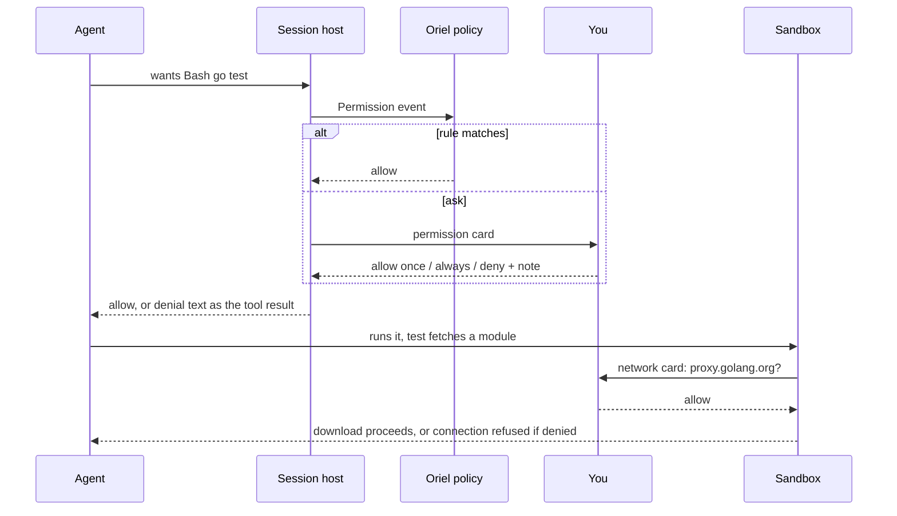
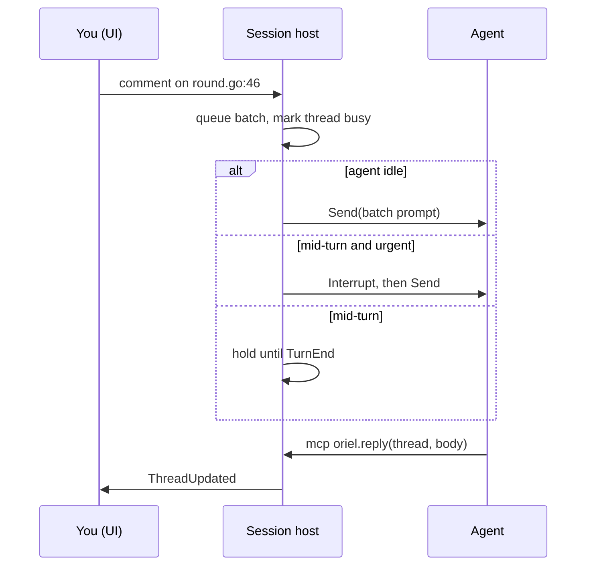

# Agents: Claude, Codex, and whatever comes next

Each provider is driven the way its **subscription** allows.

- `claude -p` and the Agent SDK are billed per token. Only the interactive `claude` CLI uses your
  Max subscription. So Claude runs as a **full interactive session in a PTY**, driven by Oriel's
  Claude Code mod through function hooks, the way crit does it today.
- Codex's `app-server` is what the official IDE extensions use with a ChatGPT login, and it is billed to the
  ChatGPT plan (checked in P0-5: `spikes/P0-5-codex-billing.md`). Billing follows the auth mode, so the provider requires
  `account/read` → `chatgpt` and asks before running on an `apiKey` login.
- Oriel draws the conversation itself from hook events plus the transcript. The PTY is still there for when you want it raw.

## Providers

| | Claude | Codex |
|---|---|---|
| Process | interactive `claude --plugin-dir <oriel-mod>` in a PTY (subscription) | `codex app-server`, JSON-RPC (JSONL) over stdio, ChatGPT login (subscription) |
| Control channel | the mod's function hooks run `oriel hook <op>`, which talks to the session host over a unix socket | JSON-RPC requests |
| Send a prompt | `$.prompt.submit` (the mod receives it from the host) | `turn/start` |
| Interrupt | `$.turn.abort` | `turn/interrupt` |
| Our tools | `$.tool.register` (`mcp__oriel__*`), backed by the host | MCP server `oriel` |
| Permissions | `classic.PermissionRequest` hook → host → card → answer | `item/commandExecution/requestApproval` / `item/fileChange/requestApproval` |
| Side questions (btw, explain, verify quiz) | `$.model.fork`: tool-less, outside the main conversation | `thread/fork` |
| Turn and subagent lifecycle | hook events (turn start/complete, subagent spawn/end, StopFailure) | notifications |
| Messages and tool calls | tail `~/.claude/projects/*.jsonl` (crit's `transcript` package) | notifications + rollout files |
| Usage / quota | `$.session.usage()`, reported by the mod | `account/rateLimits/read` + `account/rateLimits/updated` |
| Guard rails | `tool.check`: deny edits outside the worktree, deny raw network git/gh | sandbox policy + approvals |

- **Terminal view comes free** for Claude: it *is* a PTY session, so "Show terminal" attaches to it.
  For Codex, "Open in terminal" runs `codex resume` on the same session.
- The skills (`plan`, `diff`, `new`, `tour`, `job`) become **prompt packs**: markdown plus tool lists.
  The Claude mod loads them as skills; Codex gets them as the first user message plus `AGENTS.md`.
- The mod is the one Claude-specific piece of TypeScript. It stays small (crit's is about 575 lines),
  and everything it decides is delegated to the host. Like crit's, it reaches the host by running a command (`oriel
  hook`, as crit's runs `crit wait` and `crit agent-event`); the function-hook API has no sockets of its own.

### The Claude provider as built (`agent/claude`)

- Launch: `claude --plugin-dir <StateDir>/claude-mod --permission-mode <mode> [--model M] [--effort E]
  [--mcp-config <GatewayMCP> --strict-mcp-config] (--session-id <uuid> [/oriel:<skill> <prompt>] | --resume <id>)`
  in a 200×50 PTY, env `ORIEL_SPAWNED=1`, `CLAUDE_CODE_ENABLE_FUNCTION_HOOKS=1`, `ORIEL_HOOK_SOCK`, `ORIEL_BIN`, then
  `StartSpec.Env`. Oriel picks the session id itself (`--session-id`), so `ID()` is known before claude is up.
  Policy → mode: ask → `default`, light → `acceptEdits`, bypass → `bypassPermissions` (refused without a sandbox).
  On the host the folder is pre-trusted in `.claude.json` and crit's agent defaults are merged into `settings.json`.
- The mod (`agent/claude/mod`, embedded) runs `$ORIEL_BIN hook <op>` with JSON on stdin for every decision; `oriel
  hook` (`claude.HookMain`) carries it over the unix socket. Ops: `hello` (→ tools to register), `wait` (a ≤45 s long
  poll → `submit` | `abort` | `fork` | `timeout`), `event` (`turn-start`, `turn-complete` with usage and rate limits,
  `subagent-start/run/end`, `api-error`, `end`), `check` (tool.check: the guard rails), `permission`, `question`,
  `tool`, `fork-answer`. Prompts are submitted `asUser`, so the agent reads them as the user's.
- Messages, tool calls and results (with `core.FileDiff` from the edit's `structuredPatch`, else its input) come
  from tailing `<config>/projects/<slug(cwd)>/<id>.jsonl` and `<id>/subagents/agent-*.jsonl`. A turn's end waits
  briefly for the log to hold the turn's answer, so its messages always come before `TurnEnd`.
- `Usage` is the windows a session's mod last reported through `$.session.usage()`; there is no probe.

### The Codex provider as built (`agent/codex`)

Shapes are from `codex-rs/app-server-protocol` v2 at the P0-5 commit (`ddb33e34`); `agent/jsonrpc` is the JSONL
JSON-RPC under it (Codex's messages carry no `"jsonrpc"` field; MCP's do).

- Launch: `codex app-server` through `StartSpec.Exec`, cwd `StartSpec.Cwd`, env `StartSpec.Env` over the host's.
  `initialize` (`clientInfo`, `capabilities.experimentalApi: true` for the user-input request), `initialized`, then
  `account/read`: only `chatgpt` runs; `apiKey`, Bedrock or none refuse with a per-token billing error unless
  `StartSpec.Env` has `ORIEL_CODEX_ALLOW_API_KEY=1`. Then `thread/start` (or `thread/resume {threadId}`) with
  `cwd`, `model`, `approvalPolicy`, `sandbox` and `config`; `ID()` is the thread id.
- Policy: ask → `untrusted` + `workspace-write`; light → `on-request` + `workspace-write` (edits in the workspace go
  ahead, shell runs in Codex's sandbox and asks to leave it); bypass → `never` + `danger-full-access`, refused
  without a sandbox.
- Oriel's tools: `config["mcp_servers.oriel"] = {command: ORIEL_BIN, args: [hook, mcp], env: {ORIEL_HOOK_SOCK},
  default_tools_approval_mode: approve}`. `oriel hook mcp` (`codex.MCPMain`) is an MCP stdio server that answers
  `initialize` and passes `tools/list` / `tools/call` over the session's unix socket to `StartSpec.Tools`. A sandbox's
  `GatewayMCP` file (`{"mcpServers": …}`) becomes more `mcp_servers.<name>` entries.
- Turns: `turn/start {threadId, input: [text, localImage…], effort}`; the pack's text is said once, before the first
  prompt. `Input.Urgent` mid-turn is `turn/steer`. `turn/interrupt {threadId, turnId}`.
- Events: `turn/started` → `TurnStart`; `item/agentMessage/delta` and reasoning deltas → partial `Message` (the text
  so far, by item id); `item/completed` agentMessage / reasoning / userMessage → `Message`; commandExecution,
  fileChange, mcpToolCall, dynamicToolCall, webSearch → `ToolCall` (`Bash`, `Edit`, `mcp__<server>__<tool>`, the
  tool, `WebSearch`) on start and `ToolResult` (fileChange with `core.FileDiff` from its diff) on completion;
  `thread/tokenUsage/updated` → the turn's `Usage` (its share of the thread total); `turn/completed` → `TurnEnd`,
  after a `Failure` if it failed; a non-retrying `error` → `Failure`; `account/rateLimits/updated` (sparse, merged)
  → `UsageUpdate` with windows `5h` / `weekly` by length, the plan and credits.
- Asks: `item/commandExecution/requestApproval` and `item/fileChange/requestApproval` → `Permission` (Summary: the
  command, or the files from the item); answered `accept`, `acceptForSession` (Always) or `decline`. The decision
  carries no reason, so a denial's note follows as `turn/steer` ("Denied by the user: …"), or with the next prompt
  if the turn has ended. `item/tool/requestUserInput` → `Question`; `mcpServer/elicitation/request` from `oriel`
  is accepted, from others → `Permission`.
- `Fork`: `thread/fork {ephemeral: true, approvalPolicy: never, sandbox: read-only, developerInstructions}`, one
  turn on the fork, its agent messages joined; nothing is saved to the main thread.
- `Detect`, `Models` (`model/list`, else a static list) and `Usage` (`account/rateLimits/read`) each run a short-lived
  app-server bounded by the context. `Terminal()` is nil: "Open in terminal" (`codex resume`) isn't built.

### Nothing else may call `claude -p` either

crit calls `claude -p` for the room assistant, agentbus auto-answers and the no-agent explain.
In Oriel each of those uses the subscription instead:

- **Inside a session** (explain, btw, verify quiz, auto-answer about this repo): `$.model.fork` on that
  session's agent. It's tool-less, cheap and has full context.
- **Outside a session** (the assistant, an auto-answer with no matching session): a **resident utility
  session**. That's a hidden interactive `claude` in a PTY with the Oriel mod, a small model, read-only tools,
  and a fresh context per task. It's started on demand and kept warm.
- There is no `/usage` probe either: Claude's plan windows come from the mod's `$.session.usage()`.


## Interface (`agent` module)

```go
type Provider interface {
    ID() string                       // "claude", "codex"
    Detect(ctx) (Install, error)      // binary, version, login state
    Models(ctx) ([]Model, error)      // name, efforts, context window
    Start(ctx, StartSpec) (Session, error)
    Resume(ctx, id string, StartSpec) (Session, error)
    Usage(ctx) (core.ProviderUsage, error) // plan windows, resets
    SandboxCredentials() []Mount      // what to copy into a container
}

type Session interface {
    ID() string
    Send(ctx, Input) error            // user turn: text, images; Urgent goes in front of the running turn
    Interrupt(ctx) error              // abort the current turn
    Fork(ctx, ForkSpec) (string, error) // a tool-less side question, answered outside the conversation
    Events() <-chan Event             // Ready, Turn*, Message, ToolCall, ToolResult, Permission, Question, Subagent, Failure, UsageUpdate, Exited
    Answer(ctx, id string, Decision) error // layer-1 approvals and questions; see "Permissions: three layers"
    Terminal() Terminal               // the raw terminal any number of views attach to; nil for Codex
    Close() error
}
```

- `StartSpec`: cwd, model, effort, MCP servers, system-prompt pack, tool
  policy, env, and the sandbox to exec into.
- `Event` is one normalised union. Provider-specific extras ride in `Raw`.
- Adding a provider (Gemini, Aider, OpenCode, a local model) means one Go
  package, or an out-of-process extension speaking the same interface over RPC
  (see `plugins.md`).
- A conformance test suite (`agent/agenttest`) runs every provider against a fake of its CLI:
  start, send, tool call, permission (allowed and denied), question, interrupt, fork, resume.
- `Fork` returns the answer rather than a session: every side question so far (btw, explain, the quiz) wants one
  answer, and both providers produce it in one turn.

### The session host as built (`worker`)

- The worker owns sessions (`worker/host.go`). It starts a session's provider with the kind's prompt pack
  (`agent/packs`), Oriel's tools (`reply`, `thread`, `resolve`, `comment`, `task_add`, `task_update`, `tasks`,
  `projects`, `commit_draft`, `pr_draft`, `test_run`) and any the app's plugins offer (`registry.AgentTool`, reached
  back over the wire: LS-3's `lsp_*`), and the user's checkouts as `Protect`.
- Comments go to the agent as a batch in crit's tagged format (`worker/prompt.go`): at once when it's idle; after
  `Interrupt` when one is urgent; at the turn's end otherwise. A delivered thread is `Busy` until the agent replies.
  btw is a `Fork`, its answer a `Btw` comment. The console's messages queue (`Agent.Queue`) the same way.
- The app's side (`app/sessions.go`, `app/requests.go`): `request.comment` fires the `CommentSend` hook (a rewrite
  changes the comment, a veto stops it), then `Client.Comment`; a new thread from the editor carries its anchor (the
  project, the path relative to it, the line and its text). `request.resolve` is `Client.SetThread`.
- Every agent event becomes core state (`TranscriptAppended`, `AgentChanged`, `SubagentChanged`, `AskOpened`, …),
  each session's in a log that survives a restart; status is `core.DeriveStatus` (crit's rules).
- A reply carries what the agent did since its last one (`Comment.Activity`) and the test runs behind it
  (`Comment.Evidence`): runs of its `test_run` tool, and shell commands that ran tests (`go test`, `pytest`, …,
  parsed from their output). A reply that says tests pass with no passing run behind it is flagged
  (`Comment.Unbacked`), and the agent is told so in the tool's answer.

### Claude and Codex, side by side

Both providers implement the same two interfaces. Claude is a PTY plus hooks, and Codex is JSON-RPC.
The session host and the UI can't tell them apart.

```go
// agent/claude — an interactive session in a PTY, driven by the Oriel mod
type Provider struct{ Bin, ModDir string }

func (p Provider) Start(ctx context.Context, s agent.StartSpec) (agent.Session, error) {
    sock, err := s.Host.Listen(ctx)                       // unix socket the mod dials (ORIEL_HOOK_SOCK)
    if err != nil {
        return nil, err
    }
    args := []string{"--plugin-dir", p.ModDir, "--model", s.Model}
    if s.Sandbox != nil {
        args = append(args, "--mcp-config", s.GatewayMCP(), "--strict-mcp-config")
    }
    if s.Pack.Skill != "" {
        args = append(args, "/oriel:"+s.Pack.Skill)         // first prompt: the session kind's skill
    }
    pty, err := s.Exec.StartPTY(ctx, p.Bin, args, s.Env.With("ORIEL_HOOK_SOCK", sock.Path()))
    if err != nil {
        return nil, err
    }
    sess := &session{pty: pty, hooks: sock, ev: make(chan agent.Event, 64)}
    go sess.serveHooks()                                   // mod → host: turns, permissions, tool calls
    go sess.tailTranscript(s.Cwd)                          // jsonl → Message, ToolCall, ToolResult, Usage
    return sess, nil
}

func (s *session) Send(ctx context.Context, in agent.Input) error {
    return s.hooks.Push(ctx, hookmsg.Submit{Prompt: render(in)}) // the mod calls $.prompt.submit
}

func (s *session) Interrupt(ctx context.Context) error {
    return s.hooks.Push(ctx, hookmsg.Abort{})              // the mod calls $.turn.abort
}

func (s *session) Fork(ctx context.Context, f agent.ForkSpec) (agent.Session, error) {
    return newForkSession(s.hooks, f)                      // the mod runs $.model.fork, streams the answer back
}

func (s *session) Answer(ctx context.Context, id agent.PermissionID, d agent.Decision) error {
    return s.hooks.Reply(ctx, id, d)                       // unblocks the PermissionRequest hook
}

func (s *session) onHook(m hookmsg.Msg) []agent.Event {    // the Claude-shaped code paths: this and the transcript
    switch m := m.(type) {
    case hookmsg.TurnStart:    return []agent.Event{agent.TurnStart{}}
    case hookmsg.TurnComplete: return []agent.Event{agent.TurnEnd{Usage: m.Usage}}
    case hookmsg.Permission:   return []agent.Event{agent.Permission{ID: m.ID, Tool: m.Tool, Input: m.Input}}
    case hookmsg.Subagent:     return []agent.Event{agent.Subagent{ID: m.ID, Prompt: m.Prompt, Done: m.Done}}
    case hookmsg.StopFailure:  return []agent.Event{agent.Failure{Err: m.Err, Retryable: m.Retryable}}
    }
    return nil
}
```

```ts
// mod/register.ts — the Claude side (sketch); everything is delegated to the host
const host = await connect($.env.get("ORIEL_HOOK_SOCK"));
host.on("submit", (m) => $.prompt.submit(m.prompt));
host.on("abort", () => $.turn.abort());
host.on("fork", async (m) => host.reply(m.id, await $.model.fork({ prompt: m.prompt, tools: [] })));
for (const t of await host.tools()) $.tool.register(t.name, t.schema, (args) => host.call(t.name, args));
classic.PermissionRequest(async (req) => host.ask("permission", req));   // blocks until you answer
$.on("turn.start", () => host.emit("turn_start"));
$.on("turn.complete", async () => host.emit("turn_complete", { usage: await $.session.usage() }));
```

```go
// agent/codex
type Provider struct{ Bin string }

func (p Provider) Start(ctx context.Context, s agent.StartSpec) (agent.Session, error) {
    proc, err := s.Exec.Start(ctx, p.Bin, []string{"app-server"}, s.Env)
    if err != nil {
        return nil, err
    }
    rpc := jsonrpc.New(proc.Stdout, proc.Stdin)
    if err := requireChatGPT(ctx, rpc); err != nil { // account/read → account.type == "chatgpt"
        return nil, err
    }
    var r struct{ Thread struct{ ID string } }
    if err := rpc.Call(ctx, "thread/start", threadParams(s), &r); err != nil {
        return nil, err
    }
    sess := &session{rpc: rpc, id: r.Thread.ID, ev: make(chan agent.Event, 64)}
    rpc.OnNotify(sess.translate)                            // thread, turn and item notifications → agent.Event
    rpc.OnRequest("item/commandExecution/requestApproval", sess.askPermission) // → agent.Permission, waits for Answer
    rpc.OnRequest("item/fileChange/requestApproval", sess.askPermission)
    return sess, nil
}

func (s *session) Send(ctx context.Context, in agent.Input) error {
    return s.rpc.Call(ctx, "turn/start", turnParams(s.id, in), nil)
}

func (s *session) Interrupt(ctx context.Context) error {
    return s.rpc.Call(ctx, "turn/interrupt", map[string]any{"threadId": s.id, "turnId": s.turn}, nil)
}
```

```go
// agent — the normalised events every UI surface reads
type Event interface{ isEvent() }

type (
    TurnStart  struct{}
    Message    struct{ Role Role; Text string; Partial bool }
    ToolCall   struct{ ID, Tool string; Input json.RawMessage }
    ToolResult struct{ ID string; Output string; IsError bool; Diff *FileDiff }
    Permission struct{ ID, Tool, Summary string; Input json.RawMessage }
    Subagent   struct{ ID, Prompt string; Done bool; Result string }
    TurnEnd    struct{ Usage Usage; Cost float64 }
    Failure    struct{ Err error; Retryable bool }
)

// registration: built-in, or a process extension speaking the same methods over JSON-RPC
func init() { agent.Register("claude", claude.Provider{Bin: "claude"}) }
```

- A process-extension provider (Gemini, say) implements the same methods as JSON-RPC.
  Its RPC adapter is also an `agent.Provider`, so the session host can't tell them apart.
- The parts of the protocols above (`thread/start`, `item/commandExecution/requestApproval`, the Claude hook API
  and transcript format) get pinned and checked against the installed CLI version in `Detect`, because they move.

## Permissions: three layers

The `Session` interface does carry permissions: the `Permission` event and `Answer`.
That's only the first of three layers, though, and the agent experiences each one differently.

| Layer | Where | When it acts | What the agent sees |
|---|---|---|---|
| 1. Agent approval | the provider's own gate: Claude's `PermissionRequest` hook, Codex approval requests | **before** a tool runs | it **waits**; then the tool runs, or it gets a structured denial ("denied by user: use the Makefile target") as the tool result |
| 2. Oriel policy | `Permission` hooks and rules (`oriel.on("Permission")`, "Always in this workspace") | before layer 1 reaches you | nothing: the answer arrives faster |
| 3. Sandbox | egress proxy, gateway MCP policy, filesystem mounts | **while** the tool runs | a held connection or a held gateway call while you decide; if denied, an ordinary tool error (`connection refused`, `gateway: push denied by user`) |



- **Layer 1 never surfaces as a failure.** The provider blocks the tool call until `Answer`.
  A denial comes back as the tool's result, with your note, so the agent adapts instead of retrying blindly.
- **Layer 3 is invisible to the agent until it bites.** The proxy and gateway *hold* the call while
  you decide (as crit does now), so an approval looks to the agent like a slow request.
  Only a denial or timeout reaches it, as the tool's own error.
- So the agent doesn't need to know about the sandbox. It just needs good errors.
  The gateway's denial messages are written for an agent to read: they say who denied it and what to do instead.
- **Policy option per session**: run the agent's own gate fully (`ask`), lightly (`edits auto, shell asks`),
  or off (`bypass`) inside a sandbox, leaving layer 3 as the only gate. The default is a light gate inside a sandbox.
- The sandbox, gateway and egress code is ported from crit unchanged (`architecture.md`).

**Built in AI-7/AI-11** (`worker/sandbox.go`, `worker/sandbox_host.go`; `oriel worker` passes the factory):

- A sandboxed session's `Open` records the workspace (`sandbox.Create`, its manifest), serves the session socket
  (gateway, egress decide/log/dial, ssh-agent) and writes the gateway's MCP config into the sandbox's Claude dir.
  `Exec` turns the provider's command into `runner.Launch`'s docker command: the env the provider added goes in,
  `ORIEL_BIN` becomes the container's `oriel`.
- Both layer-3 cards go through the host's `approve`, so layer 2 (rules, `MethodAppDecide` hooks) answers them
  first. Network: `AskNetwork`, rule `net(host:port)`; "always" also records the host machine-wide (egress
  always), and a scope (`*.golang.org`) records that pattern instead. Gateway: `AskGateway`, rule = the tool;
  "always" also grants it for the workspace. `request_host` and `ask_user_to_run` ask the same way: allow on
  `ask_user_to_run` runs the command on the host; a refused `request_host` holds for the session.
- Host tools: git through `sandbox.Git` (the guard), push/pull only from the session's branch, `gh` through
  `gateway.RunGH`, PRs from the `pr_draft` file, `repos` from the worker's registered repos, `add_project` via
  `AddRepo` and a restart once the turn ends.
- Tested without Docker: held connections and calls, allow/deny/always/scope, the hooks, push to a bare remote.
  Needs Docker to verify (`go test -tags docker -run TestSandboxRunsInDocker ./worker/`): the container, the
  egress sidecar, and the mounts.
- A refusal says who refused and what they said: `Approve` returns an `Approval` (`By`: "the user", "rule …", a
  hook's source; `Note`). The gateway answers "oriel: init.lua denied oriel__push. They said: …"; the egress proxy's
  403 reads "oriel: host is not allowed for this session: denied by the user, who said: …", in the container too
  (the agent socket's decide answer carries `why`, and the sidecar's decider keeps it per destination).
- The provider's hook socket (`agent.HookSocketEnv`, `ORIEL_HOOK_SOCK`) is carried into the container: `Exec`
  points it at `/run/oriel/hook.sock`, which the box serves in the run dir (mounted on Linux) and the agent socket
  serves at `agentsock.HookPath` for the sidecar's relay elsewhere; both reach the provider's socket on the host.
- **Sandbox settings** are the `sandbox.*` options (settings.md, "Sandbox settings"). The worker can't read the
  app's options (init.lua, trust and the project layer live in the app), so the app resolves them into a
  `sandbox.Config` and sends it with `sandbox.config` (`Client.SetSandboxConfig`) when a worker connects and whenever
  one changes: your values at the user and Lua layers, and for each repo of a session on this machine (and the
  window's project) its trusted project file's `egress`, `rules` and `image` as `Config.Projects[repo]`. The worker
  keeps the last one in `~/.oriel/sandbox.json`, so sessions that start while no window is open run on it too, and
  `Sandboxes` with no `Config` func reads it at each `Open`; the session's open network still turns the proxy off.
- Not yet: a remote worker's repos are paths on its machine, which the app can't read project files from, so they
  get only your values; `Dismissed` and approved `Dockerfile` hashes aren't settings and aren't sent.

## Comments to agent, without `crit wait`



## Guardrails against sloppy vibe-coding

All on by default, all configurable, none a nag:

- **Plan first.** Work sessions start from an approved plan or a ticket. "Just
  do it" is a deliberate choice, and the session is marked unplanned.
- **Review ledger.** Every agent-written line is unread until you've seen it in
  the diff (scrolled past it, or marked its hunk reviewed). The ledger is
  visible in the session HUD.
- **Commit gate** (`ledger.gate`), set per session kind:
  - **work and plan: hard.** Commit and PR are blocked until every agent-written line is read. "Commit anyway" is one keypress,
    and it's recorded in a commit trailer (`Unreviewed-Agent-Lines: 38`) and in the session log.
  - **jobs: soft.** One confirmation, logged.
  - **tours and scratch sessions: off.**
  - Repos can override it in `.oriel/`, and the ledger shows in the HUD, on the Ship page and in the PR description.
- **Evidence.** The agent attaches proof to claims ("tests pass" links to the
  test run in the session log), and replies without evidence get flagged.


- **Verify & raise.** crit's quiz carries over: the agent asks you about the
  change before the PR goes out.
- **Cross-model review.** AI review runs on a different provider from the
  author by default (Codex reviews Claude's work, and the other way round).
- **Slop gate.** crit's phrase filter runs on everything the agent posts.
- **Trusted authors.** crit's trusted-orgs redaction carries over unchanged.
- **Authorship.** Blame shows who wrote each line (you, the agent, a
  formatter), so "the AI wrote it" never gets lost after a commit.
