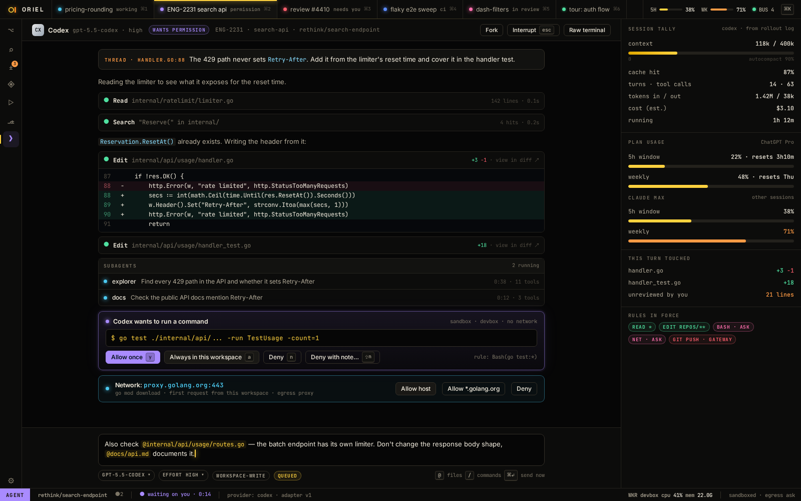
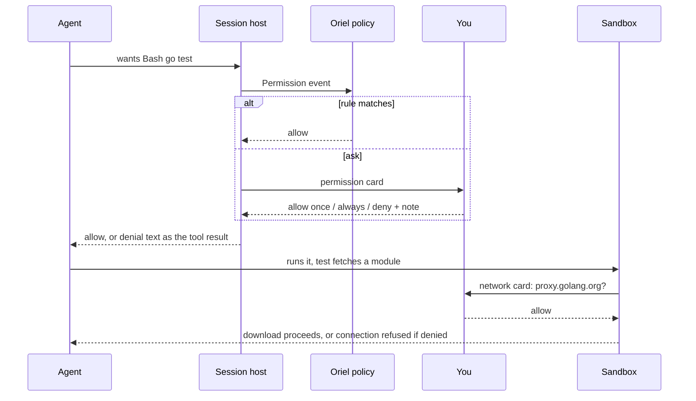
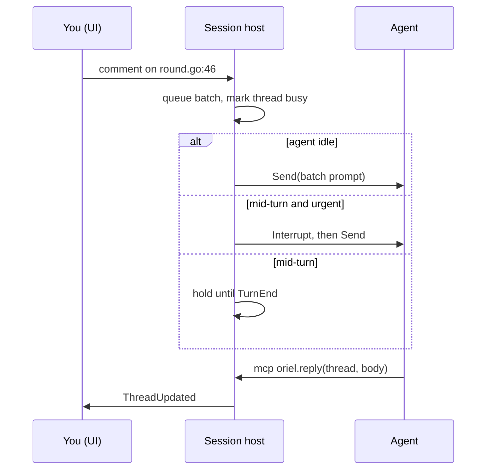
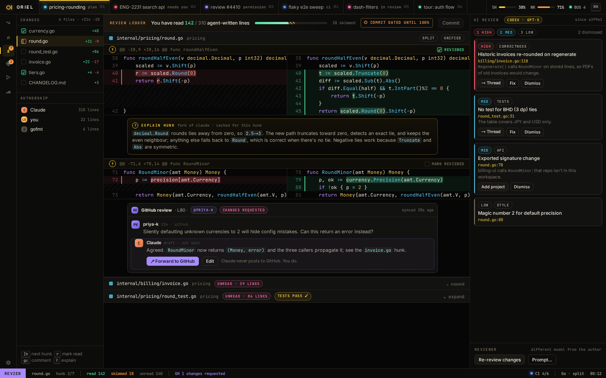

# Agents: Claude, Codex, and whatever comes next

Each provider is driven the way its **subscription** allows.

- `claude -p` and the Agent SDK are billed per token. Only the interactive `claude` CLI uses your
  Max subscription. So Claude runs as a **full interactive session in a PTY**, driven by Oriel's
  Claude Code mod through function hooks, the way crit does it today.
- Codex's `app-server` is what the official IDE extensions use with a ChatGPT login, and it is billed to the
  ChatGPT plan (checked in P0-5: `spikes/P0-5-codex-billing.md`). Billing follows the auth mode, so the provider requires
  `account/read` → `chatgpt` and asks before running on an `apiKey` login.
- Oriel draws the conversation itself from hook events plus the transcript. The PTY is still there for when you want it raw.

## Providers

| | Claude | Codex |
|---|---|---|
| Process | interactive `claude --plugin-dir <oriel-mod>` in a PTY (subscription) | `codex app-server`, JSON-RPC (JSONL) over stdio, ChatGPT login (subscription) |
| Control channel | the mod's function hooks run `oriel hook <op>`, which talks to the session host over a unix socket | JSON-RPC requests |
| Send a prompt | `$.prompt.submit` (the mod receives it from the host) | `turn/start` |
| Interrupt | `$.turn.abort` | `turn/interrupt` |
| Our tools | `$.tool.register` (`mcp__oriel__*`), backed by the host | MCP server `oriel` |
| Permissions | `classic.PermissionRequest` hook → host → card → answer | `item/commandExecution/requestApproval` / `item/fileChange/requestApproval` |
| Side questions (btw, explain, verify quiz) | `$.model.fork`: tool-less, outside the main conversation | `thread/fork` |
| Turn and subagent lifecycle | hook events (turn start/complete, subagent spawn/end, StopFailure) | notifications |
| Messages and tool calls | tail `~/.claude/projects/*.jsonl` (crit's `transcript` package) | notifications + rollout files |
| Usage / quota | `$.session.usage()`, reported by the mod; as Oriel starts, a hidden `/usage` session's | `account/rateLimits/read` + `account/rateLimits/updated` |
| Guard rails | `tool.check`: deny edits outside the worktree, deny raw network git/gh | sandbox policy + approvals |

- **Terminal view comes free** for Claude: it *is* a PTY session, so "Show terminal" attaches to it.
  For Codex, "Open in terminal" runs `codex resume` on the same session.
- The skills (`plan`, `diff`, `new`, `tour`, `job`) become **prompt packs**: markdown plus tool lists.
  The Claude mod loads them as skills; Codex gets them as the first user message plus `AGENTS.md`.
- The mod is the one Claude-specific piece of TypeScript. It stays small (crit's is about 575 lines),
  and everything it decides is delegated to the host. Like crit's, it reaches the host by running a command (`oriel
  hook`, as crit's runs `crit wait` and `crit agent-event`); the function-hook API has no sockets of its own.

### The Claude provider as built (`agent/claude`)

- Launch: `claude --plugin-dir <StateDir>/claude-mod --permission-mode <mode> [--model M] [--effort E]
  [--mcp-config <GatewayMCP> --strict-mcp-config] (--session-id <uuid> [/oriel:<skill> <prompt>] | --resume <id>)`
  in a 200×50 PTY, env `ORIEL_SPAWNED=1`, `CLAUDE_CODE_ENABLE_FUNCTION_HOOKS=1`, `ORIEL_HOOK_SOCK`, `ORIEL_BIN`, then
  `StartSpec.Env`. Oriel picks the session id itself (`--session-id`), so `ID()` is known before claude is up.
  Policy → mode: ask → `default`, light → `acceptEdits`, bypass → `bypassPermissions` (refused without a sandbox).
  On the host the folder is pre-trusted in `.claude.json` and crit's agent defaults are merged into `settings.json`.
- The mod (`agent/claude/mod`, embedded) runs `$ORIEL_BIN hook <op>` with JSON on stdin for every decision; `oriel
  hook` (`claude.HookMain`) carries it over the unix socket. Ops: `hello` (→ tools to register), `wait` (a ≤45 s long
  poll → `submit` | `abort` | `fork` | `usage` | `timeout`), `event` (`turn-start`, `turn-complete` with usage and rate limits, `usage` with rate limits,
  `subagent-start/run/end`, `api-error`, `end`), `check` (tool.check: the guard rails), `permission`, `question`,
  `tool`, `fork-answer`. Prompts are submitted `asUser`, so the agent reads them as the user's.
- Messages, tool calls and results (with `core.FileDiff` from the edit's `structuredPatch`, else its input) come
  from tailing `<config>/projects/<slug(cwd)>/<id>.jsonl` and `<id>/subagents/agent-*.jsonl`. A turn's end waits
  briefly for the log to hold the turn's answer, so its messages always come before `TurnEnd`.
- `Usage` is the newest reading of the plan's windows: a session's mod's, through `$.session.usage()` at each turn's
  end, or the `/usage` probe's (below), which `Usage` runs when `claude` is on PATH and no probe is running already. Claude's
  files aren't asked whether it's signed in: on macOS the token is in the Keychain, and the probe finds out itself.

### The `/usage` probe (`agent/claude/usage.go`)

The one probe Oriel runs, once as Oriel starts (and on the Usage page's Refresh): a hidden interactive `claude`
that only types a slash command, which Claude Code runs itself, so nothing reaches the model and nothing is billed.
`claude -p "/usage"` won't do: in print mode it gives only the "what's contributing" text, with no percentages.

- It's a session started the way any other is (`start`: the same binary, config dir, environment and mod, the
  folder trusted in `.claude.json` first), in Oriel's own folder, `Provider.ProbeDir` (the host's `<Home>/probe`),
  with a temporary state directory.
- Nothing is read off the screen. At the mod's `hello` (`Ready`) the probe types `/usage` and Enter into the PTY; then
  every 500 ms it answers the mod's `wait` with `usage`, and the mod reports `$.session.usage()` as an `event` of kind
  `usage` with its `rateLimits`, mapped by `usageOf` as a turn's are. The first report with windows ends it: Escape,
  `/exit`, and `Close` kills it if it hasn't gone in 3 s. A turn starting, a lost login, the process exiting, or 40 s
  passing fails it. Signed out, its screen says so (AI-13) and the probe ends with no reading and no error.
- What it reads is what a session's mod reads: the 5-hour and weekly (all models) windows; Claude Code's per-model
  weeks ("Current week (Fable)") aren't in `$.session.usage()`, so they aren't shown.
- Checked against Claude Code 2.1.299: `$.session.usage()` has its windows about 1.5 s after `/usage` is typed, no
  turn starts, and `/exit` quits it.

### A login that stops working (AI-13)

`Detect` reads the login from files only when a session starts, so a login that expires or is revoked later is
found where it shows, by the provider, as `agent.AuthExpired{Provider, Account, Detail, Terminal, Shell}`: `Terminal`
is what signs in again typed into the session's own terminal (`/login`; "" when it can't), `Shell` what to run in a
terminal (`claude, then /login`; `codex login`). A login seen to succeed is `agent.AuthRestored`. Detection is
written against what the CLIs recorded (`agent/claude/testdata`, Claude Code 2.1.296):

- **Claude's log.** An API error is a record Claude Code writes in the agent's place, `isApiErrorMessage: true`, with
  its type in `error` (`authentication_failed`, HTTP 401 in `apiErrorStatus`) and its text as the message: "OAuth
  token revoked · Please run /login", "Not logged in · Please run /login". `transcript.Entry.APIError` carries the
  type; one whose text says "Please run /login" is `AuthExpired` (with the text as `Detail`) instead of the agent's
  words. The type alone isn't enough: Claude Code also calls failures `authentication_failed` that a login won't fix
  (a cloud provider's credentials, a gateway's 403).
- **The mod's api-error** (`classic.StopFailure`), when it fires: the same text test, beside the `Failure`.
- **Claude's screen**, for a login gone while nothing runs: its foot says "Not logged in · Run /login" (any words, then
  "· Run /login"), read from the PTY's output with styles dropped and cursor moves as breaks, once while it stays.
  The error under a prompt ("· Please run /login") is left to the log, so a resumed conversation's old errors on the
  screen don't count. "Login successful. Press Enter to continue" (the /login dialog, from Claude Code's source) is
  `AuthRestored`.
- **Codex**: a `TurnError` whose `codexErrorInfo` is `unauthorized` (app-server-protocol v2; not recorded: SE-5
  looked for a `codex` to record it from and `account/updated` with, and there was none to run), and
  `Start` refuses a thread with no account (`account/read` → `account: null`) with `AuthExpired` as its error.

The host (`host/login.go`) keeps the logins gone by provider and account. Every running session with that
provider, and one whose agent couldn't start for it, gets a `core.AskLogin` card (`Ask.Login`, a `core.Login`), so
its status is needs you; nothing more is sent to those agents while it's flagged. The machine's state
lists them (`MachineState.SignedOut`), and `ProviderInfo` says the provider is signed out, with its detail. A card's
answer (Check again) or an `AuthRestored` makes the host ask the provider's `Detect`; signed in, every flag clears,
a turn the login stopped is told to carry on, held comments go, and an agent that couldn't start starts.

**A real login check (SE-5).** Claude Code offers no way to ask the provider whether a login works without a request
that spends tokens. Checked against Claude Code 2.1.296's CLI (`claude --help`) and its bundled source:
`claude auth status [--json|--text]` exists, but its `loggedIn` is worked out from what's stored (the credentials
file or Keychain token, an API key, a helper), never from the network: with a made-up token in a fresh
`CLAUDE_CONFIG_DIR` it says `"loggedIn": true` and exits 0. `claude doctor` checks the install, not the login.
Internally it has a zero-token `POST /api/oauth/validate`, but only for an organisation pin
(`forceLoginOrgUUID`) and the Chrome bridge, not at start and not behind a command; Oriel doesn't call Anthropic's
API with Claude's token itself. So the check stays files-based, and the host remembers a refusal: as a login is
lost it records the login the provider's files hold then (`agent.Install.Login`, for Claude a hash of the
credentials file's token; "" when it can't tell, as with the macOS Keychain). Check again then reads signed in only
with a different login on disk (one made outside Oriel); with the same one, or one it can't tell apart, it stays
signed out until a login is seen to work: `AuthRestored`, from the /login dialog's "Login successful", or from the
next request that succeeds (Claude's next answer in its log while signed out). A login the files say is gone needs
only the files to come back, as before.

### Stats and plan readings (AI-12)

- Prices are `agent/price`: one table (Claude's families, and OpenAI's `gpt-5`, `gpt-5-mini` and `gpt-5-nano` at their
  list prices, cached input at a tenth), shared by the transcript reader and the stats. The OpenAI rows are marked
  unverified: they haven't been checked against OpenAI's pricing page.
- The host's stats (`host/stats`, crit's `internal/stats` per session) read each session's logs incrementally, from
  the offset the last read stopped at, kept in `<Home>/stats.json`: Claude's transcript and subagents' logs (the
  provider's `agent.Logged`), or for a provider without a log (Codex) the host's record of its events,
  `sessions/<id>/agent/events.jsonl` (turns, tool calls and results, and each turn's usage as a request).
- The stats read **everything they can find**, not only Oriel's sessions, classified by origin: each provider that
  implements `agent.Discovered` lists every log it keeps on the machine (Claude: `<config>/projects/*/<id>.jsonl` with
  its subagents', `$CLAUDE_CONFIG_DIR` honoured; Codex: `$CODEX_HOME/sessions/**/rollout-*.jsonl` and
  `archived_sessions`, `~/.codex` by default; a compressed `.jsonl.zst` rollout isn't read), and on each scan the
  host counts every one that no Oriel session owns (by path, or by the provider and its session id) as a session
  **outside Oriel** (`stats.Session.Origin` `outside`, ID `<provider>:<session>`), so nothing is counted twice: an
  Oriel Codex session's rollout is skipped, its events already counted. An outside session is named by its first
  prompt (`Scan.Title`), else its cwd's folder, else the file; its repo is the work tree holding the cwd its log
  records; its account is its provider's now. A query skips a log last written before the period it
  compares with (`From − (To − From)`), so a long history costs a stat per file; `stats.session` reads one outside
  session whatever its age. Codex's rollout (`stats.FormatCodex`, checked against `spec/codex`): each
  `token_count` is a request, its tokens the rise in the thread's total (cached input a cache read), a repeated total
  none; `turn_context` gives the model and effort, `user_message` the turns, `function_call`/`custom_tool_call` and
  their outputs the tools (a rollout doesn't say whether a call failed). Queries filter and group by origin
  (`origin` filter, `stats.ByOrigin`), each report carries `Origins` (sessions, requests, tokens and cost of each),
  and a session's group carries its `Origin`. A message
  Claude writes over several records counts once. Per request: tokens by kind and their cost, model, effort, and
  the hour and five minutes it's in; per tool call: name, error, duration, and the files it names, which decide a
  multi-repo session's split (`stats.Session.Shares`). A compaction is the main loop's context falling to under half
  from over 40k.
- Tool calls are kept by the hour they were made, per tool and model (`stats.ToolSlot`: calls, errors, timing
  buckets), the result's error and timing going to the call's hour, so a range's tool rows count only its calls
  (AI-14); a tool's p50 is still from its sessions' samples. Each hour also keeps its first and last record, for the
  range's wall-clock (`Totals.SpanS`: per session, per day of the query's zone, first to last, added up). A stats
  file from before (`cacheVersion` below 3) is dropped and the logs read again.
- Plan usage is per **account**: `ProviderUsage.Account` is the login (Claude: `oauthAccount`'s account and
  organisation in `.claude.json`, so a company subscription and a personal one differ; Codex: `account/read`'s email),
  `AccountName` its email or organisation. `UsageSampled` keeps one entry per
  provider and account: two accounts never merge. A session's account is the one it ran on at the time (AI-14): `AgentState.Accounts` records the account when
  its agent starts (the latest reading for the provider) and whenever a reading from its own agent names
  another (a login change), and `stats.Session.Accounts` charges each hour to the account in effect by its end. A
  session that never recorded one takes its provider's account now. This drives Stats' account group
  and filter and the Usage page's "what burned the window".
- The plan's tier (`ProviderUsage.Tier`, its chip: "Max 20×", "Team", "Pro"; "" when not known). Claude: the
  credentials file's `claudeAiOauth.subscriptionType` (`max`, `pro`, `team`, `enterprise`) and `rateLimitTier`
  (`default_claude_max_20x`, `default_claude_max_5x`), else `.claude.json`'s `oauthAccount.organizationType`
  (`claude_max`…) and `organizationRateLimitTier`; a Max plan's multiplier comes from the rate limit tier, and a
  subscription Claude Code doesn't name has no tier. The key names are checked against a real Claude Code 2.x config
  (`agent/claude/testdata/account`, invented values) and the values against the ones Claude Code's own bundle
  compares with. Codex: `planType` (`pro_lite` is "Pro Lite").
- The host reads every provider's `Usage` once as Oriel starts, and on `ReadUsage` (the Usage page's
  Refresh); a reading no newer than the one it holds for the account is dropped, so a session's newer one stays.
- Every plan reading (`UsageSampled`, from a provider's `UsageUpdate` or `ReadUsage`, which asks each provider's
  `Usage`) is kept in `<Home>/usage.jsonl` for a week (`UsageHistory`). Oriel starting puts back each account's
  latest kept reading, so Claude's windows survive a restart before they're read again. `UsageWindow.Length`
  is a window's length and `ProviderUsage.Source` says where its windows come from; both providers set them.

### The Codex provider as built (`agent/codex`)

Shapes are from `codex-rs/app-server-protocol` v2 at the P0-5 commit (`ddb33e34`); `agent/jsonrpc` is the JSONL
JSON-RPC under it (Codex's messages carry no `"jsonrpc"` field; MCP's do).

- Launch: `codex app-server` through `StartSpec.Exec`, cwd `StartSpec.Cwd`, env `StartSpec.Env` over the host's.
  `initialize` (`clientInfo`, `capabilities.experimentalApi: true` for the user-input request), `initialized`, then
  `account/read`: only `chatgpt` runs; `apiKey`, Bedrock or none refuse with a per-token billing error unless
  `StartSpec.Env` has `ORIEL_CODEX_ALLOW_API_KEY=1`. Then `thread/start` (or `thread/resume {threadId}`) with
  `cwd`, `model`, `approvalPolicy`, `sandbox` and `config`; `ID()` is the thread id.
- Policy: ask → `untrusted` + `workspace-write`; light → `on-request` + `workspace-write` (edits in the workspace go
  ahead, shell runs in Codex's sandbox and asks to leave it); bypass → `never` + `danger-full-access`, refused
  without a sandbox.
- Oriel's tools: `config["mcp_servers.oriel"] = {command: ORIEL_BIN, args: [hook, mcp], env: {ORIEL_HOOK_SOCK},
  default_tools_approval_mode: approve}`. `oriel hook mcp` (`codex.MCPMain`) is an MCP stdio server that answers
  `initialize` and passes `tools/list` / `tools/call` over the session's unix socket to `StartSpec.Tools`. A sandbox's
  `GatewayMCP` file (`{"mcpServers": …}`) becomes more `mcp_servers.<name>` entries.
- Turns: `turn/start {threadId, input: [text, localImage…], effort}`; the pack's text is said once, before the first
  prompt. `Input.Urgent` mid-turn is `turn/steer`. `turn/interrupt {threadId, turnId}`.
- Events: `turn/started` → `TurnStart`; `item/agentMessage/delta` and reasoning deltas → partial `Message` (the text
  so far, by item id); `item/completed` agentMessage / reasoning / userMessage → `Message`; commandExecution,
  fileChange, mcpToolCall, dynamicToolCall, webSearch → `ToolCall` (`Bash`, `Edit`, `mcp__<server>__<tool>`, the
  tool, `WebSearch`) on start and `ToolResult` (fileChange with `core.FileDiff` from its diff) on completion;
  `thread/tokenUsage/updated` → the turn's `Usage` (its share of the thread total); `turn/completed` → `TurnEnd`,
  after a `Failure` if it failed; a non-retrying `error` → `Failure`; `account/rateLimits/updated` (sparse, merged)
  → `UsageUpdate` with windows `5h` / `weekly` by length, the plan and credits.
- Asks: `item/commandExecution/requestApproval` and `item/fileChange/requestApproval` → `Permission` (Summary: the
  command, or the files from the item); answered `accept`, `acceptForSession` (Always) or `decline`. The decision
  carries no reason, so a denial's note follows as `turn/steer` ("Denied by the user: …"), or with the next prompt
  if the turn has ended. `item/tool/requestUserInput` → `Question`; `mcpServer/elicitation/request` from `oriel`
  is accepted, from others → `Permission`.
- `Fork`: `thread/fork {ephemeral: true, approvalPolicy: never, sandbox: read-only, developerInstructions}`, one
  turn on the fork, its agent messages joined; nothing is saved to the main thread.
- `Detect`, `Models` (`model/list`, else a static list) and `Usage` (`account/rateLimits/read`) each run a short-lived
  app-server bounded by the context. `Terminal()` is nil: "Open in terminal" (`codex resume`) isn't built.

### Nothing else may call `claude -p` either

crit calls `claude -p` for the room assistant, agentbus auto-answers and the no-agent explain.
In Oriel each of those uses the subscription instead:

- **Inside a session** (explain, btw, verify quiz, auto-answer about this repo): `$.model.fork` on that
  session's agent. It's tool-less, cheap and has full context.
- **Outside a session** (the assistant, an auto-answer with no matching session): a **resident utility
  session**. That's a hidden interactive `claude` in a PTY with the Oriel mod, a small model, read-only tools,
  and a fresh context per task. It's started on demand and kept warm.
  Built in PL-4 as the host's utility agents (`architecture.md`, `host/utility.go`): started through
  `Provider.Start` like any session (so Claude is its interactive CLI, `/oriel:<name> <first turn>`, never `claude -p`),
  in Oriel's own folder, policy `ask` with every permission refused but the spec's `Allow` (the assistant's
  WebSearch and WebFetch), offered only the agent tools `for` its name. "Kept warm" is per conversation: the assistant
  keeps its agent while the conversation lasts (until **New conversation** or `assistant.idle` minutes of quiet), and
  the next conversation starts a fresh one. Not yet: explain and agentbus auto-answers with no session don't use it.
- Claude's plan windows come from the mod's `$.session.usage()`: in live sessions, and in the hidden `/usage` session
  Oriel starts once (above), which is interactive, so not `claude -p`.



## Interface (`agent` module)

```go
type Provider interface {
    ID() string                       // "claude", "codex"
    Detect(ctx) (Install, error)      // binary, version, login state
    Models(ctx) ([]Model, error)      // name, efforts, context window
    Start(ctx, StartSpec) (Session, error)
    Resume(ctx, id string, StartSpec) (Session, error)
    Usage(ctx) (core.ProviderUsage, error) // plan windows, resets
    SandboxCredentials() []Mount      // what to copy into a container
}

type Session interface {
    ID() string
    Send(ctx, Input) error            // user turn: text, images; Urgent goes in front of the running turn
    Interrupt(ctx) error              // abort the current turn
    Fork(ctx, ForkSpec) (string, error) // a tool-less side question, answered outside the conversation
    Events() <-chan Event             // Ready, Turn*, Message, ToolCall, ToolResult, Permission, Question, Subagent, Failure, UsageUpdate, AuthExpired, AuthRestored, Exited
    Answer(ctx, id string, Decision) error // layer-1 approvals and questions; see "Permissions: three layers"
    Terminal() Terminal               // the raw terminal any number of views attach to; nil for Codex
    Close() error
}
```

- `StartSpec`: cwd, model, effort, MCP servers, system-prompt pack, tool
  policy, env, and the sandbox to exec into.
- `Event` is one normalised union. Provider-specific extras ride in `Raw`.
- Adding a provider (Gemini, Aider, OpenCode, a local model) means one Go
  package, or an out-of-process plugin speaking the same interface over RPC
  (see `plugins.md`).
- A conformance test suite (`agent/agenttest`) runs every provider against a fake of its CLI:
  start, send, tool call, permission (allowed and denied), question, interrupt, fork, resume, and a lost login
  (`AuthExpired`).
- `Fork` returns the answer rather than a session: every side question so far (btw, explain, the quiz) wants one
  answer, and both providers produce it in one turn.
- Built in RV-5: explain asks through the `agent` explainer (`app/sessions.go`), which forks the session in front's
  agent with the request's depth (brief, detailed, why · history) through the host's `Fork`; its label is "fork
  of <provider> · knows this session". With no session in front it says so: the resident utility session isn't
  built yet (PL-4).
- Built in RV-6: a request with a `Format` (the walkthrough's JSON steps) is forked with the format at the end of the
  prompt instead of the depth's "in markdown" instruction; the agent explainer's byline is "written by <provider>
  from the session's own context".
- Built in RV-7: side questions in general are `registry.Forker`s (`registry.Fork`); the sessions plugin registers
  the agent's, which forks the session named in the request (not just the one in front) through `Fork`. The verify
  quiz asks through it.

### The session host as built (`host`)

- The host owns sessions (`host/session.go`), in the window's own process. It starts a session's provider with the kind's prompt pack
  (`agent/packs`), Oriel's tools (`reply`, `thread`, `resolve`, `comment`, `task_add`, `task_update`, `tasks`,
  `projects`, `commit_draft`, `pr_draft`, `test_run`) and any the app's plugins offer (`registry.AgentTool`, reached
  through the app's callbacks: LS-3's `lsp_*`), and the user's checkouts as `Protect`.
- Built in RV-8: a tour's agent also has `tour_kind` (its kind and that kind's guidance, `host/tour/kinds/*.md`;
  with `kind`, it changes it), `tour_steps`, `tour_run` (a command run inside the tour, its output, exit code and
  time appended to a step as a run block; refused in a sandbox, where only the agent's own shell runs commands) and
  `tour_share` (the published export's link), and the app's `tour_export`. The tour's question is its `where="tour"`
  thread.
- Comments go to the agent as a batch in crit's tagged format (`host/prompt.go`): at once when it's idle; after
  `Interrupt` when one is urgent; at the turn's end otherwise. A delivered thread is `Busy` until the agent replies.
  btw is a `Fork`, its answer a `Btw` comment. The console's messages queue (`Agent.Queue`) the same way.
- The app's side (`app/sessions.go`, `app/requests.go`): `request.comment` fires the `CommentSend` hook (a rewrite
  changes the comment, a veto stops it), then `Host.Comment`; a new thread from the editor carries its anchor (the
  project, the path relative to it, the line and its text). `request.resolve` is `Host.SetThread`.
- A lost login (`AuthExpired`) flags every session with that provider: see "A login that stops
  working" above.
- Every agent event becomes core state (`TranscriptAppended`, `AgentChanged`, `SubagentChanged`, `AskOpened`, …),
  each session's in a log that survives a restart; status is `core.DeriveStatus` (crit's rules).
- A reply carries what the agent did since its last one (`Comment.Activity`) and the test runs behind it
  (`Comment.Evidence`): runs of its `test_run` tool, and shell commands that ran tests (`go test`, `pytest`, …,
  parsed from their output). A reply that says tests pass with no passing run behind it is flagged
  (`Comment.Unbacked`), and the agent is told so in the tool's answer.

### Prompts and voice (PL-11, as built)

- The Prompts page (`:Prompts`, `app/prompts.go`) edits every `agent/prompts` prompt: the coding style (crit's text),
  each built-in pack, each part the packs include, and each tour kind's guidance (RV-8's `host/tour/kinds`, which
  the host registers as `tour.<kind>` and the `tour_kind` tool reads through the user's prompts). crit's other 27 prompts don't carry over one for one: in
  Oriel their text lives in the packs (drafts, comments, tours) or in code that hasn't been made editable yet
  (Start work's request, explain's depths, the walkthrough format); `prompts.Register` is how those join the page.
- Only the user's changes are kept, a file each: `prompts/style.code.md`, `agents/<kind>.md` (the same file a
  hand-written pack override is) and `agents/parts/<part>.md`. The app gives them to the host at start and on
  each change (and when one of those files is saved in the editor); the host keeps them in `prompts.json` and
  builds a built-in pack the user changed (or whose parts they changed) from them. Its own `packs.LoadDir` of
  `agents/` now only adds kinds: a built-in kind's override always comes from the app, so a reset there takes.
- The coding style goes into the `CLAUDE.md` (and `AGENTS.md`, for Codex) the host writes at the root of each
  workspace it made, never in a direct session's own directory, with the list of projects and their own
  instructions: when the agent starts, when the projects change, and when the prompts change. Both are in the
  workspace's `.git/info/exclude`, and plan mode doesn't list them as docs.
- Dictation (`app/voice.go`, module `voice`): crit captured audio in the browser; Oriel runs a recorder program and
  reads raw PCM from its stdout, so it adds no audio dependency. The rest is crit's: phrases at a 600 ms pause, the
  live phrase transcribed again each second, whisper-server started on first use and stopped after ten idle
  minutes, models fetched with checksums. Dictation types through `UIView.Key`, taking back the live phrase with
  backspaces as a new pass replaces it, and stops if focus moves. The wake word is off by default (`voice.wake`).

### Drafts when the agent goes idle (AI-10)

- Two halves. The prompt packs that offer `commit_draft` (work, plan, job, new repo; `parts/drafts.md`) tell the agent
  to fill each project's drafts before it ends a turn with nothing left to do, as crit's skill does. Behind that, the
  host (`host/drafts.go`) checks when a turn ends with nothing queued: for each writable project, a commit message is
  due for uncommitted work, a PR draft for a branch with commits of its own or uncommitted work and no open PR (as the
  last GitHub reading has it; no network call). One is due when it's missing or its fingerprint isn't the code's now;
  never when the user wrote it.
- The fingerprint (`gitx.Repo.Fingerprint`) hashes each path that differs from HEAD (a commit message) or from the
  merge base with the base (a PR draft), tracked or not, with what it holds now; so committing doesn't stale a PR
  draft. `commit_draft` and `pr_draft` store it beside the draft (`drafts/<project>.<kind>.code`), and `ship.read`
  marks a draft `Stale` when it no longer matches.
- The ask is a `<notice>` in a batch led by `NoticeLead`, not a thread. The host remembers the code it last asked
  about per project and kind, so it asks at most once per change, and again only after the code moves; a turn that
  ends without drafting isn't asked twice.
- A draft by "you" (`host.DraftByYou`) is the user's: `commit_draft`/`pr_draft` answer "Not saved: the user wrote …"
  and leave it. `ship.draft` with `Drop` clears it (Redraft).
- Decided in AI-10: a session whose pack doesn't offer `commit_draft` (direct, review, tour, scratch) is never asked.
- Not yet: an option to turn the nudge off, and remembering what was asked across a restart of Oriel (one repeat ask
  after a restart).

### Claude and Codex, side by side

Both providers implement the same two interfaces. Claude is a PTY plus hooks, and Codex is JSON-RPC.
The session host and the UI can't tell them apart.

```go
// agent/claude — an interactive session in a PTY, driven by the Oriel mod
type Provider struct{ Bin, ModDir string }

func (p Provider) Start(ctx context.Context, s agent.StartSpec) (agent.Session, error) {
    sock, err := s.Host.Listen(ctx)                       // unix socket the mod dials (ORIEL_HOOK_SOCK)
    if err != nil {
        return nil, err
    }
    args := []string{"--plugin-dir", p.ModDir, "--model", s.Model}
    if s.Sandbox != nil {
        args = append(args, "--mcp-config", s.GatewayMCP(), "--strict-mcp-config")
    }
    if s.Pack.Skill != "" {
        args = append(args, "/oriel:"+s.Pack.Skill)         // first prompt: the session kind's skill
    }
    pty, err := s.Exec.StartPTY(ctx, p.Bin, args, s.Env.With("ORIEL_HOOK_SOCK", sock.Path()))
    if err != nil {
        return nil, err
    }
    sess := &session{pty: pty, hooks: sock, ev: make(chan agent.Event, 64)}
    go sess.serveHooks()                                   // mod → host: turns, permissions, tool calls
    go sess.tailTranscript(s.Cwd)                          // jsonl → Message, ToolCall, ToolResult, Usage
    return sess, nil
}

func (s *session) Send(ctx context.Context, in agent.Input) error {
    return s.hooks.Push(ctx, hookmsg.Submit{Prompt: render(in)}) // the mod calls $.prompt.submit
}

func (s *session) Interrupt(ctx context.Context) error {
    return s.hooks.Push(ctx, hookmsg.Abort{})              // the mod calls $.turn.abort
}

func (s *session) Fork(ctx context.Context, f agent.ForkSpec) (agent.Session, error) {
    return newForkSession(s.hooks, f)                      // the mod runs $.model.fork, streams the answer back
}

func (s *session) Answer(ctx context.Context, id agent.PermissionID, d agent.Decision) error {
    return s.hooks.Reply(ctx, id, d)                       // unblocks the PermissionRequest hook
}

func (s *session) onHook(m hookmsg.Msg) []agent.Event {    // the Claude-shaped code paths: this and the transcript
    switch m := m.(type) {
    case hookmsg.TurnStart:    return []agent.Event{agent.TurnStart{}}
    case hookmsg.TurnComplete: return []agent.Event{agent.TurnEnd{Usage: m.Usage}}
    case hookmsg.Permission:   return []agent.Event{agent.Permission{ID: m.ID, Tool: m.Tool, Input: m.Input}}
    case hookmsg.Subagent:     return []agent.Event{agent.Subagent{ID: m.ID, Prompt: m.Prompt, Done: m.Done}}
    case hookmsg.StopFailure:  return []agent.Event{agent.Failure{Err: m.Err, Retryable: m.Retryable}}
    }
    return nil
}
```

```ts
// mod/register.ts — the Claude side (sketch); everything is delegated to the host
const host = await connect($.env.get("ORIEL_HOOK_SOCK"));
host.on("submit", (m) => $.prompt.submit(m.prompt));
host.on("abort", () => $.turn.abort());
host.on("fork", async (m) => host.reply(m.id, await $.model.fork({ prompt: m.prompt, tools: [] })));
for (const t of await host.tools()) $.tool.register(t.name, t.schema, (args) => host.call(t.name, args));
classic.PermissionRequest(async (req) => host.ask("permission", req));   // blocks until you answer
$.on("turn.start", () => host.emit("turn_start"));
$.on("turn.complete", async () => host.emit("turn_complete", { usage: await $.session.usage() }));
```

```go
// agent/codex
type Provider struct{ Bin string }

func (p Provider) Start(ctx context.Context, s agent.StartSpec) (agent.Session, error) {
    proc, err := s.Exec.Start(ctx, p.Bin, []string{"app-server"}, s.Env)
    if err != nil {
        return nil, err
    }
    rpc := jsonrpc.New(proc.Stdout, proc.Stdin)
    if err := requireChatGPT(ctx, rpc); err != nil { // account/read → account.type == "chatgpt"
        return nil, err
    }
    var r struct{ Thread struct{ ID string } }
    if err := rpc.Call(ctx, "thread/start", threadParams(s), &r); err != nil {
        return nil, err
    }
    sess := &session{rpc: rpc, id: r.Thread.ID, ev: make(chan agent.Event, 64)}
    rpc.OnNotify(sess.translate)                            // thread, turn and item notifications → agent.Event
    rpc.OnRequest("item/commandExecution/requestApproval", sess.askPermission) // → agent.Permission, waits for Answer
    rpc.OnRequest("item/fileChange/requestApproval", sess.askPermission)
    return sess, nil
}

func (s *session) Send(ctx context.Context, in agent.Input) error {
    return s.rpc.Call(ctx, "turn/start", turnParams(s.id, in), nil)
}

func (s *session) Interrupt(ctx context.Context) error {
    return s.rpc.Call(ctx, "turn/interrupt", map[string]any{"threadId": s.id, "turnId": s.turn}, nil)
}
```

```go
// agent — the normalised events every UI surface reads
type Event interface{ isEvent() }

type (
    TurnStart  struct{}
    Message    struct{ Role Role; Text string; Partial bool }
    ToolCall   struct{ ID, Tool string; Input json.RawMessage }
    ToolResult struct{ ID string; Output string; IsError bool; Diff *FileDiff }
    Permission struct{ ID, Tool, Summary string; Input json.RawMessage }
    Subagent   struct{ ID, Prompt string; Done bool; Result string }
    TurnEnd    struct{ Usage Usage; Cost float64 }
    Failure    struct{ Err error; Retryable bool }
)

// registration: built-in, or a process plugin speaking the same methods over JSON-RPC
func init() { agent.Register("claude", claude.Provider{Bin: "claude"}) }
```

- A process-plugin provider (Gemini, say) implements the same methods as JSON-RPC.
  Its RPC adapter is also an `agent.Provider`, so the session host can't tell them apart.
- The parts of the protocols above (`thread/start`, `item/commandExecution/requestApproval`, the Claude hook API
  and transcript format) get pinned and checked against the installed CLI version in `Detect`, because they move.

## Permissions: three layers

The `Session` interface does carry permissions: the `Permission` event and `Answer`.
That's only the first of three layers, though, and the agent experiences each one differently.

| Layer | Where | When it acts | What the agent sees |
|---|---|---|---|
| 1. Agent approval | the provider's own gate: Claude's `PermissionRequest` hook, Codex approval requests | **before** a tool runs | it **waits**; then the tool runs, or it gets a structured denial ("denied by user: use the Makefile target") as the tool result |
| 2. Oriel policy | `Permission` hooks and rules (`oriel.on("Permission")`, "Always in this workspace") | before layer 1 reaches you | nothing: the answer arrives faster |
| 3. Sandbox | egress proxy, gateway MCP policy, filesystem mounts | **while** the tool runs | a held connection or a held gateway call while you decide; if denied, an ordinary tool error (`connection refused`, `gateway: push denied by user`) |



- **Layer 1 never surfaces as a failure.** The provider blocks the tool call until `Answer`.
  A denial comes back as the tool's result, with your note, so the agent adapts instead of retrying blindly.
- **Layer 3 is invisible to the agent until it bites.** The proxy and gateway *hold* the call while
  you decide (as crit does now), so an approval looks to the agent like a slow request.
  Only a denial or timeout reaches it, as the tool's own error.
- So the agent doesn't need to know about the sandbox. It just needs good errors.
  The gateway's denial messages are written for an agent to read: they say who denied it and what to do instead.
- **Policy option per session**: run the agent's own gate fully (`ask`), lightly (`edits auto, shell asks`),
  or off (`bypass`) inside a sandbox, leaving layer 3 as the only gate. The default is a light gate inside a sandbox.
- The sandbox, gateway and egress code is ported from crit unchanged (`architecture.md`).

**Built in AI-7/AI-11** (`host/sandbox.go`, `host/sandbox_host.go`; the app passes the factory):

- A sandboxed session's `Open` records the workspace (`sandbox.Create`, its manifest), serves the session socket
  (gateway, egress decide/log/dial, ssh-agent) and writes the gateway's MCP config into the sandbox's Claude dir.
  `Exec` turns the provider's command into the backend's (`sandbox.Backend.Launch`): the env the provider added
  goes in, `ORIEL_BIN` becomes the sandbox's `oriel`. That `oriel` serves the mod's `oriel hook` as well as the
  gateway, egress and ssh helpers. In docker it is `oriel-sandbox`, built static for Linux on the app's arch and
  embedded in the app (`sandbox/helper`, `make helper`; `runner.OrielBinary` writes it out once per build). The
  desktop binary links GUI libraries and the host's glibc, so it never runs in the image. A build without the helper
  refuses to start; `oriel build --with` carries the builder's helper into the custom build.
- **Backends.** What fences the agent in is a `sandbox.Backend`, chosen by `sandbox.backend` (`Config.Backend`,
  default `sandbox.DefaultBackend()`: the first in `sandbox.Preference` this machine can run) from those registered with `sandbox.Register`, or by the session's own
  (`SandboxPolicy.Backend`, kept as `AgentState.Backend`), one of those this machine can run (`Backend.Available`,
  reported as `MachineState.Sandboxes`, the launcher's Sandbox type); everything else (session socket, gateway,
  egress decisions, approvals) is the same for all of them. A backend launches (`Launch` → a `Command`: argv, env,
  dir; a slow step says what it's doing with `sandbox.Report(ctx, …)`, sessions.md "Starting one"), stops, reports `Health` and `Sweep`s, and says where the agent finds the run dir (`AgentRunDir`) and
  whether the session must also serve on a port (`ServesPort`). What every backend gives the agent is shared in
  `sandbox`: `Binds` (the workspace, Claude's dir and transcripts, attachments, each project's git dir with git's
  own files read-only), `Prepare` (Claude settings and login, the home's ssh config, shims, git config), `AgentEnv`
  and `LoginProblems`. A backend may also say what it runs the agent in (`sandbox.Describer`: the container,
  whether it's running, the image, where it comes from and its Dockerfile, the last build's log, the running
  container's mounts, and where the agent finds host paths that aren't at the same path inside), and build its image
  again (`sandbox.Rebuilder`). `Host.Workspace`, `Host.RebuildSandbox` and `Host.RestartSandbox` are those for a
  session, and the Workspace page (ui.md 15b) shows them.
  - `docker` (`sandbox/runner`): a container per run, binds as mounts, the egress sidecar on an internal network
    (always, filtering on or off: the host dials every connection, so its VPN, tailnet and private DNS reach the
    sandbox; with filtering off, `egress.Session.Open` allows them all),
    the project's image and toolchains (installed by `mise` in the base image, never a project's, into a directory
    every sandbox mounts read-only), memory and process caps. Each image build writes its output to
    `~/.oriel/sandbox/builds/<tag>.log` (`runner.BuildLog`); a rebuild skips the cache, so downloads are fetched
    afresh. `runner.Describe` reads the mounts from the engine (`container inspect`). The same backend runs on any docker-compatible
    engine (`runner.Engine`, a `container.Engine`: CLI, socket, whether the daemon is in a VM): `docker` (the
    CLI's current context; offered when a Docker daemon is set up, not another engine's socket), `orbstack` and
    `colima` (the docker CLI pinned to their own socket; OrbStack's bundled CLI when Docker's is missing), and
    `podman`. Each is offered only when installed.
  - `seatbelt` (`sandbox/seatbelt`, macOS): `sandbox-exec` with a generated profile, no container. The agent
    reads the system but not `/Users`, `/Volumes` or the home directory, beyond toolchain directories (managers'
    installs, `PATH` entries under home) and its binds; writes only its binds (later binds override earlier
    ones, so git's own files stay read-only), its sandbox home, temp dir and the Go cache. A bind at another path
    is a symlink to the host's. The network is loopback only: the egress proxy runs in Oriel on a loopback
    port and the session's sockets are reached directly. It runs the host's `claude` and toolchains; image,
    Claude version, memory and process settings don't apply (`Health` warns). Weaker than a container where
    the OS can't separate: it shares the host's loopback, and Seatbelt can't tell the agent's own servers from
    the host's, so `sandbox.loopback` (`Config.Loopback`) picks what it may connect to: any port (`all`, the
    default), the ephemeral range where a server on port 0 lands (`ephemeral`), or nothing beyond its proxy
    (`none`). There are no resource caps.
- Both layer-3 cards go through the host's `approve`, so layer 2 (rules, the app's `Decide` hooks) answers them
  first. Network: `AskNetwork`, rule `net(host:port)`; "always" also records the host machine-wide (egress
  always), and a scope (`*.golang.org`) records that pattern instead. Gateway: `AskGateway`, rule = the tool;
  "always" also grants it for the workspace. `request_host` and `ask_user_to_run` ask the same way: allow on
  `ask_user_to_run` runs the command on the host; a refused `request_host` holds for the session.
- Host tools: git through `sandbox.Git` (the guard), push/pull only from the session's branch, `gh` through
  `gateway.RunGH`, PRs from the `pr_draft` file, `repos` from the host's registered repos, `add_project` via
  `AddRepo` and a restart once the turn ends.
- Tested without Docker: held connections and calls, allow/deny/always/scope, the hooks, push to a bare remote.
  Needs Docker to verify (`go test -tags docker -run TestSandboxRunsInDocker ./host/`): the container, the
  egress sidecar, and the mounts.
- A refusal says who refused and what they said: `Approve` returns an `Approval` (`By`: "the user", "rule …", a
  hook's source; `Note`). The gateway answers "oriel: init.lua denied oriel__push. They said: …"; the egress proxy's
  403 reads "oriel: host is not allowed for this session: denied by the user, who said: …", in the container too
  (the agent socket's decide answer carries `why`, and the sidecar's decider keeps it per destination).
- The provider's hook socket (`agent.HookSocketEnv`, `ORIEL_HOOK_SOCK`) is carried into the sandbox: `Exec`
  points it at `hook.sock` in the backend's `AgentRunDir` (`/run/oriel` in a container), which the box serves in
  the run dir (mounted on Linux) and the agent socket serves at `agentsock.HookPath` for the sidecar's relay
  elsewhere; both reach the provider's socket on the host.
- **Sandbox settings** are the `sandbox.*` options (settings.md, "Sandbox settings"). The host doesn't read
  options or project settings files (init.lua, trust and the project layer live in the app), so the app resolves them
  into a `sandbox.Config` and gives it to the host (`Host.SetSandboxConfig`) at start and whenever
  one changes: your values at the user and Lua layers, and for each repo of a session (and the
  window's project) its trusted project file's `egress`, `rules` and `image` as `Config.Projects[repo]`. An untrusted
  file is left out, and the session gets a notice offering Trust (`settings.trust {path}`). The host
  keeps the last config in `~/.oriel/sandbox.json`, and
  `Sandboxes` with no `Config` func reads it at each `Open`; the session's open network still turns the proxy off.
- **What a sandbox allows, and what it did**, for the Permissions view (ui.md 15): `Host.Permissions(session)` reads
  the gateway's `Policy` with each tool's source and the session's own rule, the egress rules in force (`egress.Rule`
  with its `Source`), the connection log and the destinations waiting on a card; `Host.SetToolRule` and
  `Host.SetNetRule` write the session's own (the gateway's grants, the egress session's grants). An agent not in a
  sandbox has none.
- **A connection that never got through** (`egress.Event.Failed`: refused, or allowed but not reached) is put in
  the session's transcript once per destination (`egress.Session.Failed`): "Network: blocked host:port (why)", or an
  error item "Network: couldn't reach host:port: …". Claude Code's `StopFailure` only fires once its retries are
  spent, so this is what says why a sandboxed agent is stuck.
- `sandbox.servers` reach the gateway as `Config.Servers`: `Discover` lists them after Claude Code's own (user scope,
  then plugins), and `sandbox.hidden_servers` hides any of them.
- Not yet: `Dismissed` and approved `Dockerfile` hashes aren't settings and aren't sent.
- **The app's agent tools ask through the same layers** (DB-3): an act tool called by a session's agent (the
  debugger's, when its access is `ask`) is put to the host with `Host.Ask`
  (`host.AskReq{Session, Ask}`), which runs `approve` as for layer 3: the session's rules, then the `Permission`
  hooks, then a `core.AskPermission` card for `mcp__oriel__<tool>`; "Always" adds the tool's name as a rule.

## Comments to agent, without `crit wait`



## Guardrails against sloppy vibe-coding

All on by default, all configurable, none a nag:

- **Plan first.** Work sessions start from an approved plan or a ticket. "Just
  do it" is a deliberate choice, and the session is marked unplanned.
- **Review ledger.** Every agent-written line is unread until you've seen it in
  the diff (scrolled past it, or marked its hunk reviewed). The ledger is
  visible in the session HUD.
  Built in RV-1: marking a hunk reviewed in the diff is a session event (`core.HunksReviewed`) keyed by the change's
  content, which the ledger (RV-2) counts from.
- **Commit gate** (`ledger.gate`), set per session kind:
  - **work and plan: hard.** Commit and PR are blocked until every agent-written line is read. "Commit anyway" is one keypress,
    and it's recorded in a commit trailer (`Unreviewed-Agent-Lines: 38`) and in the session log.
  - **jobs: soft.** One confirmation, logged.
  - **tours and scratch sessions: off.**
  - Repos can override it in `.oriel/`, and the ledger shows in the HUD, on the Ship page and in the PR description.
  - Built in RV-2: the ledger counts the agent-written lines of a repo's branch change (against the merge-base,
    uncommitted work included; in a session, of the files an agent commit on the branch touched or the session's
    agent edited, each diffed and blamed off the loop; outside one, of the files opened in the diff, starting none): an added line is the agent's when blame says so (an agent author or Co-Authored-By),
    when the open buffer's authors say so, or, not committed yet and with no author known, when the session's
    transcript has an edit of the agent's adding that text to that file. Blank lines don't count. A line is **read**
    when its change is marked reviewed (`core.HunksReviewed`) or it stayed wholly on screen in the diff for 1 s plus
    150 ms per unread agent line showing with it (at most 8 s); **skimmed** when it stayed 400 ms or more but less;
    a line flicked past in under 400 ms counts for nothing. Lines seen are the session event `core.LinesSeen`
    (`Review.Read`, `Review.Skimmed`, keyed `core.LineKey(change, n)`), recorded with `Host.SetSeen`;
    outside a session they last as long as the window. The gate is `ledger.gate` (`auto` by default: the session's
    `CommitGate`, set by the host from its kind's `KindSpec.Gate`, else `core.DefaultGate`; off outside a session),
    settable per repo in `.oriel/settings.toml` and per session. It counts the not-yet-committed agent lines of the
    files the commit takes (staged, or everything with `all`), skimmed ones as not read. Hard: `git.commit` opens
    the COMMIT GATED dialog (Review `r`, Commit anyway `a`, Cancel `esc`); anyway commits with
    `Unreviewed-Agent-Lines: N` (git's `--trailer`), a warning notice in the session's log, and
    `core.CommitGateOverridden` in `SessionState.Overrides` (`Host.RecordOverride`). Soft: one confirmation (`⏎`),
    logged the same way without a trailer. Not yet: the gateway's `commit` (an agent's, approved on its card) isn't
    gated, though its card shows the ledger; the PR gate (FG-6) and the PR description's ledger.
- **Evidence.** The agent attaches proof to claims ("tests pass" links to the
  test run in the session log), and replies without evidence get flagged.


- **Verify.** crit's quiz carries over, as something you choose to take: the agent asks you about the change before
  you put your name on it. It never holds up a PR (the user's decision after RV-7).
  Built in RV-7 (`app/verify.go`, ui.md 13): **Verify…** on the "Verify quiz" row of "before this ships". Four
  questions from a tool-less fork, each answer graded right, partly or wrong; it passes with no wrong answers, and a
  passed quiz's answers can go in the next PR raised as reviewer notes. The result is a session event and a session
  log line.
- **Cross-model review.** AI review runs on a different provider from the
  author by default (Codex reviews Claude's work, and the other way round).
  Built in RV-3 (`host/aireview.go`): the reviewer is a short-lived session the host starts on the reviewer's
  provider (`Provider.Start`, so Claude is its interactive CLI, never `claude -p`) with the `ai-review` pack, the
  `ask` policy and every permission it raises refused, so it only reads (Claude's Read and Grep, Codex's safe
  commands), and two tools: `finding` (severity on the threads' scale, category, title, file and line, body, project,
  and `repo` for a repository the session hasn't got) and `projects`. It isn't a session of its own: its findings and
  its run are the reviewed session's events. Not a `Fork`: a fork is the author's own model and tool-less, and the
  point is another model that reads the code. The provider is `review.ai.provider` if set, else the first installed and
  signed-in provider other than the session agent's at its default model, else the author's provider on another of its
  models (the default first), else the same model, which the column says ("same model as the author"). The prompt is
  who wrote it, the session's prompt, each project's change as `git diff` writes it (cut at 120 kB: read the files for
  the rest), and the earlier findings with what became of them. The first review reads from the merge-base with the
  project's base (`gitx.Repo.MergeBase`; a pinned project's from origin's default branch); each review keeps the work
  tree it read as a git tree (`Snapshot`), so **Re-review changes** reads only what changed since, committed or not.
  Findings come as the tool is called; a reviewer that writes them as a JSON block instead has them read from its
  answer (`ParseFindings`, lenient about severities, `file:line` and string lines). Its turn's end ends it; a
  failure, a lost login, 20 minutes or Oriel quitting end it with an error. A review session reviews its pull
  request this way as it starts (`KindSpec.AutoReview`), beside its own agent's review.
  Not yet: the reviewer runs on the host machine even for a sandboxed session (read-only, with every permission
  refused); a running review can't be stopped from the app; Codex's own `review/start` isn't used.
- **Slop gate.** crit's phrase filter runs on everything the agent posts.
- **Trusted authors.** crit's trusted-orgs redaction carries over unchanged.
  Built in RV-4: a mirrored GitHub comment whose author isn't a member of `github.trusted_orgs` (the repository's
  owner when none is set: its OWNER and MEMBER association, else `orgs/{org}/members`) or in `github.trusted_users`
  reaches the agent as `[redacted: …]` (`host.Redacted`), in its batches and the `thread` tool alike.
- **The agent never posts to GitHub reviews.** On a thread with `origin: github` the agent's `reply` is a draft; the
  user forwards it (ui.md 06). Built in RV-4, the guards refuse every way an agent could post itself, whatever the
  user's rules say: Claude's `tool.check` denies a Bash `gh pr review|comment`, `gh issue comment`, `--comment` on
  close/reopen/merge and a `gh api` write to a PR's comments, reviews or replies (or a review GraphQL mutation)
  (`gh.PostsReview`), and an MCP review tool on any server (`gh.ReviewTool`), on the host and in a sandbox; the session host
  refuses such a permission ask from any provider before rules or the user see it; the gateway never offers or runs
  one (`gateway.FromOriel`). Not yet: Codex running with no approvals isn't checked command by command.
- **Authorship.** Blame shows who wrote each line (you, the agent, a
  formatter), so "the AI wrote it" never gets lost after a commit.
