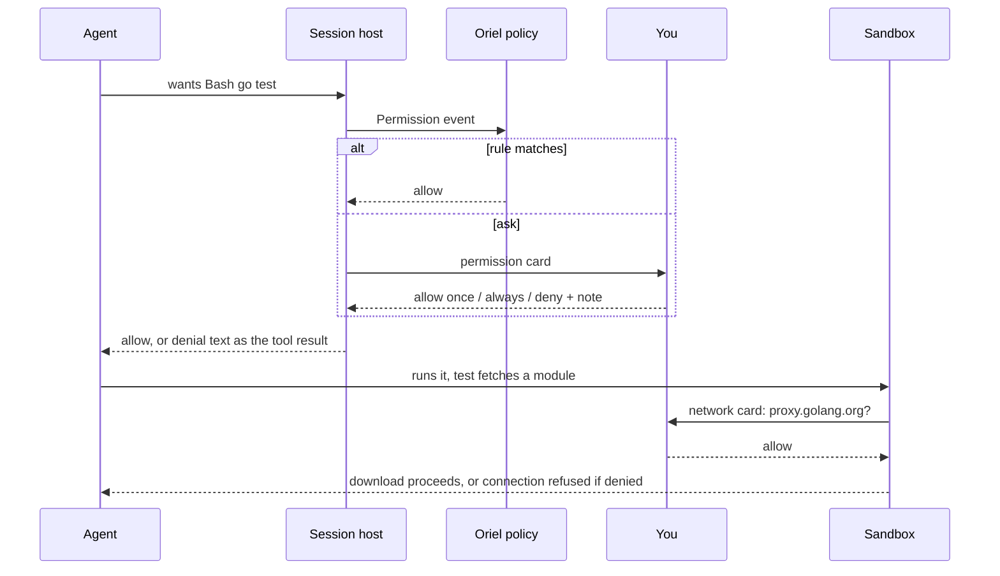
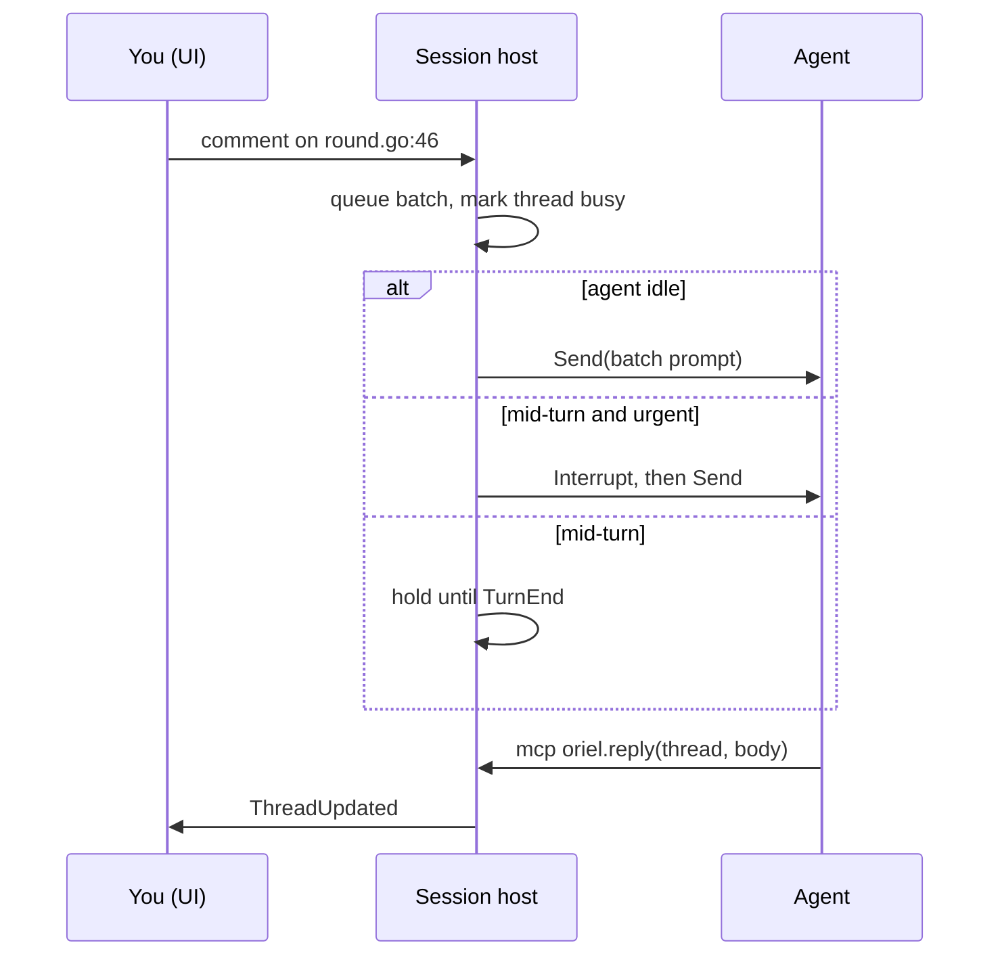

# Agents: Claude, Codex, and whatever comes next

Each provider is driven the way its **subscription** allows.

- `claude -p` and the Agent SDK are billed per token. Only the interactive `claude` CLI uses your
  Max subscription. So Claude runs as a **full interactive session in a PTY**, driven by Oriel's
  Claude Code mod through function hooks, the way crit does it today.
- Codex's `app-server` is what the official IDE extensions use with a ChatGPT login.
  Verify it's subscription-billed in the spike. If it isn't, Codex gets the same PTY-and-hooks treatment.
- Oriel draws the conversation itself from hook events plus the transcript. The PTY is still there for when you want it raw.

## Providers

| | Claude | Codex |
|---|---|---|
| Process | interactive `claude --plugin-dir <oriel-mod>` in a PTY (subscription) | `codex app-server`, JSON-RPC over stdio (verify billing) |
| Control channel | the mod's function hooks ↔ the session host over a unix socket | JSON-RPC requests |
| Send a prompt | `$.prompt.submit` (the mod receives it from the host) | `sendUserMessage` |
| Interrupt | `$.turn.abort` | `interruptConversation` |
| Our tools | `$.tool.register` (`mcp__oriel__*`), backed by the host | MCP server `oriel` |
| Permissions | `classic.PermissionRequest` hook → host → card → answer | `execCommandApproval` / `applyPatchApproval` |
| Side questions (btw, explain, verify quiz) | `$.model.fork`: tool-less, outside the main conversation | a new thread from the same rollout |
| Turn and subagent lifecycle | hook events (turn start/complete, subagent spawn/end, StopFailure) | notifications |
| Messages and tool calls | tail `~/.claude/projects/*.jsonl` (crit's `transcript` package) | notifications + rollout files |
| Usage / quota | `$.session.usage()` + the `/usage` probe (client-side, costs no tokens) | rate-limit events |
| Guard rails | `tool.check`: deny edits outside the worktree, deny raw network git/gh | sandbox policy + approvals |

- **Terminal view comes free** for Claude: it *is* a PTY session, so "Show terminal" attaches to it.
  For Codex, "Open in terminal" runs `codex resume` on the same session.
- The skills (`plan`, `diff`, `new`, `tour`, `job`) become **prompt packs**: markdown plus tool lists.
  The Claude mod loads them as skills; Codex gets them as the first user message plus `AGENTS.md`.
- The mod is the one Claude-specific piece of TypeScript. It stays small (crit's is about 575 lines),
  and everything it decides is delegated to the host over the socket.

### Nothing else may call `claude -p` either

crit calls `claude -p` for the room assistant, agentbus auto-answers and the no-agent explain.
In Oriel each of those uses the subscription instead:

- **Inside a session** (explain, btw, verify quiz, auto-answer about this repo): `$.model.fork` on that
  session's agent. It's tool-less, cheap and has full context.
- **Outside a session** (the assistant, an auto-answer with no matching session): a **resident utility
  session**. That's a hidden interactive `claude` in a PTY with the Oriel mod, a small model, read-only tools,
  and a fresh context per task. It's started on demand and kept warm.
- The `/usage` probe stays: it's client-side and spends no tokens.


## Interface (`agent` module)

```go
type Provider interface {
    ID() string                       // "claude", "codex"
    Detect(ctx) (Install, error)      // binary, version, login state
    Models(ctx) ([]Model, error)      // name, efforts, context window
    Start(ctx, StartSpec) (Session, error)
    Resume(ctx, id string, StartSpec) (Session, error)
    Usage(ctx) (Usage, error)         // plan windows, resets
    SandboxCredentials() []Mount      // what to copy into a container
}

type Session interface {
    ID() string
    Send(ctx, Input) error            // user turn: text, images, file refs
    Interrupt(ctx) error              // abort the current turn
    Fork(ctx, ForkSpec) (Session, error) // tool-less side conversation
    Events() <-chan Event             // Turn*, Message, ToolCall, ToolResult, Permission, Usage, Subagent*, Error
    Answer(ctx, PermissionID, Decision) error // layer-1 approvals; see "Permissions: three layers"
    Close() error
}
```

- `StartSpec`: cwd, model, effort, MCP servers, system-prompt pack, tool
  policy, env, and the sandbox to exec into.
- `Event` is one normalised union. Provider-specific extras ride in `Raw`.
- Adding a provider (Gemini, Aider, OpenCode, a local model) means one Go
  package, or an out-of-process extension speaking the same interface over RPC
  (see `plugins.md`).
- A conformance test suite runs every provider against a fake repo:
  start, send, tool call, permission, interrupt, fork, resume.

### Claude and Codex, side by side

Both providers implement the same two interfaces. Claude is a PTY plus hooks, and Codex is JSON-RPC.
The session host and the UI can't tell them apart.

```go
// agent/claude — an interactive session in a PTY, driven by the Oriel mod
type Provider struct{ Bin, ModDir string }

func (p Provider) Start(ctx context.Context, s agent.StartSpec) (agent.Session, error) {
    sock, err := s.Host.Listen(ctx)                       // unix socket the mod dials (ORIEL_HOOK_SOCK)
    if err != nil {
        return nil, err
    }
    args := []string{"--plugin-dir", p.ModDir, "--model", s.Model}
    if s.Sandbox != nil {
        args = append(args, "--mcp-config", s.GatewayMCP(), "--strict-mcp-config")
    }
    if s.Pack.Skill != "" {
        args = append(args, "/oriel:"+s.Pack.Skill)         // first prompt: the session kind's skill
    }
    pty, err := s.Exec.StartPTY(ctx, p.Bin, args, s.Env.With("ORIEL_HOOK_SOCK", sock.Path()))
    if err != nil {
        return nil, err
    }
    sess := &session{pty: pty, hooks: sock, ev: make(chan agent.Event, 64)}
    go sess.serveHooks()                                   // mod → host: turns, permissions, tool calls
    go sess.tailTranscript(s.Cwd)                          // jsonl → Message, ToolCall, ToolResult, Usage
    return sess, nil
}

func (s *session) Send(ctx context.Context, in agent.Input) error {
    return s.hooks.Push(ctx, hookmsg.Submit{Prompt: render(in)}) // the mod calls $.prompt.submit
}

func (s *session) Interrupt(ctx context.Context) error {
    return s.hooks.Push(ctx, hookmsg.Abort{})              // the mod calls $.turn.abort
}

func (s *session) Fork(ctx context.Context, f agent.ForkSpec) (agent.Session, error) {
    return newForkSession(s.hooks, f)                      // the mod runs $.model.fork, streams the answer back
}

func (s *session) Answer(ctx context.Context, id agent.PermissionID, d agent.Decision) error {
    return s.hooks.Reply(ctx, id, d)                       // unblocks the PermissionRequest hook
}

func (s *session) onHook(m hookmsg.Msg) []agent.Event {    // the Claude-shaped code paths: this and the transcript
    switch m := m.(type) {
    case hookmsg.TurnStart:    return []agent.Event{agent.TurnStart{}}
    case hookmsg.TurnComplete: return []agent.Event{agent.TurnEnd{Usage: m.Usage}}
    case hookmsg.Permission:   return []agent.Event{agent.Permission{ID: m.ID, Tool: m.Tool, Input: m.Input}}
    case hookmsg.Subagent:     return []agent.Event{agent.Subagent{ID: m.ID, Prompt: m.Prompt, Done: m.Done}}
    case hookmsg.StopFailure:  return []agent.Event{agent.Failure{Err: m.Err, Retryable: m.Retryable}}
    }
    return nil
}
```

```ts
// mod/register.ts — the Claude side (sketch); everything is delegated to the host
const host = await connect($.env.get("ORIEL_HOOK_SOCK"));
host.on("submit", (m) => $.prompt.submit(m.prompt));
host.on("abort", () => $.turn.abort());
host.on("fork", async (m) => host.reply(m.id, await $.model.fork({ prompt: m.prompt, tools: [] })));
for (const t of await host.tools()) $.tool.register(t.name, t.schema, (args) => host.call(t.name, args));
classic.PermissionRequest(async (req) => host.ask("permission", req));   // blocks until you answer
$.on("turn.start", () => host.emit("turn_start"));
$.on("turn.complete", async () => host.emit("turn_complete", { usage: await $.session.usage() }));
```

```go
// agent/codex
type Provider struct{ Bin string }

func (p Provider) Start(ctx context.Context, s agent.StartSpec) (agent.Session, error) {
    proc, err := s.Exec.Start(ctx, p.Bin, []string{"app-server"}, s.Env)
    if err != nil {
        return nil, err
    }
    rpc := jsonrpc.New(proc.Stdout, proc.Stdin)
    var r struct{ ConversationID string }
    if err := rpc.Call(ctx, "newConversation", newConvParams(s), &r); err != nil {
        return nil, err
    }
    sess := &session{rpc: rpc, id: r.ConversationID, ev: make(chan agent.Event, 64)}
    rpc.OnNotify(sess.translate)                            // codex/event → agent.Event
    rpc.OnRequest("execCommandApproval", sess.askPermission) // → agent.Permission, waits for Answer
    rpc.OnRequest("applyPatchApproval", sess.askPermission)
    return sess, nil
}

func (s *session) Send(ctx context.Context, in agent.Input) error {
    return s.rpc.Call(ctx, "sendUserMessage", userMessage(s.id, in), nil)
}

func (s *session) Interrupt(ctx context.Context) error {
    return s.rpc.Call(ctx, "interruptConversation", map[string]any{"conversationId": s.id}, nil)
}
```

```go
// agent — the normalised events every UI surface reads
type Event interface{ isEvent() }

type (
    TurnStart  struct{}
    Message    struct{ Role Role; Text string; Partial bool }
    ToolCall   struct{ ID, Tool string; Input json.RawMessage }
    ToolResult struct{ ID string; Output string; IsError bool; Diff *FileDiff }
    Permission struct{ ID, Tool, Summary string; Input json.RawMessage }
    Subagent   struct{ ID, Prompt string; Done bool; Result string }
    TurnEnd    struct{ Usage Usage; Cost float64 }
    Failure    struct{ Err error; Retryable bool }
)

// registration: built-in, or a process extension speaking the same methods over JSON-RPC
func init() { agent.Register("claude", claude.Provider{Bin: "claude"}) }
```

- A process-extension provider (Gemini, say) implements the same methods as JSON-RPC.
  Its RPC adapter is also an `agent.Provider`, so the session host can't tell them apart.
- The parts of the protocols above (`newConversation`, `execCommandApproval`, the Claude hook API
  and transcript format) get pinned and checked against the installed CLI version in `Detect`, because they move.

## Permissions: three layers

The `Session` interface does carry permissions: the `Permission` event and `Answer`.
That's only the first of three layers, though, and the agent experiences each one differently.

| Layer | Where | When it acts | What the agent sees |
|---|---|---|---|
| 1. Agent approval | the provider's own gate: Claude's `PermissionRequest` hook, Codex approval requests | **before** a tool runs | it **waits**; then the tool runs, or it gets a structured denial ("denied by user: use the Makefile target") as the tool result |
| 2. Oriel policy | `Permission` hooks and rules (`oriel.on("Permission")`, "Always in this workspace") | before layer 1 reaches you | nothing: the answer arrives faster |
| 3. Sandbox | egress proxy, gateway MCP policy, filesystem mounts | **while** the tool runs | a held connection or a held gateway call while you decide; if denied, an ordinary tool error (`connection refused`, `gateway: push denied by user`) |



- **Layer 1 never surfaces as a failure.** The provider blocks the tool call until `Answer`.
  A denial comes back as the tool's result, with your note, so the agent adapts instead of retrying blindly.
- **Layer 3 is invisible to the agent until it bites.** The proxy and gateway *hold* the call while
  you decide (as crit does now), so an approval looks to the agent like a slow request.
  Only a denial or timeout reaches it, as the tool's own error.
- So the agent doesn't need to know about the sandbox. It just needs good errors.
  The gateway's denial messages are written for an agent to read: they say who denied it and what to do instead.
- **Policy option per session**: run the agent's own gate fully (`ask`), lightly (`edits auto, shell asks`),
  or off (`bypass`) inside a sandbox, leaving layer 3 as the only gate. The default is a light gate inside a sandbox.
- The sandbox, gateway and egress code is ported from crit unchanged (`architecture.md`).

## Comments to agent, without `crit wait`



## Guardrails against sloppy vibe-coding

All on by default, all configurable, none a nag:

- **Plan first.** Work sessions start from an approved plan or a ticket. "Just
  do it" is a deliberate choice, and the session is marked unplanned.
- **Review ledger.** Every agent-written line is unread until you've seen it in
  the diff (scrolled past it, or marked its hunk reviewed). The ledger is
  visible in the session HUD.
- **Commit gate** (`ledger.gate`), set per session kind:
  - **work and plan: hard.** Commit and PR are blocked until every agent-written line is read. "Commit anyway" is one keypress,
    and it's recorded in a commit trailer (`Unreviewed-Agent-Lines: 38`) and in the session log.
  - **jobs: soft.** One confirmation, logged.
  - **tours and scratch sessions: off.**
  - Repos can override it in `.oriel/`, and the ledger shows in the HUD, on the Ship page and in the PR description.
- **Evidence.** The agent attaches proof to claims ("tests pass" links to the
  test run in the session log), and replies without evidence get flagged.


- **Verify & raise.** crit's quiz carries over: the agent asks you about the
  change before the PR goes out.
- **Cross-model review.** AI review runs on a different provider from the
  author by default (Codex reviews Claude's work, and the other way round).
- **Slop gate.** crit's phrase filter runs on everything the agent posts.
- **Trusted authors.** crit's trusted-orgs redaction carries over unchanged.
- **Authorship.** Blame shows who wrote each line (you, the agent, a
  formatter), so "the AI wrote it" never gets lost after a commit.
