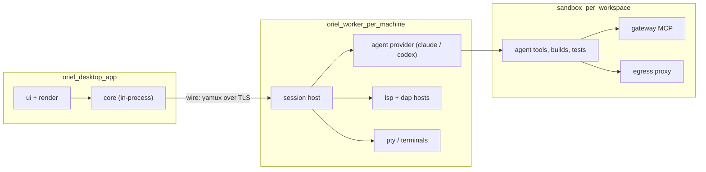

# Architecture

One Go monorepo, many small modules behind interfaces. The desktop app is a
client of a headless core. Workers stay as they are in crit: one per machine,
dialling home.

## Processes



- **Desktop app** (`oriel`): UI, renderer and the client-side core in one process.
  Holds the editor buffers you're typing into, so keystrokes never leave the process.
- **Worker** (`oriel worker`): what crit's worker and session servers are
  today, merged into one process per machine. It owns worktrees, agents,
  sandboxes, LSP/DAP servers and PTYs. The local machine runs one too.
- **Sandbox**: kept from crit unchanged: container, gateway MCP, egress proxy, network approvals.
- **No per-session HTTP servers.** Sessions are objects inside the worker,
  reached over a single multiplexed connection. This cuts the port-range and
  registry machinery.
- **No browser, no built-in web client.** Remote control (a phone, a browser) would be a **plugin**: a process plugin
  with `session.control` and agent permissions that serves its own UI. The core protocol stays private.

## Where buffers live

- The file of record is on the worker (in the worktree).
- The app holds a **replica** per open buffer: `text` rope plus an op log.
- Edits flow both ways as ops tagged with an author. The agent's edits arrive
  as file changes on the worker, which turns them into ops (a diff against the
  last synced snapshot). Simple OT is enough: there are only two writers, and
  the worker sequences them.
- LSP runs on the worker, next to the code and toolchain (and inside the
  sandbox when there is one). The app forwards requests, and keeps the latency
  tolerable with optimistic local highlighting from tree-sitter.

## Go modules (one repo, `go.work`)

| Module | Owns | Depends on |
|---|---|---|
| `text` | rope, snapshots, anchors, authorship, undo tree | – |
| `edit` | the editing primitives every input engine drives: cursors, edits with authorship and undo, registers, marks, messages, files, named motions; `edit/input` (the `input.Engine` interface), `edit/input/plain` (CUA keys) and `edit/input/emacs` (a sample plugin) | text |
| `vim` | modal engine over `edit` | text, edit |
| `syntax` | tree-sitter (wazero), highlight, folds, units, outline | text, wazero |
| `lsp` | LSP client, server registry, capabilities | text |
| `dap` | DAP client, adapter registry | lsp/jsonrpc (the base protocol's framing) |
| `testrun` | test discovery, runner adapters (go, pytest, vitest/jest, cargo), result streams, watch, coverage | text, syntax |
| `term` | the terminal model behind `term.Emulator`: grid, scrollback, modes, keys, snapshots, OSC 133 commands and OSC 7 cwd; `term/ghostty` (libghostty-vt as wasm under wazero), `term/pty` (pseudo-terminals over `x/sys/unix`), `term/vttest` (esctest-style case runner) | wazero, x/sys |
| `wire` | yamux protocol, typed RPC + event streams | – |
| `core` | sessions, workspaces, threads, tasks, events (pure state + logic) | wire |
| `agent` | `Provider` interface + shared turn/transcript types; `agent/agenttest` (the conformance suite and a fake provider); `agent/hostexec` (processes and PTYs on the host); `agent/packs` (prompt packs); `agent/prompts` (the editable prompts and the user's versions of them); `agent/jsonrpc` | core, term (PTYs) |
| `agent/claude`, `agent/codex` | provider impls | agent |
| `worker` | session host, pty, worktrees, launches providers; `worker/search` (project search on ripgrep); `worker/sysload` (CPU and memory) | core, agent, gitx, testrun (test runs as evidence), wire, sandbox, registry/settingsfile and toml (its repos' own project settings) |
| `sandbox` | containers, gateway, egress (ported from crit) | – |
| `gitx`, `gh` | git and GitHub (ported from crit) | – |
| `integ/*` | linear, slack (agentbus is company-specific, so it's an external plugin, `github.com/liamg/oriel-agentbus`, with its `oriel-agentbus` helper process) | core; their processes `agent/jsonrpc`, `gh` |
| `render` | GPU surface interface and display lists; `render/typeset` (shaping, fonts, rasterising, atlas); `render/raster` (draws display lists on the CPU); `render/bake` (glows and rounded rects as images); `render/headless` (keeps display lists and shoots them, for tests); `render/snapshot` (golden lists and perceptual PNG diffs); `render/scenes` (01-ide and the budget scenes) | go-text, x/image, theme |
| `render/gio` | the Gio backend: windows, input, offscreen rendering, the glyph atlas and baked shapes | render, gioui.org |
| `ui` | widgets, layout, theme, animation, input routing | render |
| `app` | the desktop app: screens, panels, HUD; wires it all together | everything |
| `registry` | contribution registry: commands, events/hooks, options, views, decorations | ui (a view returns a `ui.Node`); `registry/settingsfile` (settings files and their trust, shared with the worker) needs only toml |
| `script` | Lua VM (`script/gopherlua`, maybe `script/luajit`), the `oriel.*` bindings generated from Go | registry |
| `catalog` | the plugin registry's client and the plugin manager (catalog.md): `oriel plugin pack`, `[plugins]` in settings.toml, oriel-lock.toml, signed indexes | plugin, registry, script/api (the API's capabilities, for pack) |
| `plugin` | plugin host: manifests, process RPC, wasm, plugin manager, permissions | registry, core (`Host` hands out sessions) |
| `assistant` | the assistant's conversation (ui.md 11): turns typed or spoken, replies and their rows, confirmations, actions with an undo, idle reaping; its agent behind an interface (a worker's utility agent in the app) | – |
| `voice` | dictation: a recorder program as the microphone, phrases at pauses, whisper.cpp or an OpenAI-compatible endpoint, the wake word, speech; `voice/voicetest` (a scripted mic and transcriber) | – |
| `update` | release manifests (ed25519), staged swap and rollback, pushing updates to workers | wire |
| `cmd/oriel` | the binary (app, worker, cli subcommands) | app, worker, update |
| `cmd/oriel-spike` | the phase-0 Gio spike (build tag `spike`): 01-ide drawn natively, benchmarks, go/no-go report in `spikes/P0-4-gio.md`. Superseded by `render/gio`; kept for its report | gioui.org |
| `toml` | TOML 1.0 parser and round-tripping editor, for settings and themes (`settings.md`) | – |
| `theme` | theme files, colour maths (CSS Color 4, OkLCh) and token resolution into a flat table (`theming.md`) | toml |
| `tools` | repo tooling run by tests and CI: the layout check, `depcheck`, `refcheck`; `tools/perf` (the timing budgets' `perf.Timed`) | – |

Rules:

- `text`, `edit`, `vim`, `syntax`, `lsp`, `dap`, `core`, `agent`, `term` never import `ui` or `render`. `tools/layout` reads this line and fails on any such import, tests included.
- Every "swap me" seam is an interface in the consumer package, with impls in subpackages.
- Each module has its own tests; `vim` has the nvim conformance suite.
- Every module is listed in `go.work`, and `tools/layout` fails if a module in this table has no directory or a `go.mod` is missing from `go.work`.
- `make test` runs every module's tests (`go test` over `go list -m`).

## Events

- The worker is the source of truth for session state, and streams typed events
  (`ThreadUpdated`, `AgentTurn`, `TaskChanged`, `UsageSampled`, `WorkerLoad`, …).
- The app keeps a materialised `core.State` and the UI reads from it. The UI
  never asks the network on a frame.
- The same event log feeds the HUD, notifications, the assistant's context and tests.
- An event is a plain struct with `Scope()` (its session, or none) and `Apply(*State) error`, its effect on state.
  A store applies it to a copy and keeps the copy only if it applied cleanly, so a rejected event changes nothing.
- `core.RegisterEvent[E](name)` names an event type in logs; plugins register theirs the same way.
  A log is JSON lines, `{"seq":1,"type":"SessionOpened","event":{…}}`, written by a `core.Recorder` subscribed to the store.
- `core.Replay` applies a log to a fresh store. Replaying it reproduces the state's JSON byte for byte.

## What crit code carries over

- Ported almost as-is: `sandbox`, `egress`, `gateway`, `mcp`, `gh`, `git`,
  `wire`, `agentbus`, `linear`, `prompts`, `slop`, `review`'s thread model,
  `tour`, `job`, `quota`, `transcript`, `stats`.
- Rewritten: everything under `web/`, `server/` (it becomes `worker` + `core`),
  `manager` and `dashboard` (they fold into the app), `lsp` (it grows into a
  full client), and the neovim editor.
- Dropped: `media`, room, puzzle, sea and scenes, the 3D stack, and cinema.

## Go interfaces

```go
// package core — session state, the thing every surface reads
type Store interface {
    Sessions() []Session
    Session(id SessionID) (Session, bool)
    Apply(ev Event) error                          // the only mutation path; events come from the worker
    Subscribe(filter Filter, fn func(Event)) (cancel func())
    State() State                                  // a copy of the materialised state
}

type Session interface {
    ID() SessionID
    Kind() Kind                                    // plan, work, review, tour, job, or plugin-defined
    Status() Status                                // needs_you, permission, working, ci, reviewer, quiet
    Projects() []Project
    Threads() ThreadList
    Tasks() []Task
    Agent() AgentState                             // provider, model, ctx, turn, usage
    Ledger() Ledger
}
```

```go
// package wire — app ↔ worker, one connection, many streams
type Conn interface {
    Call(ctx context.Context, method string, in, out any) error
    Stream(ctx context.Context, method string, in any) (Stream, error) // events, PTYs, logs
    Handle(method string, h Handler)
}
```

```go
// package worker — what the app asks a worker to do
type Worker interface {
    Open(ctx context.Context, spec SessionSpec) (core.SessionID, error)
    Comment(ctx context.Context, t core.ThreadID, body string, opts CommentOpts) error
    Files(ctx context.Context, s core.SessionID) (FileService, error)  // read/write/sync buffers
    LSP(ctx context.Context, s core.SessionID, lang string) (lsp.Client, error)
    Debug(ctx context.Context, s core.SessionID, cfg dap.LaunchConfig) (dap.Session, error)
    PTY(ctx context.Context, s core.SessionID, spec PTYSpec) (PTY, error)
}
```

- The worker is behind `wire`, so the app sees `lsp.Client`, `dap.Session` and friends as plain interfaces.
  A local in-process worker (no network) is just another implementation, which helps tests and single-machine use.
- As built (AI-1): `wire.Conn` adds `HandleStream`, `Close` and `Done`; either end calls and handles (the worker asks
  the app for plugins' agent tools and for the Permission hooks). `wire.Pipe` is an in-process pair; `wire.Client` /
  `wire.Server` serve a unix socket with no handshake (this machine's worker, owner-only); `wire.Dial` / `wire.Accept`
  are crit's pinned-TLS handshake for workers elsewhere. `worker.Client` is the worker's methods over a `wire.Conn`;
  its `Events` stream sends each session whole (`SessionSynced`) and then every event, which the app applies to its
  store. LSP and DAP still run in the app for now.
- As built (PL-4): a worker also runs **utility agents** (`worker/utility.go`): an agent with no session, for the
  assistant. `utility.run` is a stream (`UtilitySpec{Name, Provider, Model, Pack, Prompt, Allow}`): the worker starts
  the provider in `<Home>/utility/<name>` on its small model (`agent.Model.Small`), offered only the app's tools for
  that name (`app.tools` with `ToolsReq{Agent}`; a session asks with its kind), sends `ready` then `UtilityEvent`s,
  refuses every permission but `Allow`'s and every question, and stops the agent when the stream ends.
  `utility.send` and `utility.interrupt` take turns. `worker.Client.StartUtility` is the app's side.
- As built (PL-6): `worker.Options.Handlers` add methods to each app connection; `oriel worker --connect` serves the
  updater's through it (`distribution.md`).

