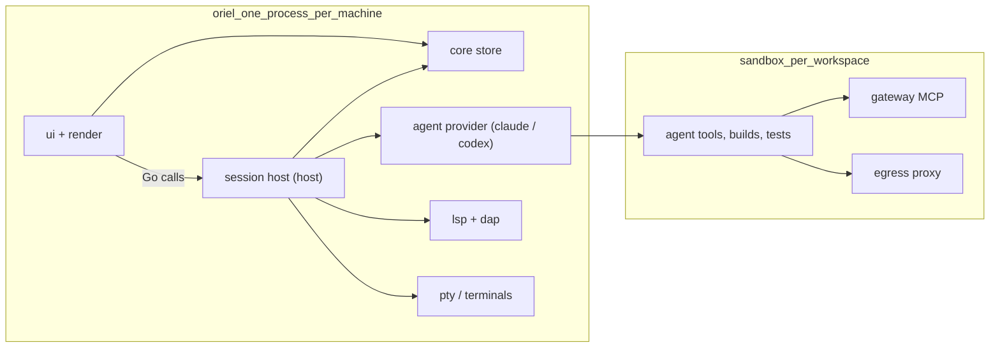

# Architecture

One Go monorepo, many small modules behind interfaces. One process per machine:
the Oriel window, which hosts its sessions itself. Another machine runs its own
Oriel; the two never talk.

## Processes



- **Oriel** (`oriel`): UI, renderer, core and the session host in one process.
  Holds the editor buffers you're typing into, so keystrokes never leave the process.
- **Session host** (`host`): what crit's worker and session servers are, as a
  package in the app's process. It owns worktrees, agents, sandboxes, LSP/DAP
  servers and PTYs. The app calls its methods directly; there is no socket.
- **One Oriel at a time**: the app holds `~/.oriel/oriel.lock` (`sessions.md`).
- **Sandbox**: kept from crit unchanged: container, gateway MCP, egress proxy, network approvals.
- **No per-session HTTP servers.** Sessions are objects inside the host,
  reached by plain Go calls. This cuts the port-range and registry machinery.
- **No browser, no built-in web client.** Remote control (a phone, a browser) would be a **plugin**: a process plugin
  with `session.control` and agent permissions that serves its own UI. The core protocol stays private.

## Where buffers live

- The file of record is in the worktree.
- The app holds a **replica** per open buffer: `text` rope plus an op log.
- Edits flow both ways as ops tagged with an author. The agent's edits arrive
  as file changes in the worktree, which the host turns into ops (a diff against
  the last synced snapshot). Simple OT is enough: there are only two writers, and
  the host sequences them.
- LSP runs next to the code and toolchain (and inside the sandbox when there is
  one), with optimistic local highlighting from tree-sitter.

## Go modules (one repo, `go.work`)

| Module | Owns | Depends on |
|---|---|---|
| `text` | rope, snapshots, anchors, authorship, undo tree | – |
| `edit` | the editing primitives every input engine drives: cursors, edits with authorship and undo, registers, marks, messages, files, named motions; `edit/input` (the `input.Engine` interface), `edit/input/plain` (CUA keys) and `edit/input/emacs` (a sample plugin) | text |
| `vim` | modal engine over `edit` | text, edit |
| `syntax` | tree-sitter (wazero), highlight, folds, units, outline | text, wazero |
| `lsp` | LSP client, server registry, capabilities | text |
| `dap` | DAP client, adapter registry | lsp/jsonrpc (the base protocol's framing) |
| `testrun` | test discovery, runner adapters (go, pytest, vitest/jest, cargo), result streams, watch, coverage | text, syntax |
| `term` | the terminal model behind `term.Emulator`: grid, scrollback, modes, keys, snapshots, OSC 133 commands and OSC 7 cwd; `term/ghostty` (libghostty-vt as wasm under wazero), `term/pty` (pseudo-terminals over `x/sys/unix`), `term/vttest` (esctest-style case runner) | wazero, x/sys |
| `core` | sessions, workspaces, threads, tasks, events (pure state + logic) | – |
| `agent` | `Provider` interface + shared turn/transcript types; `agent/agenttest` (the conformance suite and a fake provider); `agent/hostexec` (processes and PTYs on the host); `agent/packs` (prompt packs); `agent/prompts` (the editable prompts and the user's versions of them); `agent/jsonrpc` | core, term (PTYs) |
| `agent/claude`, `agent/codex` | provider impls | agent |
| `host` | the session host, in the app's process: sessions, pty, worktrees, launches providers, jobs; `host/search` (project search on ripgrep); `host/stats` (session stats); `host/sysload` (CPU and memory); `host/tour` (tours) | core, agent, gitx, gh, testrun (test runs as evidence), sandbox |
| `sandbox` | sandbox backends (docker containers, macOS seatbelt), gateway, egress (ported from crit) | – |
| `gitx`, `gh` | git and GitHub (ported from crit) | – |
| `integ/*` | linear, slack (agentbus is company-specific, so it's an external plugin, `github.com/liamg/oriel-agentbus`, with its `oriel-agentbus` helper process) | core; their processes `agent/jsonrpc`, `gh` |
| `render` | GPU surface interface and display lists; `render/typeset` (shaping, fonts, rasterising, atlas); `render/raster` (draws display lists on the CPU); `render/bake` (glows and rounded rects as images); `render/headless` (keeps display lists and shoots them, for tests); `render/snapshot` (golden lists and perceptual PNG diffs); `render/scenes` (01-ide and the budget scenes) | go-text, x/image, theme |
| `render/gio` | the Gio backend: windows, input, offscreen rendering, the glyph atlas and baked shapes | render, gioui.org |
| `ui` | widgets, layout, theme, animation, input routing | render |
| `app` | the desktop app: screens, panels, HUD; wires it all together | everything |
| `registry` | contribution registry: commands, events/hooks, options, views, decorations | ui (a view returns a `ui.Node`); `registry/settingsfile` (settings files and their trust) needs only toml |
| `script` | Lua VM (`script/gopherlua`, maybe `script/luajit`), the `oriel.*` bindings generated from Go | registry |
| `catalog` | the plugin registry's client and the plugin manager (catalog.md): `oriel plugin pack`, `[plugins]` in settings.toml, oriel-lock.toml, signed indexes | plugin, registry, gitx, toml, script/api (the API's capabilities, for pack), tools/depcheck (a plugin's deps, for the registry's CI) |
| `plugin` | plugin host: manifests, process RPC, wasm, plugin manager, permissions | registry, core (`Host` hands out sessions) |
| `assistant` | the assistant's conversation (ui.md 11): turns typed or spoken, replies and their rows, confirmations, actions with an undo, idle reaping; its agent behind an interface (the host's utility agent in the app) | – |
| `voice` | dictation: a recorder program as the microphone, phrases at pauses, whisper.cpp or an OpenAI-compatible endpoint, the wake word, speech; `voice/voicetest` (a scripted mic and transcriber) | – |
| `update` | release manifests (ed25519), staged swap and rollback | – |
| `cmd/oriel` | the binary (the app, and the `hook`, `version`, `build`, `plugin`, `update` and `dev` subcommands) | app, host, update |
| `cmd/oriel-spike` | the phase-0 Gio spike (build tag `spike`): 01-ide drawn natively, benchmarks, go/no-go report in `spikes/P0-4-gio.md`. Superseded by `render/gio`; kept for its report | gioui.org |
| `toml` | TOML 1.0 parser and round-tripping editor, for settings and themes (`settings.md`) | – |
| `theme` | theme files, colour maths (CSS Color 4, OkLCh) and token resolution into a flat table (`theming.md`) | toml |
| `tools` | repo tooling run by tests and CI: the layout check, `depcheck`, `refcheck`; `tools/perf` (the timing budgets' `perf.Timed`) | – |

Rules:

- `text`, `edit`, `vim`, `syntax`, `lsp`, `dap`, `core`, `agent`, `term` never import `ui` or `render`. `tools/layout` reads this line and fails on any such import, tests included.
- Every "swap me" seam is an interface in the consumer package, with impls in subpackages.
- Each module has its own tests; `vim` has the nvim conformance suite.
- Every module is listed in `go.work`, and `tools/layout` fails if a module in this table has no directory or a `go.mod` is missing from `go.work`.
- `make test` runs every module's tests (`go test` over `go list -m`).

## Events

- The host is the source of truth for session state. It applies typed events
  (`ThreadUpdated`, `AgentTurn`, `TaskChanged`, `UsageSampled`, `MachineChanged`, …)
  to a `core.Store`, and the app shares that store.
- The materialised `core.State` is what the UI reads. The UI never asks the host on a frame.
- The same event log feeds the HUD, notifications, the assistant's context and tests.
- An event is a plain struct with `Scope()` (its session, or none) and `Apply(*State) error`, its effect on state.
  A store applies it to a copy and keeps the copy only if it applied cleanly, so a rejected event changes nothing.
- `core.RegisterEvent[E](name)` names an event type in logs; plugins register theirs the same way.
  A log is JSON lines, `{"seq":1,"type":"SessionOpened","event":{…}}`, written by a `core.Recorder` subscribed to the store.
- `core.Replay` applies a log to a fresh store. Replaying it reproduces the state's JSON byte for byte.

## What crit code carries over

- Ported almost as-is: `sandbox`, `egress`, `gateway`, `mcp`, `gh`, `git`,
  `agentbus`, `linear`, `prompts`, `slop`, `review`'s thread model,
  `tour`, `job`, `quota`, `transcript`, `stats`.
- Rewritten: everything under `web/`, `server/` (it becomes `host` + `core`),
  `manager`, `dashboard` and the worker (they fold into the app), `lsp` (it grows into a
  full client), and the neovim editor.
- Dropped: `wire` (no process boundary is left to cross), `media`, room, puzzle, sea and scenes, the 3D stack, and cinema.

## Go interfaces

```go
// package core — session state, the thing every surface reads
type Store interface {
    Sessions() []Session
    Session(id SessionID) (Session, bool)
    Apply(ev Event) error                          // the only mutation path; the host applies events
    Subscribe(filter Filter, fn func(Event)) (cancel func())
    State() State                                  // a copy of the materialised state
}

type Session interface {
    ID() SessionID
    Kind() Kind                                    // plan, work, review, tour, job, or plugin-defined
    Status() Status                                // needs_you, permission, working, ci, reviewer, quiet
    Projects() []Project
    Threads() ThreadList
    Tasks() []Task
    Agent() AgentState                             // provider, model, ctx, turn, usage
    Ledger() Ledger
}
```

```go
// package host — the session host, in the app's process
func New(opts Options) (*Host, error)
func (h *Host) Store() core.Store                  // the app's store too
func (h *Host) SetApp(a App)                       // the callbacks into the app
func (h *Host) Start(ctx context.Context, spec core.SessionSpec) (core.SessionID, error)
func (h *Host) Comment(ctx context.Context, r CommentReq) (core.ThreadID, error)
func (h *Host) Terminal(ctx context.Context, s core.SessionID) (<-chan []byte, error)
func (h *Host) StartUtility(ctx context.Context, spec UtilitySpec) (*Utility, error)
func (h *Host) HandOver()                          // quit: stop the agents for the next launch, close
```

- The app owns one `*host.Host` and calls it directly, off the UI goroutine.
- The host calls back into the app through `SetApp(host.App{Tools, CallTool, Decide})`: plugins' agent tools and
  the Permission hooks. With none installed (tests, a closing window) it has no tools and no hook answers.
- Not crashing: every exported method, every goroutine the host starts and every callback into the app recovers a
  panic, logs it ("panic in the session host") and returns it as an error.
- As built (PL-4): the host also runs **utility agents** (`host/utility.go`): an agent with no session, for the
  assistant. `StartUtility(UtilitySpec{Name, Provider, Model, Pack, Prompt, Allow})` starts the provider in
  `<Home>/utility/<name>` on its small model (`agent.Model.Small`), offered only the app's tools for that name
  (`App.Tools` with `ToolsReq{Agent}`; a session asks with its kind), refuses every permission but `Allow`'s and
  every question, and returns a `*Utility`: `Send` and `Interrupt` take turns, `Events` streams `UtilityEvent`s,
  `Close` stops the agent.
- LSP and DAP still run in the app.
