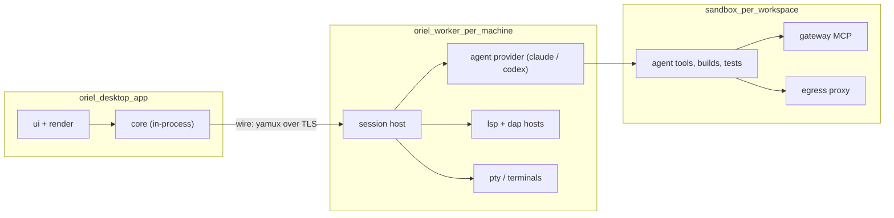

# Architecture

One Go monorepo, many small modules behind interfaces. The desktop app is a
client of a headless core. Workers stay as they are in crit: one per machine,
dialling home.

## Processes



- **Desktop app** (`oriel`): UI, renderer and the client-side core in one process.
  Holds the editor buffers you're typing into, so keystrokes never leave the process.
- **Worker** (`oriel worker`): what crit's worker and session servers are
  today, merged into one process per machine. It owns worktrees, agents,
  sandboxes, LSP/DAP servers and PTYs. The local machine runs one too.
- **Sandbox**: kept from crit unchanged: container, gateway MCP, egress proxy, network approvals.
- **No per-session HTTP servers.** Sessions are objects inside the worker,
  reached over a single multiplexed connection. This cuts the port-range and
  registry machinery.
- **No browser, no built-in web client.** Remote control (a phone, a browser) would be a **plugin**: a process plugin
  with `session.control` and agent permissions that serves its own UI. The core protocol stays private.

## Where buffers live

- The file of record is on the worker (in the worktree).
- The app holds a **replica** per open buffer: `text` rope plus an op log.
- Edits flow both ways as ops tagged with an author. The agent's edits arrive
  as file changes on the worker, which turns them into ops (a diff against the
  last synced snapshot). Simple OT is enough: there are only two writers, and
  the worker sequences them.
- LSP runs on the worker, next to the code and toolchain (and inside the
  sandbox when there is one). The app forwards requests, and keeps the latency
  tolerable with optimistic local highlighting from tree-sitter.

## Go modules (one repo, `go.work`)

| Module | Owns | Depends on |
|---|---|---|
| `text` | rope, snapshots, anchors, authorship, undo tree | – |
| `vim` | modal engine over `text` | text |
| `syntax` | tree-sitter (wazero), highlight, folds, textobjects | text |
| `lsp` | LSP client, server registry, capabilities | text |
| `dap` | DAP client, adapter registry | – |
| `testrun` | test discovery, runner adapters (go, pytest, vitest/jest, cargo), result streams, watch, coverage | text, syntax |
| `wire` | yamux protocol, typed RPC + event streams | – |
| `core` | sessions, workspaces, threads, tasks, events (pure state + logic) | wire |
| `agent` | `Provider` interface + shared turn/transcript types | core |
| `agent/claude`, `agent/codex` | provider impls | agent |
| `worker` | session host, pty, worktrees, launches providers | core, agent, lsp, dap |
| `sandbox` | containers, gateway, egress (ported from crit) | – |
| `gitx`, `gh` | git and GitHub (ported from crit) | – |
| `integ/*` | linear, slack, ical; agentbus via the `oriel-agentbus` helper process (keeps its sqlite dependency out of Oriel) | core |
| `render` | GPU surface interface; `render/gio` impl | – |
| `ui` | widgets, layout, theme, animation, input routing | render |
| `app` | the desktop app: screens, panels, HUD; wires it all together | everything |
| `registry` | contribution registry: commands, events/hooks, options, views, decorations | – |
| `script` | Lua VM (`script/gopherlua`, maybe `script/luajit`), the `oriel.*` bindings generated from Go | registry |
| `ext` | extension host: manifests, process RPC, wasm, plugin manager, permissions | registry |
| `update` | release manifests (ed25519), staged swap and rollback, pushing updates to workers | wire |
| `cmd/oriel` | the binary (app, worker, cli subcommands) | app, worker |
| `cmd/oriel-spike` | the phase-0 Gio spike (build tag `spike`): 01-ide drawn natively, benchmarks, go/no-go report in `spikes/P0-4-gio.md`. The only module that imports Gio until `render/gio` | gioui.org |
| `tools` | repo tooling run by tests and CI: the layout check, `depcheck`, `refcheck` | – |

Rules:

- `text`, `vim`, `syntax`, `lsp`, `dap`, `core`, `agent` never import `ui` or `render`.
- Every "swap me" seam is an interface in the consumer package, with impls in subpackages.
- Each module has its own tests; `vim` has the nvim conformance suite.
- Every module is listed in `go.work`, and `tools/layout` fails if a module in this table has no directory or a `go.mod` is missing from `go.work`.
- `make test` runs every module's tests (`go test` over `go list -m`).

## Events

- The worker is the source of truth for session state, and streams typed events
  (`ThreadUpdated`, `AgentTurn`, `TaskChanged`, `UsageSampled`, `WorkerLoad`, …).
- The app keeps a materialised `core.State` and the UI reads from it. The UI
  never asks the network on a frame.
- The same event log feeds the HUD, notifications, the assistant's context and tests.

## What crit code carries over

- Ported almost as-is: `sandbox`, `egress`, `gateway`, `mcp`, `gh`, `git`,
  `wire`, `agentbus`, `linear`, `prompts`, `slop`, `review`'s thread model,
  `tour`, `job`, `quota`, `transcript`, `stats`.
- Rewritten: everything under `web/`, `server/` (it becomes `worker` + `core`),
  `manager` and `dashboard` (they fold into the app), `lsp` (it grows into a
  full client), and the neovim editor.
- Dropped: `media`, room, puzzle, sea and scenes, the 3D stack, and cinema.

## Go interfaces

```go
// package core — session state, the thing every surface reads
type Store interface {
    Sessions() []Session
    Session(id SessionID) (Session, bool)
    Apply(ev Event) error                          // the only mutation path; events come from the worker
    Subscribe(filter Filter, fn func(Event)) (cancel func())
}

type Session interface {
    ID() SessionID
    Kind() Kind                                    // plan, work, review, tour, job, or plugin-defined
    Status() Status                                // needs_you, permission, working, ci, reviewer, quiet
    Projects() []Project
    Threads() ThreadList
    Tasks() []Task
    Agent() AgentState                             // provider, model, ctx, turn, usage
    Ledger() Ledger
}
```

```go
// package wire — app ↔ worker, one connection, many streams
type Conn interface {
    Call(ctx context.Context, method string, in, out any) error
    Stream(ctx context.Context, method string, in any) (Stream, error) // events, PTYs, logs
    Handle(method string, h Handler)
}
```

```go
// package worker — what the app asks a worker to do
type Worker interface {
    Open(ctx context.Context, spec SessionSpec) (core.SessionID, error)
    Comment(ctx context.Context, t core.ThreadID, body string, opts CommentOpts) error
    Files(ctx context.Context, s core.SessionID) (FileService, error)  // read/write/sync buffers
    LSP(ctx context.Context, s core.SessionID, lang string) (lsp.Client, error)
    Debug(ctx context.Context, s core.SessionID, cfg dap.LaunchConfig) (dap.Session, error)
    PTY(ctx context.Context, s core.SessionID, spec PTYSpec) (PTY, error)
}
```

- The worker is behind `wire`, so the app sees `lsp.Client`, `dap.Session` and friends as plain interfaces.
  A local in-process worker (no network) is just another implementation, which helps tests and single-machine use.

