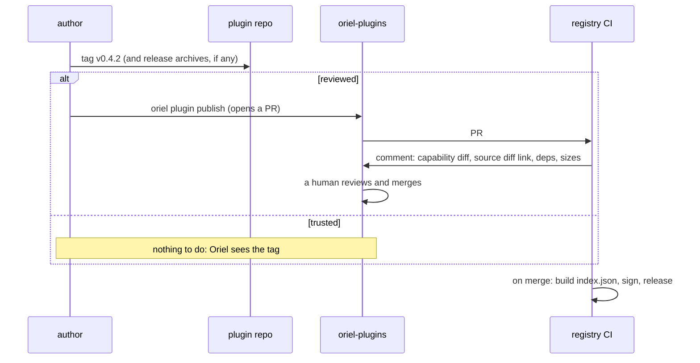

# Plugin registry: installing, packaging and publishing plugins

How plugins are listed, installed, packaged and published. Phase 8.
What plugins can *do* is in `plugins.md` and `scripting.md`. What they're *allowed* to do is in `security.md`.

- In prose and the UI it's the **plugin registry**.
- In code it's the `catalog` module, because `registry` is the contribution registry (`plugins.md`).
- "Plugin" is the only word for these. "Extension" isn't used.

## Data in TOML, logic in Lua

The same split as settings (`settings.md`): the GUI and hand edits write the same file, and dotfiles just work.

| What | Where | Written by |
|---|---|---|
| which plugins are installed, and their versions | `settings.toml` → `[plugins]` | GUI or hand edit |
| a plugin's options | `settings.toml` → `[plugin.<name>]` | GUI or hand edit |
| registries, and update behaviour | `settings.toml` → `[registry]` | GUI or hand edit |
| what was consented to, plus exact commits and hashes | `oriel-lock.toml`, next to `settings.toml` | Oriel only |
| a plugin's logic | the plugin's `init.lua` | its author |
| your own logic | `init.lua` | you |

### `[plugins]`

```toml
[plugins]
"acme/jira"      = "^0.4"                                   # from the registry
"liamg/surround" = "*"
"someone/thing"  = { git = "github.com/someone/thing" }     # not in the registry: unverified
"me/wip"         = { path = "~/src/wip" }                    # local, for development
"acme/linear"    = { version = "^1", enabled = false }
"user/pickers"   = { version = "*", lazy = { keys = "<leader>f" } }   # overrides the manifest's lazy
```

- A string is a semver range resolved through the registries. A table with `git` or `path` is a source outside them.
- Every key under `[plugins]` is a plugin. Plugin settings live elsewhere: `[registry]` and `[plugin.<name>]`.

### Install by editing the file

- `settings.toml` is watched. On load or change, every entry that isn't installed, or doesn't match the lockfile,
  is resolved and fetched.
- Consent stays all or nothing (`security.md`):
  - If the lockfile records that you accepted this version with these capabilities, the plugin activates silently.
    That's how dotfiles on a new machine work.
  - If not, or if it now asks for more than you accepted, it stays **inactive**, and an inbox card opens the consent
    screen (mockup 29). Nothing runs half-granted.
  - The pieces are PL-3's: `plugin.Diff(plugin.Locked(grants), lock.capabilities)` is what a plugin asks for beyond its
    lock entry, and `plugins.consent` is the screen (security.md, "As built (PL-3)").
- If an entry is removed, the plugin is deactivated, its files are removed, and its lock entry is dropped.
- The GUI installs by writing one line to `[plugins]`, then follows the same path. The file is the only list, so the
  GUI and the file can't disagree.
- A plugin from a project's `.oriel/settings.toml` is installed only once that project is trusted. It's listed with
  the project as its source.

### Plugin options

- A plugin registers options from Lua with `OptionSpec` (`settings.md`), named `plugin.<name>.<option>`:

```lua
oriel.option{ name = "plugin.jira.site", type = "string", help = "Your Jira host", default = "" }
```

- They appear in the plugin's section of the settings page, save to `[plugin.jira]`, and `@plugin:jira` filters to them.
- Options aren't declared in the manifest, so they can't drift from the code that reads them.
- Built in PL-10 (scripting.md, "As built (PL-10)"): the section is the plugin's name (`[plugin.jira]` is the jira
  section), and a name outside `plugin.<name>.` is an error.

### The lockfile: `oriel-lock.toml`

```toml
["acme/jira"]
source       = "registry:liamg/oriel-plugins"
version      = "0.4.2"
commit       = "9c1e07a…"
badge        = "reviewed"
capabilities = ["net:acme.atlassian.net", "secrets:JIRA_TOKEN@acme.atlassian.net", "editor.read", "agent.tools"]
archives     = { "darwin/arm64" = "sha256:…", "linux/amd64" = "sha256:…" }
```

- The lockfile is written only by Oriel. It's committed alongside `settings.toml`.
- It's trusted as much as `init.lua`, which can already do anything.

## What a plugin is

A git repo with an `oriel.toml` manifest and, unless it's data-only, an `init.lua`.

| Content | Loaded by | Per platform? |
|---|---|---|
| `init.lua`, `lua/` | Oriel: **always the entry point** | no |
| `.wasm` | `oriel.wasm.load(path)` | no |
| a process binary | `oriel.process.spawn(path, …)`, JSON-RPC over stdio, OS-sandboxed | **yes** |
| `assets/` | `oriel.asset(path)`, or declared under `[contributes]` | no |

- **Every plugin enters through Lua.** WASM and processes are tools a plugin's Lua starts and calls, so every plugin
  loads, lazy-loads and unloads the same way.
- A plugin that's mostly a binary has a three-line `init.lua` that spawns it. `oriel plugin init --process` writes it.
- Spawning the plugin's own binary or loading its own `.wasm` needs no `exec` grant. Running anything else does.
- Native Go (`oriel build --with`, `plugins.md`) isn't a package: it's compiled in, and isn't installed this way.

### Assets

- Everything under `assets/`: the icon, themes, fonts, grammar packs, prompt packs, help pages, and images for panels.
- They're read-only. `oriel.asset("icons/x.svg")` needs no capability: it's the plugin's own directory, not `fs.read`.
- Some contribute by declaration alone:

```toml
[contributes]
themes    = ["assets/themes/*.toml"]
fonts     = ["assets/fonts/*.ttf"]
icons     = "assets/icons/"
languages = ["assets/languages/*"]     # grammar packs (ED-11)
prompts   = ["assets/prompts/*.md"]
help      = ["assets/help/*.md"]
```

- A data-only plugin (a theme, a grammar pack) is `oriel.toml` + `assets/`, with no `init.lua`.
- Each plugin can be at most 20 MB, unpacked.

### Manifest (`oriel.toml`)

```toml
id          = "acme/jira"
version     = "0.4.2"
oriel       = ">=0.9"
description = "Jira tickets in Oriel"
license     = "MIT"
icon        = "assets/icon.svg"
runs        = "both"                                   # app | session | both (security.md)
lazy        = { commands = ["Jira*"], events = ["SessionStart"] }
binaries    = ["darwin/arm64", "darwin/amd64", "linux/amd64", "linux/arm64"]   # only if it has one

[permissions]
net = { hosts = ["acme.atlassian.net"], why = "Fetch and update Jira tickets" }
```

- `id` is `<owner>/<name>`, where the owner is the GitHub owner of the repo.

### Files on disk

- **No binaries**: Oriel clones the repo at the pinned commit.
- **Binaries**: the author attaches `<name>-<version>-<os>-<arch>.tar.gz` to the GitHub release for the tag.
  Oriel downloads the archive for each platform it needs.
- Plugins install to `~/.local/share/oriel/plugins/<id>/<commit>/`, read-only. The active commit is a symlink, so rollback is cheap.
- Workers get their archive from the app over wire, as with self-update (`distribution.md`). They never fetch from GitHub.

## The registry repo: `liamg/oriel-plugins`

```
plugins/
  acme/jira/plugin.toml
  liamg/surround/plugin.toml
```

- The path is the id. CI checks that `<author>` is the GitHub owner of the source repo, so only acme can publish `acme/*`.

```toml
# a reviewed plugin: every version is pinned and was reviewed in a PR
repo        = "github.com/acme/oriel-jira"
description = "Jira tickets in Oriel"

[[versions]]
version  = "0.4.2"
commit   = "9c1e07a…"
reviewed = "https://github.com/liamg/oriel-plugins/pull/123"
archives = { "darwin/arm64" = "sha256:…", "linux/amd64" = "sha256:…" }
built    = "ci"                     # ci: rebuilt from the commit and matched; author: not reproducible

[[versions]]
version = "0.4.1"
yanked  = "crashes on Linux"
```

```toml
# a trusted plugin: Oriel follows the author's semver tags
repo    = "github.com/liamg/oriel-surround"
trusted = true
since   = "2026-10-13"

[revoked]
"0.3.0" = "exfiltrated tokens: see #140"
```

- `trusted` is set in a reviewed PR. It's a decision about the author, not about any one version.
- **Yanked**: stays installed, but isn't offered for new installs.
- **Revoked**: disabled at the next index fetch, with an inbox card saying why. This is the kill switch (`security.md`).
  Revoking any version of a trusted plugin also needs `trusted` removed in the same PR.

### The index

- On merge, CI flattens every `plugin.toml` into **`index.json`** and signs it into **`index.sig`** (ed25519).
  Both are published as the assets of a GitHub release.
- The signing key lives only in the repo's CI secrets, like the app's release key (`distribution.md`).
- The client fetches and verifies the index on launch and then hourly, and caches it. Trusted plugins' tags are
  listed on the same schedule.
- While the repo is private, fetching needs the gh token, as the updater does.

### More than one registry

```toml
[registry]
sources      = ["liamg/oriel-plugins", "acme/oriel-plugins"]
keys         = { "acme/oriel-plugins" = "ed25519:…" }
updates      = "ask"          # auto | ask | manual
trusted_hold = "24h"          # how long a trusted plugin's new tag waits before it's offered
```

- `liamg/oriel-plugins` is the default, and its key is embedded in the binary. Every other registry's key is pinned here.
- An id found in more than one registry resolves to the first source listed, and the GUI shows which.

## Badges

| Badge | Meaning | The install screen shows |
|---|---|---|
| builtin | ships in the binary | n/a |
| reviewed | this exact commit was reviewed in a registry PR | commit, sha256, "reviewed in #123", deps check |
| trusted | in the registry, author trusted; this version wasn't reviewed | tag, commit, sha256, "author trusted since …" |
| unverified | a `git` or `path` source | **warning**: "Not in any registry. Nobody has reviewed this code." |

- Capability consent is the same for every badge. A badge says who looked at the code, not what the code may do.
- Mockups 16 and 29 show a COMMUNITY badge. It becomes one of these (PL-21).

## Publishing



- **`oriel plugin pack`** is run in a plugin repo. It:
  - validates `oriel.toml`;
  - checks that each statically visible `oriel.*` call's capability is declared;
  - enforces the size limit;
  - builds the release archives and prints their sha256s.
- **`oriel plugin publish`** reads `oriel.toml` and the current tag, then opens the PR through `gh` (fork and branch,
  as Homebrew's `bump-formula-pr` does). For a trusted plugin it checks the tag and says there's nothing to publish.
- **A new plugin** always starts with a reviewed PR. Trust can come later.
- **A review** covers the source diff since the last reviewed version. CI's comment leads with the capability diff
  and links the GitHub compare. Any `gate` capability is called out.

### What the registry's CI checks

- The path matches the repo owner, and the PR author is that owner or a member of the org.
- The tag points at the recorded commit.
- `oriel plugin pack` passes at that commit.
- Every platform in `binaries` has an archive. Go ones are rebuilt with `-trimpath` and must match (`built = "ci"`);
  others are recorded as `built = "author"`, and install says so.
- Go dependencies are checked against the `deps.md` allowlist rules. That's "N deps · all allowlisted" on mockup 29.
  A dependency outside the allowlist doesn't block the PR, but install shows it.

## Updates

- An update is the newest version in the `[plugins]` range: reviewed versions, or tags if the plugin is trusted.
  A trusted plugin's tag counts only after `trusted_hold` has passed.
- Same capabilities: applied according to `[registry] updates`.
- More capabilities: the consent screen again. Take the update with its new list, or stay on this version (`security.md`).
- "View diff" (mockup 29) is the GitHub compare between the old commit and the new one.

## Risks

- **Trusted means the author's GitHub account is the root of trust.** A hijacked account ships to everyone on the next
  update. Mitigations: the capability diff, `trusted_hold`, and revocation.
- **Binaries on macOS** that Oriel downloads aren't quarantined, but they're only ad-hoc signed. They should run fine
  under sandbox-exec. The spike is `TestDownloadedAdhocBinaryRuns` (`plugin/ossandbox`, darwin only): a binary
  fetched over HTTP as an install does, signed ad hoc with `codesign -s -`, checked unquarantined, then run under
  sandbox-exec with a profile. Result: not run yet. It needs a Mac (the sandbox PL-19 was built in is Linux), and
  macOS CI runs it.
- **Review load**: every version of an untrusted plugin is a PR. Trust is the relief valve.
- **Abuse at scale**: if the registry ever goes public with many authors, PR review won't scale. That's when to
  consider a hosted service. The client reads only `index.json`, so that change stays server-side.

## Out of scope

- A web catalog site, ratings, download counts. Paid plugins. A hosted registry service.

## As built (PL-19)

- **A plugin is a directory** with `oriel.toml` (`plugin.ManifestFile`) and, unless it's data-only, `init.lua`
  (`plugin.EntryFile`). `app.DirPlugin(dir, opts)` loads one: its `[contributes]` first, then `init.lua` in a VM of its
  own. A plugin with neither fails to load with a notice. The manifest never had a `run` field.
- **The manifest** also checks that `version` is a full semver version (`plugin.ParseVersion`) and that each
  `binaries` entry is one of `plugin.Platforms` (darwin/arm64, darwin/amd64, linux/amd64, linux/arm64).
- **`[contributes]`** (`plugin.Contributes`, `plugin.Contribute(registry, dir, source, c)`) takes globs of the plugin's
  own files (`icons` is a directory). A pattern leaving the plugin is a manifest error, and one matching nothing is a
  load error, so a typo doesn't pass for an empty plugin. A symlink out of the plugin is skipped.
  - `themes`: each file is a theme (`theme.File`), checked as it's registered.
  - `languages`: each directory is a grammar pack (`plugin.ReadLanguagePack`, shared with the local packs).
  - `prompts`: each file is a prompt pack named after it (`registry.PromptPack`).
  - `help`: the files are help pages, as one source named after the plugin.
  - `fonts` and `icons` register `registry.Font` and `registry.Icon` contributions (kinds `font` and `icon`), so the
    Plugins page can list them. Nothing draws them yet: the typesetter's faces are fixed when the window opens, and
    icons are drawn as strokes, with no SVG renderer.
  - Everything is taken back when the plugin stops.
- **`oriel.asset(path)`** returns an asset's contents: path is under `assets/`, needs no capability, and can't lead out
  of `assets/` (`plugin.Asset`).
- **`oriel.process.spawn` and `oriel.wasm.load`** were already scoped as PL-19 asks (PL-2): the plugin's own file
  needs no grant, and anything else needs `exec` or `fs.read` (`TestSpawnNeedsExecForOthers`).
- **The size limit** is `plugin.MaxSize` (20 MB, unpacked): pack enforces it on every archive, and `catalog.Unpack`
  refuses an archive over it.
- **`oriel plugin pack [DIR]`** (`catalog.Pack`):
  - Checks the manifest, the entry point or `[contributes]`, each pattern and the icon, and the capabilities.
  - The capability check (`catalog.Undeclared`) lexes `init.lua` and `lua/**/*.lua`. It finds `oriel.ns.fn`
    directly or through an alias (`local L = oriel`), and looks up each function's capability in the API reference.
    apigen now writes `Cap` into `api.Reference`. `process.spawn`, `wasm.load` and `read` given a literal relative
    path are the plugin's own file and need nothing; otherwise they need `exec` or `fs.read`. `http.request` needs
    `net`.
  - Archives go to `DIR/dist`. A plugin with no binaries gets one archive, `<name>-<version>.tar.gz` (platform `any`).
    A plugin with binaries gets `<name>-<version>-<os>-<arch>.tar.gz` for each platform in `binaries`, holding the
    plugin and its `bin/`:
    - with a `go.mod`, each `cmd/<x>` is built for that platform with `catalog.GoBuildFlags` (`-trimpath
      -buildvcs=false -ldflags=-buildid=`, `CGO_ENABLED=0`);
    - otherwise the binaries come from `bin/<os>-<arch>/`.
  - Dot files, `bin/` and `dist/` aren't packed. Archives are reproducible: sorted, with fixed times, owners and
    modes, so the registry's CI can build them again and compare.
  - It prints `sha256:<hex>  <platform>  <file>` for each archive.
- **`oriel plugin init [--process] [--id OWNER/NAME] [DIR]`** (`catalog.Scaffold`) writes `oriel.toml` and
  `init.lua`. With `--process` it also writes `binaries`, a `go.mod`, `cmd/<name>/main.go` (a stdio JSON-RPC
  server with a `hello` method) and an `init.lua` that spawns it. The id defaults to the GitHub owner of `origin`
  and the directory's name, without an `oriel-` prefix. It never writes over a file.

## Tickets

- PL-19 package format, `oriel.process` / `oriel.wasm` / `oriel.asset`, `oriel plugin pack`
- PL-20 `[plugins]` in `settings.toml`, install from the file, `oriel-lock.toml` consent
- PL-21 registry client, badges, the Registry tab, "Extensions" → "Plugins" in the UI
- PL-16 the `liamg/oriel-plugins` repo and its CI
- PL-17 `oriel plugin publish`
- PL-18 rename the `plugin` package to `plugin`
