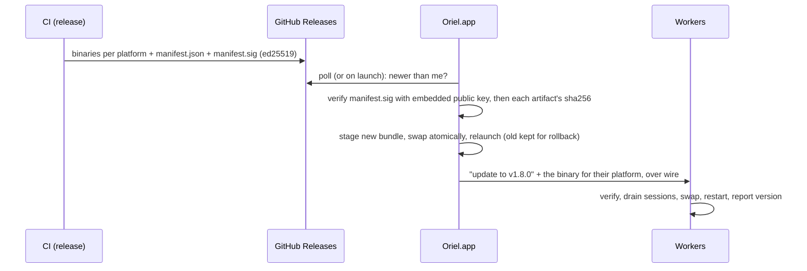

# Distribution and updates

Install from a DMG once, then Oriel keeps itself and every worker up to date.
Facts about macOS signing below are from general knowledge; the spike verifies them on a real Mac.

## macOS: what actually blocks an update

| Mechanism | What it checks | Triggered by |
|---|---|---|
| **Gatekeeper** | signed by a Developer ID *and* notarized | files carrying the `com.apple.quarantine` xattr (browser downloads, AirDrop, Mail) |
| **Code signing (Apple Silicon)** | every binary must be at least ad-hoc signed | always (Go's linker ad-hoc signs darwin/arm64 builds by default) |
| **TCC privacy grants** (mic for dictation, Desktop/Documents access, accessibility) | the app's *designated requirement*, derived from its signature | every launch: a changed identity = re-prompt |
| **Keychain item ACLs** (where secrets live) | the same designated requirement | every secret read: a changed identity = "allow access?" prompt |

So yes: `xattr -dr com.apple.quarantine /Applications/Oriel.app` gets an unsigned/ad-hoc app past Gatekeeper, and
**self-updates don't need it at all**: a file Oriel downloads itself over HTTP isn't quarantined (only apps that opt in to
quarantine, like browsers, tag their downloads). Gatekeeper is not the problem for updates.

**The real problem is identity.** An ad-hoc signature is a hash of that exact build, so every update looks like a new app
to TCC and the keychain: re-approve the mic, re-allow every secret. Avoiding that needs a **stable signing identity**.

## Options

| | First install | Updates | TCC / keychain prompts | Cost |
|---|---|---|---|---|
| **A. Developer ID + notarization** | double-click DMG, no warnings | silent | none — identity is your Team ID, stable forever | Apple Developer Program ($99/yr); CI on a macOS runner with `codesign`, `notarytool`, `stapler` |
| **B. Self-signed certificate** (your own code-signing cert, private key in CI secrets) | `xattr -dr com.apple.quarantine` once (or right-click → Open) | silent | none — the designated requirement pins your cert, which never changes | free |
| C. Ad-hoc only | `xattr` once | silent | **re-prompted after every update** (mic, folders, every keychain secret) | free |

**Decided: B, self-signed, with no planned switch.** It's enough for you, your team and anyone happy to run one command.
A becomes worth $99/yr only if a public release targets people who won't:
- B gives the flow you described: install the DMG once, run `xattr` once, then silent self-updates with no re-prompts.
- What B can't avoid, for other people:
  - A **first-launch block** on every fresh install: "Apple could not verify…". On recent macOS the right-click → Open
    bypass is gone, so it's System Settings → Privacy & Security → Open Anyway, or the `xattr` command.
  - **Managed or corporate Macs** may refuse unnotarised apps outright, through MDM policy.
  - **No notarisation**, so there's no Apple malware scan to point people at. That's fine for your own builds.
  - Package managers may be stricter about unsigned apps (I believe Homebrew has been tightening this for casks; check before relying on a cask).
- An install script (`curl … | sh` that downloads, copies to /Applications and runs the `xattr`) removes most of the friction for technical users.
- If that ever matters, switching is only a change to the CI signing step. The updater and ed25519 verification don't change.
  The one-time cost: TCC and keychain grants are re-asked once, when the identity changes.

## The updater (`update` module)

- **Integrity doesn't rely on Apple at all**: CI signs a release manifest (versions, platforms, sha256s) with an **ed25519**
  key (`crypto/ed25519`, stdlib). The app and the workers embed the public key and refuse anything that doesn't verify. That
  works the same on Linux, and protects against a compromised download path, not just macOS policy.
- **Private repo**: the app fetches releases with your GitHub token (keychain, via the existing `gh` login).
  **Workers never need GitHub access** — the app downloads each worker's platform binary once and **streams it to them over
  the existing wire connection** (pinned TLS). Workers that *can* reach GitHub may pull directly instead; both verify the same signature.
- **Swap**: macOS replaces the `.app` bundle (stage in `~/Library/Application Support/Oriel/updates`, `rename` into place,
  relaunch); Linux/workers replace the binary and re-exec. The previous version is kept; a failed health check after
  restart rolls back automatically.
- **Workers drain first** (crit's drain): no new turns start, running ones finish or pause, sessions resume after restart.
  Agents run in PTYs/sandboxes that survive a worker restart where possible; others resume by session id.
- **Version skew**: app ↔ worker protocol is versioned; a worker too old for the app is updated before it's used, a newer
  worker than the app is fine within one minor version.
- **Channels**: `stable` and `nightly`; settings → updates: automatic / ask / manual. `oriel update` on the CLI, and the HUD
  shows "update ready · restart" when one is staged.
- **Release notes** appear in the update card, rendered from the release markdown.

## Linux

- Release artifacts: a static binary (tar.gz) per arch, plus an AppImage for the desktop app later. Same updater, same
  ed25519 verification; no OS signing needed.

## CI pieces

- Build matrix: darwin/arm64, darwin/amd64 (universal binary via `lipo`), linux/amd64, linux/arm64.
- macOS job: `codesign --options runtime` with the self-signed (B) or Developer ID (A) identity → DMG (`hdiutil`) →
  (A only) `notarytool submit --wait` + `stapler staple`.
- Manifest signing key lives only in CI secrets; rotation = ship a release signed by the old key that embeds the new one.
