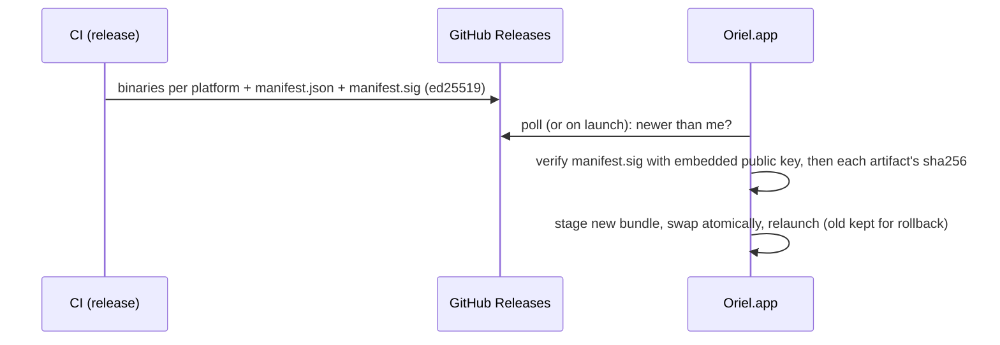

# Distribution and updates

Install from a DMG once, then Oriel keeps itself up to date.
Facts about macOS signing below are from general knowledge; the spike verifies them on a real Mac.

## macOS: what actually blocks an update

| Mechanism | What it checks | Triggered by |
|---|---|---|
| **Gatekeeper** | signed by a Developer ID *and* notarized | files carrying the `com.apple.quarantine` xattr (browser downloads, AirDrop, Mail) |
| **Code signing (Apple Silicon)** | every binary must be at least ad-hoc signed | always (Go's linker ad-hoc signs darwin/arm64 builds by default) |
| **TCC privacy grants** (mic for dictation, Desktop/Documents access, accessibility) | the app's *designated requirement*, derived from its signature | every launch: a changed identity = re-prompt |
| **Keychain item ACLs** (where secrets live) | the same designated requirement | every secret read: a changed identity = "allow access?" prompt |

So yes: `xattr -dr com.apple.quarantine /Applications/Oriel.app` gets an unsigned/ad-hoc app past Gatekeeper, and
**self-updates don't need it at all**: a file Oriel downloads itself over HTTP isn't quarantined (only apps that opt in to
quarantine, like browsers, tag their downloads). Gatekeeper is not the problem for updates.

**The real problem is identity.** An ad-hoc signature is a hash of that exact build, so every update looks like a new app
to TCC and the keychain: re-approve the mic, re-allow every secret. Avoiding that needs a **stable signing identity**.

## Options

| | First install | Updates | TCC / keychain prompts | Cost |
|---|---|---|---|---|
| **A. Developer ID + notarization** | double-click DMG, no warnings | silent | none — identity is your Team ID, stable forever | Apple Developer Program ($99/yr); CI on a macOS runner with `codesign`, `notarytool`, `stapler` |
| **B. Self-signed certificate** (your own code-signing cert, private key in CI secrets) | `xattr -dr com.apple.quarantine` once (or right-click → Open) | silent | none — the designated requirement pins your cert, which never changes | free |
| C. Ad-hoc only | `xattr` once | silent | **re-prompted after every update** (mic, folders, every keychain secret) | free |

**Decided: B, self-signed, with no planned switch.** It's enough for you, your team and anyone happy to run one command.
A becomes worth $99/yr only if a public release targets people who won't:
- B gives the flow you described: install the DMG once, run `xattr` once, then silent self-updates with no re-prompts.
- What B can't avoid, for other people:
  - A **first-launch block** on every fresh install: "Apple could not verify…". On recent macOS the right-click → Open
    bypass is gone, so it's System Settings → Privacy & Security → Open Anyway, or the `xattr` command.
  - **Managed or corporate Macs** may refuse unnotarised apps outright, through MDM policy.
  - **No notarisation**, so there's no Apple malware scan to point people at. That's fine for your own builds.
  - Package managers may be stricter about unsigned apps (I believe Homebrew has been tightening this for casks; check before relying on a cask).
- An install script (`curl … | sh` that downloads, copies to /Applications and runs the `xattr`) removes most of the friction for technical users.
- If that ever matters, switching is only a change to the CI signing step. The updater and ed25519 verification don't change.
  The one-time cost: TCC and keychain grants are re-asked once, when the identity changes.

## The updater (`update` module)

- **Integrity doesn't rely on Apple at all**: CI signs a release manifest (versions, platforms, sha256s) with an **ed25519**
  key (`crypto/ed25519`, stdlib). The app embeds the public key and refuse anything that doesn't verify. That
  works the same on Linux, and protects against a compromised download path, not just macOS policy.
- **Private repo**: the app fetches releases with your GitHub token (keychain, via the existing `gh` login).
- **Swap**: macOS replaces the `.app` bundle (stage in `~/Library/Application Support/Oriel/updates`, `rename` into place,
  relaunch); Linux replaces the binary and re-execs. The previous version is kept; a failed health check after
  restart rolls back automatically.
- **Quit drains first** (`sessions.md`, Quitting hands over): turns finish or are cut short at 60s, the agents hand
  over, and the relaunched copy resumes them by session id.
- **No version skew**: the session host is in the app's process, so it's always the app's own build.
- **Channels**: `stable` and `nightly`; settings → updates: automatic / ask / manual. `oriel update` on the CLI, and the HUD
  shows "update ready · restart" when one is staged.
- **Release notes** appear in the update card, rendered from the release markdown.

- As built (PL-6): `update` has the pieces, tested with real `go build`s of `update/internal/testapp` and a test
  key, never GitHub:
  - `Manifest` / `Release` (the manifest's exact bytes and their signature); `Sign`, `Release.Verify(keys)`. The
    trusted keys come from `update.Keys()`, linked in by CI with `-X github.com/liamg/oriel/update.releaseKeys=<hex>`
    (comma-separated during a rotation). A build with no key refuses every update.
  - Artifacts are `binary` (Linux) or `bundle` (the macOS `.app` as a `.tar.gz` of paths relative to the
    bundle; no path or link may leave it).
  - `Installer{Target, Exe, Dir}`: `Stage` checks the size and sha256 against the manifest, unpacks a bundle, then
    runs `<exe> version` and refuses it unless it prints the manifest's version (crit's verify-before-swap). `Swap`
    moves it beside Target and renames it in; the old copy is kept beside Target as `.<name>.prev` (the same
    filesystem, so swap and rollback are each a rename). The swap is recorded as pending in `Dir`.
  - `Boot(ctx, health)` runs first on every start: a pending swap gets one start to pass `health`. A failure, or an
    earlier start that never reported (a crash, a hang), puts the previous version back, records why
    (`Installer.Last`), and the caller re-execs onto it (`update.Reexec`, unix).
  - The app finds releases through a `Source`: `GitHub` (the releases API with a token; a pre-release counts only on
    `nightly`) or `Dir`. `Cache` keeps each verified download. `Check` is "newer than me?".
  - The app (`app/update.go`, `Config.Updates`): an `update.Updater` (the `GitHub` source with the token from `gh auth
    token`, `update.Keys()`, an `Installer` on the `.app` bundle or the binary, staged in the state directory's
    `updates/`). It checks 30 s after start and hourly on `updates.channel`, unless `updates.mode` is manual. Ask
    (the default) offers a release in a notice (What's new, Update); automatic installs it. Installing swaps
    this copy in; it runs after a restart.
  - The update card (`app.overlay.update`, `:UpdateCheck` or `update.notes`): the version, the one you have, the
    channel, and the release notes as markdown, with Later and Update, then Restart.
  - "update ready · restart" is the indicator `update` (SH-8's `registry.Indicator`) in the `statusline.right` slot,
    shown once an update is installed and while one installs. Clicking it, Restart on the card or in the notice, or
    `update.restart` quits (the drain and hand-over), lets `~/.oriel/oriel.lock` go, and relaunches the installed copy
    once the window has closed (`open -n` for a bundle); the new copy resumes the handed-over agents.
  - The app runs `Boot` as it starts: the health check is the window opening (`Config.Started`) within two minutes.
    A failure, or a start before that crashed, rolls back and re-execs onto the previous copy.
  - `oriel update [--check] [--channel nightly] [--from DIR]` checks and installs without the app.
  - A custom build (`oriel build --with`, native plugins linked in) has no updater either: a release would drop its
    plugins, so it's rebuilt instead.
  - A build with no release key (any build CI didn't make) has no updater: the app doesn't check and `oriel update`
    says so. `Boot` still runs, for a swap made before.

## Linux

- Release artifacts: a static binary (tar.gz) per arch, plus an AppImage for the desktop app later. Same updater, same
  ed25519 verification; no OS signing needed.

## CI pieces

- Build matrix: darwin/arm64, darwin/amd64 (universal binary via `lipo`), linux/amd64, linux/arm64.
- macOS job: `codesign --options runtime` with the self-signed (B) or Developer ID (A) identity → DMG (`hdiutil`) →
  (A only) `notarytool submit --wait` + `stapler staple`.
- Manifest signing key lives only in CI secrets; rotation = ship a release signed by the old key that embeds the new one.
