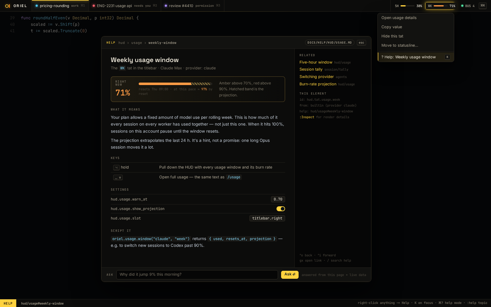

# Help: everywhere, invisible until you ask

Every element in Oriel can explain itself: tabs, indicators, gutter marks, badges, menu items, panels,
statusline segments, status colours. You never see help until you ask for it, and then it's one gesture away.



## Asking

- **Right-click anything → Help: \<name\>**, always the last item in every context menu.
- **`K`** on the focused element, as vim's `K` looks up the keyword under the cursor. **F1** does the same.
- **Help mode** (`⌘?`): every element with help gets a faint `?` marker. Hover for a one-line tooltip, click for the full page, `esc` to leave.
- **`:help topic`** and the `␣h` picker search all of it: Oriel's pages and plugins'. Vim's own `:help` isn't
  included (decided in P3): vim's reference is online, and Oriel doesn't ship its docs.
- **Which-key** (`ui.md` 02c) and the keymaps picker link each mapping to its help page.

## What a help page shows

- **What it is** and **what it means**, written for someone seeing it for the first time.
- **Right now**: the element's live value and what it implies. A usage indicator shows its burn-rate projection.
  A red session dot says *why* it's red ("replied 4m ago, awaiting you"). A gutter diamond says how many agent lines are unread.
- **Keys** that act on it, **settings** that change it (editable in place), and **how to script it** (`oriel.*`).
- **Related** pages, and the element's own id and source (which plugin drew it), with `:Inspect` one step away.
- **Ask**: a question box answered from the page plus live data (by the session's agent fork, or the utility session).
- `⌃o` / `⌃i` move back and forward through help, the same as the jumplist.

## Written in markdown

Help pages are plain markdown in the repo, rendered with the same renderer as plan docs and requests
(mermaid diagrams included):

```markdown
---
id: hud/usage
covers: [hud.indicator.usage.*, hud.panel.usage]   # element ids this page explains
---

# Usage windows

## Weekly usage window {#weekly-window}

{{live "usage.week"}}                          <!-- the "Right now" block, live data -->

Your plan allows a fixed amount of model use per rolling week…

{{keys "usage.*"}}                             <!-- generated from the keymap registry -->
{{options "hud.usage"}}                        <!-- generated from the option registry, editable -->
{{api "oriel.usage.window"}}                     <!-- generated from the Go API declarations -->
```

- **Generated sections can't drift**: key tables, option lists and API signatures come from the same
  registries the app runs on. Rename a command and its help updates with it.
- Pages live in `app/help/pages/**.md`, embedded in the binary, and work offline.
- Plugins ship their own pages (a `help` contribution point: `Registry.HelpPages(HelpSource{FS})`, and
  `Registry.HelpLive(name, fn)` for a `{{live}}` block). Your own config can add pages under
  `~/.config/oriel/help/`; a page with the same id as Oriel's replaces it.
- **Prose is user-editable**: `:help edit` opens the page's markdown, and a local override sits beside it, like themes.

## Making sure it really is everywhere

- **Every interactive element needs a help id.** In the `ui` toolkit, `ui.Ctx.ID` takes an optional `Help("hud/usage#weekly-window")`.
  Help mode and right-click read it from the widget tree, so plugin views get it for free.
- **CI lint**: render the fixture workspace with the headless backend, walk every interactive node, and fail if one has
  no help id or its id doesn't resolve to a page and anchor. The same applies to plugins in our repo.
- **Doctests**: Lua and shell snippets in help pages run in CI. Key and option references are checked against the registries.
- **Coverage report**: elements by help coverage, so gaps are visible.

## Built so far (SH-10)

- Right-click anything with help and no menu of its own: a menu with **Help** (widgets with menus add it last,
  claiming the click). `F1` everywhere, and `K` in the widgets' own key modes (not in inputs, or the editor, where
  `K` is vim's). `⌘?` toggles help mode. `:help topic` matches ids, anchors and titles; `␣h` is the picker.
- `{{keys "glob"}}` lists the keymaps whose command matches, `{{options "prefix"}}` the options and their values,
  `{{live "name"}}` a registered block. `{{api}}` waits for the generated Lua API (PL-1), and the **Ask** box for the
  agents (P5). Vim's own `:help` entries aren't shipped (decided in P3).
- The lint (`TestHelpLint`) walks the omnibox, a picker, toasts and the log, a help page and help mode.

## Go interfaces

```go
// package help
type Page struct {
    ID     string            // "hud/usage"
    Covers []string          // element id globs
    Body   markdown.Doc      // parsed once; {{live}} blocks bound at render time
}

type Live interface {        // registered by whoever owns the data
    Name() string            // "usage.week"
    Render(ctx ui.Ctx)       // the "Right now" block
}

type Index interface {
    For(elementID string) (Page, Anchor, bool)
    Search(q string) []Hit   // feeds :help and the ␣h picker
}
```
