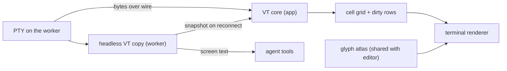

# IDE features: LSP, debugging, terminals, search

The "professional IDE" half. Everything here works without an agent.

## LSP (`lsp` module)

- Full client for LSP 3.17, beyond crit's hover and go-to-definition:
  - Completion with resolve, snippets and fuzzy filtering; signature help; hover.
  - Definition, declaration, type definition, implementation, references (peek inline).
  - Diagnostics (push and pull), code actions with quick-fix lightbulbs, and rename (with a preview diff).
  - Formatting (on save, range, as you type), inlay hints, semantic tokens layered over tree-sitter.
  - Call and type hierarchy, workspace symbols (in the omnibox), document symbols (outline).
  - Code lens (run test, references count), folding ranges, selection ranges, linked editing.
- Server registry: language → command, init options, root markers. Built in:
  gopls, typescript-language-server or vtsls, pyright or basedpyright,
  rust-analyzer, clangd, lua-language-server, yaml/json-ls, bash-ls, terraform-ls.
- Servers run on the worker (inside the sandbox if there is one), with the
  project toolchain from mise. Unknown languages degrade to tree-sitter only.
- **Agent access**: the agent gets read-only LSP tools through MCP
  (`definition`, `references`, `diagnostics`, `hover`). Fewer grep-and-guess
  edits, more precise ones.

### As built (LS-1/LS-2 core)

The UI-free half: the module, its registry contribution and tests. The editor's half is "As built (LS-1/LS-2 UI)"
below.

- **No go-lsp.** owenrumney/go-lsp would be a tier-C dependency, so the module has its own: `lsp/jsonrpc` (JSON-RPC
  2.0 with Content-Length framing; `$/cancelRequest` when a call's ctx ends; handlers run one at a time, in order,
  off the read loop), `lsp/protocol` (the 3.17 messages used, as JSON-tagged structs; unions decode by shape) and
  `lsp/snippet` (snippet syntax to plain text and tab stops, with variables and transforms).
- **Oriel's positions.** Every `lsp` type uses `text.Pos` (0-based line, byte column) and `lsp.Range`; the client
  offers `utf-8` then `utf-16`, takes what the server picks (`utf-32` too) and converts with `text.Snapshot`,
  reading files that aren't open from disk (`Options.ReadFile`). Out-of-range positions clamp to the line or text.
- **`lsp.Client`** is a struct, not the interface sketched under "Go interfaces": one running server for one root.
  `Start(ctx, spec, root, Options)` launches and initializes it (`Options.Launch`, default `Exec`; a `Process` is
  stdio plus `Wait` and `Kill`, so the worker or a sandbox can supply its own). Documents: `DidOpen`,
  `DidChange(path, text.Change)` (incremental when the server takes it: one replace, or several in either order;
  otherwise, or when a change doesn't follow the last one sent, the whole text; an older change is dropped),
  `DidSave`, `DidClose`. Requests: `Complete`/`ResolveCompletion`, `Hover`, `SignatureHelp`, `Definition`,
  `Declaration`, `TypeDefinition`, `Implementation`, `References`, `PullDiagnostics`, `CodeActions`/`ResolveAction`,
  `ExecuteCommand`, `InlayHints`, `PrepareRename`/`Rename`, `DocumentSymbols`, `WorkspaceSymbols`,
  `PrepareCallHierarchy`/`IncomingCalls`/`OutgoingCalls`, `Format`/`FormatRange`, `SemanticTokens` (decoded with
  the legend into ranges and type names), `FoldingRanges`, `SelectionRanges`, `CodeLenses`/`ResolveCodeLens`. A
  feature the server didn't advertise returns `ErrNotSupported` without asking it. `EditFor` turns a server's edits
  into a `text.Edit`.
- **Pushed state goes through callbacks**, not the `Diagnostics()` channel: `Options.OnDiagnostics(DiagnosticSet)`
  (a file's whole set, byte columns, severity, source, code, tags, related places; empty clears),
  `OnStatus(Status)` (`Starting`, `Ready`, `Busy` while `$/progress` work is open, with its title, message and
  percent, `Stopped`, `Crashed` with `Err`), `OnApplyEdit` (`workspace/applyEdit`; refused when nil),
  `OnMessage`, `OnLog` (default: the stderr writer) and `OnRefresh`. They run on the client's goroutine in the order
  the server sent them. `Client.Diagnostics(path)` and `Client.Status()` read the latest. Server requests are
  answered: `workspace/configuration` from the spec's `Settings` by dotted section (`null` where there's none),
  registrations kept, progress tokens accepted, `window/showDocument` declined.
- **Lifecycle.** `Done()` closes when the process exits; without `Shutdown` that's `Crashed`. The app gives each
  server's stderr as an `io.Writer`, a `logs.Lines` whose logger has the source `lsp:<name>`.
- **`lsp.Manager`** routes by language and root: `SpecFor` takes the lowest `Order` spec that serves the language
  and is installed (`Installed` looks the command up on PATH), `ServerSpec.FindRoot` tries each root marker in turn
  from the file upwards (so `go.work` beats a nearer `go.mod`) and falls back to the file's directory. One client per
  (server, root); `Open` starts it (bounded by `StartTimeout`), and a crashed one is started again on the next
  `Open` or `Restart`, with the documents that were open as they are now. `Change`, `Save`, `Close`, `Client(path)`,
  `Clients`, `Statuses`, `Shutdown`.
- **`ServerSpec`** gained `Name` (the diagnostics' owner and log source), `Settings`, `Order` and `Source`. It's
  registered as `registry.LSPServer` (kind `lsp.server`, `registry.LSPServers(r)` by order then name), a copy of its
  fields so either converts to the other: `lsp` can't import the registry, which imports `ui`. `lsp.Builtins()` are
  the servers above; vtsls and basedpyright have order 1, so typescript-language-server and pyright win when both
  are installed. gopls's built-in settings turn on semantic tokens and parameter, assignment and composite-literal
  hints; typescript-language-server's turn on its inlay hints.
- **Tests.** `spec/lsp` vendors the 3.17 pages the tests quote; `refcheck` matches LSP headings by their
  `<a name="…">` anchor. `lsp/lsptest` records a session through a proxy (`Recorder.Launcher`; JSON lines, the root
  written as `${root}`, log and telemetry left out) and replays it from a fake server (`Fake`) that answers in the
  recorded order once the client has sent each recorded message (method and params, ids and `processId` aside).
  `TestSession` runs one script (open, seeded diagnostic, typed completion and resolve, hover, signature help,
  code actions, inlay hints, definition, references, prepare and rename, document and workspace symbols, call
  hierarchy, formatting, folding, semantic tokens, shutdown) on Go, TypeScript and Python fixtures and checks what
  the UI would show. Recorded with gopls v0.20.0, typescript-language-server 5.3.0 with TypeScript 6.0.3, and
  pyright 1.1.413 (Node 22.12.0). `ORIEL_LSP_LIVE=1` runs it against the installed servers; `go test ./lsp -run
  TestSession -record` re-records.
- Not yet: the editor wiring and the status-line segment, the Lua binding for `lsp.server`, running servers on
  the worker, type hierarchy, linked editing, document highlights, `workspace/didChangeWatchedFiles`, workspace
  diagnostics and semantic token deltas.


### As built (LS-1/LS-2 UI)

- `app/lsp*.go`, a built-in like any plugin: it registers the built-in servers as `registry.LSPServer`s, runs an
  `lsp.Manager` over whatever the registry holds, opens a buffer on its server the first time a pane draws it
  (decorations are asked for every visible buffer), feeds it the buffer's changes and saves, puts diagnostics in the
  registry (owner: the server), its stderr in the log as `lsp:<name>`, and its state in the status line.
- `registry.LSPServer.Connect` (and `lsp.ServerSpec.Connect`) reaches a server some other way than running its
  command: in process, over a socket. Tests plug a recorded transcript in this way, through `lsptest.Responder`, which
  answers in any order, as an editor asks; `lsptest.Fake` still checks the exact session.
- Popups (completion with the highlighted item's resolved docs, signature help, the `K` card, the code actions
  menu, the rename prompt) are an overlay view at the cursor. Their keys are `registry.KeyLayer`s: a mode laid over
  the others while active, so `⌃n` and `⏎` are the menu's only while it's open, and insert-mode maps still apply.
- Inlay hints are a new decoration kind, `registry.Inlay`: text drawn inline before a column, the code after it shifted
  on the grid (the cursor, selections and spans too).
- Keys follow nvim 0.11's defaults: `K`, `grr`, `grn`, `gra`, `gri`, `gO`, plus `gd`, `gD`, `gy`, `␣ca`, `␣rn`, `␣ci`,
  `␣co` and `⌃␣` in insert mode. Without a server, `K`, `gd` and `gD` are vim's.
- `grr` peeks inline (a block under the line: the list by file, the highlighted reference's code); rename shows a
  diff of every file before it changes anything, through the same preview as project search's replace.
- The symbols pickers (`␣s`, `gO`, `␣S`, the omnibox's) ask the server, falling back to the tree-sitter outline;
  `␣ci`/`␣co` list callers and callees in a picker.
- Not yet: semantic tokens over tree-sitter, code lenses, formatting on save, lightbulbs, and LSP folding and selection
  ranges in the editor; the agent group in code actions comes with the agent (TR-6).
## Debugging (`dap` module)

- A DAP client and an adapter registry: delve (Go), debugpy (Python),
  js-debug (Node and browser), codelldb (Rust, C/C++).
- Launch configs live in `.oriel/debug.toml`, with sensible defaults inferred:
  "debug this test" from a code lens, "debug main", or "attach to pid".
- UI: gutter breakpoints (conditional, logpoints, hit counts), current-frame
  arrow, inline values, call stack, variables tree, watch, REPL console, and
  exception breakpoints.
- Vim-native: `<leader>db` toggles a breakpoint, `]f`/`[f` move frames, `:Dc` continues.
- **AI-first**: the agent gets debugger tools through MCP (`set_breakpoint`,
  `continue`, `stack`, `eval`). You can ask "why is this -25" on a paused frame,
  and the agent inspects it live instead of guessing from source.
  It asks permission like any other tool.


## Running tests


- **▶ in the gutter on every test**: test functions, subtests (`t.Run("…")`), and **rows of table-driven tests** where
  the name can be worked out statically. After a run each one shows ✓, ✕ or ◌ (flaky) with its duration, as virtual text on the line.
- **Run scopes**: nearest (`␣tt`), file (`␣tf`), last (`␣tl`), failed only (`⟳`), package, whole project. **Watch mode** re-runs
  the tests affected by a save (Go: the packages that import the changed one; JS: vitest's related-files graph).
- **Failures appear inline** under the failing assertion: want and got side by side with an intraline diff, the test's own output,
  and four actions:
  - **jump to assertion**;
  - **debug this case** (DAP, breakpoint at the assertion);
  - **ask the agent to explain**: why it fails, from the failure, the test and the code under test. A tool-less fork that
    changes nothing, shown as an explain card under the failure (as in `ui.md` 07b);
  - **ask the agent to fix** (opens a request with the failure attached).
- **Explain sits next to fix everywhere.** Wherever Oriel offers "ask the agent to fix" (test failures, diagnostics and
  code actions, CI failures on the Ship page, merge conflicts, a red terminal command), it also offers **ask to explain**,
  so understanding is always one click away and never requires handing over the keyboard.
- **Tests panel**: a tree by package, file, test and case; filters (failed, slowest); recent-pass history sparklines and
  **flaky detection** (fails sometimes, passes on re-run); output per case, per run, or raw JSON.
- **Coverage**: `⌥▶` runs with coverage, and covered or uncovered lines show in the gutter (Go `-coverprofile`, pytest-cov,
  vitest/istanbul, cargo llvm-cov when installed).
- **The agent's runs land in the same panel**, marked as the agent's, and they're the **evidence** that "tests pass" claims link to
  (`agents.md`). The HUD tat shows `TESTS 13 ✓ 1 ✕` for the session.
- **Runs happen on the worker, in the session sandbox**, with the project's mise toolchain, so they behave exactly like CI.

| Language | Discovery | Runner and result stream |
|---|---|---|
| Go | tree-sitter `tests.scm` (`func TestX`, `t.Run("…")`, table rows) + gopls code lenses | `go test -json` (test2json events), `-run '^TestX$/^case$'` |
| Python | `def test_*`, classes, `@pytest.mark.parametrize` ids | pytest with a **small bundled reporter plugin** (one file, no dependencies) that writes JSON lines |
| TS/JS | `describe`/`it`/`test`, `.each` tables | vitest `--reporter=json`, jest `--json` (detected from package.json) |
| Rust | `#[test]`, `#[tokio::test]` | `cargo nextest --message-format libtest-json` if installed, otherwise parse `cargo test` output |
| others | via plugins | the `testrun.Adapter` interface |

```go
// package testrun
type Adapter interface {
    Name() string
    Detect(ws Workspace) bool                                 // go.mod, pyproject, package.json, Cargo.toml…
    Discover(src Source) []Item                               // gutter ▶ positions; cheap, runs on every edit
    Command(ws Workspace, items []Item, mode Mode) (Cmd, error) // ModeRun | ModeDebug | ModeCoverage | ModeWatch
    Parse(r io.Reader, emit func(Event)) error                // streaming: Started, Output, Passed, Failed{Want,Got,Loc}, Skipped, BuildFailed
}
```

- Testing is covered by `testing.md`: each adapter is checked against recorded runner output for every case (pass, fail,
  panic, timeout, skip, nested, parallel).

### As built (TR core)

The UI-free core of TR-1, TR-3 and TR-4 is in `testrun` (it imports only `text` and `syntax`). The gutter, inline
results, failure block and tests panel are still to build on it.

- **Discovery.** `Adapter.Discover(Source{Path, Text, Syntax})`. `Syntax` is the buffer's `*syntax.Document`, and the
  adapter runs the language's `tests.scm` on it with the general `Document.Query(kind)` (a plain snapshot is parsed on
  a pooled parser instead). `Set.Discover(ws, src)` picks the workspace's adapter. Items carry `Package` and `Name`
  (`Item.Key()` matches events and history), `Path` (the name's parts), `File`, the 0-based `Line` of the name, and a
  `Kind`: test, subtest, row, suite, package or file.
  - Go: `func TestXxx(*testing.T)`, static `t.Run("…")`, and table rows: a slice or map composite literal ranged over
    by a loop that calls `t.Run(tc.<field>, …)` or `t.Run(<map key>, …)`, keyed or positional. Names are rewritten as
    go test does (spaces to underscores, unprintables escaped, `#NN` for repeats), checked against a real run.
    Subtests inside a table row's closure aren't listed.
  - pytest: `test*` functions and methods of `Test*` classes without `__init__` (nested classes too), and
    `@pytest.mark.parametrize` ids for literal values, `ids=[…]` and `pytest.param(…, id=…)`, stacked decorators
    included; checked against `pytest --collect-only`. unittest classes aren't listed.
  - vitest/jest: `describe`/`it`/`test` (with `.skip`/`.only`/`.concurrent`…) and `.each([…])` tables with printf
    placeholders and `$name` (vitest formats `$name` with chai, jest with pretty-format, so the adapters differ there);
    tagged-template tables aren't listed. A test's `Package` is its file's absolute path, as the reports name it.
  - Rust: functions with `#[test]`, `#[tokio::test]` or any `…::test` attribute, named by module path; `Package` is
    the target (`lib`, `test/<name>`, `bin/<name>`).
- **Running.** `Start(ctx, Request{Adapter, Workspace, Items, Mode, Trigger, By, Change, Timeout}, emit)` returns an
  `Exec` (`Cancel`, `Done`, `Wait() (*Run, error)`); events stream to `emit` and fold into the `Run`. The process runs in
  its own process group, killed on cancel or timeout; tests still running when a timeout fires fail with
  `ReasonTimeout`. `Cmd.Files` are written to a fresh run directory (`${ORIEL_TESTRUN_DIR}`), which is how the
  pytest plugin and coverage files travel. Relative failure locations are made absolute.
  - Go: `go test -json [-run '^A$/^b$'] pkgs…` with each level regex-quoted; several items are cut to the shallowest
    depth so none loses subtests (a superset runs). `Go.Flags` adds flags.
  - pytest: `python -m pytest -p oriel_pytest`, the plugin (`testrun/pytest/oriel_pytest.py`, embedded) writing
    `@@oriel-event {json}` lines to the stdout pytest started with; node ids are passed as absolute paths.
  - vitest `run --reporter=json -t <pattern>`, jest `--json --testLocationInResults --testNamePattern … --runTestsByPath`.
    Both print one report at the end, so their events arrive together; vitest's JSON has no test output.
  - Rust: `cargo nextest run --message-format libtest-json-plus` (the `-plus` form names each suite's target) with
    `NEXTEST_EXPERIMENTAL_LIBTEST_JSON=1` and an `-E` filterset when nextest is installed, otherwise `cargo test` with
    stderr merged (`Cmd.Stderr`) for its "Running …" lines.
  - Debug: Go returns `dlv test`, pytest `debugpy`; DB-2 wires them to DAP. The others return `ErrUnsupported`.
- **Events.** `Started`, `Output` (a raw line), `Passed`, `Failed{Failure{Reason, Message, Want, Got, Loc}}`, `Skipped`
  (with the reason), `BuildFailed`, each with `Elapsed`; an empty `Test` is the package's own. Reasons: assert, panic,
  timeout, build, error (pytest setup or teardown). Want and got are best effort from Go's `got X, want Y` shapes,
  testify, pytest's `assert a == b`, chai and jest's expected/received, and Rust's left/right.
- **History (TR-3).** `Run` has its id, trigger, scope, `By` (user, agent, watch), `Change` (a fingerprint of the code
  run), start and end, results per test with durations and output, package results, the raw output and coverage;
  `Failed()`, `Slowest(n)`, `Counts()`. `History` keeps the last N runs and N outcomes per test, saved and loaded as
  JSON: `Entries(key)` (the sparkline), `Flaky(key)` (failed then passed with the same `Change`, or pass and fail
  alternating more than once in the last N), `FlakyTests`, `Failing`, `Slowest`, `Run(id)` and `Last(by)`.
- **Watch (TR-4).** `Set.Affected(ws, file)` asks each adapter that implements `Watcher`; the items run with
  `ModeWatch`. Go: the file's package and every package in the module that imports it, directly or through others,
  from code or tests (`go list -e -json ./...`, cached until go.mod or go.work changes or an unknown directory shows
  up). vitest: `vitest related <file> --run`; jest `--findRelatedTests`. pytest: the test file itself; for
  `conftest.py` its directory; else test files that import the module by dotted name, failing that by its bare name.
  cargo: the crate.
- **Coverage.** `ModeCoverage` runs with Go's `-coverprofile`, pytest-cov's JSON (`--cov=<root>`), istanbul JSON from
  vitest (with `--coverage.reportOnFailure`) and jest, and `cargo llvm-cov --json --ignore-run-fail`. Each becomes one
  `Coverage`: per file, 0-based line → hits, with `Ranges(file)` of covered and uncovered lines and `Percent`. The pytest
  and llvm-cov results agree with those tools' own line summaries.
- **Plugins.** `Set.Register(a)`, or a `testrun.Contribution` of kind `testrun.adapter` (`plugins.md`).
- **Deviations from the sketch above**: `Command` takes the workspace and `Parse` returns an error; modes are prefixed
  (`ModeRun`…) because `Run` and `Coverage` are the model's types; `Discover` takes a `Source` so it can use the
  buffer's syntax document rather than parse again.


### As built (TR-1..TR-4 UI)

- `app/tests*.go`, a built-in: adapters come from `testrun.Builtin()` plus `testrun.adapter` contributions. A
  decoration provider puts `▶` signs (decorations can now run a command when clicked: `Decoration.Command`) on every
  discovered item and the latest result after it; a failure is a block at its assertion's line (TR-2) with want/got
  (the differing middle marked), output and four actions.
- Explain and fix go through extension points so they work the moment the agent exists: explain asks the first
  `registry.Explainer` (it answers text only, so explaining can't change a file), fix runs `request.new`, debug runs
  `debug.test` (DB-2); each is dimmed while nothing provides it.
- Run scopes: `␣tt` nearest, `␣tf` file, `␣tp` package, `␣ta` all, `␣tF` failed, `␣tl` last, `]t` next failure; the
  file buttons over the editor are `registry.EditorAction`s. A run's `Change` is `testrun.Fingerprint` (paths, sizes,
  times), so flaky detection needs no git. History (20 runs) persists per work dir in the state directory.
- The Tests panel is the `tests` view (the rail's Tests lights up): a tree by package and test (subtests and rows
  under their test), all / failed / slowest, sparklines of recent runs, flaky marks, and output (case, run, raw JSON).
  The status line shows `TESTS n ✕ n ✓`, also offered as a `hud.tat` for the HUD (SH-8).
- Watch (TR-4) is a `BufWritePost` hook running `Set.Affected`; coverage (`␣tc`) marks covered and uncovered lines with
  gutter edges until toggled off.
- Not yet: running in the worker's sandbox (AI-1), the agent's runs as evidence (TR-5), debug (DB-2).
## Terminals

### How a terminal is rendered



**The VT core is Ghostty's** (decided). `libghostty-vt` parses escape codes into a cell grid, behind `term.Emulator`.

- It's compiled to WASM and run under wazero: the same core crit already ships in the browser (ghostty-web), and no cgo.
- That gets us the kitty keyboard and graphics protocols, grapheme clusters and synchronized output.
- WASM costs ~1.5–2× native, which is still far above what a PTY produces.
- The WASM is built in CI from a pinned Ghostty commit (`deps.md`). If wazero isn't approved, the same core links via cgo instead.

**Drawing** is done by our own renderer, not the VT core:

- Cells become glyph runs through the **same atlas as the editor**, so text looks identical in code and terminal.
- **Box-drawing, block and powerline glyphs are drawn procedurally** (as Ghostty and kitty do), so lines join
  pixel-perfectly at any size, with no font gaps.
- **Damage tracking per row**, and output coalesced to at most one redraw per vsync. `cat` of a huge
  file doesn't redraw for every chunk. Synchronized output (DEC 2026) is honoured, so TUIs don't tear.
- Ligatures are off by default in terminals, and can be turned on. Bold, italic, undercurl and colour
  underlines come from the theme's terminal palette (`theming.md`).
- Images: the kitty graphics protocol and sixel become textures. OSC 8 hyperlinks are clickable.
- Selection, search and terminal-normal mode run over the grid plus scrollback (a ring buffer, compressed beyond 10k lines).

**Where it runs**

- The PTY lives on the worker, next to the code and the sandbox.
- The **app runs the VT core** that renders, so typing and scrolling never wait on the network.
- The **worker keeps a headless VT copy** (like tmux or mosh). It does two jobs:
  - On reconnect or app restart it sends a screen snapshot, not the whole byte history.
  - The agent can **read terminal screens** through a tool. "Why did this fail?" works on the terminal
    you're looking at, and you can attach a selection of output to a request.

**IDE touches from shell integration** (OSC 133 / OSC 7):

- Prompt marks: `[[`/`]]` jump between commands. Each command gets a gutter dot for its exit status (green or red).
- "Copy last output", "Send last output to a request", and re-run in a new split.
- The terminal follows the shell's cwd, and the Explorer can follow the terminal.

**Budgets**: parse at least 200 MB/s, keypress-to-echo latency within the editor's 8 ms
(local PTY), and full-screen redraw under 2 ms.

### Panes and modes

- Panes are splittable, attach to session PTYs on the worker, and survive app restarts.
- Any placement: docked at the bottom like other editors, a split or tab in the main area, floating,
  drop-down, or zoomed full-window. The same layout model applies to every pane (`ui.md` 01d).
- Terminal-normal mode (`⌃\ ⌃N`) gives vim motions, search and yank over the scrollback.
- Claude's own PTY is just another terminal view. The agent console (`ui.md` 15) is the structured view of the same session.

## Explorer scopes

- **Changed** (branch vs merge-base, uncommitted included; opens diffs), **Uncommitted** (vs HEAD; staging),
  **All** (the whole tree, with git status, ± lines, agent-unread, thread and diagnostic markers).
- Backed by one `gitx.Status` model on the worker: it streams file states and line counts, and refreshes on fs-notify.
- See `ui.md` 01c.
- As built (FG-1): `gitx.Repo.Status` reads every scope in one go (`git status --porcelain=v2`, `git diff --numstat`
  against HEAD, the index and the merge-base with origin's default branch, else main or master); `gitx.Status` keeps
  it, tells watchers which paths changed, and runs in the app until the worker exists (AI-1). It refreshes every 2 s,
  after a write and after each git command, rather than on fs-notify: a watcher over x/sys (inotify, kqueue) comes
  with the worker. Fixture repos for tests are built with `gitx/gittest`.

## Navigation and search

- Omnibox `⌘K`: sessions, files, symbols, commands, tickets, PRs, jobs: one ranked list.
- Pickers (snacks/telescope-style): `␣␣` files, `␣/` live grep, `␣k` keymaps, `␣s` symbols, `␣'` resume. Same engine
  as the omnibox, one source at a time, with preview (`ui.md` 02b). Which-key hints after a prefix (`ui.md` 02c).
- Project search: ripgrep on the worker, results streamed into a quickfix panel, with replace-in-files preview.
- As built (FG-3): `worker/search` runs `rg --json -P` (PCRE2, streamed in batches) and the same matching in Go
  (`regex`) when rg isn't installed; tests hold the two to the same results. It runs in the app until the worker
  exists (AI-1). Generated and vendored files go to rg as an `--ignore-file`, unless the query starts `@all `. The
  Search view (the rail's Search, `⌘F`, `⌘⇧F`, `search.open {query}`) streams matches by file; a replacement
  previews per match, and Replace all… opens `search.replace`, a tab with every file's diff (`search.Plan`,
  PCRE2's `$n`), which writes nothing until Apply. Apply edits open buffers in the buffer (one undo step) and writes
  other files atomically, refusing one that changed since. The grep picker runs on the same engine.
- Jumplist and changelist across files and sessions (`ctrl-o` goes back to the other session you were in).
- Marks across sessions: `mA` on one worktree, `'A` from anywhere.

## Git

- Gutter hunks, stage and unstage a hunk (`<leader>hs`), inline blame with author kind (you, agent, other).
- As built (FG-2): hunks are `gitx.DiffLines` (Myers, no context, git's numbering) from the index's version to the
  buffer as it would be written (`DecorationCtx.FileBytes`, `vim.Pane.FileBytes`), so unsaved edits show. Staging
  writes the index blob directly (`hash-object` + `update-index`, keeping the mode); tests hold each hunk against `git
  apply --cached` with git's own patch. Keys: `␣hs` stage, `␣hu` unstage, `␣hr` reset (one undo step), `␣hp` preview
  (a block of the old lines), `]c`/`[c`, `␣hb` blame (`git.blame.inline`). Blame is `git blame --contents -` on the
  buffer; an author is an agent by name or email (claude, codex, anthropic, openai, copilot, `[bot]`) or a
  Co-Authored-By trailer naming one, and "you" by `user.email`. The Explorer's Uncommitted lists the selected file's
  staged and unstaged hunks, and `s` stages or unstages one.
- crit's Git and PR flow carried over: uncommitted → behind base → unpushed →
  PR → checks → merge, per project, cross-linked across projects.
- Conflict resolution as a 3-way merge view, with "ask the agent" on a conflict block.

## Go interfaces

```go
// package lsp
type ServerSpec struct {                           // registry entry, from a plugin or config
    Language []string
    Cmd      []string
    Roots    []string                              // go.mod, package.json, …
    Init     json.RawMessage
}

type Client interface {
    DidChange(doc DocID, s text.Snapshot, edits []text.Change)
    Complete(ctx context.Context, at Loc) ([]Completion, error)
    Hover(ctx context.Context, at Loc) (*Hover, error)
    Definition(ctx context.Context, at Loc) ([]Loc, error)
    References(ctx context.Context, at Loc) ([]Loc, error)
    CodeActions(ctx context.Context, r Range, diags []Diagnostic) ([]Action, error)
    Rename(ctx context.Context, at Loc, to string) (*WorkspaceEdit, error)
    Diagnostics() <-chan DiagnosticSet
}
```

```go
// package dap
type AdapterSpec struct {
    Type   string                                   // "go", "python", "node", "lldb"
    Launch func(cfg LaunchConfig) (Transport, error) // spawn dlv dap, debugpy, …
}

type Session interface {
    SetBreakpoints(ctx context.Context, file string, bps []Breakpoint) ([]Breakpoint, error)
    Continue(ctx context.Context, thread int) error
    Step(ctx context.Context, thread int, kind StepKind) error
    Stack(ctx context.Context, thread int) ([]Frame, error)
    Scopes(ctx context.Context, frame int) ([]Scope, error)
    Variables(ctx context.Context, ref int) ([]Variable, error)
    Eval(ctx context.Context, frame int, expr string) (Variable, error)
    Events() <-chan Event                          // stopped, output, terminated
}

// the agent's debugger tools are a thin MCP wrapper over Session, filtered by the granted scope
type DebugScope struct{ Read, Eval, Breakpoints, Step bool }
```

```go
// package term — swap the VT core without touching panes
type Emulator interface {
    Write(p []byte)                                // bytes from the PTY
    Resize(cols, rows int)
    Grid() Grid                                    // cells with attrs, dirty rows
    Cursor() (x, y int, shape Shape)
    Title() string
}

// package gitx — the model behind explorer scopes and gutters
type Status interface {
    Files(scope Scope) []FileState                  // Changed | Uncommitted | All
    Lines(path string) LineStates                   // gutter: added/modified/deleted by hunk
    Watch(fn func(paths []string)) (cancel func())
}
```

## Browser pane (future: not in the first iteration; decision deferred)

For previewing a dev server, reading a PR or docs page, or watching the agent check a UI change.
Gio has no web engine, so a browser comes in one of three ways:

| Approach | How | Can Oriel draw over it? (HUD, notes, vim keys) | Cost |
|---|---|---|---|
| **Chromium driven over CDP, frames drawn as a texture** | spawn the user's Chrome/Chromium headless, stream frames (`Page.startScreencast` or a shared buffer), forward input with `Input.dispatch*` | **yes**: it's just an image in our UI | no linked dependency (CDP is JSON over a websocket, `x/net`); ~30–60 fps, a little input latency |
| CEF off-screen rendering | link Chromium Embedded Framework, render into a texture | yes | ~150 MB, cgo/C++, tier-C dependency, Chromium update treadmill |
| Native OS webview as a child window | WebKitGTK / WKWebView / WebView2 placed over the Gio surface | **no**: it's a separate native layer (no overlays, rounded corners or transforms; focus handoff is awkward) | WebKitGTK quality on Linux, the reason Wails was ruled out |

- Leaning towards the first option, but the decision is deferred until this is picked up: nothing goes into `go.mod`, it stays composable, and **the agent can drive the same
  browser** (screenshot, click, read the DOM) over the same CDP connection. "Check the page still renders" becomes something
  you watch it do in a pane.
- OAuth and other logins still go to the system browser.
