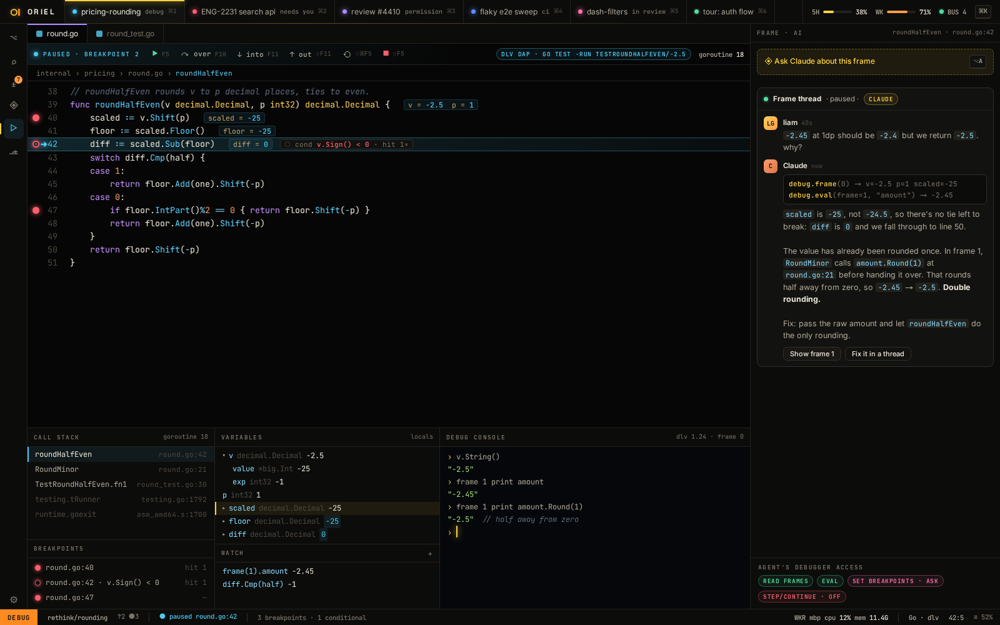
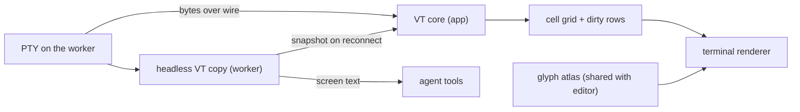

# IDE features: LSP, debugging, terminals, search

The "professional IDE" half. Everything here works without an agent.

## LSP (`lsp` module)

- Full client for LSP 3.17, beyond crit's hover and go-to-definition:
  - Completion with resolve, snippets and fuzzy filtering; signature help; hover.
  - Definition, declaration, type definition, implementation, references (peek inline).
  - Diagnostics (push and pull), code actions with quick-fix lightbulbs, and rename (with a preview diff).
  - Formatting (on save, range, as you type), inlay hints, semantic tokens layered over tree-sitter.
  - Call and type hierarchy, workspace symbols (in the omnibox), document symbols (outline).
  - Code lens (run test, references count), folding ranges, selection ranges, linked editing.
- Server registry: language → command, init options, root markers. Built in:
  gopls, typescript-language-server or vtsls, pyright or basedpyright,
  rust-analyzer, clangd, lua-language-server, yaml/json-ls, bash-ls, terraform-ls.
- Servers run on the worker (inside the sandbox if there is one), with the
  project toolchain from mise. Unknown languages degrade to tree-sitter only.
- **Agent access**: the agent gets read-only LSP tools through MCP
  (`definition`, `references`, `diagnostics`, `hover`). Fewer grep-and-guess
  edits, more precise ones.

## Debugging (`dap` module)

- A DAP client and an adapter registry: delve (Go), debugpy (Python),
  js-debug (Node and browser), codelldb (Rust, C/C++).
- Launch configs live in `.oriel/debug.toml`, with sensible defaults inferred:
  "debug this test" from a code lens, "debug main", or "attach to pid".
- UI: gutter breakpoints (conditional, logpoints, hit counts), current-frame
  arrow, inline values, call stack, variables tree, watch, REPL console, and
  exception breakpoints.
- Vim-native: `<leader>db` toggles a breakpoint, `]f`/`[f` move frames, `:Dc` continues.
- **AI-first**: the agent gets debugger tools through MCP (`set_breakpoint`,
  `continue`, `stack`, `eval`). You can ask "why is this -25" on a paused frame,
  and the agent inspects it live instead of guessing from source.
  It asks permission like any other tool.



## Running tests


- **▶ in the gutter on every test**: test functions, subtests (`t.Run("…")`), and **rows of table-driven tests** where
  the name can be worked out statically. After a run each one shows ✓, ✕ or ◌ (flaky) with its duration, as virtual text on the line.
- **Run scopes**: nearest (`␣tt`), file (`␣tf`), last (`␣tl`), failed only (`⟳`), package, whole project. **Watch mode** re-runs
  the tests affected by a save (Go: the packages that import the changed one; JS: vitest's related-files graph).
- **Failures appear inline** under the failing assertion: want and got side by side with an intraline diff, the test's own output,
  and four actions:
  - **jump to assertion**;
  - **debug this case** (DAP, breakpoint at the assertion);
  - **ask the agent to explain**: why it fails, from the failure, the test and the code under test. A tool-less fork that
    changes nothing, shown as an explain card under the failure (as in `ui.md` 07b);
  - **ask the agent to fix** (opens a request with the failure attached).
- **Explain sits next to fix everywhere.** Wherever Oriel offers "ask the agent to fix" (test failures, diagnostics and
  code actions, CI failures on the Ship page, merge conflicts, a red terminal command), it also offers **ask to explain**,
  so understanding is always one click away and never requires handing over the keyboard.
- **Tests panel**: a tree by package, file, test and case; filters (failed, slowest); recent-pass history sparklines and
  **flaky detection** (fails sometimes, passes on re-run); output per case, per run, or raw JSON.
- **Coverage**: `⌥▶` runs with coverage, and covered or uncovered lines show in the gutter (Go `-coverprofile`, pytest-cov,
  vitest/istanbul, cargo llvm-cov when installed).
- **The agent's runs land in the same panel**, marked as the agent's, and they're the **evidence** that "tests pass" claims link to
  (`agents.md`). The HUD tat shows `TESTS 13 ✓ 1 ✕` for the session.
- **Runs happen on the worker, in the session sandbox**, with the project's mise toolchain, so they behave exactly like CI.

| Language | Discovery | Runner and result stream |
|---|---|---|
| Go | tree-sitter `tests.scm` (`func TestX`, `t.Run("…")`, table rows) + gopls code lenses | `go test -json` (test2json events), `-run '^TestX$/^case$'` |
| Python | `def test_*`, classes, `@pytest.mark.parametrize` ids | pytest with a **small bundled reporter plugin** (one file, no dependencies) that writes JSON lines |
| TS/JS | `describe`/`it`/`test`, `.each` tables | vitest `--reporter=json`, jest `--json` (detected from package.json) |
| Rust | `#[test]`, `#[tokio::test]` | `cargo nextest --message-format libtest-json` if installed, otherwise parse `cargo test` output |
| others | via plugins | the `testrun.Adapter` interface |

```go
// package testrun
type Adapter interface {
    Detect(ws Workspace) bool                       // go.mod, pyproject, package.json, Cargo.toml…
    Discover(buf text.Snapshot) []Item              // gutter ▶ positions; cheap, runs on every edit
    Command(items []Item, mode Mode) (Cmd, error)   // Mode: Run | Debug | Coverage | Watch
    Parse(r io.Reader, emit func(Event))            // streaming: Started, Output, Passed, Failed{Want,Got,Loc}, Skipped
}
```

- Testing is covered by `testing.md`: each adapter is checked against recorded runner output for every case (pass, fail,
  panic, timeout, skip, nested, parallel).

## Terminals

### How a terminal is rendered



**The VT core is Ghostty's** (decided). `libghostty-vt` parses escape codes into a cell grid, behind `term.Emulator`.

- It's compiled to WASM and run under wazero: the same core crit already ships in the browser (ghostty-web), and no cgo.
- That gets us the kitty keyboard and graphics protocols, grapheme clusters and synchronized output.
- WASM costs ~1.5–2× native, which is still far above what a PTY produces.
- The WASM is built in CI from a pinned Ghostty commit (`deps.md`). If wazero isn't approved, the same core links via cgo instead.

**Drawing** is done by our own renderer, not the VT core:

- Cells become glyph runs through the **same atlas as the editor**, so text looks identical in code and terminal.
- **Box-drawing, block and powerline glyphs are drawn procedurally** (as Ghostty and kitty do), so lines join
  pixel-perfectly at any size, with no font gaps.
- **Damage tracking per row**, and output coalesced to at most one redraw per vsync. `cat` of a huge
  file doesn't redraw for every chunk. Synchronized output (DEC 2026) is honoured, so TUIs don't tear.
- Ligatures are off by default in terminals, and can be turned on. Bold, italic, undercurl and colour
  underlines come from the theme's terminal palette (`theming.md`).
- Images: the kitty graphics protocol and sixel become textures. OSC 8 hyperlinks are clickable.
- Selection, search and terminal-normal mode run over the grid plus scrollback (a ring buffer, compressed beyond 10k lines).

**Where it runs**

- The PTY lives on the worker, next to the code and the sandbox.
- The **app runs the VT core** that renders, so typing and scrolling never wait on the network.
- The **worker keeps a headless VT copy** (like tmux or mosh). It does two jobs:
  - On reconnect or app restart it sends a screen snapshot, not the whole byte history.
  - The agent can **read terminal screens** through a tool. "Why did this fail?" works on the terminal
    you're looking at, and you can attach a selection of output to a request.

**IDE touches from shell integration** (OSC 133 / OSC 7):

- Prompt marks: `[[`/`]]` jump between commands. Each command gets a gutter dot for its exit status (green or red).
- "Copy last output", "Send last output to a request", and re-run in a new split.
- The terminal follows the shell's cwd, and the Explorer can follow the terminal.

**Budgets**: parse at least 200 MB/s, keypress-to-echo latency within the editor's 8 ms
(local PTY), and full-screen redraw under 2 ms.

### Panes and modes

- Panes are splittable, attach to session PTYs on the worker, and survive app restarts.
- Any placement: docked at the bottom like other editors, a split or tab in the main area, floating,
  drop-down, or zoomed full-window. The same layout model applies to every pane (`ui.md` 01d).
- Terminal-normal mode (`⌃\ ⌃N`) gives vim motions, search and yank over the scrollback.
- Claude's own PTY is just another terminal view. The agent console (`ui.md` 15) is the structured view of the same session.

## Explorer scopes

- **Changed** (branch vs merge-base, uncommitted included; opens diffs), **Uncommitted** (vs HEAD; staging),
  **All** (the whole tree, with git status, ± lines, agent-unread, thread and diagnostic markers).
- Backed by one `gitx.Status` model on the worker: it streams file states and line counts, and refreshes on fs-notify.
- See `ui.md` 01c.
- As built (FG-1): `gitx.Repo.Status` reads every scope in one go (`git status --porcelain=v2`, `git diff --numstat`
  against HEAD, the index and the merge-base with origin's default branch, else main or master); `gitx.Status` keeps
  it, tells watchers which paths changed, and runs in the app until the worker exists (AI-1). It refreshes every 2 s,
  after a write and after each git command, rather than on fs-notify: a watcher over x/sys (inotify, kqueue) comes
  with the worker. Fixture repos for tests are built with `gitx/gittest`.

## Navigation and search

- Omnibox `⌘K`: sessions, files, symbols, commands, tickets, PRs, jobs: one ranked list.
- Pickers (snacks/telescope-style): `␣␣` files, `␣/` live grep, `␣k` keymaps, `␣s` symbols, `␣'` resume. Same engine
  as the omnibox, one source at a time, with preview (`ui.md` 02b). Which-key hints after a prefix (`ui.md` 02c).
- Project search: ripgrep on the worker, results streamed into a quickfix panel, with replace-in-files preview.
- Jumplist and changelist across files and sessions (`ctrl-o` goes back to the other session you were in).
- Marks across sessions: `mA` on one worktree, `'A` from anywhere.

## Git

- Gutter hunks, stage and unstage a hunk (`<leader>hs`), inline blame with author kind (you, agent, other).
- crit's Git and PR flow carried over: uncommitted → behind base → unpushed →
  PR → checks → merge, per project, cross-linked across projects.
- Conflict resolution as a 3-way merge view, with "ask the agent" on a conflict block.

## Go interfaces

```go
// package lsp
type ServerSpec struct {                           // registry entry, from a plugin or config
    Language []string
    Cmd      []string
    Roots    []string                              // go.mod, package.json, …
    Init     json.RawMessage
}

type Client interface {
    DidChange(doc DocID, s text.Snapshot, edits []text.Change)
    Complete(ctx context.Context, at Loc) ([]Completion, error)
    Hover(ctx context.Context, at Loc) (*Hover, error)
    Definition(ctx context.Context, at Loc) ([]Loc, error)
    References(ctx context.Context, at Loc) ([]Loc, error)
    CodeActions(ctx context.Context, r Range, diags []Diagnostic) ([]Action, error)
    Rename(ctx context.Context, at Loc, to string) (*WorkspaceEdit, error)
    Diagnostics() <-chan DiagnosticSet
}
```

```go
// package dap
type AdapterSpec struct {
    Type   string                                   // "go", "python", "node", "lldb"
    Launch func(cfg LaunchConfig) (Transport, error) // spawn dlv dap, debugpy, …
}

type Session interface {
    SetBreakpoints(ctx context.Context, file string, bps []Breakpoint) ([]Breakpoint, error)
    Continue(ctx context.Context, thread int) error
    Step(ctx context.Context, thread int, kind StepKind) error
    Stack(ctx context.Context, thread int) ([]Frame, error)
    Scopes(ctx context.Context, frame int) ([]Scope, error)
    Variables(ctx context.Context, ref int) ([]Variable, error)
    Eval(ctx context.Context, frame int, expr string) (Variable, error)
    Events() <-chan Event                          // stopped, output, terminated
}

// the agent's debugger tools are a thin MCP wrapper over Session, filtered by the granted scope
type DebugScope struct{ Read, Eval, Breakpoints, Step bool }
```

```go
// package term — swap the VT core without touching panes
type Emulator interface {
    Write(p []byte)                                // bytes from the PTY
    Resize(cols, rows int)
    Grid() Grid                                    // cells with attrs, dirty rows
    Cursor() (x, y int, shape Shape)
    Title() string
}

// package gitx — the model behind explorer scopes and gutters
type Status interface {
    Files(scope Scope) []FileState                  // Changed | Uncommitted | All
    Lines(path string) LineStates                   // gutter: added/modified/deleted by hunk
    Watch(fn func(paths []string)) (cancel func())
}
```

## Browser pane (future: not in the first iteration; decision deferred)

For previewing a dev server, reading a PR or docs page, or watching the agent check a UI change.
Gio has no web engine, so a browser comes in one of three ways:

| Approach | How | Can Oriel draw over it? (HUD, notes, vim keys) | Cost |
|---|---|---|---|
| **Chromium driven over CDP, frames drawn as a texture** | spawn the user's Chrome/Chromium headless, stream frames (`Page.startScreencast` or a shared buffer), forward input with `Input.dispatch*` | **yes**: it's just an image in our UI | no linked dependency (CDP is JSON over a websocket, `x/net`); ~30–60 fps, a little input latency |
| CEF off-screen rendering | link Chromium Embedded Framework, render into a texture | yes | ~150 MB, cgo/C++, tier-C dependency, Chromium update treadmill |
| Native OS webview as a child window | WebKitGTK / WKWebView / WebView2 placed over the Gio surface | **no**: it's a separate native layer (no overlays, rounded corners or transforms; focus handoff is awkward) | WebKitGTK quality on Linux, the reason Wails was ruled out |

- Leaning towards the first option, but the decision is deferred until this is picked up: nothing goes into `go.mod`, it stays composable, and **the agent can drive the same
  browser** (screenshot, click, read the DOM) over the same CDP connection. "Check the page still renders" becomes something
  you watch it do in a pane.
- OAuth and other logins still go to the system browser.
