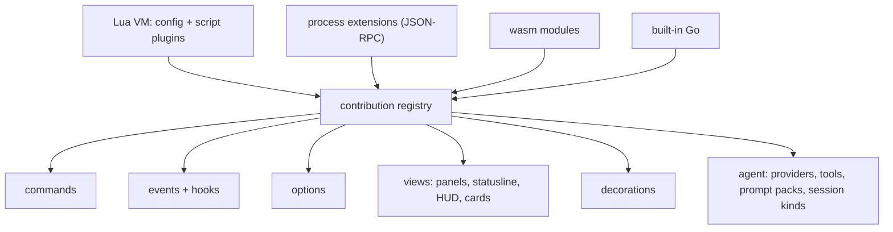

# Plugins: vim-level customisation

The bar: anything you can see, press or trigger, you can rebind, hook,
replace or script, from your config, live, without a rebuild.
The scripting API itself is in `scripting.md`. Installing, packaging and publishing plugins is in `catalog.md`.


## Principles

0. **No special cases.** Features never get private shortcuts into the core. When a feature needs a capability the
   API lacks, the API grows a general version of it (with Lua and RPC bindings), and the feature uses that. The test is
   whether a third party could build the same feature as a plugin.
1. **Dogfood.** Every built-in feature is an extension: the vim keymaps, the
   panels, the HUD, the Claude provider, the review ledger. If a built-in needs
   an API, the API exists for everyone.
2. **Everything is a command.** Every action has a name, takes arguments,
   and is callable from a key, the omnibox, a script, the agent, or `:`.
3. **Everything emits events.** Editor, sessions, agents, threads, git, LSP,
   DAP, workers. Hooks can observe, **veto** or **rewrite** (see below).
4. **Everything is an option.** Typed, scoped (global → session → project →
   buffer → window), introspectable with `:set foo?`, and observable.
5. **Every surface is composable.** Statusline, tabline, HUD, panels, thread
   cards, notifications: each is a view built by a function you can replace.
6. **Live.** `:source`, hot reload on save, a `:lua` REPL, `:Inspect` on anything under the cursor.

## Four tiers

| Tier | Runs as | Latency | Use it for | Isolation |
|---|---|---|---|---|
| **Config & scripts** (Lua) | in-process VM on the UI loop | µs | keymaps, options, autocmds, statusline, small panels, custom commands, agent tools | none: your own config is trusted |
| **Script plugins** (Lua) | same VM, loaded from a plugin dir | µs | what neovim plugins do: surround, motions, pickers, panels | per-plugin namespace, declared permissions for net/exec |
| **Process extensions** | child process, JSON-RPC (stdio) | ~0.2 ms | heavy or long-running work, other languages, integrations, providers | OS process + Landlock / sandbox-exec |
| **WASM modules** | wazero, in-process | ~µs | tree-sitter grammars, pure transforms, untrusted snippets | memory-safe, capability-only host calls |

- An installed plugin always **enters through Lua** (`init.lua`). Its WASM modules and process binaries are started from
  that Lua with `oriel.wasm.load` and `oriel.process.spawn` (`catalog.md`).
- **Native Go** is a fifth tier: the same contribution API, compiled in. That covers the built-ins and
  third-party plugins linked in with `oriel build --with …` (see "Performance and native plugins").
- All tiers register through the same **contribution registry**, so a Lua
  panel, a Go panel and a process panel are indistinguishable to the user.



## Contribution points

**Editor**
- keymaps (per mode, including custom modes), operators, motions, text objects (`vim.RegisterMotion`,
  `vim.RegisterObject` in Go today; their Lua bindings come with PL-1).
- ex commands with ranges, bang, counts and completion.
- decorations: highlights, signs, virtual text, virtual lines, inline blocks, conceal. A provider gets the buffer, the
  lines in view and `FileBytes` (the buffer as it would be written), for diffing against a file's other versions, and
  where it's drawn: `Window` (the editor window's id), `Presenter` (the presenter drawing the buffer, "" for its text)
  and `Now` (the frame's time). A `Sign` can be a built-in icon (`Icon`, its `Text` small beside it: a count) and have a
  `Hover` card, shown while the pointer is on the sign or the card and never taking focus (`widget.HoverCard`). A
  `LineBg` on a changed line can say what the line read before (`Was`), for a presenter that shows the change. The
  agent's latest edit to a file is a built-in provider (`agent.edits`): its lines lit green for ten minutes, a one-line
  change's old text in `Was`, and "agent edited 4s ago" after the first.
- buffer presenters (`registry.BufferPresenter{Name, Label, When(path), Comments, Build(ctx)}`, ED-15): a way to draw a
  buffer other than as its text, per window. `editor.present {name, window}` shows a window (the focused one by
  default) with it, and again shows the text; the buffer stays open and editable, and the presentation is built again
  each frame from its text, so two windows on one file can be in Edit and a presentation at once. `Build` maps each
  block it makes to the source lines it came from: `ctx.Block(from, to, body)` (0-based, inclusive; `Space` above it,
  `Label` its accessible name), whose body is drawn with `PresentDraw{Width, Decorations, Kicker}`. From that map the
  host (`app/present.go`) gives every presenter the same: the decorations of the file (every provider's, all its lines)
  on the block holding their line (a line no block maps belongs to the nearest block before it): `Block`s are cards
  in a margin level with their block (the file's threads), `Sign`s sit beside the block, a `LineBg` fills it and
  colours its edge, a `VirtualText` is a label at its top right, an underline colours its edge; the block's line
  number shows where a card is; with `Comments`, a click on a block, or `j`/`k` then `c`/`⏎`, runs
  `thread.new {file, line, end_line}` on its lines, a real code anchor that shows in Edit too; `o` goes to its source
  (`present.next`, `present.prev`, `present.comment`, `present.source`, key mode `present`); and scrolling a
  presentation keeps the window's top line with the block at its top, so Edit comes back where the presentation was
  (and a presentation opens where Edit was). A window's presenter is kept across restarts with its file. The built-in
  `markdown` plugin (`app/mdpreview.go`) is one, with comments on, drawing with the shared markdown renderer's blocks
  (`mdParse`), its **Preview / Edit** action and `:MarkdownPreview`; plan mode's doc is the same presenter.
- filetypes and ftplugins, grammars, queries, formatters, linters, LSP and DAP specs. A query kind is any name:
  `syntax.Parser.Query(kind)` and `syntax.Document.Query(kind)` run a language's `<kind>.scm` and return its matches
  with named captures and `#set!` properties. Built-in kinds: `highlights`, `folds`, `injections`, `units`, and
  `tests` (test discovery, below); a plugin's language brings its own the same way.
- **test adapters** (`testrun.Adapter`: Detect, Discover, Command, Parse; optionally `Coverer` and `Watcher`), as a
  `testrun.Contribution{Adapter}` of kind `testrun.adapter` (`Registry.Contribute`). The app adds every one to its
  `testrun.Set` with `testrun.Contribute(set, reg.Contributions("testrun.adapter"))`; a later adapter of the same
  name shadows the built-in until disposed. An adapter for a language with a grammar usually finds tests with that
  language's `tests.scm` (`Source.Syntax.Query("tests")`). Go, pytest, vitest, jest and cargo are built-ins written
  the same way (`ide.md` → Running tests). Lua bindings come with PL-1's binding work.
- registers (e.g. a `"*` provider), completion sources, snippet engines.

**Shell**
- commands, picker/omnibox sources and actions, panels, docks, layouts. Which-key is a built-in plugin built only on the public API.
- the `view` keymap mode: keys for a focused view with no key mode of its own (`q` and `⌃W c` close it; Escape closes
  one outside the main area, such as the log). A tab's ✕, shown while the pointer is on it, closes its view.
- command-line hints (`registry.CmdlineHint`): text at the right of the `:` line while it applies, as the LSP's
  "⇥ use LSP rename" on a `:s` of a whole word.
- editor actions (`registry.EditorAction`): buttons at the right of an editor's breadcrumb for the files they apply to,
  their command run with `window` (the window clicked in) added to their args. `On(window)` lights one for the window
  it's in (`registry.EditorWindow{ID, Path, Presenter}`), and `LabelOn`/`IconOn` show while it's on (Preview ↔ Edit);
  `Note(window)` is dim text after the label (a count); an `Icon` naming a built-in icon is drawn.
  lit while `On` says so (the tests' file, failed, watch and coverage).
- explainers (`registry.Explainer`): answer an `ExplainRequest` (a failure, a diagnostic, a selection, a code unit;
  `Depth` brief, detailed or why) in markdown, with no way to change anything; every "ask to explain" uses the first
  (`registry.Explain`), and its `Label` (“fork of claude · knows this session”) shows under the answer. The agent's
  comes with AI; Lua adds one with `oriel.agent.explainer`. `explain.ask {file, line, end_line | text; subject, kind,
  context, depth; key}` (RV-5) is how a feature asks: about a file's lines, a card between them; about text (or just a
  `context`), a notice; with a `key`, the answer is kept for the place that asked to draw (the failure block's card).
  It's unavailable until an explainer is registered. A feature that parses the answer calls `registry.Explain` with
  `ExplainRequest.Format` (RV-6): the shape the answer must take instead of prose, which replaces the explainer's own
  instructions on length and form (the walkthrough's JSON steps). `Explainer.Byline` says who wrote a long answer
  ("written by claude from the session's own context"); `Explainer.WrittenBy()` falls back to "written by" and the
  label. Lua: `oriel.agent.explainer{…, byline}`, and `req.format`.
- forkers (`registry.Forker`, RV-7): answer a side question for a session (`ForkRequest{Session, Prompt}`) from its
  agent's context, with no tools and outside its conversation (agents.md: btw, explain, the verify quiz);
  `registry.Fork` asks the first by `Order` and `registry.ForkLabel(session)` says who ("claude · fork, no tools").
  The sessions extension registers the agent's (order 10, the wire's `agent.fork`); Lua adds one with
  `oriel.agent.forker { name, order, label, run = fn({ session, prompt }) }`.
- fix and explain twins (TR-6): something gone wrong is a `registry.Trouble` (kind, subject, context, file and lines,
  the fix request's text). Every "ask the agent to fix" runs `agent.fix` (`registry.FixCommand`) with
  `Trouble.Args()`, which writes a request with it attached; its twin runs `explain.ask` (`registry.ExplainCommand`)
  with the same args. A `MenuItem` whose command is `agent.fix` gets its twin right after it, labelled "Ask the agent
  to explain", wherever menu items are listed (`registry.MenuItems`, `registry.WithTwins` for a menu of one's own such
  as the code actions'); a plugin's too. `MenuItem.Trouble(at)` computes the trouble where the menu opened, and hides
  the pair when there's none (the terminal's failed command). Buttons use `askTwins` (explain then fix, the answer
  under them by `key`). A fix that runs `request.new` itself is a test failure (`TestFixesGoThroughAgentFix`).
- the walkthrough (RV-6): `explain.change` opens Explain this change (the `explain.change` view, a tab in the main
  area) and asks for a walkthrough when there's none still good; `explain.change.step {step | by}`,
  `explain.change.line {by}`, `explain.change.ask`, `explain.change.comment {line}`, `explain.change.discard` and
  `explain.change.close` drive it, and its keys are the `explain.change` key mode. A diff view's header button runs
  `explain.change`.
- annotations (RV-6): `widget.Annotation(c, key, AnnotationOpts{N, Title, Tone, Width, Ground}, body)` is a note in
  the annotation house style (a numbered diamond and its title over the body, in a card with two corners cut;
  `widget.AnnotationBody` is its prose's style), `widget.Diamond` a numbered diamond, and `widget.Leader(frame, from,
  to, tone)` (`LeaderPath`) the angled leader line from code to its card. Theme tokens `annotation.*`.
- images (RV-8): `widget.Image(c, key, img, width, ImageOpts{Label, Help})` draws an `image.Image` at a width, its
  shape kept, scaled once per size to the device's pixels (`ui.RoleImage` to assistive technology).
- tours (RV-8): `tour.open` opens the tour reader (the `tour` view, a tab) for the tour session in front, and opens
  by itself when one comes to the front; `tour.step {step | by}`, `tour.scroll {by}`, `tour.open-quote {n}`,
  `tour.ask {text}`, `tour.export {format, ask}` and `tour.close` drive it, and its keys are the `tour` key mode.
  Steps are read by `worker/tour` (`tour.NewLoader().Load(ctx, root, worker.TourOf(root))`, the model a plugin's own
  reader would draw), `tour.Markdown` and `tour.HTML(t, HTMLOptions{Highlight, Palette})` export them, and
  `tour.Palette(dark, light)` is a page's colours. The app offers the `tour_export` agent tool
  (`registry.AgentTool`); the worker its `tour_kind`, `tour_steps`, `tour_run` and `tour_share`.
- clickable signs: a `Sign` decoration with a `Command` runs it, with its `Args`, when clicked (a test's ▶).
- block signs: a `Sign` whose text is one lower (▁…█) or left (▉…▏) block element fills that part of the whole line,
  so a run of them on consecutive lines is one unbroken bar (the git gutter's ▎).
- a keymap with `Nowait` (vim's `<nowait>`) runs as soon as it matches, not waiting for a longer mapping in a mode
  after its own: the explain card's `[` over the editor's `[c`.
- key layers (`registry.KeyLayer`): a keymap mode laid over every other while its `Active` says so, as the completion
  menu's `⌃n` and `⏎`; keys it doesn't map go on as before.
- exclusive keys (`registry.ExclusiveKeys{Mode, Active, Allow}`): while `Active`, a keymap mode stands alone; the modes
  after it lend it only the keymaps `Allow` lets through and none of their longer keys. The start view's `empty` mode
  is exclusive with no directory open, lending only its entries' and links' commands.
- raw keys (`registry.RawKeys`): a keymap mode whose ⌃ keys skip the global maps, so a terminal's program gets `⌃W`;
  ⌘ and ⌥ chords, and the mode's own maps, still apply.
- picker sources can be `Unlisted`: opened by their command only (a result list, such as callers), not in the strip.
- requests (AI-5): `request.comment {thread | file, line, text; body, title, urgent, btw, status}` is how anything comments to
  the agent (it fires `CommentSend` first: a rewrite changes the comment, a veto stops it); `request.resolve`,
  `request.reopen`, `request.new {text, context, file, line}`, `request.open {thread}` and `request.attach {items |
  text, title}` (the pickers' `⌃a`) drive the Requests views, and `thread.new` opens a thread on the cursor's line, or on `{file}`'s `{line}` through `{end_line}`.
  A new thread with `{status: "resolved"}` is a note: it's kept on its lines but never handed to the agent (explain's
  Pin as note). `request.this {what: review | tests | refactor}` writes a request about the selection or the unit at
  the cursor (RV-5's right-click entries).
- threads shown or hidden (ED-15): each window shows its file's threads between the lines or hides them; `threads.toggle
  {window}` (`␣R`, and the **💬 n** editor action, n the file's open threads) switches the focused window, and
  `editor.threads = "shown" | "hidden"` is how a window shows a file it hasn't been switched on. Hidden, each line with
  threads has a speech-bubble sign in the colour of its first thread's state, with their count when there are several;
  hovering it shows a card of them (title, state, the last two messages as markdown) that goes when the pointer leaves
  the sign and the card and never takes focus or keys; a click, or `⏎` on the line (the `threads.hidden` key layer),
  runs `threads.show {window, thread}`: the threads again, scrolled to that one with its reply field focused. In a
  presentation the same bubbles sit beside the blocks; shown, its margin also keeps closed threads, folded to a line
  with **reopen**, and a planning session's cards have **defer**.
  The `threads` picker source lists the session in front's requests. A test run is shown by `test.run.show {id,
  session}` (the `test.run` view), which evidence chips run.
- plan (AI-8): `plan.open {doc}` shows a planning session's docs (the `plan` and `plan.docs` views), and its doc
  is the `markdown` presenter's, so a presentation's keys (`present.*`) move through it and comment on a block, and
  `session.start-work {clear, fresh, branches, sandbox, network, model, effort}` is available while the session in
  front is planning; `plan.start-work` opens its dialog, and `plan.start-work.run` (⌘↵ in the `startwork` key
  mode) runs what the dialog holds. `worker.hand-over-now` drains this machine's worker without waiting for its agents'
  turns, for a restart or a quit (⌘↵ in the `workerdrain` key mode; `sessions.md` → As built). A comment on a file at the workspace root,
  outside every project, is anchored to the project `core.DocsProject` (`"__docs__"`) with the path relative to the
  workspace; `request.comment {file}` does that for an absolute path, and an agent's `comment` tool takes
  `project: "__docs__"`.
- the review diff (RV-1): `diff.open {path}` opens a file's or a repo's branch diff (the `diff` view, one per repo
  root); `diff.layout {layout}`, `diff.hunk.next`/`prev`, `diff.line.next`/`prev`, `diff.review {path, hunk}`,
  `diff.review.file {path, reviewed}`, `diff.comment`, `diff.explain`, `diff.source`, `diff.expand {path}` drive it
  (key mode `diff`). Its slots are views drawn in name order, built with the repo's root as `ViewCtx.Instance`:
  `diff.header.<order>-<name>` above the files (the review ledger), `diff.side.<order>-<name>` in the left column
  under the changed files (the built-in `diff.side.50-authorship`), and `diff.right.<order>-<name>` in a column at
  the right (an AI review's findings). Between its lines it draws every decoration provider's Blocks on the new side,
  asked with `DecorationCtx.Presenter = "diff"`, so a provider can tell it's in the diff (an explain card, a review
  finding, a mirrored GitHub thread). `?` runs `explain.unit {path, line}`, which RV-5 registers. Reviewed marks are
  the session event `core.HunksReviewed {session, project, file, hunks, reviewed}` (`SessionState.Reviews`,
  `ReviewedHunks`), sent through the worker's `review.set` (`worker.Client.SetReviewed`), each hunk named by
  `gitx.Hunk.ID`; `gitx.Unified`, `gitx.Intraline` and `Repo.FileAt` are the diff's pieces for others to reuse.
  `widget.Check` is a checkbox with on, off and mixed states. `diff.open {path, line}` selects the new side's line.
- the review ledger and commit gates (RV-2): `registry.ReviewLedger{Name, Order, Get(root) Ledger}` (kind
  `review.ledger`) answers `registry.LedgerOf(r, root)`: a repo's agent-written lines as `LedgerCount{Read, Skimmed,
  Unread}`, for the whole change (`All`), those not committed yet (`Uncommitted`) and per file (`Files`, `File`,
  `Of`); `Ready` is false while diffs are still being read. The built-in one (`diff`, Order 100) counts from the diff;
  a lower Order shadows it. `registry.CommitGate{Name, Label, Order, Check(CommitCheck) GateResult}` (kind
  `commit.gate`) is asked by `registry.CheckCommit(r, CommitCheck{Root, Files, Message})` before every commit: a
  `GateResult` says its `Mode` (hard, soft, off), `Pass`, `Pending`, progress `Done`/`Total`, `Reason`, the
  `Trailer` a commit past it carries, `Unread`, and a `Review` command with its label. The built-in gate is `ledger`.
  `git.commit {path, message, all, anyway, confirm}` is every commit path's command (the Explorer, the diff's
  ledger bar, the Ship page, scripts): no message opens a dialog; a hard gate holds the commit in the COMMIT GATED
  dialog (key mode `commit`: `a` `git.commit.anyway`, `r` `git.commit.review`, `⏎` `git.commit.confirm`, `esc`
  `git.commit.cancel`) until anyway; a soft one until confirm; then it fires the `Commit` hook (`CommitEvent{project,
  root, message, files, unread}`; a veto stops it) and commits with `gitx.Repo.CommitStaged(message, trailers...)`.
  Lines seen in the diff are `core.LinesSeen` (worker `review.seen`), a commit past a gate `core.CommitGateOverridden`
  (worker `review.override`). `widget.MeterOpts.Then` stacks more parts on a meter.
- the AI review (RV-3): the built-in `ai-review` extension draws `diff.right.50-ai-review`. `review.ai.run {id, full}`
  asks the session's worker for a review (`worker.Client.AIReview`, `review.ai.run`, `AIReviewReq{session, provider,
  model, full, pack}`), `review.ai.thread` / `review.ai.fix` / `review.ai.dismiss {dismissed}` /
  `review.ai.add-project` / `review.ai.open` take `{id, finding}`, `review.ai.filter {severity}`,
  `review.ai.dismissed` and `review.ai.prompt` drive the column. Reviews and findings are session events,
  `core.AIReviewChanged {session, review}` and `core.FindingsRecorded {session, findings}` (replaced by ID;
  `SessionState.AIReviews`, `Findings`, `SortedFindings`, `FindingOpen`; `core.Severities` is the threads' scale), and
  the app changes a finding through `review.ai.findings` (`Client.SetFindings`: dismissed or not). **The ship gate's
  "AI review" row** reads `SessionState.AIReviewGate() (ok, label)`: not run, running, "n high or critical open", or
  clear; the built-in `ai-review` ship gate shows it. `request.comment` takes `{severity, finding}` for a new thread
  (`CommentReq.Severity`, `Finding`: the thread's `Origin` is `core.OriginAIReview` and the finding records it). A
  session kind's `KindSpec.AutoReview` reviews its change as it starts (the review kind's does). The reviewer runs
  on the `ai-review` prompt pack, overridden by the user's `agents/ai-review.md` (sent with each request, since the
  worker may be elsewhere; `packs.FromText` reads it). `gitx.Repo.MergeBase`, `Snapshot` (the work tree as a git tree,
  the index untouched) and `Diff` are its git pieces. `widget.ToggleChipOpts.Tone` makes a toned filter chip.
  A slot view that implements `registry.Shown` (`Shown(instance) bool`) is left out of the diff's columns while it
  has nothing for that repo, so the room goes to the rest: the AI review outside a session. `DiffRight` views share
  the column's height, each scrolling its own content.
- a Block decoration's controls take and keep focus (a reply field between the lines): the editor doesn't take focus
  back from something inside its code column.
- inlay decorations (`registry.Inlay`): text drawn inline before a column, the code after it moved along the grid.
- instances that outlive the app: a view implementing `registry.Persisted` (`Persist(instance) (state, ok)`,
  `Revive(state) (instance, error)`) keeps its instances across restarts. The layout is saved per directory as it
  changes (`layout-<hash>.json` in the state dir) with each instance's state, and when the app starts again there,
  each view revives its instances into the places they had; one that can't is left out. The editor keeps each window's
  file and cursor, the terminal its command (its screen is its own state file).
- tab markers: a view implementing `registry.Marked` gives each instance a small marker after its tab title (the
  editor gives its file's git status letter), in a theme token's colour.
- project sidebar entries (`RailEntry`, `oriel.rail.add`; ui.md 01h) and start view actions (`StartEntry`,
  `oriel.start.add`). A start entry with `Link` is a small link under the actions with its `Note()` figure (Stats,
  Usage; AI-12). A rail entry has a `Scope`: `project` (`registry.ScopeProjectEntry`) is one of each project's
  panels, listed under the open project and run with `project` added to its args (`RailEntry.ArgsFor`); `session`
  (the default) is listed below the projects; `global` (`registry.ScopeGlobalEntry`, AI-12) is a page every session
  shares (Stats, Usage, Jobs, Settings), listed last below a second divider and at the foot of the narrow form, and in
  the omnibox's **Pages** with its note and key (`registry.GlobalEntries`). `Note(project)` is dim text at its right ("4", "48 ✓"), `Badge()` a
  pill, `Active(project)` lights it (for an entry with neither, a `view.*` command's `id` showing for the project
  does), and `Shown(project)` leaves it out (Pull request without a remote). `registry.ProjectEntries` and
  `SessionEntries` list them. `ProjectState` contributions add to each project's header line after its branch and
  changes (`StatePart{Text, Style, Dot}`: a PR's number, a CI result with its dot); FG-6's `ship` adds the PR and CI. Both
  kinds of entry are
  dimmed while their command isn't available: a command's optional `Available(args)` says so, and
  `Registry.Available(id, args)` asks (registered, not turned off, and `Available` agrees). The omnibox leaves
  unavailable commands out, and a key bound to one doesn't run it: one with a `Desc` says "… isn't available yet".
- PR actions (PL-9): `registry.PRAction` buttons on a raised PR (`oriel.ship.action`), as the Slack plugin's PTAL.
- ship (FG-6; ui.md 18): "before this ships" gates are `registry.ShipGate{Name, Title, Order, Check(session) Gate}`
  (`Gate{State, Note, Action, Command, Args}`, State pass, warn, fail, pending or optional, "" to leave it out; an
  `Action` is a button under the gate's row running `Command` with `Args`, as the verify quiz's **Verify…** and AI
  review's **Review**; `oriel.ship.gate`), listed by
  `registry.ShipGates(r, session, kind)`, a session kind's `Gates` naming the ones it gets. Built in: plan, threads,
  tests; the review ledger, the verify quiz and AI review add theirs. A gate informs; what stops a step is a hook:
  `ShipCommit {session, project, message, files, force}` before a commit (a veto shows its reason in the commit box and
  offers **Commit anyway…**, which fires it again with `force`; a rewrite adds a trailer) and `ShipRaise {session,
  project, title, body, draft, reviewers, edit, all}` before a raise or edit (a veto shows on the Raise PR tab; a rewrite can change
  the body, as a passed verify quiz's reviewer notes; `all` is one of `ship.raise-all`'s). Commands: `ship.open`, `ship.refresh`, `ship.commit {project, message, files, force}`,
  `ship.commit-all`, `ship.sync {project}`, `ship.sync-all`, `ship.push {project}`, `ship.raise {project, title,
  body, draft, reviewers}`, `ship.raise-all`, `ship.ready`, `ship.pr.open`, `ship.fix-ci`, `ship.redraft {project,
  kind}`, `ship.draft.save`, `ship.github`; views `ship`, `pull-request`, `pr` (instance = project). A worker answers
  `ship.read` (`worker.ShipReq` → `[]worker.Ship`: files, behind and predicted conflicts, unpushed commits, the PR,
  checks and a failing job's log line, the drafts and who wrote them, the PR template, CODEOWNERS), `ship.commit`,
  `ship.push`, `ship.sync`, `ship.pr` (raise or edit, ask reviewers, cross-link the session's PRs), `ship.ready` and
  `ship.draft` (`worker.Client.Ship*`; AI-10: a `DraftReq` with `Drop` clears the user's draft, and a `Draft` read
  says `Stale` once the code moved on; `ship.draft.save {project, kind, title, body}` saves the commit box's or the
  PR tab's as the user's); its GitHub client is `worker.Options.GitHub` (the user's gh by default).
  `gh.Client` is GitHub as Oriel uses it, `gh.API` over a `gh.Transport` (`gh.CLI`, `gh.HTTP`), and `gh/ghtest` a
  fake GitHub for tests.
- verify (RV-7; ui.md 13): the optional quiz is the `verify` extension, built only on the above: the `verify` ShipGate
  (whose **Verify…** starts it), questions and grades through `registry.Fork`, a `ShipRaise` rewrite hook ("verify
  notes") adding a passed quiz's answers to the PR's body, and the `core.Verified` session event (`Verification{Result,
  Projects, By, Questions}`, `SessionState.Verifications`, sent to the worker as `verify.record`). Commands
  `verify.open {id}`, `verify.send {text}`, `verify.again`, `verify.open-file`, `verify.close`; keymap mode `verify`
  (`⌘↵`, `⌥O`, Escape); view `app.overlay.verify`.
- GitHub review mirroring (RV-4; ui.md 06): a worker answers `github.sync` (`worker.MirrorReq{Session, Fresh, Trust}`
  → `worker.Mirror`: the PRs and each reviewer's state), `github.forward` (`worker.ForwardReq` → the sent comment) and
  `github.draft` (`worker.DraftEditReq`) (`worker.Client.SyncGitHub`, `ForwardGitHub`, `EditDraft`). `gh.Client`
  reads `ReviewComments`, `Reviews`, `IssueComments`, `ResolvedThreads` (GraphQL) and `OrgMember`, and posts
  `ReplyReview` and `Comment`; `gh.ReviewStates` is where each reviewer stands; `gh/ghtest` fakes them all
  (`AddReviewComment`, `AddReview`, `AddIssueComment`, `EditComment`, `Resolve`, `AddMember`, `SetLogin`).
  Commands `github.sync`, `github.forward {thread, comment}`, `github.edit`, `github.draft.save {thread, comment,
  body}`; options `github.trusted_orgs`, `github.trusted_users`; the status segment `statusline.left.70-github`;
  theme tokens `github.accent`, `github.changes`, `github.approved`, `requests.avatar.github`, `requests.draft.bg`,
  `requests.draft.border`.
- icons: the built-in set (`files`, `search`, `git`, `pullrequest`, `requests`, `comment`, `ship`, `debug`, `tests`, `settings`,
  `plus`, `resume`, `folder`; since SH-9 `key`, `inbox`, `network`, `gateway`, `question`, `permission`, `review`) is drawn, not a font's; any other name is drawn as a glyph.
- statusline, tabline (session tabs), titlebar and HUD indicators, notification cards. Title-bar segments are views named
  `titlebar.right.<order>-<name>`: the plan's usage windows are `titlebar.right.40-usage` (the stats extension's since AI-12: one button to Usage with a
  hover card).
- indicators in slots (SH-8): `registry.Indicator{Name, Slot, Order, Title, Note, Span, Help, Every, On, Build}`
  (kind `hud.indicator`), listed by `registry.Indicators(r, slot)`. Slots: `titlebar.right`, `statusline.left`,
  `statusline.right` (drawn among the views named `<slot>.<order>-<name>`, an indicator sorting as
  `<slot>.<Order>-<Name>`), `hud` (the HUD's panels: `Title`, `Note`, `Span` of four columns) and `hud.today` (under
  the Today panel). What `Build` returns is kept and drawn until it's built again: every `Every`, on a core event
  named in `On`, on `hud.refresh {name}`, or when any contribution comes or goes (`Registry.ContributionsGen`); a
  `ui.Func` that reads the store as it's drawn is live without any. An error draws in its place and counts towards
  turning it off (`Report("hud.indicator", name, err)`). Commands `hud.toggle`, `hud.close`, `hud.refresh`; key mode
  `hud`; view `app.overlay.hud`; options `hud.hold`, `hud.hold_delay`. Widgets `widget.Indicator`, `widget.Panel`,
  `widget.Drawer`, `MeterOpts.To` (hatched on to a projection). Input: `render.ModsEvent` (the modifiers held),
  `ui.UI.Mods`/`Chord`, `ui.Ctx.Held` and `HeldAlone` (a modifier held with nothing pressed since). A worker's load
  reading is `worker.Options.Load` (`sysload.Read` by default).
- inbox cards (SH-9): `registry.InboxSource{Name, Cards}` (kind `inbox.source`) gives the inbox its cards, read on
  the app's loop as it's drawn; `registry.InboxCards(r)` gathers every source's, by source name, each keyed
  `<source>/<id>` (`InboxCard.Key`). An `InboxCard` has `ID`, `Type` (its help anchor), `Group` (the Inbox panel's
  filter: `agents`, `bus`, `github`, `sandbox`), `Mine` (the ME filter), `Session` (whose tab counts it), `Icon`,
  `Tone` (a theme token), `Title`, `Sub`, `Created`, `Expires` (a countdown ring), `Interrupt` (stacks at the
  window's bottom right while it waits), `Banner` (on its own at the top), `Done` (history only); its face as
  `Kicker`, `Detail`, `Code`, `Note`, `Body` and `Actions` (`InboxAction{Label, Key, Primary, Command, Args, Run}`) in
  a `widget.ActionCard`, or `Draw(c, key, CardPlace{Stacked, Dismiss})` drawing it whole; `Dismissed` hears its ✕ or
  Escape. A card its source stops giving is answered: the inbox keeps it as history (the last 200). Every session's
  asks are the built-in source `asks` (`app/askcards.go`); agentbus (PL-5) adds its question and review-request
  cards the same way. Commands `inbox.open` (⌘⇧I, `<Leader>i`), `inbox.dismiss {id}`, `inbox.next`, `inbox.prev`;
  key mode `inbox`; views `inbox` and `app.overlay.inbox` (replacing AI-7's `app.overlay.asks`); the title-bar
  indicator `inbox`. `widget.ActionCardOpts` gained `Dismiss` (a ✕ and Escape, `ActionCardResult.Dismissed`),
  `Countdown`/`Left` (the ring) and `Icon`. Theme tokens `ask.key`, `inbox.count`, `inbox.row.selected`,
  `inbox.done`.
- agent console side sections: views named `agent.console.side.<order>-<name>` are drawn at the top of the console's
  right column, in name order, built with the session's ID as `ViewCtx.Instance`; one that has nothing to say for a
  session draws nothing. Jobs adds `agent.console.side.10-job` (SE-4).
- rich text: a `widget.Span` with `Code` and a `Tone` is in that colour on a tint of it: a repo named in a job's
  prompt, in its project colour.
- pages over the main area: `widget.Page` with `PageOpts.Over` (the node it covers, as laid out last frame) draws a
  page beside the sidebar rather than over the whole window, at `ui.LayerPage`; Stats and Usage are overlay views
  (`overlay.stats`, `overlay.usage`) drawn that way, and any plugin's page can be.
- charts: `widget.Chart(c, key, series, ChartOpts)` (AI-12) draws stacked bars, stacked areas, lines (dashed, from a
  point: a projection), a sparkline or a 100% strip, with a y axis of round values, labels, a legend, marks (a
  dashed or solid line with a label: now, a reset, a compaction), bands (a hatched stretch: idle), a strip of ticks
  (turns) and a hover card of the point's values; `ChartResult` says the series and point under the pointer and a
  click; `Table` draws the same data as a table. Lua: `oriel.ui.chart`. The stats pages are built only on it.
- dates (AI-14): `widget.DatePicker(c, key, &DateRange, DatePickerOpts)` picks a range of days on a month's calendar
  (arrows move, ⏎ picks one end then the other, PageUp/PageDown a month, ‹ › page, a typed `2026-09-01..2026-09-30`
  with ⏎, Esc cancels; key mode `datepicker`); `DatePopover` shows it under an anchor, and `DateSelect` is a button
  showing the range that opens it. `ParseDateRange` reads the typed form. Theme tokens `datepicker.*`. Lua:
  `oriel.ui.date_picker`. Stats' custom range is built on it.
- segmented strips take `SegmentedOpts.Badges`, a small chip after each label: the Usage switcher's plan tiers.
- stats: a provider that keeps its own log of a session implements `agent.Logged` (`Logs(cwd, session) []agent.Log`:
  Claude's transcript and its subagents'); the worker records the events of one that doesn't (Codex). A provider that
  can find every log it keeps on the machine implements `agent.Discovered` (`Discover() []agent.Transcript`: the
  provider's session id, its logs, when they last changed; Claude's config directory, Codex's rollouts); the worker
  counts those no Oriel session owns as outside Oriel (`stats.Session.Origin`, `stats.ByOrigin`, the `origin` filter,
  `stats.Report.Origins`, `stats.Group.Origin`/`Worker`). The worker reads
  them into `worker/stats` and answers `stats.query` (`stats.Query{Group, From, To, Step, Offset, Filters, Split}` →
  `stats.Report`), `stats.session` (`worker.StatsSessionReq` → `stats.Detail`), `usage.history` and `usage.read`
  (`worker.Client.StatsQuery`, `SessionStats`, `UsageHistory`, `ReadUsage`); `stats.Merge` adds workers' answers up.
  Commands: `stats.open`, `stats.session` (`{id}`, and `{worker}` for a session outside Oriel), `stats.group`,
  `stats.origin`, `stats.range`, `stats.custom`, `stats.move`, `stats.drill`, `stats.back`, `stats.copy`,
  `stats.split`, `usage.open`, `usage.refresh`, `:Stats`, `:Usage`. Plans are per account
  (`core.ProviderUsage.Account`, `Same`, `Uses`; `stats.ByAccount` and the `account` filter); `usage.accounts` names them.
  A provider's reading carries its plan's tier (`ProviderUsage.Tier`), and a session the accounts it ran on
  (`core.AgentState.Accounts`, `RanOn`; `stats.Session.Accounts`).
- jobs (SE-4): a worker answers `jobs.list`, `jobs.save`, `jobs.delete` and `jobs.run` (`worker.Job`,
  `worker.Schedule`; `Client.Jobs`, `SaveJob`, `DeleteJob`, `RunJob`) and `session.delete` (`Client.Delete`); a run's
  row is `worker.RunOf(session)`. Commands: `jobs.open`, `:Jobs`, `jobs.new`, `jobs.edit`, `jobs.duplicate`,
  `jobs.save`, `jobs.run`, `jobs.delete`, `session.delete`, `jobs.form.save`; key modes `jobs` and `jobs.form`; theme
  tokens `jobs.run.running`, `jobs.run.done`, `jobs.run.blocked`, `jobs.run.stopped`. A kind's `PromptFile` writes its
  prompt into the workspace as the session starts (the job kind's `JOB.md`).
- workers (AI-15): `core.WorkerState` carries `Label` (the app's name, `WorkerRenamed`; `Title()` reads it first),
  `Arch`, `Version`, `Build`, `Providers` and `Since` (when it connected or went away; `WorkerGone.At`);
  `WorkerForgotten` takes an offline one off the list, and `core.State.FromWorker` says which events a worker may
  send. `wire.HashKey` and `wire.KeyHashAuth` keep and check keys by hash. Commands: `workers.open`, `:Workers`,
  `workers.add {name, listen}`, `workers.rename {name, to}`, `workers.revoke {name}`, `workers.forget {name}`,
  `workers.restart`, `workers.dialog.save`; option `workers.listen`; key modes `workers` and `workers.add`; the
  `workers` icon; views `app.overlay.workers` and `app.overlay.workers.dialog`.
- updates (PL-6): commands `:UpdateCheck` / `update.check`, `update.notes` (the card), `update.install`,
  `update.restart`; options `updates.mode` (`automatic`, `ask`, `manual`) and `updates.channel` (`stable`,
  `nightly`); the view `app.overlay.update` (the card) and the indicator `update` in `statusline.right` ("update ready ·
  restart", built again with `hud.refresh {name = "update"}` as it changes). Notices `update.available` (with What's new and Update),
  `update.ready` (Restart), `update.failed` and `update.worker`. `worker.Options.Handlers` add wire methods to each
  app connection.
- themes, fonts, effects, and icon sets. A theme is a plugin like any other: data-only, or with Lua for dynamic themes (see `theming.md`).

**AI**
- agent providers (`agent.Provider`). A provider whose login stops working says so with `agent.AuthExpired{Provider,
  Account, Detail, Terminal, Shell}` (an event, or `Start`'s error), and a login it sees succeed with
  `agent.AuthRestored`; the worker flags the login (`core.WorkerState.SignedOut`, a `core.AskLogin` card with its
  `core.Login` on each session waiting on it) and checks it with `Detect` (AI-13). `agent.login {id | provider, worker}`
  opens a local agent's terminal with the provider's `Terminal` login typed.
- **agent tools**: an MCP tool defined in Lua or Go and offered to the session's agent.
  Since PL-4 a `registry.AgentTool` says who it's for: `For` (session kinds such as `work`, or a utility agent's name
  such as `assistant`; none is every session's agent and no utility agent's; `registry.AgentToolsFor`), what data it
  `Reads` (the assistant lists it as a source), `InputSchema` when `Params` can't say it, and `Confirm`, which makes it
  an act: `registry.CallAgentTool` asks the agent's `registry.AgentOwner` (a contribution by agent name with `Confirm`
  and `Acted`) with the `registry.Confirmation` it describes (title, lead, rows, a block, a note, a line) and runs it
  only on a yes; a session's agent has no owner, so an act there is refused. `Run` may return a `registry.Acted`
  (`Result` for the agent; `Line`, `Detail`, `Open`/`OpenArgs` and `Undo` for the owner). The worker asks the app for
  an agent's tools with `worker.ToolsReq{Session, Agent}` and calls them with `ToolCall.Agent`; utility agents are
  `utility.run` / `utility.send` / `utility.interrupt` (`architecture.md`). Lua: `oriel.agent.tool{…, for, read_only,
  reads}`.
- **the assistant** (PL-4, ui.md 11): its tools are agent tools `for = { "assistant" }`: the built-ins (`reply`,
  `sessions`, `past_sessions`, `open_session`, `rename_session`, `resume_session`, `new_session`, `start_session`,
  `stop_session`, `review_pr`, `jobs`, `run_job`, `repos`, `my_prs`, `review_requests`, `usage`, `workers`,
  `settings`), and any a plugin adds: Linear's `my_tickets` (PL-8), mission control's `mission_control` (SH-7) and
  agentbus's `request_review` (PL-5) come this way. Commands `assistant.toggle` (`⌘/`), `assistant.open {text}`,
  `assistant.close`, `assistant.say {text, voice}`, `assistant.send`, `assistant.new`, `assistant.stop` (`⌘.`),
  `assistant.answer {id, yes}`, `assistant.pick {n}` (`⌘1`–`⌘9`), `assistant.undo {id}`, `assistant.show {id}`; key
  mode `assistant`; view `app.overlay.assistant`; options `assistant.provider`, `assistant.model`, `assistant.web`,
  `assistant.wake`, `assistant.idle`; the prompt `assistant.system` (group Assistant, `{{date}}`, `{{workers}}`);
  the inbox source `assistant`; a Decide hook on `VoiceWake`. `session.start {background}` starts a session behind the
  one in front. `gh.SearchPRs` (`gh.SearchMine`, `gh.SearchReview`) through the worker's `github.prs`
  (`Client.SearchPRs`); `gh.ParsePR` reads a PR's URL or `owner/name#N`.
- prompt packs, session kinds (plan, work, review, tour, job, newrepo, direct and scratch are built-ins). A kind is
  registered on the worker (`worker.Kinds().Register(worker.KindSpec{…})`: its title, a few words (`Desc`), what
  starting does (`About`), what it starts from (`From`: prompt, pr, name, dir or nothing), its pack and worktrees,
  and its `Variants`, the sorts of it a session can be, the first the default: a tour's seven kinds, RV-8);
  the launcher lists the worker's kinds (`kinds.list`), so a registered one is a mode there with no more code, and a
  kind with variants gets a picker whose choice is `session.start {variant}` (`SessionSpec.Variant`).
  `oriel.session.kind` (`registry.SessionKind`) is the app's side and doesn't reach the worker yet.
  `agent/packs`: `packs.Register(agent.Pack)` shadows a kind's pack until unregistered; each `agents/<kind>.md`
  (frontmatter `name`, `description`, `tools`; `<!-- include: part -->` pulls in a part, the user's
  `agents/parts/<part>.md` before the built-in one) overrides one. `packs.Builtins()`, `Source(name)` (as written,
  includes unexpanded), `Parts()`, `Part(name)` and `FromTextWith(src, name, part)` read and build them.
- **editable prompts** (PL-11, `agent/prompts`): every prompt the Prompts page edits is a `prompts.Def{ID, Group,
  Label, Help, Vars, Default, File}`: the built-ins (`agent/prompts/defaults/NN-<id>.md`, crit's frontmatter: group,
  label, help, vars), each built-in pack (`pack.<name>`, kept in `agents/<name>.md`) and part (`part.<name>`,
  `agents/parts/<name>.md`), and any `prompts.Register(Def)` adds (kept in `prompts/<id>.md`): the worker registers
  each tour kind's guidance as `tour.<kind>` (`worker.TourKindID`). Only the user's
  changes are kept (`prompts.Store{Dir}`: `Load`, `Set`, which takes the file away for empty or default text,
  `Reset`, `Path`). `prompts.Overrides` reads them: `Text(id)`, `Custom(id)`, `Style()`, `Render(id, vars)` (with
  `{{style}}` the coding style, `prompts.StyleID`), `Pack(name, base)` (a built-in pack the user changed, or whose
  parts they changed, built from their text; any other from base). The app sends them to every worker on connect and
  on each change (`prompts.set`, `worker.Client.SetPrompts`); the worker binary's packs are the built-in ones for
  the built-in kinds (the user's versions come from the app) and `agents/` only adds kinds. The worker writes
  each workspace's agent notes (`worker.NotesFiles`: `CLAUDE.md` and `AGENTS.md`) with the projects and the coding
  style, as crit's `WriteAgentNotes` does. Commands `Prompts`, `prompts.open {id}`, `prompts.set {id, text}`,
  `prompts.reset {id}`, `prompts.save`, `prompts.edit {id}`; key modes `prompts` and `prompts.text`; view
  `app.overlay.prompts`; the `prompts` icon. No Lua binding of its own yet: the commands are Lua's way in.
- **voice** (PL-11, module `voice`): `voice.Mic` → `voice.Stream` (20 ms frames of 16 kHz mono); `voice.Recorder`
  runs a recorder program (pw-record, parecord, arecord, sox's rec, ffmpeg) rather than linking an audio library;
  `voice.Transcriber` (`voice.Whisper`: a resident whisper-server, or an OpenAI-compatible `URL`; models downloaded
  with checksums); `voice.Dictate` (phrases at pauses, the live one re-transcribed each second), `voice.Wake` and
  `voice.WakeMatch`; `voice.Speaker` (`voice.System`, `voice.Piper`). `voice/voicetest` has a scripted mic and a
  transcriber. In the app, `Config.Voice` swaps them; options `voice.dictation`, `voice.model`, `voice.url`,
  `voice.recorder`, `voice.wake`, `voice.wake_word`, `voice.speech`, `voice.piper_voice`; commands `voice.dictate`
  (`<C-S-Space>`, and `<D-S-Space>` on macOS), `voice.cancel` (`<Esc>` in the `voice` key layer), `voice.download
  {model}`, `voice.speak {text}`; the `VoiceWake` hook (`VoiceWake{Text}`: a Decide hook takes the request, a
  rewrite changes it, a veto drops it; otherwise it goes to the agent in front with `agent.send`, whose reply is
  spoken at `AgentTurnEnd`, or to the omnibox). Dictation types into whatever has focus and takes text:
  `ui.Style.Text` marks such a node (`widget.Input` sets it, the editor while its engine's `input.Mode.Text` is
  set: vim's insert and replace, plain, emacs), and `ext.UIView.TakesText()` and `UIView.Key(ev)` let any plugin
  type there, past the keymaps.
- thread sources (GitHub, Jira, agentbus), thread actions ("rewrite", "forward"). Built in RV-4:
  `registry.ThreadSource{Origin, Title, Head, Comment}` (`registry.ThreadSourceFor`) draws threads of an origin in
  every thread card (between the editor's and the diff's lines, and in a request): its title, its head after the
  status dot, and what goes under a comment; the built-in `github` source's Comment is a draft's Forward and Edit.
  A `core.Comment.Draft` is a reply not sent where the thread came from. `widget.ButtonOpts.Tone` fills a primary
  button with a colour of its own. No Lua binding yet.
  review-ledger rules, commit and PR gates, slop rules, and status-colour rules.

**Workspace**
- worker hooks, sandbox policies, network-approval rules, gateway policies, git hooks.

## Hooks that can change things, not just watch

| Kind | Signature | Example |
|---|---|---|
| observe | `fn(ev)` | log every agent tool call to a file |
| veto | `fn(ev) -> false, reason` | block commits while the review ledger is under 100% |
| rewrite | `fn(ev) -> ev'` | expand `@ticket` in a comment before it reaches the agent; set `BufRead`'s `read_only` to open a file read-only |
| decide | `fn(ev) -> decision` | auto-allow `Bash(go test …)` permission prompts in this repo |
| provide | `fn(ctx) -> items` | add PRs-awaiting-me to the omnibox |

- Hooks run in priority order. Each one has a time budget, with a warning past 2 ms on hot paths.
- `:Hooks` lists every hook on an event, who registered it and its p99 time.

## UI from extensions: the view tree

- Views are functions returning a tree of `ui.Node`s: `Box` (rows and columns, with sizes, padding, gaps, alignment,
  clipping, scrolling and floats), `Text`, `Paint`, and `Func` (Go views that build with widgets) today. `Code`, `Markdown`, `Button`, `Input`, `List`, `Table`,
  `Bar`, `Spark`, `Chart` (`widget.Chart`, AI-12; `oriel.ui.chart`), `Badge`, `Term`, `Editor` (an embedded buffer) and `Canvas` (draw ops) join them as their
  widgets land. Built-in widgets lay out through the same nodes, so a plugin's view and a built-in one behave alike.
- Lua and Go build them directly. Process extensions send the same tree as
  JSON, with id-keyed patches.
- Built-in panels are written this way, so you can **replace** one:
  `oriel.view.override("requests", my_requests_view)`.
- Views get the theme tokens. Hardcoded colours work, but lint warns.

## Manifest (`oriel.toml`)

```toml
id = "acme/linear"
version = "1.2.1"
permissions = { net = ["api.linear.app"], secrets = ["LINEAR_TOKEN"] }
lazy = { commands = ["Linear*"], events = ["SessionStart"], omnibox = ["tickets"] }
```

- The entry point is always `init.lua`. Every field is in `catalog.md`.

## Permissions

Deny by default: capabilities are declared, granted at install, and enforced per tier. Session plugins run in the
session sandbox. All of this is in `security.md`.

## Plugin manager (built-in)

- Plugins are data, so they're listed in `settings.toml` under `[plugins]`, not in Lua. The GUI writes the same table.
- They come from a plugin registry (reviewed or trusted), or from a git URL or a local path (unverified).
  Each is pinned by commit in `oriel-lock.toml`, which also records what you consented to.
- Lazy load on command, key, event, filetype or omnibox source.
- `:Plugins` shows load time, hooks and memory per plugin.
- All of it is in `catalog.md`.

## Runtime path

```
~/.config/oriel/
├── init.lua            config entry
├── lua/                your modules
├── ftplugin/go.lua     per-filetype
├── views/              view overrides
├── agents/             prompt packs, agent tools
├── themes/
└── after/              loaded last
```

The same layout under `<repo>/.oriel/` gives per-project config, trusted on
first open the way direnv works.

## Go interfaces

```go
// package registry — everything registers here, from any tier
type Registry interface {
    Command(c Command) Disposable
    Keymap(k Keymap) Disposable                   // keys in vim notation → a command, per mode
    Option(o OptionSpec) Disposable               // fields and the settings page: settings.md
    View(id string, v View) Disposable            // override = register the same id later; disposing it restores the one beneath
    Decorations(id string, p DecorationProvider) Disposable
    Input(e input.Engine) Disposable              // InputByID(id) and Inputs() find them; editor.input picks one
    Provider(p agent.Provider) Disposable
    AgentTool(t AgentTool) Disposable
    Theme(t theme.Source) Disposable
    Language(l LanguageSpec) Disposable           // filetypes, grammar .wasm, queries (ED-11)

    Run(ctx Ctx, id string, args Args) error      // every tier runs commands the same way
    Commands() []Command                          // what :Commands lists, with sources
    Keymaps() []Keymap                            // what :Keys lists, with sources
    Lookup(modes, keys []string) (exact *Keymap, more bool) // modes most specific first: a panel's, then "n"
    ViewByID(id string) (View, bool)              // the view under a guard: a panic turns it off (errors.md)
    Options() Options                             // values by layer: settings.md

    SetDiagnostics(owner, file string, ds []Diagnostic) // replaces owner's for file; Problems and the editor show them
    Diagnostics() ([]Diagnostic, int)                    // every one, by file and line, and a generation
    DiagnosticsFor(file string) []Diagnostic
    SetCoverage(owner, file string, hits map[int]int) // line coverage by 0-based line; the tests gutter shows it
    ClearCoverage(owner string)
    CoverageFor(file string) map[int]int // every owner's, a line keeping its largest count

    OnFault(fn func(Fault)) Disposable            // a contribution turned off: it panicked, or kept failing
    OnFailure(fn func(Failure)) Disposable        // each contribution error, and warnings (a hook over budget)
    Report(kind, id string, err error)            // how a call went, nil for a success: FailLimit (3) errors in a row turn it off
    TurnOff(kind, id string, err error)           // kind: "command", "view", "hook", "decoration"
    TurnOn(kind, id string)                       // "Turn back on"
    TurnedOff() []Off                             // what :Hooks and friends show as off, with the error
}

// Every call into a contribution runs under registry.Call, which turns a panic into a *registry.Panic with its
// Go stack. ui.Ctx.Guard does the same for a view's Func node while it builds.

// Each extension registers through registry.WithSource(r, id), which stamps Source on what it registers:
// "builtin:introspect", "init.lua:14", a plugin's id.

type Command struct {
    ID     string                                 // "git.commit"
    Title  string
    Args   Schema                                 // typed, so the omnibox can prompt for them
    Run    func(ctx Ctx, args Args) error
    Source string
}

// typed events; hooks are generic over the payload
type Hook[E any] func(ctx Ctx, ev *E) Verdict      // Continue | Veto(reason) | Decided(value)

func On[E any](r Registry, h Hook[E], opts ...HookOpt) Disposable

// events are plain structs — one per thing that happens
type CommentSend struct{ Session, Thread, File string; Line int; Body string; Urgent, Btw bool } // app.CommentSend
type Permission  struct{ Session SessionID; Tool string; Input json.RawMessage; Decision *Decision }
type Commit      struct{ Project string; Message string; Unread int }

type Keymap struct {
    Mode    string                                // "n", "i", or a panel's own mode ("requests")
    Keys    string                                // "x", "<C-w>", "<Leader>rr"; <Leader> is expanded when it's defined
    Command string
    Args    Args
    Desc    string
    Source  string
}

type View interface {
    Build(ctx ViewCtx) ui.Node                    // pure: state in, tree out
}

type DecorationProvider interface {
    Decorations(ctx DecorationCtx) []Decoration   // ctx: the buffer's Name, Buffer, Snap, and lines [Top, Bottom) in view
}

// Decoration{Kind, Line or Anchor, From/To, Style, Edge, Text, Node, Priority}. Kinds: Sign (gutter), LineBg
// (with a gutter Edge), Highlight and Underline (byte columns), VirtualText (after the line), Block (a ui.Node
// between this line and the next). An Anchor the provider made on the Buffer moves with edits, so a block
// stays with its text. Providers run under the guard; one that panics is turned off (KindDecoration).
```

```go
// package ext — the plugin itself, in any tier
type Extension interface {
    Manifest() Manifest
    Activate(ctx context.Context, h Host) error
    Deactivate(ctx context.Context) error
}

type Host interface {
    registry.Registry
    Session(id SessionID) (core.Session, bool)
    Sessions() []core.Session
    Editor() edit.Editor                          // focused window
    Secrets() Secrets                             // only what the manifest declares
    Net() *http.Client                            // egress filtered to declared hosts
    Log() *slog.Logger                            // redacted, with the extension as its source
    Notify(n core.Notice)                         // the one path every notice takes (errors.md)
    State() core.State                            // a copy: the notification history, focus, sessions
}

// core.Notice: ID ("lsp.crashed"), Severity (info, warning, error, question), Source (defaults to the
// extension), Session ("" for Oriel's log), Title, Text, Detail (a trace, stderr), Location (file:line),
// Actions (each a command with args), Time, and Key (answers a key just typed, so it goes sooner).
```

- The window is made of views like any other, each replaceable by registering the same id: `app.root`,
  `app.statusline`, `app.notifications` (toasts) and `app.modal`. The log panel is `log`, and `:Events` is `events`.
- The titlebar is `app.titlebar`: the logo, a tab per session open in the window (`State.Tabs`: status dot, name,
  its status or kind, `⌘N`, a ✕ under the pointer, and `✕N` while it has errors you haven't seen), and segments named
  `titlebar.right.<order>-<name>` at its right, for indicators. `session.focus {n}` or `{id}` brings a session to the
  front, opening its tab (`SessionFocused`); `⌘1`–`⌘9` run it, counting the tabs. `session.close-tab {id}` closes one
  (`TabClosed`) and leaves the session; the front passes to its neighbour, or to the start view.
- Picker sources: `Registry.Picker(PickerSource{ID, Title, Prefix, Order, Items, Preview, Run})`. `Items(ctx, query)`
  gives `PickerItem`s (label, detail, note, icon, badge, key, a ranking boost); the omnibox and the pickers match the
  query against each label (`app/fuzzy`, fzf-style), add the boost, and show the source's `Preview` of the
  selection. Sessions, commands, files and symbols are built-in sources; tickets and PRs come from their plugins.
- `Host.Pending()` is the keys typed towards a longer mapping or engine command, with the engine's next keys, for
  which-key. A keymap with no command is a group's label, never run. `Host.HoldPending()` keeps the pending mapping
  from timing out until the next key: which-key calls it while it shows the keys, so the popup doesn't vanish at
  `keymap.timeoutlen`.
- Views named `app.overlay.<name>` float over the window: the omnibox is `app.overlay.omnibox`.
- The status line is segments: views named `statusline.left.<order>-<name>` and `statusline.right.<order>-<name>`,
  in name order (`statusline.left.00-mode`, `statusline.right.90-position`). Register one to add a segment. A
  segment with nothing to show builds a nil node and takes no room (the walkthrough's `statusline.left.05-explain`).
- A view open in the layout is built with `ViewCtx.Instance` (which instance: `editor#3` is instance `3`),
  `ViewCtx.Focused`, and `ViewCtx.Project`: the project it was opened for (`view.open {project}`, a project entry's
  panel), "" for a session's view or a window with one project. The project is part of the instance
  (`layout.ViewRef.Project`), so each project has its own Explorer; the layout keeps it across restarts, and the tab
  reads "admin-ui · Explorer". With 2+ projects a tab leads with its project's colour square and its tooltip names
  the project: the one it was opened for, or for a `registry.Located` view (the editor) the one its file is in. A view can implement `registry.Titled` to name each instance's tab, and
  `registry.EdgeToEdge` to be drawn without the pane's padding; `registry.As[T](view)` sees through the guard.
  `Registry.Views()` lists every view id.
- `Host.Layout()` is the layout tree, to change from commands and views (`Open`, `Close`, `Show`, `Swap`, `Row`,
  `Shown`, `OnClose`), `Host.PaneRect(v)` where a view's pane was drawn, and `Host.Redraw()` asks for a frame from
  any goroutine. `view.open` takes `beside` (`"editor#3"`), `size`, `project` and `alone` (in a dock, by itself: what was there closes), and `view.toggle` and `view.close` an `id`,
  `instance` and `project`. `project.open {project | index}` opens a project of the session (`core.ProjectOpened`;
  the open project, each project's last panel (`ProjectPanelOpened`) and colour (`ProjectColoured`) are
  `SessionState.ProjectUI`), `project.panel {name, project}` runs a project entry for the open project, `project.add`
  opens the picker of repos to add, and `sidebar.form {form}` makes the window's sidebar wide or narrow.
- `Host.CurrentTheme()` is the theme the window is drawn in, and `Host.Shot(th)` the window built and drawn again on
  the CPU in another theme, without touching the live frame (`ui.UI.Fork`). Drawn in `theme.Probe(th)`, every token
  and syntax group in a colour of its own, it tells what painted each pixel: the theme editor's pick mode.
- Hooks (PL-1): `Registry.Hook(Hook{Event, Pattern, Priority, Kind, Label, Fn, Source})`, `Fire(ctx, event, subject,
  ev)`, `DeclareEvent` and `Hooks()`, with `registry.On[E]` for a typed Go hook. `Registry.Contribute` and
  `Contributions(kind)` are the general contribution point for later features (agent tools, prompt packs, session
  kinds, HUD indicators, status rules, `:Inspect` sections). `Host.Do(fn)` runs fn on the loop from any goroutine.
  `registry.SourcedView` and `Registry.ViewSource` say who registered a view.
- `Host.Here()` is where the user is, as an `At`: the session in front (or `oriel` with none), the project, and
  the focused editor's buffer and window; read options there. `core.Store.Focus()` is the session in front, cheaply.
- Errors (PL-12): `Registry.Report(kind, id, err)` counts a contribution's errors in a row, and FailLimit (3) turn
  it off (`Fault.Errors` says so); `Fire` reports each hook's, and a Lua view or decoration reports its own.
  `Registry.OnFailure` hears each error and warning (a hook over the 2 ms budget), for the notices. An error that
  knows its place (`Where()`, `Trace()`, as `script.Error` does) gets them on its notice, with **Open at line**
  (`editor.open`). `Host.Dismiss(id)` takes down a notice's toasts when its problem is gone.
- Diagnostics (PL-12): `Registry.SetDiagnostics(owner, file, ds)` publishes a file's `Diagnostic{Line, From, To,
  Severity, Message}` as LSP does; the built-in `problems` extension marks them in the editor through a decoration
  provider (`DecorationCtx.Path` is the buffer's absolute file) and lists them in `:Problems`. Lua's
  `L.diagnostics.set` binds it; the Lua config publishes its errors as owner `lua`.
- Coverage (TR-4): `Registry.SetCoverage(owner, file, hits)` publishes a file's line hits the same way. A coverage run
  publishes as owner `tests`, and the tests gutter shows every owner's, so another tool's report (jest, pytest) shows
  there too. Lua's `L.coverage.set(owner, file, { [line] = hits })` and `L.coverage.lines(file, first, last)` bind it.
- Language servers (LS-1): `registry.LSPServer` contributions (kind `lsp.server`: `Name`, `Language`, `Cmd`,
  `Roots`, `Init`, `Settings`, `Order`, `Source`), listed by `registry.LSPServers(r)`. A later one of a name shadows
  the built-in (`lsp.Builtins()`); among the servers for a language the lowest `Order` that's installed runs. The
  app's `lsp.Manager` reads them on every open (ide.md, "As built (LS-1/LS-2 core)").
- Debug adapters (DB-1): `registry.DebugAdapter` contributions (kind `dap.adapter`: `Name`, `Type`, `Language`,
  `Cmd`, `Transport` (stdio, tcp, reverse), `Probe`, `Launch`, `Attach`, `Infer`, `Order`, `Source`, `Connect`),
  listed by `registry.DebugAdapters(r)`; a later one of a name shadows the built-in (`dap.Builtins()`: dlv, debugpy),
  and a config's type picks the first installed by `Order`. Hook events `DebugStopped` and `DebugEnded`
  (ide.md, "As built (DB-1)").
- Gutter actions (DB-1): `registry.GutterAction{Name, Command, Args, When(path), Order}` (kind `editor.gutter`); a
  click on an editor's line numbers runs the lowest-order one that applies to the file, with `{file, line}` (1-based)
  added to its args. The debugger's breakpoint toggle is one.
- Right-click menus (PL-13): `registry.MenuItem` contributions (kind `menu.item`) with a `When` (view, file glob,
  selection, help-id prefix); the window's one context menu gathers those that match what was clicked
  (`registry.MenuItems`), by group, Help last. What was clicked is a `MenuCtx`: the pane's view and instance from the
  layout (`Root.Visible`), and the file and selection from a view that implements `registry.Located` (the editor).
  The built-in entries (Copy path, Move pane…, Close) are menu items too. Lua: `oriel.menu.add`. An item running
  `agent.fix` comes with its explain twin (TR-6).
- Drag and drop (PL-15): `ui.Style.Drag` (a `DragData`: kind, data, label) makes a node a drag source and
  `Style.Drop` (kinds) a target; the UI tracks the drag, lights the target under it that takes the kind and draws a
  ghost, and on release hands the payload to the target as `Interaction.Dropped` (`DragOver` while it's over). A
  source or target is focusable, in the `dnd` key mode where Space picks up and drops (`ui.drag`), Esc puts down and
  Tab moves on. Files dropped on the window are a `render.DropEvent`: the target under them that takes `"file"` gets
  their paths, else they open in the editor. Lua nodes take `drag = {…}`, `accepts = {…}` and `on_drop`.
- Picker sources can show an item live as it's highlighted (`PickerSource.Hover`) and undo that when the picker
  closes without picking (`Cancel`); `PickerItem.Current` is where the list opens. The themes picker is built on
  them. A String option can offer `OptionSpec.Choices`, worked out when asked; the settings page makes it a menu
  (`ui.theme` lists the registered themes).
- Plugins search text with `regex` (PCRE2's syntax), the same engine as project search; Lua's `L.regex` binds it.
- An option may be a list of strings (`registry.List`, `[]string`) or strings by name (`registry.Map`,
  `map[string]string`, with `KeyLabel` and `ValueLabel` for its two sides), and `OptionSpec.Validate` refuses a value
  of the right type that's still wrong; `Check` asks it, so every way of setting the option does. `registry.ListOf`
  and `MapOf` build a Validate from a check of one item or entry, which the settings page's editors also ask as you
  type. A list's `Choices` make it a multi-select on the page (settings.md).
- `Options` keeps where each value came from: `SetFrom(name, layer, at, v, source)`, `Source(name, at)`,
  `Lookup(name, layer, at)` and `Spec(name)` (settings.md, "As built").
- `Registry.Themes()` returns a generation with the sources; the window watches a theme registered at any time.
  `theme.Readable(fg, on, ratio)` declares a pair a widget draws, for the theme lint, as `theme.Declare` does a token.
- Motion is general (rendering.md, "Motion"): `Style.Enter`, `Style.Exit`, `Style.Glide`, `Style.EaseFill`, `Style.Fade`,
  `Ctx.Motion` and `Ctx.ResetMotion`, underlay floats (`Z < 0`) and `Ctx.ListBehind`, for a plugin's views as for
  the built-ins.
- A box with `ui.Style.Wheel` takes the scroll wheel itself, as `Interaction.Scroll`, for content it scrolls on
  its own (an editor that draws only the lines in view).

- Keys resolve like vim's mappings (`registry.Resolver`): an ambiguous prefix waits up to `keymap.timeoutlen`
  (default 1 s, off with `keymap.timeout = false`), then the longest complete mapping runs, or the first key passes on
  unmapped. `keymap.leader` defaults to Space.
- Lua sees the same API through generated bindings (`oriel.on("Commit", fn)` is `registry.On[Commit]`).
- Process extensions see it as JSON-RPC methods. WASM sees it as host functions.
  One declaration, three bindings.

## As built (PL-2)

- `ext.Manifest` is `oriel.toml` (`ext.ParseManifest`, `LoadManifest`): id, version, oriel, description, license,
  icon, runs, lazy, binaries and `[permissions]` as `[]ext.Grant{Cap, Scope, Why}`, in security.md's forms and
  plugins.md's short one (`net = ["api.linear.app"]`); a dotted key (`fs.read = …`) works unquoted. An unknown
  capability, or a scoped one (net, fs, exec, secrets, agent.tools) with no scope, is an error.
- `ext.Plugin{ID, Dir, Guard}` is a plugin as the hosts see it: `Dir` holds its own files (`Path`, `Own`, symlinks
  followed), and a nil `Guard` is your own config, trusted. `ext.Methods` are host functions called by name with JSON
  params (`Method{Name, Cap, Target, Run}`; a later one shadows until disposed), each checked by the guard before it
  runs; `ext.HostMethods` has `log`, `notify`, `fs.read {path}` and `fs.write {path, data}`. A refused call is a
  JSON-RPC error with `ext.CodeNotDeclared` (-32001).
- `ext.Processes.Spawn(plugin, name, SpawnOpts{Args, Dir, Env, Request, Notify, Exit, Stderr})` starts a process
  plugin: JSON-RPC 2.0 over stdio, one message a line (`agent/jsonrpc`). Its requests and notifications go to the
  plugin's own handlers first, then to the host methods. Its stderr goes to `logs.Lines` under `plugin:<id>`
  (`ext.Logger`). A plugin's process runs in `ext/ossandbox` (`ext.ProfileFor`: its directory, its fs grants, its
  exec programs, its net hosts' ports), with a PATH, its own temp dir as HOME and TMPDIR and the locale for an
  environment; your config's runs as you. `Process.Call`, `Notify`, `Pid`, `Done`, `Err`, `Stop` (stdin closed,
  then killed after `StopAfter`); `Processes.List`, `Close`.
- `ext.WASM.Load(ctx, plugin, name, WASMOpts{Request})` runs a module in wazero (64 MiB at most, stopped with its
  context), with WASI holding no files, environment or sockets (stdout and stderr to the plugin's log) and the host
  module `oriel`: `request(method_ptr, method_len, params_ptr, params_len) i64`, `notify(…)` and `log(level, ptr,
  len)`. Data crosses through the module's exported `oriel_alloc(len) ptr`; a JSON function takes `(ptr, len)` and
  returns `ptr << 32 | len` of a JSON-RPC response body (`{"result": …}` or `{"error": …}`), both ways.
  `Module.Call` (numbers), `Request` (JSON), `Exports`, `Close`. `ext/exttest.Module()` is a hand-assembled module
  for tests.
- Native plugins: a package's `init` calls `ext.Register(e)`; `ext.Native()` lists them, `cmd/oriel` activates them
  after the built-ins and `oriel version` names them. `oriel build --with PKG[@VERSION][=DIR] [--oriel VERSION|DIR]
  [-o FILE] [-tags …]` (`ext/nativebuild`) writes a module whose main imports each package and runs
  `cmd/oriel/cli.Main` (the command's body, importable for this), replaces what comes from directories (a checkout's
  go.work modules all), and runs `go get`, `go mod tidy` and `go build -trimpath`.
- Not yet: the plugin manager's loading of installed plugins and `:Plugins` (PL-19, PL-20), process plugins' JSON
  views, a `--oriel VERSION` base (oriel's modules don't require one
  another at versions yet: build from a checkout), and offering to rebuild when the native list changes.

## As built (PL-10)

- The calendar is a plugin built only on the above, as a third party would build it (`integ/ical`): `plugin/` is what
  installs (`oriel.toml`, `init.lua`, `eventkit.js`), and `cmd/oriel-ical` its process, `bin/oriel-ical` once built.
  The Lua declares its options, spawns the process (`oriel.process.spawn`) and asks it `upcoming {url, me, now,
  limit}` (`ical.Server`, `ical.Serve`: the feed read in the process's OS sandbox, which its `net` grant opens) or,
  with `plugin.ical.source = "mac"` on macOS, runs the EventKit script with `osascript` (its `exec` grant: a
  sandboxed process can't reach EventKit) and asks the process to read the answer (`eventkit {output, now}`). The next
  meeting is an indicator in `hud.today` (`ical.next`, built every 30 s, the meetings read again every 5 minutes):
  a `ring` counting down the last hour to it ("18m"; "now" and the meeting's end once it starts), "NEXT MEETING ·
  14:30", its title, and where (a link's host or the location) with how many are invited. ui.md asks for no title-bar
  or status-line indicator, so there's none.
- `integ/ical` is crit's reader, extended: `Upcoming(r, now, until, Options{Me, Zone})` leaves out invitations one of
  `Me` declined (`ATTENDEE;PARTSTAT=DECLINED`; with no `Me`, a Google feed's `X-WR-CALNAME` names its owner), and an
  `Event` has the call's `Link` (`X-GOOGLE-CONFERENCE`, `URL`) and `People`. `ParseEventKit` reads the script's answer
  (`EventKitScript`, `EventKitArgs`), leaving out what you declined (`EKParticipant.isCurrentUser` and
  `participantStatus`).
- General pieces it needed: `oriel.option{ name, type, default, help, values, min, max, section }` declares an option
  (catalog.md, "Plugin options"; a plugin's are named `plugin.<name>.…`, in its own section, disposed with it);
  `oriel.now()` is the window's clock (`ext.UIView.Now`, `ui.UI.Now`), which a test fixes; `oriel.platform`;
  `oriel.exec(argv, { on_done })` runs in the background; `oriel.ui.ring` and `widget.Ring` (theme tokens
  `ring.track`, `ring.arc`, `ring.label`); a `title` text style.
- Not yet: Windows time zone names in TZIDs (Outlook's "GMT Standard Time" reads as local time, as crit did), and
  crit's beep a minute before.

## As built (PL-9)

- **PR actions** (`registry.PRAction{Name, Order, Label(PullRequest) string, Help, Command, Args}`, kind
  `ship.pr.action`): buttons on a raised PR, after Edit PR on the Ship page's PR step and on the Pull request panel.
  `Label` names it for the PR, "" leaving it off (a closed PR's); a click runs `Command` with `Args` and the PR's
  fields (`registry.PullRequest{Session, Project, Repo, Number, Title, URL, State, Draft, Merged}`, `Args()`).
  `registry.PRActions(r, pr)` lists them by Order. Lua: `oriel.ship.action`.
- **HTTP and secrets** (security.md, "As built (PL-9)"): `ext.Host` has `Net()` (the client plugins' requests go
  through, `app.Config.Net`) and `Secrets()` (`ext.Secrets`: `Secret`, `SetSecret`, `SecretNames`; `ext.SecretFile`
  is the store, `app.Config.Secrets`). The host method `http.request` (`ext.HTTPMethod`, in `ext.HostMethods` when the
  reporter is an `ext.Network`; `ext.Fetch` is its body) takes `ext.HTTPRequest{method, url, headers, body, auth,
  url_secret, timeout}` and answers `ext.HTTPResponse{status, body, headers}`, so process and WASM plugins have it
  too; Lua's is `oriel.http.request`. `ext/exttest.Net(srv)` is a client whose every host is a TLS test server.
- **Lua plugins shipped in the build**: `app.ScriptPlugin(fsys)` runs the oriel.toml and init.lua at an `fs.FS`'s root
  as an extension, in a VM of its own under a guard granting what the manifest declares (the build is the consent
  until PL-20's lock file); one that fails to load is a notice, not a failed start. `cmd/oriel` runs `integ/slack`'s
  this way.
- **Slack PTAL** (`integ/slack`, ui.md 18): a Lua plugin (`plugin/oriel.toml`, `plugin/init.lua`, embedded as
  `slack.Files`) with `net = hooks.slack.com` and `secrets = { SLACK_WEBHOOK = "hooks.slack.com" }`. It adds the
  `slack` PR action on open PRs ("Slack", then "Bump Slack", "Bump 2"…, "Sending…" while it posts) running
  `slack.ptal {url, title; channel, username, emoji}`, which posts crit's message (`internal/slack`: "PTAL:
  *title* — <url|owner/name#n>", the title escaped and cut to 160 characters, "Bump! "/"2nd Bump! " before a repeat)
  with `url_secret = "SLACK_WEBHOOK"` and says "Posted to Slack", "Bump 1 posted", or Slack's own reason for refusing.
  `slack.webhook` opens the secret's dialog. Post counts are the plugin's memory, so they start again with the app
  (crit kept them in its config): plugins have no store of their own yet.

## As built (PL-8)

- **Ticket sources** (`registry.TicketSource{Name, Title, Order, Match(key), Lookup(ctx, key) (Ticket, error)}`, kind
  `ticket.source`): a tracker's tickets by key. `registry.TicketFor(r, key)` is the first by Order whose `Match` takes
  the key (on the loop), `registry.LookupTicket(ctx, source, key)` asks it. A `registry.Ticket` is `{Key, Title, URL,
  State, StateTone, Summary, Facts, Context}`: what the launcher's card shows (ui.md 04), and `Context`, markdown that
  goes to the agent with the prompt. Lua: `oriel.ticket.source` (cap `agent.prompt`, since the context reaches the
  agent).
- **The launcher's ticket** (`app/launcher.go`): the ticket field, once it has rested 350 ms (or at once when
  `session.new {ticket}` filled it), is looked up from the first source that takes it; the card shows the key, a state
  chip, the title, the description's start and the facts, with ✕ to take it off; Start waits while it's being looked
  up; the header says "from ticket". `session.start {context}` carries the card's context:
  `core.SessionSpec.Context`, which the worker sends after the prompt as the first request (or alone, with no prompt)
  and doesn't keep as the session's prompt.
- **Picker sources from Lua**: `oriel.picker.source{ id, title, prefix, order, picker_only, items = fn(query), run,
  preview }` registers a `registry.PickerSource`; items are tables (`label, detail, note, icon, icon_style, badge,
  badge_style, key, boost, id`, and the source's own fields), handed back to `run` and `preview` as given.
- **Events**: `SessionStart {session, kind, ticket, prompt, worker}`, fired after `session.start` starts one (the
  subject its id), and `PrSeen {session, project, ticket, number, url, title, state, draft, merged}`, fired the first
  time the app reads a session's PR on the Ship page's read (the session in front, every 10 s), whoever raised it.
- **http.request**'s `auth_scheme` (`ext.HTTPRequest.AuthScheme`): what goes before the secret in the Authorization
  header, `Bearer` by default, `none` for the value as it is (Linear's personal API keys).
- **Linear** (`integ/linear`, crit-reference.md → Linear): a plugin built as a third party's would be, on the APIs
  above. `plugin/oriel.toml` (net `api.linear.app`, `secrets = { LINEAR_TOKEN = "api.linear.app" }`, `agent.prompt`)
  and `plugin/init.lua`, which spawns its process, `bin/oriel-linear` (`integ/linear/cmd/oriel-linear`, Go: crit's
  `internal/linear` ported, `linear.Serve`). The process asks the host for each GraphQL request (`http.request` with
  `auth = "LINEAR_TOKEN", auth_scheme = "none"`), so neither it nor the Lua sees the key. Its methods: `assigned`,
  `ticket {key}` (with comments and attachments, a summary, facts and the agent's context), `start {key}` (into the
  team's In Progress, from triage, backlog or unstarted), `review {key}` (into In Review, from any state before it;
  a team without one stays put), `link {key, url, number, title}` (an attachment titled "#12 title"). The Lua adds the `tickets` omnibox source (`!`, crit's order, a key ask
  while there's none), Linear's ticket source, `SessionStart` and `PrSeen` hooks (into progress; link, then into
  review while the PR is open), the assistant's `my_tickets` tool (`agent.tools`; the tickets the omnibox lists, as
  Linear last told them); commands
  `LinearTickets`, `LinearKey`, `linear.refresh`. `integ/linear/lineartest` is the recorded API (`testdata/*.json`,
  served as api.linear.app over TLS, mutations kept and applied).
- Not yet: installing it (PL-19/20 bring the plugin manager; it isn't bundled, since `app.ScriptPlugin` has no
  directory for a process binary). Not carried over from crit (crit-reference.md): the company feed, "Continue" for a
  ticket with a workspace, and the ticket's done move on merge.

## Performance and native plugins

**How fast each tier is** (rough figures on a 2024 laptop):

| Tier | Call overhead | Tight compute vs Go | Good for |
|---|---|---|---|
| Built-in Go | ~ns | 1× | input engines, renderers, providers, anything per-frame |
| WASM (wazero, compiled) | ~50–100 ns per host call | 1.2–2× | heavy compute you want sandboxed: grammars, formatters, diff algorithms |
| Lua (gopher-lua) | ~0.3–1 µs per call | 20–50× | keymaps, hooks, commands, panels, statuslines, an emacs mode |
| Lua (LuaJIT, cgo) | ~0.1 µs | 2–5× | same, with headroom |
| Process (JSON-RPC) | ~50–200 µs per round trip | n/a | integrations, providers, long-running work |

What the budgets mean:

- **Per key** (8 ms budget): Lua is fine. Neovim runs whole plugin ecosystems on per-key
  Lua, and gopher-lua is slower than LuaJIT but still about 100× under budget.
- **Per frame** (4 ms at 120 Hz): Lua is fine for a statusline, a HUD indicator or a decoration provider,
  as long as they work on the visible lines only, which is how the APIs are shaped.
  It's not fine for drawing the editor itself.
- **Per byte of a large file** (search, diff, parse): Lua is too slow. That belongs in Go, or in WASM if it has to be a plugin.
- **GC**: gopher-lua allocates. Hot-path hooks get a p99 budget, and `:Hooks` shows offenders,
  so slowness is visible rather than mysterious.

**Native plugins: the xcaddy model.**

- Go's `plugin` package is out: it needs identical toolchains and dependency versions, and it's Linux/macOS only.
- Instead, **`oriel build --with github.com/someone/oriel-emacs@v1.2`** compiles a custom `oriel`
  binary with those packages linked in, the way `xcaddy` does for Caddy.
  - Each package's `init()` calls `registry.Register…`. There's no runtime loading, and it runs at full Go speed.
  - The plugin manager knows which plugins are native, and offers to rebuild when the list changes.
  - Builds are cached, so a rebuild takes ~10 s.
- A native plugin is just a Go module that implements the same interfaces (`input.Engine`,
  `agent.Provider`, `registry.View`…). The built-in vim engine and the Claude provider are native plugins too.
- Use native when the work is per-frame or per-byte. Use Lua for everything else.
  A plugin can ship both, with the Lua side calling into its own native commands.
