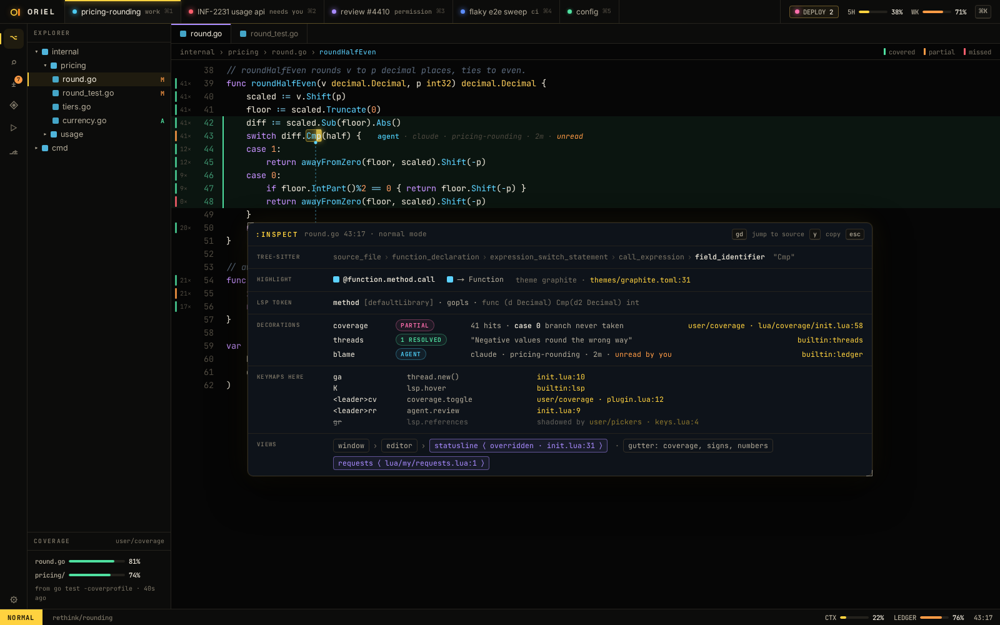
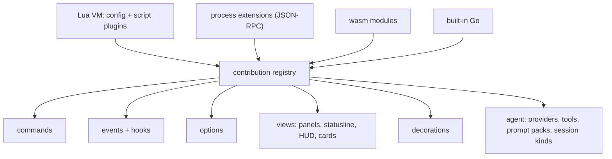

# Extensions: vim-level customisation

The bar: anything you can see, press or trigger, you can rebind, hook,
replace or script, from your config, live, without a rebuild.
The scripting API itself is in `scripting.md`.




## Principles

0. **No special cases.** Features never get private shortcuts into the core. When a feature needs a capability the
   API lacks, the API grows a general version of it (with Lua and RPC bindings), and the feature uses that. The test is
   whether a third party could build the same feature as a plugin.
1. **Dogfood.** Every built-in feature is an extension: the vim keymaps, the
   panels, the HUD, the Claude provider, the review ledger. If a built-in needs
   an API, the API exists for everyone.
2. **Everything is a command.** Every action has a name, takes arguments,
   and is callable from a key, the omnibox, a script, the agent, or `:`.
3. **Everything emits events.** Editor, sessions, agents, threads, git, LSP,
   DAP, workers. Hooks can observe, **veto** or **rewrite** (see below).
4. **Everything is an option.** Typed, scoped (global → session → project →
   buffer → window), introspectable with `:set foo?`, and observable.
5. **Every surface is composable.** Statusline, tabline, HUD, panels, thread
   cards, notifications: each is a view built by a function you can replace.
6. **Live.** `:source`, hot reload on save, a `:lua` REPL, `:Inspect` on anything under the cursor.

## Four tiers

| Tier | Runs as | Latency | Use it for | Isolation |
|---|---|---|---|---|
| **Config & scripts** (Lua) | in-process VM on the UI loop | µs | keymaps, options, autocmds, statusline, small panels, custom commands, agent tools | none: your own config is trusted |
| **Script plugins** (Lua) | same VM, loaded from a plugin dir | µs | what neovim plugins do: surround, motions, pickers, panels | per-plugin namespace, declared permissions for net/exec |
| **Process extensions** | child process, JSON-RPC (stdio) | ~0.2 ms | heavy or long-running work, other languages, integrations, providers | OS process + Landlock / sandbox-exec |
| **WASM modules** | wazero, in-process | ~µs | tree-sitter grammars, pure transforms, untrusted snippets | memory-safe, capability-only host calls |

- **Native Go** is a fifth tier: the same contribution API, compiled in. That covers the built-ins and
  third-party plugins linked in with `oriel build --with …` (see "Performance and native plugins").
- All tiers register through the same **contribution registry**, so a Lua
  panel, a Go panel and a process panel are indistinguishable to the user.



## Contribution points

**Editor**
- keymaps (per mode, including custom modes), operators, motions, text objects (`vim.RegisterMotion`,
  `vim.RegisterObject` in Go today; their Lua bindings come with PL-1).
- ex commands with ranges, bang, counts and completion.
- decorations: highlights, signs, virtual text, virtual lines, inline blocks, conceal.
- filetypes and ftplugins, grammars, queries, formatters, linters, LSP and DAP specs.
- registers (e.g. a `"*` provider), completion sources, snippet engines.

**Shell**
- commands, picker/omnibox sources and actions, panels, docks, layouts. Which-key is a built-in plugin built only on the public API.
- statusline, tabline (session tabs), titlebar and HUD tats, notification cards.
- themes, fonts, effects, and icon sets. A theme is a plugin like any other: data-only, or with Lua for dynamic themes (see `theming.md`).

**AI**
- agent providers (`agent.Provider`).
- **agent tools**: an MCP tool defined in Lua or Go and offered to the session's agent.
- prompt packs, session kinds (plan, work, review, tour and job are built-ins).
- thread sources (GitHub, Jira, agentbus), thread actions ("rewrite", "forward"),
  review-ledger rules, commit and PR gates, slop rules, and status-colour rules.

**Workspace**
- worker hooks, sandbox policies, network-approval rules, gateway policies, git hooks.

## Hooks that can change things, not just watch

| Kind | Signature | Example |
|---|---|---|
| observe | `fn(ev)` | log every agent tool call to a file |
| veto | `fn(ev) -> false, reason` | block commits while the review ledger is under 100% |
| rewrite | `fn(ev) -> ev'` | expand `@ticket` in a comment before it reaches the agent |
| decide | `fn(ev) -> decision` | auto-allow `Bash(go test …)` permission prompts in this repo |
| provide | `fn(ctx) -> items` | add PRs-awaiting-me to the omnibox |

- Hooks run in priority order. Each one has a time budget, with a warning past 2 ms on hot paths.
- `:Hooks` lists every hook on an event, who registered it and its p99 time.

## UI from extensions: the view tree

- Views are functions returning a tree of `ui.Node`s: `Box` (rows and columns, with sizes, padding, gaps, alignment,
  clipping, scrolling and floats), `Text`, `Paint`, and `Func` (Go views that build with widgets) today. `Code`, `Markdown`, `Button`, `Input`, `List`, `Table`,
  `Bar`, `Spark`, `Chart`, `Badge`, `Term`, `Editor` (an embedded buffer) and `Canvas` (draw ops) join them as their
  widgets land. Built-in widgets lay out through the same nodes, so a plugin's view and a built-in one behave alike.
- Lua and Go build them directly. Process extensions send the same tree as
  JSON, with id-keyed patches.
- Built-in panels are written this way, so you can **replace** one:
  `oriel.view.override("requests", my_requests_view)`.
- Views get the theme tokens. Hardcoded colours work, but lint warns.

## Manifest (`oriel.toml`, for plugins that aren't just a Lua file)

```toml
id = "linear"
run = { process = "oriel-linear" }        # or { lua = "init.lua" } / { wasm = "x.wasm" }
permissions = { net = ["api.linear.app"], secrets = ["LINEAR_TOKEN"] }
lazy = { commands = ["Linear*"], events = ["SessionStart"], omnibox = ["tickets"] }
```

## Permissions

Deny by default: capabilities are declared, granted at install, and enforced per tier. Session plugins run in the
session sandbox. All of this is in `security.md`.

## Plugin manager (built-in)

- `oriel.plugins{ { "user/surround" }, { "user/pickers", lazy = { keys = "<leader>f" } } }`.
- Git URLs, pinned by commit, with a lockfile (`oriel-lock.json`).
- Lazy load on command, key, event, filetype or omnibox source.
- `:Plugins` shows load time, hooks and memory per plugin.
- No marketplace until it's open-sourced.

## Runtime path

```
~/.config/oriel/
├── init.lua            config entry
├── lua/                your modules
├── ftplugin/go.lua     per-filetype
├── views/              view overrides
├── agents/             prompt packs, agent tools
├── themes/
└── after/              loaded last
```

The same layout under `<repo>/.oriel/` gives per-project config, trusted on
first open the way direnv works.

## Go interfaces

```go
// package registry — everything registers here, from any tier
type Registry interface {
    Command(c Command) Disposable
    Keymap(k Keymap) Disposable                   // keys in vim notation → a command, per mode
    Option(o OptionSpec) Disposable               // fields and the settings page: settings.md
    View(id string, v View) Disposable            // override = register the same id later; disposing it restores the one beneath
    Decorations(id string, p DecorationProvider) Disposable
    Input(e input.Engine) Disposable              // InputByID(id) and Inputs() find them; editor.input picks one
    Provider(p agent.Provider) Disposable
    AgentTool(t AgentTool) Disposable
    Theme(t theme.Source) Disposable
    Language(l LanguageSpec) Disposable           // filetypes, grammar .wasm, queries (ED-11)

    Run(ctx Ctx, id string, args Args) error      // every tier runs commands the same way
    Commands() []Command                          // what :Commands lists, with sources
    Keymaps() []Keymap                            // what :Keys lists, with sources
    Lookup(modes, keys []string) (exact *Keymap, more bool) // modes most specific first: a panel's, then "n"
    ViewByID(id string) (View, bool)              // the view under a guard: a panic turns it off (errors.md)
    Options() Options                             // values by layer: settings.md

    OnFault(fn func(Fault)) Disposable            // a contribution turned off: it panicked, or kept failing
    TurnOff(kind, id string, err error)           // kind: "command", "view", "hook"
    TurnOn(kind, id string)                       // "Turn back on"
    TurnedOff() []Off                             // what :Hooks and friends show as off, with the error
}

// Every call into a contribution runs under registry.Call, which turns a panic into a *registry.Panic with its
// Go stack. ui.Ctx.Guard does the same for a view's Func node while it builds.

// Each extension registers through registry.WithSource(r, id), which stamps Source on what it registers:
// "builtin:introspect", "init.lua:14", a plugin's id.

type Command struct {
    ID     string                                 // "git.commit"
    Title  string
    Args   Schema                                 // typed, so the omnibox can prompt for them
    Run    func(ctx Ctx, args Args) error
    Source string
}

// typed events; hooks are generic over the payload
type Hook[E any] func(ctx Ctx, ev *E) Verdict      // Continue | Veto(reason) | Decided(value)

func On[E any](r Registry, h Hook[E], opts ...HookOpt) Disposable

// events are plain structs — one per thing that happens
type CommentSend struct{ Thread ThreadID; Body string; Urgent bool }
type Permission  struct{ Session SessionID; Tool string; Input json.RawMessage; Decision *Decision }
type Commit      struct{ Project string; Message string; Unread int }

type Keymap struct {
    Mode    string                                // "n", "i", or a panel's own mode ("requests")
    Keys    string                                // "x", "<C-w>", "<Leader>rr"; <Leader> is expanded when it's defined
    Command string
    Args    Args
    Desc    string
    Source  string
}

type View interface {
    Build(ctx ViewCtx) ui.Node                    // pure: state in, tree out
}

type DecorationProvider interface {
    Decorations(ctx DecorationCtx) []Decoration   // ctx: the buffer's Name, Buffer, Snap, and lines [Top, Bottom) in view
}

// Decoration{Kind, Line or Anchor, From/To, Style, Edge, Text, Node, Priority}. Kinds: Sign (gutter), LineBg
// (with a gutter Edge), Highlight and Underline (byte columns), VirtualText (after the line), Block (a ui.Node
// between this line and the next). An Anchor the provider made on the Buffer moves with edits, so a block
// stays with its text. Providers run under the guard; one that panics is turned off (KindDecoration).
```

```go
// package ext — the plugin itself, in any tier
type Extension interface {
    Manifest() Manifest
    Activate(ctx context.Context, h Host) error
    Deactivate(ctx context.Context) error
}

type Host interface {
    registry.Registry
    Session(id SessionID) (core.Session, bool)
    Sessions() []core.Session
    Editor() edit.Editor                          // focused window
    Secrets() Secrets                             // only what the manifest declares
    Net() *http.Client                            // egress filtered to declared hosts
    Log() *slog.Logger                            // redacted, with the extension as its source
    Notify(n core.Notice)                         // the one path every notice takes (errors.md)
    State() core.State                            // a copy: the notification history, focus, sessions
}

// core.Notice: ID ("lsp.crashed"), Severity (info, warning, error, question), Source (defaults to the
// extension), Session ("" for Oriel's log), Title, Text, Detail (a trace, stderr), Location (file:line),
// Actions (each a command with args), Time, and Key (answers a key just typed, so it goes sooner).
```

- The window is made of views like any other, each replaceable by registering the same id: `app.root`,
  `app.statusline`, `app.notifications` (toasts) and `app.modal`. The log panel is `log`, and `:Events` is `events`.
- The status line is segments: views named `statusline.left.<order>-<name>` and `statusline.right.<order>-<name>`,
  in name order (`statusline.left.00-mode`, `statusline.right.90-position`). Register one to add a segment.
- A view open in the layout is built with `ViewCtx.Instance` (which instance: `editor#3` is instance `3`) and
  `ViewCtx.Focused`. A view can implement `registry.Titled` to name each instance's tab, and
  `registry.EdgeToEdge` to be drawn without the pane's padding; `registry.As[T](view)` sees through the guard.
  `Registry.Views()` lists every view id.
- `Host.Layout()` is the layout tree, to change from commands and views (`Open`, `Close`, `Show`, `Swap`, `Row`,
  `Shown`, `OnClose`), `Host.PaneRect(v)` where a view's pane was drawn, and `Host.Redraw()` asks for a frame from
  any goroutine. `view.open` takes `beside` (`"editor#3"`) and `size`, and `view.close` an `id` and `instance`.
- A box with `ui.Style.Wheel` takes the scroll wheel itself, as `Interaction.Scroll`, for content it scrolls on
  its own (an editor that draws only the lines in view).

- Keys resolve like vim's mappings (`registry.Resolver`): an ambiguous prefix waits up to `keymap.timeoutlen`
  (default 1 s, off with `keymap.timeout = false`), then the longest complete mapping runs, or the first key passes on
  unmapped. `keymap.leader` defaults to Space.
- Lua sees the same API through generated bindings (`oriel.on("Commit", fn)` is `registry.On[Commit]`).
- Process extensions see it as JSON-RPC methods. WASM sees it as host functions.
  One declaration, three bindings.

## Performance and native plugins

**How fast each tier is** (rough figures on a 2024 laptop):

| Tier | Call overhead | Tight compute vs Go | Good for |
|---|---|---|---|
| Built-in Go | ~ns | 1× | input engines, renderers, providers, anything per-frame |
| WASM (wazero, compiled) | ~50–100 ns per host call | 1.2–2× | heavy compute you want sandboxed: grammars, formatters, diff algorithms |
| Lua (gopher-lua) | ~0.3–1 µs per call | 20–50× | keymaps, hooks, commands, panels, statuslines, an emacs mode |
| Lua (LuaJIT, cgo) | ~0.1 µs | 2–5× | same, with headroom |
| Process (JSON-RPC) | ~50–200 µs per round trip | n/a | integrations, providers, long-running work |

What the budgets mean:

- **Per key** (8 ms budget): Lua is fine. Neovim runs whole plugin ecosystems on per-key
  Lua, and gopher-lua is slower than LuaJIT but still about 100× under budget.
- **Per frame** (4 ms at 120 Hz): Lua is fine for a statusline, a HUD tat or a decoration provider,
  as long as they work on the visible lines only, which is how the APIs are shaped.
  It's not fine for drawing the editor itself.
- **Per byte of a large file** (search, diff, parse): Lua is too slow. That belongs in Go, or in WASM if it has to be a plugin.
- **GC**: gopher-lua allocates. Hot-path hooks get a p99 budget, and `:Hooks` shows offenders,
  so slowness is visible rather than mysterious.

**Native plugins: the xcaddy model.**

- Go's `plugin` package is out: it needs identical toolchains and dependency versions, and it's Linux/macOS only.
- Instead, **`oriel build --with github.com/someone/oriel-emacs@v1.2`** compiles a custom `oriel`
  binary with those packages linked in, the way `xcaddy` does for Caddy.
  - Each package's `init()` calls `registry.Register…`. There's no runtime loading, and it runs at full Go speed.
  - The plugin manager knows which plugins are native, and offers to rebuild when the list changes.
  - Builds are cached, so a rebuild takes ~10 s.
- A native plugin is just a Go module that implements the same interfaces (`input.Engine`,
  `agent.Provider`, `registry.View`…). The built-in vim engine and the Claude provider are native plugins too.
- Use native when the work is per-frame or per-byte. Use Lua for everything else.
  A plugin can ship both, with the Lua side calling into its own native commands.
