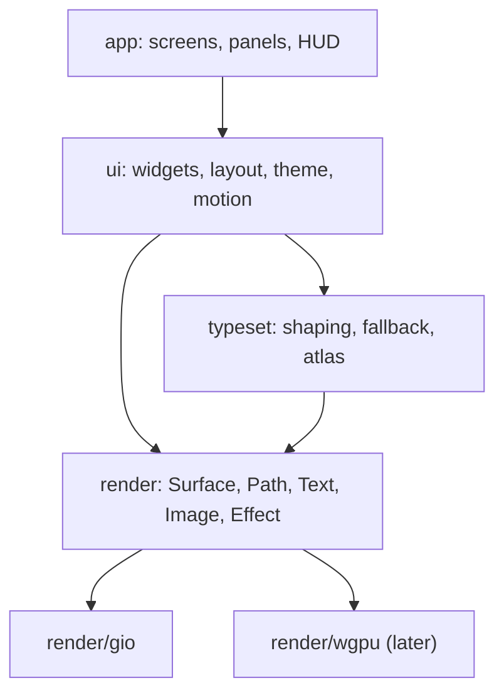

# Rendering and UI toolkit

How we get beautiful text and a UI we can bend into anything.

## Layers



## `render` interface

- Retained display lists, built per frame, with damage regions (the dirty
  rects we actually redraw).
- Primitives: rect (radius, border, gradient), path, glyph run, image, clip,
  transform, and **effects**: blur, glow, scanline, noise. The sci-fi look
  comes from a handful of cheap shader effects, never from 3D.
- Implemented first on Gio's `op` lists. Effects Gio lacks (blur, glow) are
  drawn with prebaked textures until we own a renderer.
- Gio stencils every path on every frame, so `render/gio` draws rounded rects and borders as 9-slices of baked
  images, as it does glows (P0-6; `spikes/P0-4-gio.md`).
- The next frame is requested (`op.InvalidateCmd`) **before** `Frame`. Gio reads it while processing that frame, and
  one executed after `Frame` returns races the main thread and can be lost until the next input event (P0-6).
- Gio also stencils any image drawn under a scale or a fractional offset. So `render/gio` never scales an image: a
  9-slice's corners and pre-stretched edge strips live in the shared atlas and draw at integer offsets, and a uniform
  centre is a plain fill. Small baked images share atlas pages rather than each being a texture.

## Text (`typeset`)

- Shaping: `go-text/typesetting` (a HarfBuzz port): ligatures, kerning, `calt`, `ss01..ss20`.
- Fonts: bundled JetBrains Mono, Inter and Space Grotesk, plus system fallback via fontconfig and CoreText, one face
  at a time, the first time a rune needs it. Never a scan or index of every system font: on macOS that cost 68 MB (P0-6).
  A fallback file is mapped, not read, only the face that covers the rune is parsed, and loading runs off the frame:
  the rune shows as tofu for a frame or two. Loading whole collections onto the heap cost 1 GB on macOS (P0-6).
- Rasterise to a **glyph atlas**, keyed by (font, size, subpixel x-offset in quarters).
  Grayscale AA by default; subpixel LCD AA when the backend allows.
- Gio can't tint an image, so `render/gio`'s atlas holds glyphs already tinted, keyed by colour too, over a
  colour-free coverage cache. A backend with its own shaders samples one coverage atlas and tints in the shader.
- Monospace fast path: shape a whole line once, cache it by content hash, and
  reuse it while the line is unchanged.
- Proportional text (plan docs, threads) goes through the same pipeline,
  with paragraph layout and line breaking (UAX #14).
- Gamma-correct blending and stem darkening. This is most of what makes the difference between "terminal" and
  "beautiful". Coverage is mapped so Gio's blending matches CSS: light text against black, dark text against white,
  with dark text's coverage raised to the power 1/1.25 (`scene/atlas.go` in the spike).
- Letter-spacing (tracking) and font features (`liga`, `calt`, `ss01`…) are `typeset`'s job: Gio's text API
  has neither, so `typeset` shapes with go-text directly (P0-4).

## Blending

- Gio blends in **linear light**; CSS, and so the mockups, blend in sRGB. A translucent token that looks right in
  a mockup comes out much stronger in Gio (a 7% tint about 3× as bright; `spikes/P0-4-gio.md`).
- So `theme` resolves translucent component tokens to **opaque colours over the surface they sit on**, and
  `render/gio` remaps alpha for solid fills whose backdrop isn't known (scrims, opacity layers), solving over the
  frame's `Backdrop` (the theme's `bg.base`), so the remap holds in light themes too.
- Images are different: Gio samples them as premultiplied sRGB, which already blends like CSS over a dark backdrop.
  Glows, baked shapes and the glyph atlas take their colours unchanged (P0-6).
- Dark text on light looks thin under linear blending, so the glyph atlas's gamma and stem darkening must land
  before the light theme.

## `ui` toolkit

- **Immediate-mode API, retained layout cache.** Widgets are functions:
  `Panel(ctx, id, func(ctx){ … })`. State is keyed by id. No widget objects, no DOM.
- Layout: flex rows and columns plus absolute overlays and anchors. An
  "anchor" widget can pin to a buffer position, which is how callouts and
  explain notes follow code.
  - **Text never runs out of its box.** A row too narrow for its children narrows its content-sized ones, last
    first, and a text narrowed this way is cut with "…" (its accessible name stays whole). Content gives way before
    what holds a control (anything clickable or focusable) or is marked `Keep` (a status chip); `Fixed` sizes keep
    theirs. A column clamps a child wider than itself. A box that scrolls sideways keeps its content whole: a tab
    strip or a table wider than its panel scrolls rather than cuts. A stretchy child (`Flex`) gets at least its
    content's width while there's room for every one's.
  - `UI.Overflowing` lists any text drawn past a box it's in; every app snapshot test fails on one.
- **Theme** is data (TOML), with layered tokens, overrides only and a live editor. See `theming.md`.
- **Motion**: a spring-based animator per id. Used sparingly: status pulses,
  panel slides, number roll-ups.
- **Input**: a keymap layer above widgets: vim modes, then app chords
  (`⌘K`, `⌘1..9`), then the focused widget. Everything is rebindable.
- **Accessibility**: an AccessKit-style tree emitted from the same widget ids,
  so screen readers aren't an afterthought. This matters if we open-source it.
  - As built (FW-10): a box with a `Role` is in the tree (window, region, group, button, textbox, list, tree, tab,
    menu, dialog, status…); one without is transparent. Its name is its `Label`, or else the text inside it; its
    value, selection, expansion, focus, `Modal` (a focus trap) and help id (as its description) come from its style,
    its bounds from layout, and its actions (click, focus, scroll) from what it takes. Every widget and the layout's
    regions (Main, the docks, each pane and its tabs) set roles.
  - `render.AccessDiff` turns two trees into an update: nodes added or changed, removed, and the focus. A window
    that implements `render.Accessible` gets an update after each frame and reports a screen reader's actions, which
    the app runs through `UI.Act` (a click is a click, focus is focus). The headless window implements it for tests.
  - The platform bridges (NSAccessibility on macOS, AT-SPI on Linux) are FW-12; Gio has none.
- **Images** (`widget.Image`): an image is drawn at the width it's given, in the device's pixels, scaled once per
  size and kept. With `ImageOpts.Zoom` it takes the pointer cursor and an edge while hovered, and a click on it shows
  it in the lightbox (`widget.Lightbox`, at `LayerDialog`): large over a scrim, fit to the window. Escape, a click on
  the scrim or on the fitted image, or its ✕ closes it; ← and → move between the images of its group, counted n / m
  under it with its caption. The wheel zooms around the pointer, a drag pans the zoomed image, a double-click or 0
  fits it again and 1 shows it at its own size. Only the part in view is scaled, so zooming far into a large image
  costs no more than the window. `ImageOpts.Group` names the group (a document's images); an image with none is
  alone. Tokens: `lightbox.scrim`, `lightbox.fg`, `lightbox.fg.muted`, `lightbox.chrome`, `image.hover.border`.
  - A `widget.Vector` (its own size, a `Draw(frame, rect)`, a `Fill` laid under it in the lightbox, and `Tips`:
    tooltips over parts of it, in its own pixels, shown for the part under the pointer at any size) is a picture
    that draws itself at any size, a diagram: `widget.VectorImage` shows one as `Image` shows pixels, zoomable into
    the same lightbox and group (`LightboxItem.Vector`). The lightbox draws it at the size it shows it, so it stays
    sharp however far it's zoomed, and fits it at up to twice its own size, where an image stops at its own.
- **Diagrams** (`render/diagram`): mermaid flowcharts and sequence diagrams parsed, laid out with the real shaper and
  kept as a display list of their own (rects, paths, dashed lines, text) in logical pixels. `Layout.Draw(frame, rect,
  palette)` scales it into rect: coordinates and stroke widths by the ratio, text reshaped at the scaled size (to a
  quarter pixel), so nothing is rasterised ahead. The parser and layout import no `ui`. See editor.md, "Diagrams".

- **Loading** (FW-14). A view never says it's loading in its own words; it uses the toolkit, so every wait looks and
  behaves the same (`TestViewsUseTheLoadingToolkit` fails on a view drawing its own "Reading…").
  - `plugin.Load[T]` runs a fetch off the loop and tracks it as Idle → Pending → Ready / Failed. A result from a
    fetch started before the latest `Reload` or `Reset` is dropped; a timeout or a panic in the fetch fails it; a
    `Reload` keeps the last value on show (`Stale`) and a failed reload keeps it too, with the error. The fetch's
    `report(note, frac)` fills in what it's doing and how far along it is. `Start` does nothing once started, so a
    view may call it every frame. It lives in `plugin` (it needs `Host.Do`); widgets read a plain
    `widget.LoadState`.
  - `widget.Busy` is the one loading line: a spinner, the label (the "…" added), the load's note, and after 3 s the
    elapsed time ("· 12s", "· 1m 05s"); read out as a status. `widget.ProgressBar` fills to a known fraction or
    slides with no known end (a still, striped bar with reduced motion). `widget.Skeleton` is placeholder rows or
    blocks in the shape of what's coming, pulsing gently, still with reduced motion. `ButtonOpts.Busy` puts a spinner
    in place of the key cap, swaps in `BusyLabel`, disables the button and keeps its width.
  - `widget.Dots` says someone is at work with no known end (an agent's turn): three dots with a wave of brightness
    crossing them in twelve ticks a cycle, a frame a tick, still with reduced motion; read out as a status. Token
    `dots.fg` (`status.working`).
  - `widget.Async` draws a section by its load's state and a policy (ui.md, "Loading"): nothing for the first
    150 ms (`Delay`), then the loading view, which stays at least 300 ms (`MinShow`) so a load just past the delay
    doesn't flash; a failure is a warning-coloured line with **Retry**; `Empty` only once Ready; a reload keeps the
    body with a 2 px bar along its top edge. `widget.Waiting(states…)` tells a submit button whether to wait
    (`Pending`, `Failed`, `Reason`).
  - Tokens: `busy.fg`, `busy.clock`, `progress.track`, `progress.bar`, `skeleton.fill`, `async.error`,
    `async.empty`, `button.busy.fg`. Snapshots: `ui/widget/testdata/loading-*.png`.
  - With a test's fixed clock nothing loading shows until the test moves the clock past the delay. A load with a
    zero start time (started before there's a window) counts as past the delay, with no elapsed time.
  - A busy button shows at once, with no delay: a gated submit says why it waits straight away. Waits of minutes
    (a walkthrough) show the elapsed time from 1 s.

## Performance budgets

| Thing | Budget |
|---|---|
| keypress → photon | < 8 ms |
| frame (scroll, 50k-line file) | < 4 ms CPU, 120 Hz |
| idle CPU, HUD live | < 1% |
| cold start to editable buffer | < 300 ms |
| RSS with 6 sessions open | < 400 MB (excluding LSPs) |

- Every PR touching `render`, `typeset` or `ui` runs a benchmark scene and
  fails CI on a regression of more than 10%.

## Go interfaces

```go
// package render — what a backend (Gio now, wgpu later) implements
type Backend interface {
    NewWindow(o WindowOpts) (Window, error)
    Shaper() typeset.Shaper                       // the backend's fonts; the headless one is fixed-pitch
}

type Window interface {
    Frame(fn func(f Frame)) error                 // records a frame as a display list; the backend draws it on its own loop
    Events() <-chan Event                         // keys, IME, pointer, resize, redraw; closed when the window is
    Scale() float32
    Size() Point                                  // logical pixels
    Close()
}

// A window whose close the app can hold, to ask first: held, its close button (and on macOS the app menu's Quit,
// pointed at the window's close) sends a CloseRequestEvent instead, and the window stays open until Close. Gio aborts
// its ClosingEvent; headless has RequestClose for tests.
type CloseHolder interface {
    HoldClose(hold bool)
}

// A window that knows where it is. The app keeps its frame in the state directory (window.json) when it closes, and
// passes it back as WindowOpts.Frame; the backend fits it to the screens as they are then (PlaceWindow: kept on the
// screen it's mostly on, shrunk and moved inside its work area; on no screen, centred on the main one). Gio places
// with AppKit on macOS and Xlib on X11; Wayland won't let a window place itself, so there it keeps only its size.
type Placed interface {
    Placement() (r Rect, ok bool)                 // logical pixels, from the main screen's top left
}

// Logical (CSS) pixels throughout; rects snap to device pixels, paths and lines don't.
type Frame interface {
    Rect(r Rect, s Style)                         // fill or gradient, radius, inside stroke (a CSS border)
    Path(p *Path, s Style)                        // fill and/or stroke
    Glyphs(run *typeset.Run, at Point, c Color)   // at is the pen on the baseline
    Image(img *image.RGBA, at Point)              // premultiplied, device pixels, never scaled
    Effect(kind EffectKind, r Rect, blur float32, c Color) // Glow, GlowDisc
    PushClip(r Rect, radius float32)
    PushOpacity(a float32)
    Pop()
    Backdrop(c Color)                             // the theme's base background, which unknown backdrops blend over
    Scale() float32
}
```

- Transforms, blur, scanline and damage rects come when something needs them.
- `render.List` is a recorded frame. The app records on its goroutine and the backend replays the latest list
  whenever its platform asks for a frame, so no app code runs on the platform's loop. `render/headless` keeps the
  lists for tests.

```go
// package typeset — shaping and the atlas, independent of the backend
type Shaper interface {
    Shape(text string, f FontSpec) *Run           // FontSpec: family, weight, italic, size, tracking, features
}

type Run struct {                                 // logical pixels
    Text            string
    Glyphs          []Glyph                       // each with its *Face, so fallback faces mix in one run
    Advance         float32
    Ascent, Descent float32
}

func Rasterise(face *Face, gid GlyphID, ppem float32, sub uint8) Coverage // one of SubpixelSteps (4) positions
type Atlas struct{ … }                            // shelf-packed pages; starts again on new pages when full
```

- `typeset.Typesetter` shapes with go-text against the bundled faces (JetBrains Mono, Inter, Space Grotesk), then the
  other bundled faces, then system fallbacks loaded off the frame path. It caches up to 8192 runs.
- `render/gio` keeps every cache bounded: atlas 8 × 1024² pages, 8192 coverages, 512 baked shapes and glows (unused
  ones go after 120 frames), Image ops for 2 frames, 24 fallback faces.

## Headless and snapshots (FW-8)

- `render/raster` draws a display list on the CPU, blending in sRGB as CSS does, so UI tests and theme screenshots
  need no GPU (`shell.md`). It shares glow and rounded-rect baking with `render/gio` (`render/bake`). The fixture
  draws in about 150 ms at 1×.
- `render/snapshot`: `List(l)` writes a display list one op per line for golden files; `Compare(want, got, t)` is a
  perceptual diff (deltaE OK per pixel, the fraction past `t`, and a want | got | heat map image); `GoldenPNG` and
  `Golden` check against files, rewritten with `ORIEL_UPDATE=1`.
- In CI, `make test` draws the fixture workspace (01-ide) in both built-in variants and holds it to the mockups
  (mean deltaE ≤ 0.025, ≤ 6% of pixels past 0.1) and to its own goldens (≤ 0.1% past one JND, 0.02).
- `typeset.NewBundled()` shapes with the bundled fonts only, so goldens are the same on every machine.
- `headless.NewWith(shaper)` and `Window.Shot(frame, bg)` give tests real text and pixels.

## Measuring

- `oriel dev window [-auto] [SCENE]` opens a reference scene (`render/scenes`: ide, scroll, text, glow, hud, type);
  `-auto` runs the budget script and prints frame times, CPU, RSS and late frames.
- `oriel dev bench` measures every scene offscreen; `oriel dev shot DIR` renders them to PNGs; `oriel dev compare`
  diffs a render against a mockup. `render/gio`'s tests hold 01-ide within 8/255 mean and 6.5% of pixels of its mockup.

```go
// package ui — widgets are functions over a *Ctx; each call adds a node to this frame's tree
func (c *Ctx) Box(key any, st Style, body func(c *Ctx)) ID // Row and Column set st.Dir
func (c *Ctx) Text(key any, s string, ts TextStyle) ID
func (c *Ctx) Paint(key any, w, h Size, fn func(f render.Frame, r render.Rect)) ID
func (c *Ctx) Node(n Node)                        // a plugin's view tree: *Box, *Text, *Paint
func (c *Ctx) List(key any, st Style, n int, rowH float32, row func(c *Ctx, i int)) ID // builds only the rows in view
func (c *Ctx) KeepInView(box, target ID) // scrolls to target when it changes; ScrollIntoView every frame fights the user
func (c *Ctx) Items(key any, st Style, n int, o ItemsOpts, item func(c *Ctx, i int)) ID // items of any height: only
    // those in view are built, each as tall as when last built (o.Estimate before), o.End follows its end (Follow), o.Reveal scrolled to unbuilt

type Style struct {
    Dir         Dir                               // Row or Column
    W, H        Size                              // Px(v), Flex(weight), Pct(f), or fit (zero); Clamp(min, max)
    Pad         Insets
    Gap         float32
    Main, Cross Align                             // Start, Center, End; SpaceBetween on the main axis
    Fill, Stroke render.Color; Border, Radius float32
    Clip, ScrollX, ScrollY bool                   // scroll offsets persist by id
    Follow bool                                   // at its end, stays there as it grows (a log); scrolled away, stays put
    Sideways bool                                 // the wheel's up and down scroll it across: a strip of tabs
    Selectable bool                               // its text selects with the pointer (a drag across nodes, a double
                                                  // click a word) and copies with ⌘C / ⌃⇧C; controls keep their clicks
    Wrap bool                                     // a row puts what doesn't fit on the next line, Gap apart: a strip of
                                                  // chips plugins add to; its own content is its widest child
    Float *Float                                  // out of the flow, against another id's rect, a point, or the parent;
                                                  // a Fill one against its parent sized Flex fills it that way (a card's edge)
                                                  // a Flip one that would run past the window's bottom goes above its anchor
                                                  // (a Popover's menu under a control at the window's foot)
    Z     int                                     // floats paint after the flow, in Z order, outside their parent's clip
}

func (u *UI) Frame(f render.Frame, size render.Point, build func(c *Ctx)) // build, lay out, paint
func (u *UI) Rect(id ID) (render.Rect, bool)      // last frame's layout
func (u *UI) Hit(p render.Point) []ID              // topmost first, as clipped when painted
func (u *UI) ScrollBy(id ID, dx, dy float32)

func Indicator(c *ui.Ctx, key any, o IndicatorOpts) ui.ID               // a readout: label, meter, value, dot (SH-8)
func Panel(c *ui.Ctx, key any, o PanelOpts, body func(*ui.Ctx)) ui.ID   // a HUD instrument: frame, brackets, title, note
func Drawer(c *ui.Ctx, key any, o DrawerOpts, body func(*ui.Ctx)) DrawerResult // a sheet pulled down from Top
```

- **Layout** (FW-4) works like Clay's: sizes are fitted up the tree on each axis, then grow and percent space is
  shared down it (weights, honouring min and max), then boxes are placed, then floats. It's deterministic and
  allocation-light; `ui/testdata/layout/*.golden` pins the behaviour. A `Wrap` row breaks its children into lines once
  its width is known (widths are settled before heights), so it grows as tall as its lines. Text is one line until wrapping lands with
  the first widget that needs it.
- Ids hash the parent's id with a key (the child's index when there's none; duplicates get `#n`). State not built
  in a frame is dropped. `Theme` joins the `Ctx` with FW-7.
- **Text selection**: a `Selectable` box's text selects like a document's, one selection a window (`ui/textsel.go`).
  A press on its text (not on a control in it: an interactive node, an input, a drag source) starts it at the nearest
  character boundary of the nearest line, a drag extends it across text nodes in the order they were built (rows,
  wrapped lines), a double press selects a word and a triple a node's text, ⇧ extends it; a press anywhere else ends
  it, and a drag that selected isn't a click on what it started over. It's painted under the glyphs (`text.selection`);
  ⌘C or ⌃⇧C copies it (`UI.SelectedText`: nodes on a line joined by what's between them, lines by newlines). The
  markdown preview, markdown text everywhere, help pages, the agent console's transcript and the Workspace and
  Permissions pages are selectable. ⌘A (⌃A too) selects all the text of the box last pressed in, while what has focus
  holds it. A drag held past the top or bottom of the scrolling box the selection is in scrolls it, faster the further out,
  and the selection follows; in a list that builds only what shows (`Items`), an end scrolled away holds at the edge.
- **Interaction** (FW-5): boxes opt in with `Interactive`, `Focusable`, `Disabled`, `Cursor` and `Tooltip`.
  `u.Pointer(ev)` resolves hover and press against the latest painted frame (immediate mode's one frame of lag), and
  a widget asks `c.Interaction(c.Next(key))` for hovered, pressed, clicked, focused and focus-visible before it
  builds itself. A click is press and release on the same node; a second within `ui.DoubleClick` (400 ms, the
  one interval the editor, the terminal, text selection and the lightbox use too) is also `DoubleClicked`. A key or
  press with no modifier held isn't a chord, so the next ⌥ held alone still counts as held alone. Disabled nodes take nothing and hide what's under
  them. The wheel scrolls the topmost scroller on its axis. `FocusNext(±1)` walks focusables in paint order, and a
  node focused from the keyboard gets a 2 px focus ring. A tooltip shows after the pointer rests 500 ms.
  `PressedWithin` and `FocusWithin` ask the same of a node's subtree: a press anywhere inside a pane focuses that
  pane, so a view that holds the keys (a terminal) gives them up to a click elsewhere.
  Anything clickable (enabled, `Interactive` or `Focusable`, with the pointer cursor) gets a wash under the pointer and
  a stronger one pressed, the theme's `hover` and `pressed`; a widget that draws its own sets `NoHover`.
- **Motion** (FW-13): one spring for everything that moves, `c.Motion(key, target)` on a 0..1 progress, critically
  damped at ω = 45 (within 2% by 130 ms, settled by about 210 ms; nothing runs past 250 ms). The theme's `motion`
  effect scales it (0 turns it off) and `ui.reduced_motion` makes it jump. On it, generally in `ui`: `Style.Enter`
  and `Style.Exit` (a `Transition`: fade, and a shift to come from or go to; an exit keeps the node's last frame
  drawn, taking no input, until it's out), `Style.Glide` (a move animates), `Style.EaseFill` (a fill change eases),
  `Style.Fade`, and floats with `Z < 0`, which draw behind their parent's content (`Ctx.ListBehind` puts one behind a
  list's rows). The widgets use them: menus and popovers fade in 4 px from their anchor and fade out; a modal's scrim
  fades and its card rises 8 px; toasts slide in 24 px from the right, fade out, and the stack glides; the tab
  underline and a list's selection glide; buttons, menu items and rows ease their fills; docks slide open and shut
  with their content fading. Rendering has no scale transform, so menus move rather than scale (0.97 → 1). A key
  acts at once whatever is moving. Six things animating take about 0.1 ms a frame.
- **Springs**: `c.Anim(key, target)` is critically damped (within 2% at 200 ms, settled by 500 ms). The UI reports
  `NextFrame()` while anything moves or a tooltip is due, and the app redraws at 120 Hz until then. A frame that read
  input (a click, keys, the wheel) asks for the next one too, since what the input changed shows only then. The option
  `ui.reduced_motion` makes every spring jump.
- **Frames for pointer moves**: no widget decides whether it needs drawing; the toolkit knows what a frame read.
  `u.Pointer(ev)` reports whether a move can change the next frame: it does when a button is held, a drag or
  scrollbar drag is on, what's hovered changes, a node read `Interaction.Pointer()` (a method, so the read is seen),
  a tooltip is up (it follows the pointer), or the pointer crossed a region the toolkit tested (`over`, a scrollbar's
  hover). Otherwise the app builds no frame, and sets the cursor alone. The frames moves do need are paced to one per
  120 Hz interval; keys and other input draw at once. An animation's next frame is due an interval after the last
  one drawn, so moves that build none never push it back (`TestMenuHoverWhileThePointerMovesBudget`). The Gio
  window also skips a display list identical to the last (`render.List.Same`). A sweep over an open directory takes about 4% CPU.
  The lag budgets (`app/lag_test.go`) hold this through the real loop: moves at 1 kHz over the Explorer, a context
  menu, and the Explorer after drags, with a jump every so often onto something that lights up. That jump shows within
  50 ms (p90), no slower at the end of a run than at its start, and the loop never falls more than 30 ms behind the moves.
- `render.Window.SetCursor` and `render.PointerEvent` (move, press, release, scroll, leave) carry the pointer. A
  `PointerEvent`'s `At` is when it happened, from the OS's timestamp (Gio's, read against the earliest epoch any event
  gives), or zero. A move reaches the app only while the window is the one under the pointer: AppKit sends moves to
  the key window wherever the pointer is, so on macOS `render/gio` turns the first move over another window (a
  non-activating panel such as the screenshot preview) into a leave and drops the rest, and nothing behind that window
  hovers or sets the cursor. X11 and Wayland send moves only to the window under the pointer. The loop times each move that changes a frame from `At` to the frame built with it; past 100 ms
  that's a stall, and `--debug`'s overlay shows it beside the frame time. The Gio window sends a
  `render.SlowFrameEvent` when a frame waits past 100 ms for it to start on it, or takes past 100 ms to draw and
  present (once a second at most), another stall. Stalls go to the trace, not the log: `oriel --trace <file>` keeps a
  flight recorder of the execution trace, and on any of those stalls (or a loop turn held up past 50 ms) writes its
  last ~10 s to the file, later ones numbered beside it, at
  most one every 10 s, for `go tool trace`: what the loop and the main thread were doing while the frame was late.
- **Widgets** (FW-6, `ui/widget`), built only on `ui`'s public API: `Button`, `Chip`, `Input`, `List` (virtual, with a
  selection), `Tree`, `Tabs`, `Menu`, `ContextMenu`, `MenuButton` (an icon button with a menu under it, right-aligned; a
  `Checkable` item chosen leaves it open) and `ToggleMenu` (a `MenuButton` of on/off `ToolItem`s, ticked while on), `Popover`, `Modal`, `Page` (a full-window page such as settings: holds focus,
  Escape closes it; one is up at a time, so opening one closes whichever was, SE-5; and it gives way to what's put in
  front: a view opened or shown, from the sidebar, a command or a file opened, closes the page, through the layout's
  `Root.OnShow` and each page's `registry.Place.Close`, a view already open under the page being revealed, not toggled
  shut), `Scrim` (a dialog's backdrop: a click on it closes the dialog) and `Toasts`. `Input` takes an `Accept` filter (`Digits`, `Decimal`) and draws `Invalid` text with
  an `input.border.invalid` border. With `Lines` (SE-5) it takes several lines: the text wraps at the field's width, the
  field grows from `MinLines` to `Lines` and then scrolls, ⏎ is a new line and ⌘⏎ (Ctrl⏎ elsewhere) submits; ↑/↓ move
  by line, keeping the column, and ⌘↑/⌘↓ go to the start and end of the text. `EnterSubmits` makes it a message's field
  (a comment, a reply): ⏎ submits and ⇧⏎ is a new line. Its selection is painted in `input.selection` (`text.selection`
  by default), which the theme lint keeps at 1.5:1 or more on `input.bg`. `Rows` takes `ClickSelects` for rows
  whose own buttons open them: a click only selects, ⏎ still opens. It hands up the keys it doesn't move or open
  with, so Escape on a list page closes the page. It edits with the platform's keys: on macOS ⌘←/→ (line), ⌥←/→ (word), ⌘⌫, ⌥⌫,
  ⌘A/C/X/V; elsewhere Home/End, Ctrl+←/→, Ctrl+⌫/Del, Ctrl+A/C/X/V. The clipboard is the UI's (`UI.SetClipboard`,
  `Ctx.Clipboard`). Each paints with component tokens
  it declares (`button.bg`, `input.border.focus`, `list.row.selected`, `menu.item.hover`, `modal.scrim`…), takes a
  help id, and has keyboard and mouse paths (see each widget's doc comment). Snapshots of a gallery of all of them
  are pinned in dark and light (display lists and PNGs), and a test fails if any interactive node lacks a help id.
- **Views compose widgets; they don't hand-build controls.** Anything clicked is a `widget.Clickable` (a box with the
  click, hover, press, focus keys and button role done once) or a widget built on it, such as `Segmented` (a strip of
  mono options, one lit). A control a view needs that no widget covers is added to `ui/widget` first, with its tokens
  and a test. Only pointer surfaces (the editor's text, the theme editor's pick and preview) read the pointer
  themselves.
- **Keys reach widgets** through the keymap layer: a focused node with a `KeyMode` ("input", "list", "menu"…) puts
  that mode first, then `global` (app chords such as `⌘K`); otherwise `n`, then `global`. Keys no mapping takes go
  to the focused node (`u.Key`), and a widget reads them from `Interaction.Keys`. So `L.keymap.set("list", "dd", …)`
  is a list-local mapping, and nothing in `n` fires while an input has focus. A widget hands keys it doesn't take
  up to the nearest node above it with a `KeyMode` (`Ctx.PassKeys`), for its next frame: Escape on a focused button or
  toggle reaches the page it's on.
- A press focuses the nearest focusable node at or above it. `Style.Trap` (a modal) keeps focus inside while it's
  up, other than for a float layered over it (a window kept on top over a page). Focus a widget moves itself (`Ctx.Focus`) draws no focus ring; keyboard focus does. `Ctx.Focus` from under the
  float that holds focus, or took it this frame, is ignored, so a page can't take focus back from a dialog over it.
- A float's `Z` is a named layer, lowest first: `LayerUnder` (behind its parent's content: a selection under the
  text), `LayerContent` (highlights, a cursor), `LayerPane` (floating panes),
  `LayerPage` (settings, the theme editor), `LayerPopup` (menus, popovers), `LayerToast`, `LayerWindow` (floating windows kept on top: the assistant's),
  `LayerDialog` (the omnibox,
  pickers, help, modals), `LayerOverlay` (which-key, help markers, pick mode), `LayerDrag` and `LayerTooltip`; add a
  little (`LayerOverlay + 1`) to order floats within one. A float inside another is at least at its layer and paints
  over it, so a popover opened in a dialog is over the dialog. A test fails on a bare number for `Z`.
- A box that clips draws its border over its children, so content that fills it (a terminal in a floating pane)
  doesn't hide its edge.
- A right-click gives the node `Interaction.Context`; `ContextMenu` opens there and always ends with Help for the
  target's help id (`help.md`).
- `ui.Func` lets a Go view build with the frame's `*Ctx` (and so use widgets and keep their state by id, through
  `ui.State[T]`). Process plugins' JSON views (not built yet: a process plugin draws through its Lua) will get the widgets as node types.

```go
// package ui/layout — one tree for every view; docks are its edges (FW-9)
type ViewRef struct{ ID, Instance, Title string }  // a registered view, and which one
type Node struct {                                   // a split (Split set) or a tab group (Tabs)
    Split   Axis; Kids []*Node; Weights []float32
    Tabs    []ViewRef; Active int
}
type Root struct {
    Main *Node; Docks map[Edge]*Dock; Floats []*Float; DropDown *Dock
    Zoomed, Focus *ViewRef
}

func (r *Root) Open(v ViewRef, p Placement, o Opts) error // Docked | Split | Tab | Float | DropDown
func (r *Root) Move(v ViewRef, p Placement, o Opts) error // ⌃W J/L/T/F, ⌃W M's menu
func (r *Root) Drop(v ViewRef, t Target) error            // a drag: a leaf's centre or edge, a dock, open space
func (r *Root) ToggleZoom(v ViewRef)                      // the tree isn't touched, so ⌃W Z again restores it exactly
func (r *Root) FocusDir(d Dir, rects map[*Node]render.Rect) bool // ⌃W h/j/k/l across main and docks alike
func (r *Root) Save() Snapshot; func Restore(Snapshot) (*Root, error) // JSON

func View(c *ui.Ctx, key any, r *Root, panes *Panes, content Content) bool // draws it; tabs drag, splitters resize
```

- The model is plain data, so every move and drop is a golden of the tree it leaves (`ui/layout/testdata`), and
  drags are scripted with real pointer events in tests. Dropping a view on its own leaf's edge splits it off, unless
  it's the leaf's only tab. Splitting the same way twice gives one split with three children.
- A drag lights its target (the half of a leaf an edge drop takes, the whole leaf for its centre, a dock, a 24px
  window edge for a dock that's closed) with an accent fill and glow that glide between targets on springs.
- `⌃W h/j/k/l` goes to the nearest pane in that direction by last frame's rects; a tie goes back to where focus came
  from, as vim's window moves feel.
- The app's built-in `layout` plugin owns the root and registers `view.open {id, place, edge, side, size}` (`size` is the height or width a closed dock opens at),
  `view.close`, `layout.move`, `layout.zoom`, `layout.focus {dir}`, `layout.dock {edge}`, `layout.equalize`,
  `layout.save/restore {name}` and `layout.menu`, with the ⌃W keys, `⌃J` and ``⌃` `` bound in `global`. Saved layouts
  are in memory until sessions persist them (SE-2).


- `widget.Window` is a floating window over the IDE (`LayerWindow`): a title bar that drags it (with a lead, the title,
  a head slot, and minimise and close buttons), left, right and bottom edges and bottom corners that resize it down to
  its `Min`, kept whole in the viewport; its place is a `WindowState` its owner keeps. It doesn't trap focus. A
  `widget.Badge` is a count in a pill (99+ past 99), as the rail's entries and the assistant show what's waiting.
  `Ctx.Still` says the UI keeps still (reduced motion, or motion at 0), so what loops on its own doesn't.
