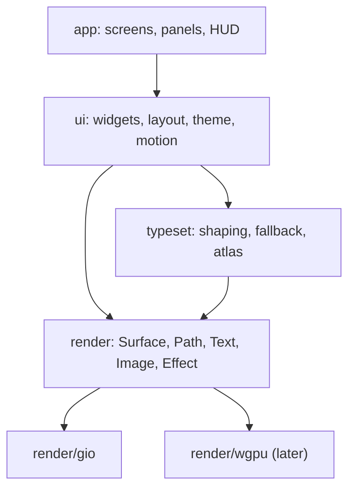

# Rendering and UI toolkit

How we get beautiful text and a UI we can bend into anything.

## Layers



## `render` interface

- Retained display lists, built per frame, with damage regions (the dirty
  rects we actually redraw).
- Primitives: rect (radius, border, gradient), path, glyph run, image, clip,
  transform, and **effects**: blur, glow, scanline, noise. The sci-fi look
  comes from a handful of cheap shader effects, never from 3D.
- Implemented first on Gio's `op` lists. Effects Gio lacks (blur, glow) are
  drawn with prebaked textures until we own a renderer.
- Gio stencils every path on every frame, so `render/gio` draws rounded rects and borders as 9-slices of baked
  images, as it does glows (P0-6; `spikes/P0-4-gio.md`).
- The next frame is requested (`op.InvalidateCmd`) **before** `Frame`. Gio reads it while processing that frame, and
  one executed after `Frame` returns races the main thread and can be lost until the next input event (P0-6).
- Gio also stencils any image drawn under a scale or a fractional offset. So `render/gio` never scales an image: a
  9-slice's corners and pre-stretched edge strips live in the shared atlas and draw at integer offsets, and a uniform
  centre is a plain fill. Small baked images share atlas pages rather than each being a texture.

## Text (`typeset`)

- Shaping: `go-text/typesetting` (a HarfBuzz port): ligatures, kerning, `calt`, `ss01..ss20`.
- Fonts: bundled JetBrains Mono, Inter and Space Grotesk, plus system fallback via fontconfig and CoreText, one face
  at a time, the first time a rune needs it. Never a scan or index of every system font: on macOS that cost 68 MB (P0-6).
  A fallback file is mapped, not read, only the face that covers the rune is parsed, and loading runs off the frame:
  the rune shows as tofu for a frame or two. Loading whole collections onto the heap cost 1 GB on macOS (P0-6).
- Rasterise to a **glyph atlas**, keyed by (font, size, subpixel x-offset in quarters).
  Grayscale AA by default; subpixel LCD AA when the backend allows.
- Gio can't tint an image, so `render/gio`'s atlas holds glyphs already tinted, keyed by colour too, over a
  colour-free coverage cache. A backend with its own shaders samples one coverage atlas and tints in the shader.
- Monospace fast path: shape a whole line once, cache it by content hash, and
  reuse it while the line is unchanged.
- Proportional text (plan docs, threads, tours) goes through the same pipeline,
  with paragraph layout and line breaking (UAX #14).
- Gamma-correct blending and stem darkening. This is most of what makes the difference between "terminal" and
  "beautiful". Coverage is mapped so Gio's blending matches CSS: light text against black, dark text against white,
  with dark text's coverage raised to the power 1/1.25 (`scene/atlas.go` in the spike).
- Letter-spacing (tracking) and font features (`liga`, `calt`, `ss01`…) are `typeset`'s job: Gio's text API
  has neither, so `typeset` shapes with go-text directly (P0-4).

## Blending

- Gio blends in **linear light**; CSS, and so the mockups, blend in sRGB. A translucent token that looks right in
  a mockup comes out much stronger in Gio (a 7% tint about 3× as bright; `spikes/P0-4-gio.md`).
- So `theme` resolves translucent component tokens to **opaque colours over the surface they sit on**, and
  `render/gio` remaps alpha for solid fills whose backdrop isn't known (scrims, opacity layers).
- Images are different: Gio samples them as premultiplied sRGB, which already blends like CSS over a dark backdrop.
  Glows, baked shapes and the glyph atlas take their colours unchanged (P0-6).
- Dark text on light looks thin under linear blending, so the glyph atlas's gamma and stem darkening must land
  before the light theme.

## `ui` toolkit

- **Immediate-mode API, retained layout cache.** Widgets are functions:
  `Panel(ctx, id, func(ctx){ … })`. State is keyed by id. No widget objects, no DOM.
- Layout: flex rows and columns plus absolute overlays and anchors. An
  "anchor" widget can pin to a buffer position, which is how callouts and
  explain notes follow code.
- **Theme** is data (TOML), with layered tokens, overrides only and a live editor. See `theming.md`.
- **Motion**: a spring-based animator per id. Used sparingly: status pulses,
  panel slides, number roll-ups.
- **Input**: a keymap layer above widgets: vim modes, then app chords
  (`⌘K`, `⌘1..9`), then the focused widget. Everything is rebindable.
- **Accessibility**: an AccessKit-style tree emitted from the same widget ids,
  so screen readers aren't an afterthought. This matters if we open-source it.

## Performance budgets

| Thing | Budget |
|---|---|
| keypress → photon | < 8 ms |
| frame (scroll, 50k-line file) | < 4 ms CPU, 120 Hz |
| idle CPU, HUD live | < 1% |
| cold start to editable buffer | < 300 ms |
| RSS with 6 sessions open | < 400 MB (excluding LSPs) |

- Every PR touching `render`, `typeset` or `ui` runs a benchmark scene and
  fails CI on a regression of more than 10%.

## Go interfaces

```go
// package render — what a backend (Gio now, wgpu later) implements
type Backend interface {
    NewWindow(o WindowOpts) (Window, error)
    Shaper() typeset.Shaper                       // the backend's fonts; the headless one is fixed-pitch
}

type Window interface {
    Frame(fn func(f Frame)) error                 // records a frame as a display list; the backend draws it on its own loop
    Events() <-chan Event                         // keys, IME, pointer, resize, redraw; closed when the window is
    Scale() float32
    Size() Point                                  // logical pixels
    Close()
}

// Logical (CSS) pixels throughout; rects snap to device pixels, paths and lines don't.
type Frame interface {
    Rect(r Rect, s Style)                         // fill or gradient, radius, inside stroke (a CSS border)
    Path(p *Path, s Style)                        // fill and/or stroke
    Glyphs(run *typeset.Run, at Point, c Color)   // at is the pen on the baseline
    Image(img *image.RGBA, at Point)              // premultiplied, device pixels, never scaled
    Effect(kind EffectKind, r Rect, blur float32, c Color) // Glow, GlowDisc
    PushClip(r Rect, radius float32)
    PushOpacity(a float32)
    Pop()
    Scale() float32
}
```

- Transforms, blur, scanline and damage rects come when something needs them.
- `render.List` is a recorded frame. The app records on its goroutine and the backend replays the latest list
  whenever its platform asks for a frame, so no app code runs on the platform's loop. `render/headless` keeps the
  lists for tests.

```go
// package typeset — shaping and the atlas, independent of the backend
type Shaper interface {
    Shape(text string, f FontSpec) *Run           // FontSpec: family, weight, italic, size, tracking, features
}

type Run struct {                                 // logical pixels
    Text            string
    Glyphs          []Glyph                       // each with its *Face, so fallback faces mix in one run
    Advance         float32
    Ascent, Descent float32
}

func Rasterise(face *Face, gid GlyphID, ppem float32, sub uint8) Coverage // one of SubpixelSteps (4) positions
type Atlas struct{ … }                            // shelf-packed pages; starts again on new pages when full
```

- `typeset.Typesetter` shapes with go-text against the bundled faces (JetBrains Mono, Inter, Space Grotesk), then the
  other bundled faces, then system fallbacks loaded off the frame path. It caches up to 8192 runs.
- `render/gio` keeps every cache bounded: atlas 8 × 1024² pages, 8192 coverages, 512 baked shapes and glows (unused
  ones go after 120 frames), Image ops for 2 frames, 24 fallback faces.

## Measuring

- `oriel dev window [-auto] [SCENE]` opens a reference scene (`render/scenes`: ide, scroll, text, glow, hud, type);
  `-auto` runs the budget script and prints frame times, CPU, RSS and late frames.
- `oriel dev bench` measures every scene offscreen; `oriel dev shot DIR` renders them to PNGs; `oriel dev compare`
  diffs a render against a mockup. `render/gio`'s tests hold 01-ide within 8/255 mean and 6.5% of pixels of its mockup.

```go
// package ui — immediate-mode widgets are just functions over a Ctx
type Ctx interface {
    ID(key any) Ctx                               // stable identity for state and animation
    Theme() *theme.Resolved
    Frame() render.Frame
    Input() *InputState
    Anim(target float32) float32                  // spring towards target, keyed by ID
}

func Tat(c ui.Ctx, label string, frac float32, tone theme.Token) // a HUD readout
func Panel(c ui.Ctx, title string, body func(ui.Ctx))
```

```go
// package layout — one tree for every view; docks are its edges
type Placement int // Docked | Split | Tab | Float | DropDown

type Node interface{ isNode() }
type Split struct{ Dir Axis; Children []Node; Weights []float32 }
type Leaf  struct{ Tabs []ViewRef; Active int }
type Root  struct{ Main Node; Docks map[Edge]*Leaf; Floats []*Float; Zoomed *ViewRef }

type Layout interface {
    Open(v ViewRef, p Placement, opts Opts) error
    Move(v ViewRef, p Placement, opts Opts) error // ⌃W M, drag and drop
    Zoom(v ViewRef)                                // toggle; restores the saved tree
    Focus(dir Dir)                                 // ⌃W h/j/k/l across main and docks
    Save(name string) Snapshot
    Restore(s Snapshot)
}
```

