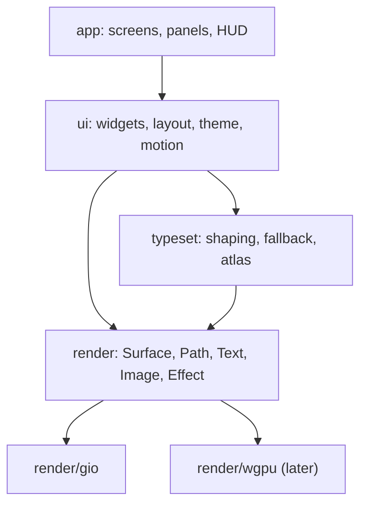

# Rendering and UI toolkit

How we get beautiful text and a UI we can bend into anything.

## Layers



## `render` interface

- Retained display lists, built per frame, with damage regions (the dirty
  rects we actually redraw).
- Primitives: rect (radius, border, gradient), path, glyph run, image, clip,
  transform, and **effects**: blur, glow, scanline, noise. The sci-fi look
  comes from a handful of cheap shader effects, never from 3D.
- Implemented first on Gio's `op` lists. Effects Gio lacks (blur, glow) are
  drawn with prebaked textures until we own a renderer.
- Gio stencils every path on every frame, so `render/gio` draws rounded rects and borders as 9-slices of baked
  images, as it does glows (P0-6; `spikes/P0-4-gio.md`).
- The next frame is requested (`op.InvalidateCmd`) **before** `Frame`. Gio reads it while processing that frame, and
  one executed after `Frame` returns races the main thread and can be lost until the next input event (P0-6).
- Gio also stencils any image drawn under a scale or a fractional offset. So `render/gio` never scales an image: a
  9-slice's corners and pre-stretched edge strips live in the shared atlas and draw at integer offsets, and a uniform
  centre is a plain fill. Small baked images share atlas pages rather than each being a texture.

## Text (`typeset`)

- Shaping: `go-text/typesetting` (a HarfBuzz port): ligatures, kerning, `calt`, `ss01..ss20`.
- Fonts: bundled JetBrains Mono, Inter and Space Grotesk, plus system fallback via fontconfig and CoreText, one face
  at a time, the first time a rune needs it. Never a scan or index of every system font: on macOS that cost 68 MB (P0-6).
  A fallback file is mapped, not read, only the face that covers the rune is parsed, and loading runs off the frame:
  the rune shows as tofu for a frame or two. Loading whole collections onto the heap cost 1 GB on macOS (P0-6).
- Rasterise to a **glyph atlas**, keyed by (font, size, subpixel x-offset in quarters).
  Grayscale AA by default; subpixel LCD AA when the backend allows.
- Gio can't tint an image, so `render/gio`'s atlas holds glyphs already tinted, keyed by colour too, over a
  colour-free coverage cache. A backend with its own shaders samples one coverage atlas and tints in the shader.
- Monospace fast path: shape a whole line once, cache it by content hash, and
  reuse it while the line is unchanged.
- Proportional text (plan docs, threads, tours) goes through the same pipeline,
  with paragraph layout and line breaking (UAX #14).
- Gamma-correct blending and stem darkening. This is most of what makes the difference between "terminal" and
  "beautiful". Coverage is mapped so Gio's blending matches CSS: light text against black, dark text against white,
  with dark text's coverage raised to the power 1/1.25 (`scene/atlas.go` in the spike).
- Letter-spacing (tracking) and font features (`liga`, `calt`, `ss01`…) are `typeset`'s job: Gio's text API
  has neither, so `typeset` shapes with go-text directly (P0-4).

## Blending

- Gio blends in **linear light**; CSS, and so the mockups, blend in sRGB. A translucent token that looks right in
  a mockup comes out much stronger in Gio (a 7% tint about 3× as bright; `spikes/P0-4-gio.md`).
- So `theme` resolves translucent component tokens to **opaque colours over the surface they sit on**, and
  `render/gio` remaps alpha for solid fills whose backdrop isn't known (scrims, opacity layers), solving over the
  frame's `Backdrop` (the theme's `bg.base`), so the remap holds in light themes too.
- Images are different: Gio samples them as premultiplied sRGB, which already blends like CSS over a dark backdrop.
  Glows, baked shapes and the glyph atlas take their colours unchanged (P0-6).
- Dark text on light looks thin under linear blending, so the glyph atlas's gamma and stem darkening must land
  before the light theme.

## `ui` toolkit

- **Immediate-mode API, retained layout cache.** Widgets are functions:
  `Panel(ctx, id, func(ctx){ … })`. State is keyed by id. No widget objects, no DOM.
- Layout: flex rows and columns plus absolute overlays and anchors. An
  "anchor" widget can pin to a buffer position, which is how callouts and
  explain notes follow code.
- **Theme** is data (TOML), with layered tokens, overrides only and a live editor. See `theming.md`.
- **Motion**: a spring-based animator per id. Used sparingly: status pulses,
  panel slides, number roll-ups.
- **Input**: a keymap layer above widgets: vim modes, then app chords
  (`⌘K`, `⌘1..9`), then the focused widget. Everything is rebindable.
- **Accessibility**: an AccessKit-style tree emitted from the same widget ids,
  so screen readers aren't an afterthought. This matters if we open-source it.
  - As built (FW-10): a box with a `Role` is in the tree (window, region, group, button, textbox, list, tree, tab,
    menu, dialog, status…); one without is transparent. Its name is its `Label`, or else the text inside it; its
    value, selection, expansion, focus, `Modal` (a focus trap) and help id (as its description) come from its style,
    its bounds from layout, and its actions (click, focus, scroll) from what it takes. Every widget and the layout's
    regions (Main, the docks, each pane and its tabs) set roles.
  - `render.AccessDiff` turns two trees into an update: nodes added or changed, removed, and the focus. A window
    that implements `render.Accessible` gets an update after each frame and reports a screen reader's actions, which
    the app runs through `UI.Act` (a click is a click, focus is focus). The headless window implements it for tests.
  - The platform bridges (NSAccessibility on macOS, AT-SPI on Linux) are FW-12; Gio has none.

## Performance budgets

| Thing | Budget |
|---|---|
| keypress → photon | < 8 ms |
| frame (scroll, 50k-line file) | < 4 ms CPU, 120 Hz |
| idle CPU, HUD live | < 1% |
| cold start to editable buffer | < 300 ms |
| RSS with 6 sessions open | < 400 MB (excluding LSPs) |

- Every PR touching `render`, `typeset` or `ui` runs a benchmark scene and
  fails CI on a regression of more than 10%.

## Go interfaces

```go
// package render — what a backend (Gio now, wgpu later) implements
type Backend interface {
    NewWindow(o WindowOpts) (Window, error)
    Shaper() typeset.Shaper                       // the backend's fonts; the headless one is fixed-pitch
}

type Window interface {
    Frame(fn func(f Frame)) error                 // records a frame as a display list; the backend draws it on its own loop
    Events() <-chan Event                         // keys, IME, pointer, resize, redraw; closed when the window is
    Scale() float32
    Size() Point                                  // logical pixels
    Close()
}

// A window that knows where it is. The app keeps its frame in the state directory (window.json) when it closes, and
// passes it back as WindowOpts.Frame; the backend fits it to the screens as they are then (PlaceWindow: kept on the
// screen it's mostly on, shrunk and moved inside its work area; on no screen, centred on the main one). Gio places
// with AppKit on macOS and Xlib on X11; Wayland won't let a window place itself, so there it keeps only its size.
type Placed interface {
    Placement() (r Rect, ok bool)                 // logical pixels, from the main screen's top left
}

// Logical (CSS) pixels throughout; rects snap to device pixels, paths and lines don't.
type Frame interface {
    Rect(r Rect, s Style)                         // fill or gradient, radius, inside stroke (a CSS border)
    Path(p *Path, s Style)                        // fill and/or stroke
    Glyphs(run *typeset.Run, at Point, c Color)   // at is the pen on the baseline
    Image(img *image.RGBA, at Point)              // premultiplied, device pixels, never scaled
    Effect(kind EffectKind, r Rect, blur float32, c Color) // Glow, GlowDisc
    PushClip(r Rect, radius float32)
    PushOpacity(a float32)
    Pop()
    Backdrop(c Color)                             // the theme's base background, which unknown backdrops blend over
    Scale() float32
}
```

- Transforms, blur, scanline and damage rects come when something needs them.
- `render.List` is a recorded frame. The app records on its goroutine and the backend replays the latest list
  whenever its platform asks for a frame, so no app code runs on the platform's loop. `render/headless` keeps the
  lists for tests.

```go
// package typeset — shaping and the atlas, independent of the backend
type Shaper interface {
    Shape(text string, f FontSpec) *Run           // FontSpec: family, weight, italic, size, tracking, features
}

type Run struct {                                 // logical pixels
    Text            string
    Glyphs          []Glyph                       // each with its *Face, so fallback faces mix in one run
    Advance         float32
    Ascent, Descent float32
}

func Rasterise(face *Face, gid GlyphID, ppem float32, sub uint8) Coverage // one of SubpixelSteps (4) positions
type Atlas struct{ … }                            // shelf-packed pages; starts again on new pages when full
```

- `typeset.Typesetter` shapes with go-text against the bundled faces (JetBrains Mono, Inter, Space Grotesk), then the
  other bundled faces, then system fallbacks loaded off the frame path. It caches up to 8192 runs.
- `render/gio` keeps every cache bounded: atlas 8 × 1024² pages, 8192 coverages, 512 baked shapes and glows (unused
  ones go after 120 frames), Image ops for 2 frames, 24 fallback faces.

## Headless and snapshots (FW-8)

- `render/raster` draws a display list on the CPU, blending in sRGB as CSS does, so UI tests and theme screenshots
  need no GPU (`shell.md`). It shares glow and rounded-rect baking with `render/gio` (`render/bake`). The fixture
  draws in about 150 ms at 1×.
- `render/snapshot`: `List(l)` writes a display list one op per line for golden files; `Compare(want, got, t)` is a
  perceptual diff (deltaE OK per pixel, the fraction past `t`, and a want | got | heat map image); `GoldenPNG` and
  `Golden` check against files, rewritten with `ORIEL_UPDATE=1`.
- In CI, `make test` draws the fixture workspace (01-ide) in both built-in variants and holds it to the mockups
  (mean deltaE ≤ 0.025, ≤ 6% of pixels past 0.1) and to its own goldens (≤ 0.1% past one JND, 0.02).
- `typeset.NewBundled()` shapes with the bundled fonts only, so goldens are the same on every machine.
- `headless.NewWith(shaper)` and `Window.Shot(frame, bg)` give tests real text and pixels.

## Measuring

- `oriel dev window [-auto] [SCENE]` opens a reference scene (`render/scenes`: ide, scroll, text, glow, hud, type);
  `-auto` runs the budget script and prints frame times, CPU, RSS and late frames.
- `oriel dev bench` measures every scene offscreen; `oriel dev shot DIR` renders them to PNGs; `oriel dev compare`
  diffs a render against a mockup. `render/gio`'s tests hold 01-ide within 8/255 mean and 6.5% of pixels of its mockup.

```go
// package ui — widgets are functions over a *Ctx; each call adds a node to this frame's tree
func (c *Ctx) Box(key any, st Style, body func(c *Ctx)) ID // Row and Column set st.Dir
func (c *Ctx) Text(key any, s string, ts TextStyle) ID
func (c *Ctx) Paint(key any, w, h Size, fn func(f render.Frame, r render.Rect)) ID
func (c *Ctx) Node(n Node)                        // a plugin's view tree: *Box, *Text, *Paint
func (c *Ctx) List(key any, st Style, n int, rowH float32, row func(c *Ctx, i int)) ID // builds only the rows in view

type Style struct {
    Dir         Dir                               // Row or Column
    W, H        Size                              // Px(v), Flex(weight), Pct(f), or fit (zero); Clamp(min, max)
    Pad         Insets
    Gap         float32
    Main, Cross Align                             // Start, Center, End; SpaceBetween on the main axis
    Fill, Stroke render.Color; Border, Radius float32
    Clip, ScrollX, ScrollY bool                   // scroll offsets persist by id
    Float *Float                                  // out of the flow, against another id's rect, a point, or the parent
    Z     int                                     // floats paint after the flow, in Z order, outside their parent's clip
}

func (u *UI) Frame(f render.Frame, size render.Point, build func(c *Ctx)) // build, lay out, paint
func (u *UI) Rect(id ID) (render.Rect, bool)      // last frame's layout
func (u *UI) Hit(p render.Point) []ID              // topmost first, as clipped when painted
func (u *UI) ScrollBy(id ID, dx, dy float32)

func Tat(c *ui.Ctx, label string, frac float32, tone theme.Token) // a HUD readout
func Panel(c *ui.Ctx, title string, body func(*ui.Ctx))
```

- **Layout** (FW-4) works like Clay's: sizes are fitted up the tree on each axis, then grow and percent space is
  shared down it (weights, honouring min and max), then boxes are placed, then floats. It's deterministic and
  allocation-light; `ui/testdata/layout/*.golden` pins the behaviour. Text is one line until wrapping lands with
  the first widget that needs it.
- Ids hash the parent's id with a key (the child's index when there's none; duplicates get `#n`). State not built
  in a frame is dropped. `Theme` joins the `Ctx` with FW-7.
- **Interaction** (FW-5): boxes opt in with `Interactive`, `Focusable`, `Disabled`, `Cursor` and `Tooltip`.
  `u.Pointer(ev)` resolves hover and press against the latest painted frame (immediate mode's one frame of lag), and
  a widget asks `c.Interaction(c.Next(key))` for hovered, pressed, clicked, focused and focus-visible before it
  builds itself. A click is press and release on the same node. Disabled nodes take nothing and hide what's under
  them. The wheel scrolls the topmost scroller on its axis. `FocusNext(±1)` walks focusables in paint order, and a
  node focused from the keyboard gets a 2 px focus ring. A tooltip shows after the pointer rests 500 ms.
  Anything clickable (enabled, `Interactive` or `Focusable`, with the pointer cursor) gets a wash under the pointer and
  a stronger one pressed, the theme's `hover` and `pressed`; a widget that draws its own sets `NoHover`.
- **Motion** (FW-13): one spring for everything that moves, `c.Motion(key, target)` on a 0..1 progress, critically
  damped at ω = 45 (within 2% by 130 ms, settled by about 210 ms; nothing runs past 250 ms). The theme's `motion`
  effect scales it (0 turns it off) and `ui.reduced_motion` makes it jump. On it, generally in `ui`: `Style.Enter`
  and `Style.Exit` (a `Transition`: fade, and a shift to come from or go to; an exit keeps the node's last frame
  drawn, taking no input, until it's out), `Style.Glide` (a move animates), `Style.EaseFill` (a fill change eases),
  `Style.Fade`, and floats with `Z < 0`, which draw behind their parent's content (`Ctx.ListBehind` puts one behind a
  list's rows). The widgets use them: menus and popovers fade in 4 px from their anchor and fade out; a modal's scrim
  fades and its card rises 8 px; toasts slide in 24 px from the right, fade out, and the stack glides; the tab
  underline and a list's selection glide; buttons, menu items and rows ease their fills; docks slide open and shut
  with their content fading. Rendering has no scale transform, so menus move rather than scale (0.97 → 1). A key
  acts at once whatever is moving. Six things animating take about 0.1 ms a frame.
- **Springs**: `c.Anim(key, target)` is critically damped (within 2% at 200 ms, settled by 500 ms). The UI reports
  `NextFrame()` while anything moves or a tooltip is due, and the app redraws at 120 Hz until then. The option
  `ui.reduced_motion` makes every spring jump.
- `render.Window.SetCursor` and `render.PointerEvent` (move, press, release, scroll, leave) carry the pointer.
- **Widgets** (FW-6, `ui/widget`), built only on `ui`'s public API: `Button`, `Chip`, `Input`, `List` (virtual, with a
  selection), `Tree`, `Tabs`, `Menu`, `ContextMenu`, `Popover`, `Modal` and `Toasts`. Each paints with component tokens
  it declares (`button.bg`, `input.border.focus`, `list.row.selected`, `menu.item.hover`, `modal.scrim`…), takes a
  help id, and has keyboard and mouse paths (see each widget's doc comment). Snapshots of a gallery of all of them
  are pinned in dark and light (display lists and PNGs), and a test fails if any interactive node lacks a help id.
- **Views compose widgets; they don't hand-build controls.** Anything clicked is a `widget.Clickable` (a box with the
  click, hover, press, focus keys and button role done once) or a widget built on it, such as `Segmented` (a strip of
  mono options, one lit). A control a view needs that no widget covers is added to `ui/widget` first, with its tokens
  and a test. Only pointer surfaces (the editor's text, the theme editor's pick and preview) read the pointer
  themselves.
- **Keys reach widgets** through the keymap layer: a focused node with a `KeyMode` ("input", "list", "menu"…) puts
  that mode first, then `global` (app chords such as `⌘K`); otherwise `n`, then `global`. Keys no mapping takes go
  to the focused node (`u.Key`), and a widget reads them from `Interaction.Keys`. So `L.keymap.set("list", "dd", …)`
  is a list-local mapping, and nothing in `n` fires while an input has focus.
- A press focuses the nearest focusable node at or above it. `Style.Trap` (a modal) keeps focus inside while it's
  up. Focus a widget moves itself (`Ctx.Focus`) draws no focus ring; keyboard focus does.
- A right-click gives the node `Interaction.Context`; `ContextMenu` opens there and always ends with Help for the
  target's help id (`help.md`).
- `ui.Func` lets a Go view build with the frame's `*Ctx` (and so use widgets and keep their state by id, through
  `ui.State[T]`). Process plugins' JSON views get the widgets as node types when PL-2 lands.

```go
// package ui/layout — one tree for every view; docks are its edges (FW-9)
type ViewRef struct{ ID, Instance, Title string }  // a registered view, and which one
type Node struct {                                   // a split (Split set) or a tab group (Tabs)
    Split   Axis; Kids []*Node; Weights []float32
    Tabs    []ViewRef; Active int
}
type Root struct {
    Main *Node; Docks map[Edge]*Dock; Floats []*Float; DropDown *Dock
    Zoomed, Focus *ViewRef
}

func (r *Root) Open(v ViewRef, p Placement, o Opts) error // Docked | Split | Tab | Float | DropDown
func (r *Root) Move(v ViewRef, p Placement, o Opts) error // ⌃W J/L/T/F, ⌃W M's menu
func (r *Root) Drop(v ViewRef, t Target) error            // a drag: a leaf's centre or edge, a dock, open space
func (r *Root) ToggleZoom(v ViewRef)                      // the tree isn't touched, so ⌃W Z again restores it exactly
func (r *Root) FocusDir(d Dir, rects map[*Node]render.Rect) bool // ⌃W h/j/k/l across main and docks alike
func (r *Root) Save() Snapshot; func Restore(Snapshot) (*Root, error) // JSON

func View(c *ui.Ctx, key any, r *Root, panes *Panes, content Content) bool // draws it; tabs drag, splitters resize
```

- The model is plain data, so every move and drop is a golden of the tree it leaves (`ui/layout/testdata`), and
  drags are scripted with real pointer events in tests. Dropping a view on its own leaf's edge splits it off, unless
  it's the leaf's only tab. Splitting the same way twice gives one split with three children.
- A drag lights its target (the half of a leaf an edge drop takes, the whole leaf for its centre, a dock, a 24px
  window edge for a dock that's closed) with an accent fill and glow that glide between targets on springs.
- `⌃W h/j/k/l` goes to the nearest pane in that direction by last frame's rects; a tie goes back to where focus came
  from, as vim's window moves feel.
- The app's built-in `layout` extension owns the root and registers `view.open {id, place, edge, side, size}` (`size` is the height or width a closed dock opens at),
  `view.close`, `layout.move`, `layout.zoom`, `layout.focus {dir}`, `layout.dock {edge}`, `layout.equalize`,
  `layout.save/restore {name}` and `layout.menu`, with the ⌃W keys, `⌃J` and ``⌃` `` bound in `global`. Saved layouts
  are in memory until sessions persist them (SE-2).

