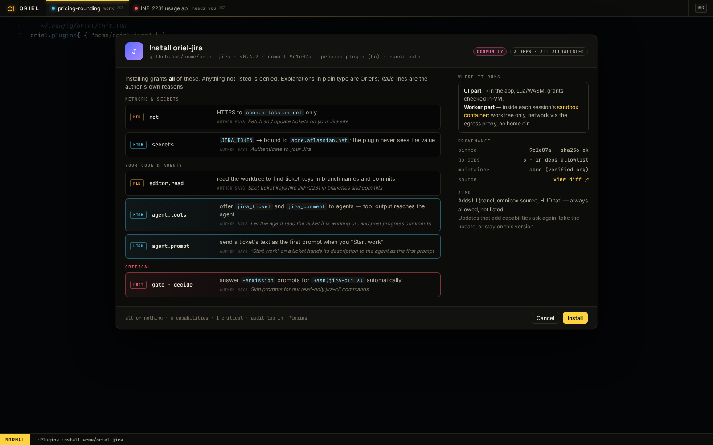
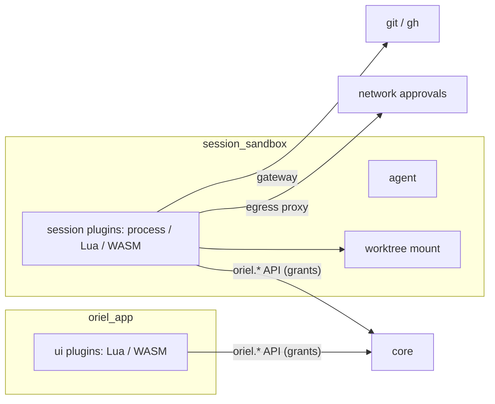

# Security: what plugins (and repos) can touch

Default: **deny everything that isn't declared**. Every plugin declares the capabilities it needs. At install you see
all of them and either install or cancel: it's **all or nothing**. The host enforces the declaration at the API boundary. Where enforcement is genuinely impossible, Oriel says so
rather than pretending.

## Capabilities

| Capability | Lets a plugin… | Risk | Shown at install |
|---|---|---|---|
| `ui` | add panels, indicators, decorations, pickers, commands, keymaps | low | no: always allowed |
| `theme` | provide themes, fonts, icons | low | no: always allowed |
| `editor.read` | read open buffers and the worktree files the session can see | medium — your code | yes |
| `editor.write` | edit buffers (authored as `plugin:<id>`, visible in blame and the review ledger) | medium | yes |
| `input.observe` | see every key pressed, not just its own mappings | **high** — a keylogger | yes, warned |
| `fs.read` / `fs.write` `{ scope }` | files outside the editor API; scope = `worktree`, `config`, or explicit paths | medium–high | yes |
| `net { hosts }` | HTTP(S) to listed hosts only | medium | yes, hosts listed |
| `secrets { name → host }` | use a named secret, **bound to a host** (see below) | high | yes |
| `exec { commands }` | run listed programs | **high** | yes, warned |
| `agent.read` | read session transcripts and threads | high — everything you discuss | yes |
| `agent.prompt` | send prompts / comments to a session's agent | high — can steer it | yes, warned |
| `agent.tools` | offer tools to the agent | high — tool output reaches the agent (prompt injection) | yes, warned |
| `gate` | `veto` / `decide` hooks: block commits, **answer permission prompts** | **critical** — auto-approval is privilege escalation | yes, warned, each hook listed |
| `session.control` | start/stop/resume sessions | medium | yes |
| `git` | commit/push/PR through the gateway (still subject to its approvals) | high | yes |
| `clipboard`, `notify` | read clipboard / show notifications | low–medium | clipboard yes · notify no |

- **All or nothing.** At install, Oriel lists every capability the plugin declares beyond the always-allowed ones,
  each with Oriel's own explanation and risk level, and **the plugin's reason** if the manifest gives one.
  The choices are **Install** or **Cancel**. There's no partial grant, so a plugin never runs half-working,
  and authors never have to code for capabilities that might be missing.
- A plugin that only needs `ui` and `theme` installs with no prompt.
- Consent is recorded in `oriel-lock.toml`. A plugin listed in `settings.toml` whose lock entry already covers its
  capabilities (your dotfiles on a new machine) activates without asking again (`catalog.md`).
- An **update that adds capabilities** is the same choice again: accept the update with its new list, or stay on the
  current version. Removing capabilities applies silently.
- **Undeclared calls fail** with a clear error naming the missing capability: never a silent no-op, never a prompt mid-flow.
- Oriel's explanation of each capability comes from Oriel (`help.md` pages), not from the plugin. The plugin's "why" is
  shown as the author's claim, labelled as such.

```toml
[permissions]
net     = { hosts = ["acme.atlassian.net"], why = "Fetch and update Jira tickets" }
secrets = { JIRA_TOKEN = "acme.atlassian.net", why = "Authenticate to your Jira" }
"agent.tools" = { tools = ["jira_ticket", "jira_comment"], why = "Let the agent read the ticket it's working on" }
```



### Secrets never enter the plugin

```toml
permissions.secrets = { LINEAR_TOKEN = "api.linear.app" }
```

- The plugin calls `oriel.http.get(url, { auth = "LINEAR_TOKEN" })`; the **host** injects the header, and only if the
  request goes to `api.linear.app`. The token value is never visible to plugin code, so it can't be exfiltrated elsewhere.
- Secrets live in the OS keychain; `:Secrets` shows which plugin uses which, and when last.

## Enforcement by tier — honestly

| Tier | How grants are enforced | Strength |
|---|---|---|
| **WASM** | only host functions exist; each checks the grant | **strong** — memory-safe, no other way out |
| **Lua (gopher-lua)** | VM started **without** `io`, `os`, `debug`, `package.loadlib`, `load` of bytecode; the only door out is `oriel.*`, which checks grants | **strong** — pure-Go VM, no native escape |
| Lua (LuaJIT, if adopted) | same, **plus FFI disabled** (FFI is a full escape) | strong only with FFI off |
| **Process** (JSON-RPC) | API calls checked like the others, **and** the process itself is OS-sandboxed (below) — otherwise it could just open sockets | strong with the sandbox, **none** without |
| **Native Go** (`oriel build --with`) | **cannot be enforced** — it's compiled into Oriel with full access | **full trust**: install shows "this plugin runs as you, unrestricted"; allowed from sources you mark trusted only |

- Your **own config** (`~/.config/oriel`) is trusted, as in vim.
- **Per-project config** (`.oriel/` in a repo) is **untrusted until approved** (direnv-style, re-approved when it changes),
  and even then runs with `ui` + `theme` only unless you grant more. Cloning a hostile repo must never run code — no
  modeline-style surprises.

## Where a plugin runs

Plugins run **where the thing they touch lives**, declared in the manifest:

```toml
runs = "app"        # UI, themes, keymaps, pickers over app state
runs = "session"    # anything that executes code or touches the worktree: linters, formatters, test runners, agent tools
runs = "both"       # e.g. a UI panel (app) backed by a worker part (session)
```



- **Session-side plugins run inside that session's sandbox container**, like the agent: they see only the worktree
  mount, their network goes through the egress proxy (declared hosts pre-approved, others asked), git goes through the
  gateway. So a session plugin gets the sandbox **for free** — the same answer to "can this touch my home dir" as the agent.
- **Sessions without a sandbox** (local, unsandboxed): process plugins get an OS sandbox instead —
  **Landlock + seccomp** on Linux (via `x/sys`), `sandbox-exec` profile on macOS — scoped to the worktree and the declared
  `fs`, `net`, `exec` grants.
- **App-side plugins** are Lua or WASM only (no process plugins in the app) — the in-VM enforcement above is enough, and
  nothing app-side can exec.
- A plugin that needs both halves is split: a UI part (app) and a worker part (session), talking through `oriel.*` messages.

## Agent-facing risk

- Tools a plugin offers the agent go through the **Permission** layer like any tool, and are labelled with their plugin.
- Tool **output** is treated as untrusted content (as crit's trusted-orgs gate treats strangers' PR text): it's marked
  as plugin-provided in the transcript, and plugins can't inject text into the system prompt or prompt packs unless granted
  `agent.prompt`.
- `gate` grants are listed in the HUD while active ("2 plugins can answer permission prompts") — never invisible.
- No agent posts to a GitHub review or a PR's conversation, whatever a rule or a grant says: the gateway never offers a
  tool that does, and the agent's shell and permission asks are refused (RV-4; agents.md). Strangers' review text
  is withheld from the agent (trusted orgs).

## Remote workers (AI-15)

A worker on another machine runs sessions and agents for the app, so letting one in is letting it act in your
window: its sessions, requests and notices show there, and it can call the tools plugins offer agents. The door:

- **Off by default.** The app listens only while `workers.listen` is set; Add a worker sets it, asking where.
- **The app is pinned, not named.** A self-signed certificate (P-256, TLS 1.3 only), made once and kept owner-only
  in the state directory. A worker dials with its fingerprint in the command line and checks it before it sends
  anything (`wire.Dial`), so a wrong host never sees the key. The fingerprint as six words (`wire.Words`) is shown by
  the dialog and printed by the worker, for checking the command arrived intact.
- **A key per worker.** 256 random bits, shown once in the Add dialog's command and never kept in the clear: the
  keys file (`workers.json`, owner-only) holds its SHA-256 (`wire.HashKey`), compared in constant time
  (`wire.KeyHashAuth`). The handshake reads at most 2 KB from a stranger and times out after 15s.
- **A worker is only itself.** It must report the ID its key is for; `local` is never a remote worker's. Its events
  are filtered to its own worker state, usage and sessions (`core.State.FromWorker`), so it can't change another
  worker's sessions or pose as this machine's.
- **Revoke** removes the key and cuts the connection; the worker is refused from then on (`wire.ErrRejected`, which
  stops `oriel worker --connect` retrying). Refusals are logged and listed on the worker's page.
- Not yet: rotating the certificate (delete it and re-add the workers), and limiting which addresses may connect.

## Operations

- **Audit log**: every capability use (which plugin, which grant, what target) — `:Plugins` shows recent use and counts.
- **Kill switch**: disable a plugin instantly from `:Plugins`, the omnibox, or the inbox card that flagged it.
- **Safe mode**: `oriel --safe` starts with no third-party plugins and no project config — for when something misbehaves.
- **Supply chain**: plugins pinned by commit + hash in `oriel-lock.toml`, with a badge (reviewed, trusted, unverified)
  saying who looked at the code; the registry can yank or revoke a version (`catalog.md`); updates show a source diff and a capability diff;
  `deps.md` rules apply to native plugins' Go dependencies.

## Go interfaces

```go
// package ext — the grant check every host API call goes through
type Grant struct {               // one per declared capability; all accepted together at install
    Cap   Capability                // e.g. CapNet
    Scope []string                  // hosts, paths, commands
    Why   string                    // the author's reason, shown as theirs
}

type Guard interface {
    Check(plugin ID, cap Capability, target string) error // ErrNotDeclared | nil
    Audit() []Use
}

// every binding wraps its API with the guard — generated, so no API can forget it
//oriel:api name=http cap=net
func (h HTTP) Get(ctx PluginCtx, url string, opts ReqOpts) (*Response, error)
```

- The `//oriel:api cap=…` annotation from `scripting.md` makes the capability part of the generated binding: an API without
  a declared capability fails `go generate`, so no unguarded door can be added by accident.
