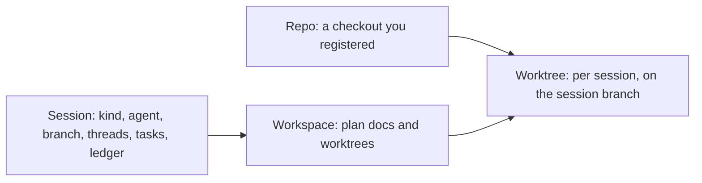
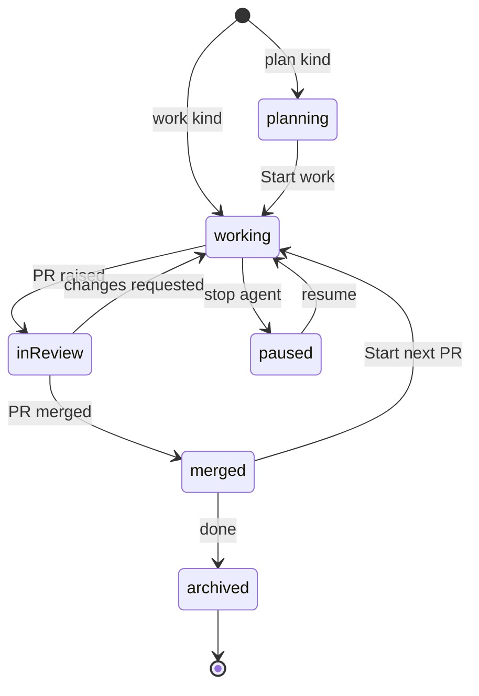

# Sessions, not folders

Oriel's unit of work is a **session**, not an open directory. You don't "open a folder"; you start a piece of work on
one or more repos, and Oriel gives it its own worktrees, branch, agent and history. Your own checkouts are never touched.

## The model



- **Repo**: a checkout Oriel knows about (path, remote, default branch, toolchain), registered once. Registering
  is one step (`repos.add {path = "~/src/pricing"}`, or from the launcher), and repos are found from your GitHub and Linear history
  too. A repo is never edited directly.
- **Workspace**: a directory under `~/.oriel/workspaces/<name>` holding the plan docs and **one git worktree per repo**,
  all on the session's branch. This is crit's model, carried over unchanged.
- **Session**: a workspace plus a **kind**, an agent (or none), a branch, and everything that accrues: threads, tasks, ledger,
  test runs, transcript and layout. Sessions are what mission control and the omnibox list; a tab is a session
  open in the window: started, resumed or brought to the front, never just for being on the start view.
  Built in RV-2: the ledger's state is the session's `Reviews` (hunks marked, lines read and skimmed), its kind's
  commit gate is `CommitGate` (from `KindSpec.Gate`), and commits made past the gate are `Overrides`.

## Kinds

| Kind | Starts from | Worktree | Agent | In the launcher |
|---|---|---|---|---|
| **work** | a prompt, a ticket, or an existing branch | created immediately from an up-to-date base | yes | yes, the default |
| **plan** | a prompt or a ticket | created at Start work | drafts docs, then implements | yes |
| **review** | a PR URL or an agentbus review request | the PR's head, read-only by default | AI review | yes |
| **job** | a saved prompt | created by the agent as needed | runs to done or blocked | no: the Jobs page |
| **new repo** | a name and a template | a fresh repo | optional | no: `session.start` |
| **direct** | a directory | **none: the directory itself**, git repo or not | optional, with a warning | no: `session.start` |

- **Work** and **plan** start on zero or more repos. With none, the workspace has no projects yet (a chat, or work
  whose repos come later); a repo added later gets its worktree on the session's branch (`AddRepo`). There is no
  scratch kind: a chat with no repo is Ori (the assistant), or a work or plan session with no repos.
- **Tours**: removed (the user's decision).

- **New repo**: pick a name and a template (empty, Go module, Go CLI, or any GitHub
  template repo). Oriel runs `git init`, optionally creates the GitHub repo (private by default, through the gateway with approval),
  registers it, and continues as a plan session ("what are we building?").
- **Direct** is "classic" editing: it opens any directory in place, git repo or not, with no worktree and no new
  branch. It starts with `session.start {kind = "direct", dir}`. The tab is marked `direct`, and an agent there gets a warning first because it would be editing your real checkout.
  Open Directory (and `oriel <dir>`) is a direct session with no agent, reused for that directory. A direct session
  ships from the branch its checkout is on now (`host.directBranch`), since it's the user's own and they switch it.
## Starting one

- **The app opens on mission control** (`ui.md` 03), not a file dialog. `⌘N` opens the launcher (`ui.md` 04): prompt, mode,
  provider, repos, sandbox.
- **From anywhere**: a ticket from any tracker, Linear or another (plan or work), a PR link (review), a branch in the Explorer (work on that branch), a failing CI run
  ("fix CI" opens a work session on the PR's branch), or an agentbus review request.
- **Commands**: `session.start` takes the launcher's fields as args (`{kind, prompt, repos, ticket, …}`), so Lua and
  the assistant start any kind without the launcher, those it doesn't offer too; `session.new` opens the launcher
  (on any kind given as `{kind}`).
- **Starting doesn't wait for the agent.** `host.Start` returns once the session and its first request exist; the
  agent starts off the call (`startAside`, which `Host.Close` cancels and waits for), as does a comment to a
  session whose agent isn't up. A fresh agent starts on what's waiting for it as its first turn (`agents.md`). A sandbox's first start can take minutes (the image, toolchains, Claude's binary),
  so while it starts `AgentState.Starting` says what it's doing: a step, a note when the step is a one-off, and
  since when (`core.AgentStart`). A backend's slow steps say so with `sandbox.Report(ctx, Progress{Step, Note})`;
  the docker backend reports building an image, installing toolchains and downloading Claude, each only when it
  does the work. A session whose agent is starting is working, not "needs you" (`AgentState.Live`), and a job's
  run is running. A failed start leaves `Starting` nil and `Error` set; a stop or a closing host during a start
  cancels it, and what it made is closed.
- **Where Start lands.** The launcher's Start passes `session.start {then = [{command = "request.open"}]}` when the
  session has a first request, so the window comes up on it: the request, queued "· agent starting", with a card
  (spinner, step, time so far, the note) until the agent is up and has it. Mission control's card says STARTING
  with the step, the console's header chip says starting, and the raw terminal says there's none yet.

### Repos

- A session only works on repos Oriel has registered (`~/.oriel/repos.json`: `{repos, ignored}`; a bare array, the
  old form, still reads). A path registers as the session starts; naming a repo by an ID it doesn't know fails with
  how to get it: `repos.add {path}` for a checkout, or `repos.clone {url}`.
- `core.Repo` carries how it came (`Source`: added, cloned, discovered, session), when (`Added`) and the last
  session started on it (`Used`). The store holds the list (`core.State.Repos`), set by `core.ReposChanged {repos,
  added}` on every add, remove and scan, so the launcher, the sidebar's `+` and the Repos page follow it live.
- Oriel's sessions never write to a repo, but for a direct session; the Repos page does (housekeeping, tags), and
  only when you press the button and confirm.
- **Adding** is its own flow, `repos.new` (the Add repo dialog, `ui.md` 45): an existing directory, or a clone of
  a URL into a parent folder and folder name you can see before it's made. `repos.clone {url, parent, name}`
  (`host.CloneRepo`) clones with `gitx.CloneProgress`; with no parent, it goes where most of your repos are
  (`host.CloneParent`), else `repos.dir` (`~/src`). A checkout of the same URL already there is registered as it
  is; anything else there is an error. Git never prompts: a clone that needs credentials fails with git's own
  message and says it clones with this machine's git credentials. Cancelling a clone takes away what it made.
- **Discovery** (`host.ScanRepos`, `repos.scan`): on start, and when a repo is added by hand, every folder a known
  repo sits in is read one level deep, and each git repo there that is its own main clone (not a worktree) is
  registered as `discovered`. Never `/` or your home folder itself, nothing under `~/.oriel`, no dot-folders, at most
  200 a scan; a folder read once isn't read again until `repos.scan`. `repos.discover` turns it off.
- **Removing** (`repos.remove`) unregisters a repo and ignores its path from then on: discovery never adds it back,
  adding it by hand does. Its files stay. A live session with a worktree of it refuses, naming the session.

## Lifecycle



- **Worktrees** are created from a freshly fetched base on a branch named `<you>/<ticket>-<slug>`. All repos in the session
  share the branch. Repos can be added mid-session (by you, or by the agent asking).
- **Start next PR** (`ship.next-pr`) moves one project on from its merged or closed PR: it brings the default branch
  up to date and cuts a fresh branch from it in the same worktree, so open buffers, the layout and the agent stay put.
  It refuses while the old branch has uncommitted changes, or commits that are neither pushed, on the base, nor the
  PR's. The PR it leaves is kept with its number, link, title and state, and Previous (the PR tab, the Ship page)
  lists them. Merged from Oriel (Merge…, or Merge into main) with the agent idle and nothing uncommitted, the next PR
  starts by itself; merged on GitHub, or with something in the way, a question asks first. Cut from a local default
  branch that isn't pushed (after Merge into main), raising waits until it is, since the PR would show its commits.
  A project that moved on from a merged PR with nothing since counts as merged for Finish session and
  `session.archive_on_merge`; when that setting would archive the session, the next PR isn't started.
- **Archiving** (after merge, or by hand) removes the worktrees but keeps the threads, transcript and test history, so
  past sessions stay searchable in the omnibox. Reopening one (`session.open`) makes its worktrees again on their
  branches, or pinned at their commit; a branch that's gone is an error.
- **Ending a session** is one dialog with several doors, never a rail entry: **End session…** on the session tab's
  right-click menu, `e` on a mission control card, the Workspace page's Overview, and **Finish session** on Ship once
  every PR is merged (`merged → archived: done`). The ✕ on a tab still only closes the tab.
  - `session.end {id, how, discard, delete_branch}`: `how` is `archive` or `delete`; none opens the dialog
    (`host.End`, `EndReq`). The tab closes first; an archive's notice offers **Undo** (`session.open`) unless its
    branches went.
  - The dialog (`app/sessionend.go`, keys in mode `session.end`: `⌘↵`, `Esc`) is a segmented Archive / Delete,
    preselected Archive once anything was pushed or raised, else Delete; a direct session can only be archived. It
    lists per project, from Ship's read, uncommitted files (count and the first three), commits not pushed, an open
    PR (it stays open), then an agent mid-turn and a running sandbox. With uncommitted work Archive is **Discard
    and archive** (`EndReq.Discard`).
  - **Delete the branches too** deletes each project's local branch, never the default one; the remote's stays.
  - `session.archive_on_merge` (off by default) archives by itself on `PrMerged` once every PR is merged and nothing
    is uncommitted.
- **Sessions survive restarts**: the agent resumes by session id, and the layout, open buffers and cursor positions come back.
  Built (SE-2): the layout is kept per directory as it changes, and views revive their instances through
  `registry.Persisted` (plugins.md); switching to a session reopens its directory, so its layout comes back too.
- **Housekeeping** (the Repos page, `repos.housekeep`): per repo, local branches merged into the default branch
  (`origin/<default>` when there is one) or whose upstream was deleted (a squash-merged PR), with their worktrees,
  and worktrees whose directory went; never the default or checked-out branch, and a live session's branch is shown
  but locked. A dirty worktree goes only when ticked. Cleaned with a confirmation, each with its own result.

## In the editor

- The **project sidebar** (`ui.md` 01h) lists the session's projects; you work in one at a time, and its panels
  (Explorer, Search, Git, Pull request, Tests) are that project's. Explorer scopes (Changed, Uncommitted, All) work per
  project (`ui.md` 01c). The `+` in the sidebar adds a repo to the session (`session.add-repo`), as the agent can.
- One tab strip holds every project's files; with 2+ projects each tab leads with its project's colour and the
  breadcrumb starts with the project's name. Opening another project's file doesn't change the open project.
- Files **outside** the session's worktrees (the stdlib, dependencies, another repo) open **read-only**, with go-to-definition
  and peek. Editing them means adding that repo to the session.
- Tabs, `⌘1–9` and mission control are all sessions (the tabs and `⌘1–9` only those open in the window). Within a session, buffers and splits are the usual vim tabs and windows.

## Go interfaces

```go
// package core
type Repo struct {
    ID         RepoID
    Path       string          // the user's checkout: never written to, except in Direct sessions
    Remote     string
    BaseBranch string
}

type Kind string // "work" | "plan" | "review" | "job" | "newrepo" | "direct" | plugin-defined

type SessionSpec struct {
    Kind     Kind
    Prompt   string
    Ticket   string            // optional: its tracker is the first whose keys take it (plugins.md, "As built (tickets)")
    PR       string            // review kind
    Repos    []RepoID          // 0..n
    Branch   string            // derived if empty
    Provider string            // "claude", "codex", "" for none
    Sandbox  SandboxPolicy
    Template string            // newrepo kind
    Context  string            // goes to the agent after the prompt, not kept as it: a ticket's text (PL-8)
}

type Sessions interface {
    Start(ctx context.Context, s SessionSpec) (SessionID, error)
    AddRepo(ctx context.Context, id SessionID, r RepoID) error
    Archive(ctx context.Context, id SessionID) error
    Resume(ctx context.Context, id SessionID) error
}
```

- Session kinds are a contribution point (`plugins.md`), so a plugin can add, say, an "incident" kind with its own prompt pack.

## As built (P5)

- **One process.** The session host (`host`) runs in the Oriel window's process: the app builds it with
  `host.New(host.Options)` at start and calls its methods directly, off the UI goroutine. Its store is the app's
  store. There is no socket and no other machine: another machine runs its own Oriel, and the two never talk.
- **One Oriel at a time.** At start the app takes an `flock` on `~/.oriel/oriel.lock`; a second launch exits with
  "Oriel is already running" (the first's live sessions would be resumed twice from the same logs). The OS drops the
  lock when the process ends, however it ends; an update's relaunch lets it go first. Windows inside the one process
  are unaffected.
- **An older `oriel worker`.** An earlier release ran sessions in an `oriel worker` process. If one still answers on
  `~/.oriel/worker.sock` (a bare dial, no protocol), the app exits: "an older `oriel worker` is still running: quit
  it with `pkill -f 'oriel worker'`". A `worker.sock` nothing answers on is deleted.
- **Not crashing.** Every exported host method, every goroutine the host starts and its callbacks into the app
  recover a panic, log it ("panic in the session host") and return it as an error, so the window stays up.
- **Quitting hands over** (`HandOver`): it stops the agents as `StoppedByHandOver` and closes the host, and the next
  launch resumes them. Agents don't outlive the window. The window holds its close (`render.CloseHolder`; on macOS
  Quit too) and the app gets a `CloseRequestEvent`. With nothing mid-turn and no scheduled job it quits at once.
  Otherwise it drains: with an agent mid-turn it waits for the turns to end, at most 60s, with a dialog naming the
  sessions and counting down; **Quit now** (⌘↵, `quit.now`, in the `quit` key mode) doesn't wait. A turn still
  going at 60s is cut short, and its agent comes back idle. The dialog (**Quit now**, **Cancel**/Escape) also lists
  the scheduled jobs, which don't run while Oriel is closed; with only those, it waits for **Quit**. Asking to quit
  again while it waits quits now. Cancel leaves everything running. An update's restart goes through the same quit. Then
  `HandOver` stops the live agents together (each stop takes its sandbox down), and while it does the dialog is
  **Shutting down**: a spinner and each agent that was running, "stopping" or "stopped". The dialog's `quit` key mode
  is exclusive (`registry.ExclusiveKeys`), so no other shortcut opens or runs over it.
- **A crash resumes too.** If Oriel dies with agents running, they die with it. At the next start, sessions whose
  agents were running are marked `StoppedByCrash` and resumed, as hand-overs are.
- **Where things are**: workspaces in `~/.oriel/workspaces/<id>` with `.oriel-workspace.json` (crit's manifest,
  field for field); each session's event log, logs and drafts in `~/.oriel/sessions/<id>/`; registered repos in
  `~/.oriel/repos.json`. A session's id is its name, from the prompt (`eng-2231-fix-stale-usage-prices`), unique on
  this machine.
- **Only Oriel's own sessions are listed.** crit's workspaces aren't read: listed with Oriel's, they buried them, and
  each made a tab. A session once taken from crit (`Source: "crit"`) is dropped, with its log, on restore.
- **Plan**: the repos are listed from the start and the agent reads the user's checkouts (protected from edits);
  Start work makes the worktrees, on the session's branch, once every thread is resolved or deferred (the plan's own
  thread, where the prompt is, and btw threads don't count: `SessionState.Holding`). A session whose kind makes its
  worktrees at Start work (plan, and new repo, which carries on as a plan) has `StartWork` set, and is `Planning()`
  until then. Start work tells the agent on the plan's thread, as crit does, that the plan is approved, that the docs
  at the workspace root are the whole plan, and which worktree of which checkout on which branch to edit; the window
  then follows the session to its worktree (it follows the session in front whenever its projects move). The plan's
  thread reaches the agent as `where="plan"`, and a comment on a doc at the workspace root is anchored to the
  `core.DocsProject` project with its path relative to the workspace (`where="PLAN.md:14"`).
- **Plan → Start work** opens a dialog over the plan (`plan.start-work`; ⌘↵ starts, Esc, its esc and Cancel close,
  as does a click outside) with how the plan becomes work. Each choice is an arg of `session.start-work` and a field
  of the host's `StartWorkReq`, so Lua and the assistant start work the same way without the dialog; what an arg leaves
  out is the default or the session's own.
  - **Clear the plan's threads** (`clear`, on): every thread but the plan's own goes (`core.ThreadsRemoved`; the log
    keeps them). Resolved ones just go; open and deferred ones are carried into the Start work prompt as a note of
    where each was, its status, its first comment and its last reply. Open threads still hold Start work up
    (readiness), so in practice it's the deferred ones. Off, the threads stay as they are.
  - **Restart the agent with a fresh context** (`fresh`, on): the plan's agent stops, and a new one (not a resume)
    starts on the `work` pack (`AgentState.Pack`, which overrides the kind's) and gets the Start work prompt, which
    points it at the plan docs, as crit restarts its agent for the work. Off, the plan's agent carries on and is told
    on the plan's thread.
  - **Branch per project** (`branches`, by project name): pre-filled with the branch the plan was given, named from
    the ticket and prompt (`BranchName`); git must take a name (`gitx.ValidBranch`), and one taken already gets
    `-2` (`FreshBranch`). A bad name refuses before any worktree is made.
  - **Sandbox** and **Open network** (`sandbox`, `network`), the session's own to start with.
  - **Model and effort** (`model`, `effort`), the plan's to start with, from the provider's models (the launcher's
    menus); a new model runs at its default effort unless one is picked. The dialog sends only what was changed.
  - A change of sandbox, network, model or effort with the conversation kept restarts the agent by its own id
    (`Resume`), so it carries on in the new place.
- **Direct** never makes a worktree or a workspace: the directory itself, git repo or not. **New repo** makes the repo from a template (`empty`, `go-module`, `go-cli`, or a
  git URL), commits it, registers it, and carries on as a plan for it. **Review** fetches `pull/<n>/head` from the
  registered repo whose remote matches the PR's URL, and pins a read-only worktree there. Since RV-3 it's AI-reviewed
  as it starts, by a model other than its agent's (`KindSpec.AutoReview`; `agents.md`, Guardrails).
- **The launcher** (`ui.md` 04) lists the host's kinds marked `Launcher` (`host.Kinds`, `host.KindSpec`: title,
  `Desc`, `About`, `From`, `Launcher`): Work, Plan and Review PR built in, in that order, Work first and picked. A
  kind `session.new {kind}` names is listed too. It starts the chosen one through `session.start`; each kind's agent
  starts with its kind's prompt pack. A pull request's link pasted alone into the prompt picks the first listed kind
  that starts from a PR (`FromPR`), with the link in its field; a code host's plugin decides what a link is
  (`registry.CodeHost.Takes`).
- **The start view shows only when there are no sessions.** Started with nothing open and sessions there, the
  window lands on the one in front last time, else the newest, without resuming its agent, and opens mission control
  over it (SH-7, `mission.at_launch`); Escape from mission control is in that session. A session started after
  launch doesn't count. With `mission.at_launch` off the window lands on the session alone.
- **Files outside the session** open read-only: the sessions plugin's `BufRead` rewrite hook marks a file outside
  every project and the session's own directory "outside the session", and one in a project the session only reads
  (a plan's checkouts before Start work, a review) "the session only reads it". It applies while the window
  is on the session in front. Go-to-definition and peek reach them as any file.
- **Archive** refuses while a worktree has uncommitted work (unless `EndReq.Discard`), then removes the worktrees and keeps the session's
  threads, transcript and test runs (`oriel` searches them: `session.search` over the whole log, not only what the
  state keeps). **Restart**: the host replays every session's log; nothing runs until it's resumed, which resumes
  the agent by its own id.
- **A lost login** (AI-13): when an agent's login stops working (`agents.md`, "A login that stops working"), every
  session using it turns **needs you** with a card, "Claude needs you to log in", and what the provider said. The
  card's **Log in** (`agent.login {provider}`) opens the agent's own terminal (`agent.terminal`, the raw PTY) with
  `/login` typed. An agent with no in-terminal login (Codex) says what to run instead ("run codex login in a
  terminal", `Login.Shell`). **Check again** asks the host to look. Once it's signed in, every card goes and the
  sessions carry on: held comments go, and a turn the login stopped is told to carry on.

## As built (tickets)

- A session has at most one ticket (`SessionSpec.Ticket`), any tracker's: its tracker is the first whose keys take it
  (`registry.TrackerFor`). The app, not the tracker's plugin, calls that tracker as the session goes: `Start` on
  `SessionStart`, `Link` and then `Review` (while the PR is open) on `PrSeen`, `Done` on `PrMerged` once none of the
  session's PRs is open, and the launcher's card is its `Lookup` (plugins.md, "As built (tickets)").
- A ticket that has a session is continued, not started again: Start work on it from the omnibox's `!` or the
  launcher's card ("Continue · <session name>") brings that session to the front with `session.open`, resuming it
  if it's stopped or archived. Several sessions on one ticket: a live one before an archived one, then the newest.

## Jobs (SE-4)

- **A job** is a saved prompt with a title and pins: where it runs (`sandbox`, `host`, or "" for
  `sandbox.default`), the provider, model and effort, and a schedule. It names no repo or branch: the prompt names the
  repos, and the agent adds them (`projects` pack part). Each is one JSON file, `~/.oriel/jobs/<slug>.json`
  (`host.Job`), keyed by that name, the slug from the title's first six words (from the prompt's first line when there's no
  title), a new one stepping aside to `-2` from a name in use, as crit's `internal/job` does. The host has
  `Jobs`, `SaveJob` (a job without a name is new; with one, that job rewritten), `DeleteJob` and `RunJob`, behind
  `jobs.save`, `jobs.delete` and `jobs.run`.
- **A run** is a session of kind job (`SessionSpec.Job` and `SessionState.Job` name its job), named from the job's
  first three words, in a fresh workspace with no projects. The prompt is its first request and is written to the
  workspace as `JOB.md` (`KindSpec.PromptFile`, the job kind's). It runs on its own (the `job` pack) to done or
  blocked. `host.RunOf` reads its row from the request thread: **done** once it's resolved, **blocked** while the
  agent's answer (the pack's `**Blocked:**` reply) or a question waits on you (its session is needs-you, so the
  request is in Requests under Needs you with the question), **running** while the agent has it, **stopped** when it
  was stopped before either; the summary is the agent's last word on the request, how long it took runs to that, and
  its repos are its projects. Its cost and the split by repo are its session stats (AI-12).
- **Delete** (`session.delete`, `host.Delete`) throws a session away: its agent stops, its worktrees go with
  whatever is in them, then its workspace and its log, and it's gone. The repos are never touched.
  A direct session is refused (archive it). Deleting a job keeps its runs.
- **Schedules** (`host.Schedule`): manual (the zero one), `weekdays` at a time, `weekly` on a day at a time, or
  `days`, a set of days at a time (the page's custom), in local time. `RunSchedules` checks them every
  30 seconds while Oriel is open, and `RunDue` starts each job due since it last looked, on the host's clock
  (`Options.Now`), so an occurrence slept through runs when the machine wakes, once. One due while
  the job's last run is still going is skipped, and the job keeps when (`Job.Skips`, the latest 50, listed among its
  runs). Since SE-5 the job keeps the occurrence it last ran or skipped (`Job.Due`), so occurrences missed while
  Oriel was closed run once when it starts: one run per job, not one per occurrence missed. An occurrence
  counts from the job's last save, so editing a schedule doesn't run what it would have run before.
- **Who stopped it** (SE-5): an agent that stops records who (`AgentState.StoppedBy`, `StoppedAt`): `you` (Stop,
  Archive), `agent` (its process ended by itself), `handover` (Oriel quit; the next start resumes it), `crash` (Oriel ended
  while it ran; the next start resumes it). Starting again clears it. A run's `Run.StoppedBy` and its time run to `StoppedAt`.
- **Opening a session somewhere** (SE-5): `session.open {id, then}` takes a list of `{command, args}` and runs them
  once the window is on the session: after the window opens again on the session's directory (the layout restored
  first), or at once when it doesn't move. The Jobs page uses it for a run's layout.
