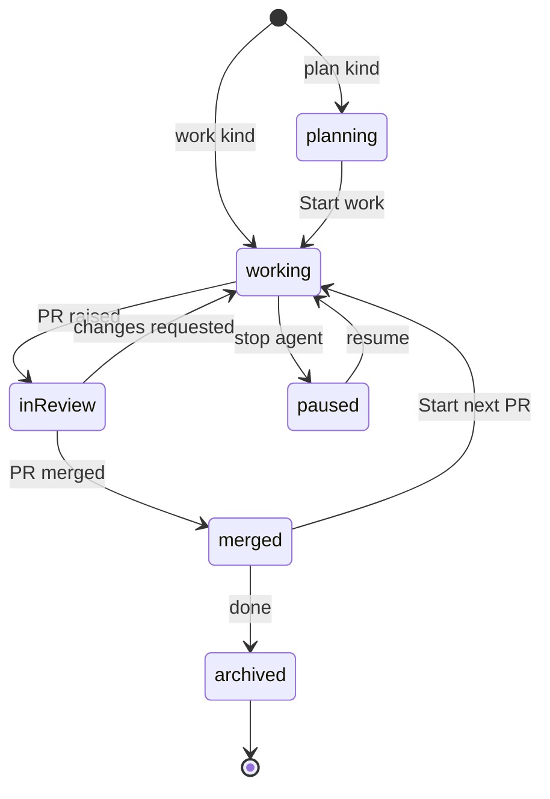

# Sessions, not folders

Oriel's unit of work is a **session**, not an open directory. You don't "open a folder"; you start a piece of work on
one or more repos, and Oriel gives it its own worktrees, branch, agent and history. Your own checkouts are never touched.

## The model


- **Repo**: a checkout Oriel knows about (path, remote, default branch, toolchain), registered per worker. Registering
  is one step (`oriel repos add ~/src/pricing`, or from the launcher), and repos are found from your GitHub and Linear history
  too. A repo is never edited directly.
- **Workspace**: a directory under `~/.oriel/workspaces/<name>` holding the plan docs and **one git worktree per repo**,
  all on the session's branch. This is crit's model, carried over unchanged.
- **Session**: a workspace plus a **kind**, an agent (or none), a branch, and everything that accrues: threads, tasks, ledger,
  test runs, transcript and layout. Sessions are what the tabs, mission control and the omnibox list.

## Kinds

| Kind | Starts from | Worktree | Agent |
|---|---|---|---|
| **plan** | a prompt or a ticket | created at Start work | drafts docs, then implements |
| **work** | a prompt, a ticket, or an existing branch | created immediately from an up-to-date base | yes |
| **review** | a PR URL or an agentbus review request | the PR's head, read-only by default | AI review |
| **tour** | a question | a pinned, read-only worktree | writes the tour |
| **job** | a saved prompt | created by the agent as needed | runs to done or blocked |
| **new repo** | a name and a template | a fresh repo | optional |
| **direct** | `oriel ~/src/foo`, or the launcher | **none: the directory itself**, git repo or not | optional, with a warning |
| **scratch** | nothing | none | optional |

- **New repo**: pick a name, where it lives (this Mac or a worker), and a template (empty, Go module, Go CLI, or any GitHub
  template repo). Oriel runs `git init`, optionally creates the GitHub repo (private by default, through the gateway with approval),
  registers it, and continues as a plan session ("what are we building?").
- **Direct** is "classic" editing: it opens any directory in place, git repo or not, with no worktree and no new
  branch. It's a first-class choice in the launcher, not only a CLI escape hatch. The tab is marked `direct`, and an agent there gets a warning first because it would be editing your real checkout.
- **Scratch** holds notes, the assistant, and terminals with no repo.

## Starting one

- **The app opens on mission control** (`ui.md` 03), not a file dialog. `⌘N` opens the launcher (`ui.md` 04): prompt, mode,
  provider, repos, worker, sandbox.
- **From anywhere**: a Linear ticket (plan or work), a PR link (review), a branch in the Explorer (work on that branch), a failing CI run
  ("fix CI" opens a work session on the PR's branch), or an agentbus review request.
- **CLI**: `oriel new "fix stale usage prices" --repo pricing --ticket INF-2231`, `oriel review <pr-url>`, `oriel open <session>`,
  `oriel init <name> --template go-cli`, `oriel ~/src/foo` (direct).

## Lifecycle



- **Worktrees** are created from a freshly fetched base on a branch named `<you>/<ticket>-<slug>`. All repos in the session
  share the branch. Repos can be added mid-session (by you, or by the agent asking).
- **Start next PR** cuts a new branch from the updated base inside the same session. Earlier PRs stay readable under Previous.
- **Archiving** (after merge, or by hand) removes the worktrees but keeps the threads, transcript, tours and test history, so
  past sessions stay searchable in the omnibox.
- **Sessions survive restarts**: the agent resumes by session id, and the layout, open buffers and cursor positions come back.
- **Housekeeping**: stale worktrees and branches are listed per repo, and cleaned with a confirmation.

## In the editor

- The **Explorer's root is the session's projects**, not a folder you picked. Explorer scopes (Changed, Uncommitted, All) work per
  project (`ui.md` 01c).
- Files **outside** the session's worktrees (the stdlib, dependencies, another repo) open **read-only**, with go-to-definition
  and peek. Editing them means adding that repo to the session.
- Tabs, `⌘1–9` and mission control are all sessions. Within a session, buffers and splits are the usual vim tabs and windows.

## Go interfaces

```go
// package core
type Repo struct {
    ID         RepoID
    Worker     WorkerID
    Path       string          // the user's checkout: never written to, except in Direct sessions
    Remote     string
    BaseBranch string
}

type Kind string // "plan" | "work" | "review" | "tour" | "job" | "newrepo" | "direct" | "scratch" | plugin-defined

type SessionSpec struct {
    Kind     Kind
    Prompt   string
    Ticket   string            // optional
    PR       string            // review kind
    Repos    []RepoID          // 0..n
    Branch   string            // derived if empty
    Provider string            // "claude", "codex", "" for none
    Worker   WorkerID
    Sandbox  SandboxPolicy
    Template string            // newrepo kind
}

type Sessions interface {
    Start(ctx context.Context, s SessionSpec) (SessionID, error)
    AddRepo(ctx context.Context, id SessionID, r RepoID) error
    NextPR(ctx context.Context, id SessionID) error
    Archive(ctx context.Context, id SessionID) error
    Resume(ctx context.Context, id SessionID) error
}
```

- Session kinds are a contribution point (`plugins.md`), so a plugin can add, say, an "incident" kind with its own prompt pack.
