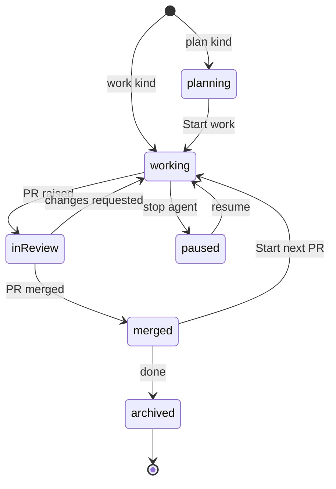

# Sessions, not folders

Oriel's unit of work is a **session**, not an open directory. You don't "open a folder"; you start a piece of work on
one or more repos, and Oriel gives it its own worktrees, branch, agent and history. Your own checkouts are never touched.

## The model


- **Repo**: a checkout Oriel knows about (path, remote, default branch, toolchain), registered per worker. Registering
  is one step (`oriel repos add ~/src/pricing`, or from the launcher), and repos are found from your GitHub and Linear history
  too. A repo is never edited directly.
- **Workspace**: a directory under `~/.oriel/workspaces/<name>` holding the plan docs and **one git worktree per repo**,
  all on the session's branch. This is crit's model, carried over unchanged.
- **Session**: a workspace plus a **kind**, an agent (or none), a branch, and everything that accrues: threads, tasks, ledger,
  test runs, transcript and layout. Sessions are what the tabs, mission control and the omnibox list.

## Kinds

| Kind | Starts from | Worktree | Agent |
|---|---|---|---|
| **plan** | a prompt or a ticket | created at Start work | drafts docs, then implements |
| **work** | a prompt, a ticket, or an existing branch | created immediately from an up-to-date base | yes |
| **review** | a PR URL or an agentbus review request | the PR's head, read-only by default | AI review |
| **tour** | a question | a pinned, read-only worktree | writes the tour |
| **job** | a saved prompt | created by the agent as needed | runs to done or blocked |
| **new repo** | a name and a template | a fresh repo | optional |
| **direct** | `oriel ~/src/foo`, or the launcher | **none: the directory itself**, git repo or not | optional, with a warning |
| **scratch** | nothing | none | optional |

- **New repo**: pick a name, where it lives (this Mac or a worker), and a template (empty, Go module, Go CLI, or any GitHub
  template repo). Oriel runs `git init`, optionally creates the GitHub repo (private by default, through the gateway with approval),
  registers it, and continues as a plan session ("what are we building?").
- **Direct** is "classic" editing: it opens any directory in place, git repo or not, with no worktree and no new
  branch. It's a first-class choice in the launcher, not only a CLI escape hatch. The tab is marked `direct`, and an agent there gets a warning first because it would be editing your real checkout.
- **Scratch** holds notes, the assistant, and terminals with no repo.

## Starting one

- **The app opens on mission control** (`ui.md` 03), not a file dialog. `⌘N` opens the launcher (`ui.md` 04): prompt, mode,
  provider, repos, worker, sandbox.
- **From anywhere**: a Linear ticket (plan or work), a PR link (review), a branch in the Explorer (work on that branch), a failing CI run
  ("fix CI" opens a work session on the PR's branch), or an agentbus review request.
- **CLI**: `oriel new "fix stale usage prices" --repo pricing --ticket INF-2231`, `oriel review <pr-url>`, `oriel open <session>`,
  `oriel init <name> --template go-cli`, `oriel ~/src/foo` (direct).

## Lifecycle



- **Worktrees** are created from a freshly fetched base on a branch named `<you>/<ticket>-<slug>`. All repos in the session
  share the branch. Repos can be added mid-session (by you, or by the agent asking).
- **Start next PR** cuts a new branch from the updated base inside the same session. Earlier PRs stay readable under Previous.
- **Archiving** (after merge, or by hand) removes the worktrees but keeps the threads, transcript, tours and test history, so
  past sessions stay searchable in the omnibox.
- **Sessions survive restarts**: the agent resumes by session id, and the layout, open buffers and cursor positions come back.
  Built (SE-2): the layout is kept per directory as it changes, and views revive their instances through
  `registry.Persisted` (plugins.md); switching to a session reopens its directory, so its layout comes back too.
- **Housekeeping**: stale worktrees and branches are listed per repo, and cleaned with a confirmation.

## In the editor

- The **Explorer's root is the session's projects**, not a folder you picked. Explorer scopes (Changed, Uncommitted, All) work per
  project (`ui.md` 01c).
- Files **outside** the session's worktrees (the stdlib, dependencies, another repo) open **read-only**, with go-to-definition
  and peek. Editing them means adding that repo to the session.
- Tabs, `⌘1–9` and mission control are all sessions. Within a session, buffers and splits are the usual vim tabs and windows.

## Go interfaces

```go
// package core
type Repo struct {
    ID         RepoID
    Worker     WorkerID
    Path       string          // the user's checkout: never written to, except in Direct sessions
    Remote     string
    BaseBranch string
}

type Kind string // "plan" | "work" | "review" | "tour" | "job" | "newrepo" | "direct" | "scratch" | plugin-defined

type SessionSpec struct {
    Kind     Kind
    Prompt   string
    Ticket   string            // optional
    PR       string            // review kind
    Repos    []RepoID          // 0..n
    Branch   string            // derived if empty
    Provider string            // "claude", "codex", "" for none
    Worker   WorkerID
    Sandbox  SandboxPolicy
    Template string            // newrepo kind
}

type Sessions interface {
    Start(ctx context.Context, s SessionSpec) (SessionID, error)
    AddRepo(ctx context.Context, id SessionID, r RepoID) error
    NextPR(ctx context.Context, id SessionID) error
    Archive(ctx context.Context, id SessionID) error
    Resume(ctx context.Context, id SessionID) error
}
```

- Session kinds are a contribution point (`plugins.md`), so a plugin can add, say, an "incident" kind with its own prompt pack.

## As built (P5)

- **The worker** (`oriel worker`) is a process of its own on each machine, so sessions and their agents outlive the
  window. The app and the CLI reach this machine's on `~/.oriel/worker.sock` (owner only), starting it if it isn't
  running; a worker elsewhere dials the app over pinned TLS (`oriel worker --connect host:port --fingerprint …`).
  Remote workers run sessions and agents, but editing a remote session's files from the app needs the buffer replica
  (`architecture.md` → Where buffers live), which isn't built: the window only follows sessions on this machine.
- **Where things are**: workspaces in `~/.oriel/workspaces/<id>` with `.oriel-workspace.json` (crit's manifest,
  field for field); each session's event log, logs and drafts in `~/.oriel/sessions/<id>/`; registered repos in
  `~/.oriel/repos.json`. A session's id is its name, from the prompt (`inf-2231-fix-stale-usage-prices`), unique on
  its worker.
- **crit's workspaces are read in place**: every `~/.crit/{work,tours,runs}/<name>` with a `.crit-workspace.json` is a
  session `crit-<name>` on crit's own directories. Oriel adds threads and an agent to it, and never writes into it.
- **Plan**: the repos are listed from the start and the agent reads the user's checkouts (protected from edits);
  Start work makes the worktrees, on the session's branch, once every thread is resolved or deferred (the plan's own
  thread, where the prompt is, and btw threads don't count: `SessionState.Holding`). A session whose kind makes its
  worktrees at Start work (plan, and new repo, which carries on as a plan) has `StartWork` set, and is `Planning()`
  until then. Start work tells the agent on the plan's thread, as crit does, that the plan is approved, that the docs
  at the workspace root are the whole plan, and which worktree of which checkout on which branch to edit; the window
  then follows the session to its worktree (it follows the session in front whenever its projects move). The plan's
  thread reaches the agent as `where="plan"`, and a comment on a doc at the workspace root is anchored to the
  `core.DocsProject` project with its path relative to the workspace (`where="PLAN.md:14"`).
- **Direct** never makes a worktree or a workspace: the directory itself, git repo or not. **Scratch** gets a
  directory for notes and no repo. **New repo** makes the repo from a template (`empty`, `go-module`, `go-cli`, or a
  git URL), commits it, registers it, and carries on as a plan for it. **Review** fetches `pull/<n>/head` from the
  registered repo whose remote matches the PR's URL, and pins a read-only worktree there.
- **The launcher** (`ui.md` 04) lists the worker's kinds (`kinds.list`, `worker.KindSpec`: title, `Desc`, `About`,
  `From`), and starts the chosen one through `session.start`; each kind's agent starts with its kind's prompt pack.
  The CLI takes its flags after the prompt too (`oriel new "fix stale usage prices" --repo pricing`), and every
  kind starts from it: `new --kind plan|work|tour|job|direct|scratch`, `review <pr-url>`, `init <name>`.
- **The app opens on the start view**, not mission control: mission control is SH-7 (P7). Until then the start
  view's Recent lists the sessions first, and opening one brings it to the front.
- **Files outside the session** open read-only: the sessions extension's `BufRead` rewrite hook marks a file outside
  every project and the session's own directory "outside the session", and one in a project the session only reads
  (a plan's checkouts before Start work, a tour, a review) "the session only reads it". It applies while the window
  is on the session in front. Go-to-definition and peek reach them as any file.
- **Archive** refuses while a worktree has uncommitted work, then removes the worktrees and keeps the session's
  threads, transcript and test runs (`oriel` searches them: `session.search` over the whole log, not only what the
  state keeps). **Restart**: the worker replays every session's log; nothing runs until it's resumed, which resumes
  the agent by its own id.
