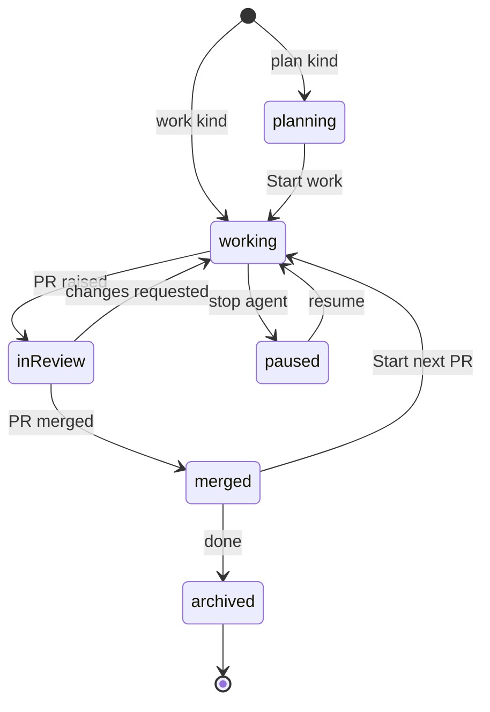

# Sessions, not folders

Oriel's unit of work is a **session**, not an open directory. You don't "open a folder"; you start a piece of work on
one or more repos, and Oriel gives it its own worktrees, branch, agent and history. Your own checkouts are never touched.

## The model


- **Repo**: a checkout Oriel knows about (path, remote, default branch, toolchain), registered per worker. Registering
  is one step (`oriel repos add ~/src/pricing`, or from the launcher), and repos are found from your GitHub and Linear history
  too. A repo is never edited directly.
- **Workspace**: a directory under `~/.oriel/workspaces/<name>` holding the plan docs and **one git worktree per repo**,
  all on the session's branch. This is crit's model, carried over unchanged.
- **Session**: a workspace plus a **kind**, an agent (or none), a branch, and everything that accrues: threads, tasks, ledger,
  test runs, transcript and layout. Sessions are what mission control and the omnibox list; a tab is a session
  open in the window: started, resumed or brought to the front, never just for being on the start view.

## Kinds

| Kind | Starts from | Worktree | Agent |
|---|---|---|---|
| **plan** | a prompt or a ticket | created at Start work | drafts docs, then implements |
| **work** | a prompt, a ticket, or an existing branch | created immediately from an up-to-date base | yes |
| **review** | a PR URL or an agentbus review request | the PR's head, read-only by default | AI review |
| **tour** | a question | a pinned, read-only worktree | writes the tour |
| **job** | a saved prompt | created by the agent as needed | runs to done or blocked |
| **new repo** | a name and a template | a fresh repo | optional |
| **direct** | `oriel ~/src/foo`, or the launcher | **none: the directory itself**, git repo or not | optional, with a warning |
| **scratch** | nothing | none | optional |

- **New repo**: pick a name, where it lives (this Mac or a worker), and a template (empty, Go module, Go CLI, or any GitHub
  template repo). Oriel runs `git init`, optionally creates the GitHub repo (private by default, through the gateway with approval),
  registers it, and continues as a plan session ("what are we building?").
- **Direct** is "classic" editing: it opens any directory in place, git repo or not, with no worktree and no new
  branch. It's a first-class choice in the launcher, not only a CLI escape hatch. The tab is marked `direct`, and an agent there gets a warning first because it would be editing your real checkout.
- **Scratch** holds notes, the assistant, and terminals with no repo.

## Starting one

- **The app opens on mission control** (`ui.md` 03), not a file dialog. `⌘N` opens the launcher (`ui.md` 04): prompt, mode,
  provider, repos, worker, sandbox.
- **From anywhere**: a Linear ticket (plan or work), a PR link (review), a branch in the Explorer (work on that branch), a failing CI run
  ("fix CI" opens a work session on the PR's branch), or an agentbus review request.
- **CLI**: `oriel new "fix stale usage prices" --repo pricing --ticket INF-2231`, `oriel review <pr-url>`, `oriel open <session>`,
  `oriel init <name> --template go-cli`, `oriel ~/src/foo` (direct).

### Repos on a worker

- A worker only works on repos it has. Naming one it hasn't registered fails with how to get it there: `oriel repos
  add <path>` for a checkout on that machine, or `oriel repos clone <url> [name]`.
- `repos.clone {url, name}` (`Client.CloneRepo`) clones into the worker's repos directory (`Options.ReposDir`,
  `~/src` by default, where new repos go too) as `name` (the URL's last part if none) with `gitx.Clone`, and
  registers it. A checkout of the same URL already there is registered as it is; anything else there is an error. Git
  never prompts: a clone that needs credentials fails with git's own message and says the worker clones with its
  machine's credentials. The app's `repos.clone {url, name, worker}` command runs it.
- `session.start {clone = {[repo] = url}}` clones each of those repos onto the worker first and starts on the clones.
- In the launcher, a repo chip the chosen worker lacks (one it hasn't registered; on this machine's worker a path
  still registers as the session starts) is outlined in warning and says "not on <worker>: **Clone**". Clone opens
  a popover with the URL, filled from the local checkout's remote (`gitx.Repo.RemoteURL`) or typed, and "Clone at
  start" queues it: the chip then says it clones at start, and the pre-flight counts the repos to clone. Start waits
  until every such chip is queued or removed, then passes them as `clone`.
- Not yet: credentials for a private repo on a worker elsewhere. The clone runs with that machine's git, ssh keys and
  credential helpers, so they must be set up there; the app doesn't lend its ssh-agent or tokens to a worker's
  git (a sandboxed agent's ssh-agent forwarding is per session and isn't used for this). The CLI has no `--worker`,
  so it only offers the commands above for this machine's worker.

## Lifecycle



- **Worktrees** are created from a freshly fetched base on a branch named `<you>/<ticket>-<slug>`. All repos in the session
  share the branch. Repos can be added mid-session (by you, or by the agent asking).
- **Start next PR** cuts a new branch from the updated base inside the same session. Earlier PRs stay readable under Previous.
- **Archiving** (after merge, or by hand) removes the worktrees but keeps the threads, transcript, tours and test history, so
  past sessions stay searchable in the omnibox.
- **Sessions survive restarts**: the agent resumes by session id, and the layout, open buffers and cursor positions come back.
  Built (SE-2): the layout is kept per directory as it changes, and views revive their instances through
  `registry.Persisted` (plugins.md); switching to a session reopens its directory, so its layout comes back too.
- **Housekeeping**: stale worktrees and branches are listed per repo, and cleaned with a confirmation.

## In the editor

- The **project sidebar** (`ui.md` 01h) lists the session's projects; you work in one at a time, and its panels
  (Explorer, Search, Git, Pull request, Tests) are that project's. Explorer scopes (Changed, Uncommitted, All) work per
  project (`ui.md` 01c). The `+` in the sidebar adds a repo to the session (`session.add-repo`), as the agent can.
- One tab strip holds every project's files; with 2+ projects each tab leads with its project's colour and the
  breadcrumb starts with the project's name. Opening another project's file doesn't change the open project.
- Files **outside** the session's worktrees (the stdlib, dependencies, another repo) open **read-only**, with go-to-definition
  and peek. Editing them means adding that repo to the session.
- Tabs, `⌘1–9` and mission control are all sessions (the tabs and `⌘1–9` only those open in the window). Within a session, buffers and splits are the usual vim tabs and windows.

## Go interfaces

```go
// package core
type Repo struct {
    ID         RepoID
    Worker     WorkerID
    Path       string          // the user's checkout: never written to, except in Direct sessions
    Remote     string
    BaseBranch string
}

type Kind string // "plan" | "work" | "review" | "tour" | "job" | "newrepo" | "direct" | "scratch" | plugin-defined

type SessionSpec struct {
    Kind     Kind
    Prompt   string
    Ticket   string            // optional
    PR       string            // review kind
    Repos    []RepoID          // 0..n
    Branch   string            // derived if empty
    Provider string            // "claude", "codex", "" for none
    Worker   WorkerID
    Sandbox  SandboxPolicy
    Template string            // newrepo kind
}

type Sessions interface {
    Start(ctx context.Context, s SessionSpec) (SessionID, error)
    AddRepo(ctx context.Context, id SessionID, r RepoID) error
    NextPR(ctx context.Context, id SessionID) error
    Archive(ctx context.Context, id SessionID) error
    Resume(ctx context.Context, id SessionID) error
}
```

- Session kinds are a contribution point (`plugins.md`), so a plugin can add, say, an "incident" kind with its own prompt pack.

## As built (P5)

- **The worker** (`oriel worker`) is a process of its own on each machine. The app and the CLI reach this machine's
  on `~/.oriel/worker.sock` (owner only), starting it if it isn't running; a worker elsewhere dials the app over
  pinned TLS (`oriel worker --connect host:port --fingerprint …`). Remote workers run sessions and agents, but
  editing a remote session's files from the app needs the buffer replica (`architecture.md` → Where buffers live),
  which isn't built: the window only follows sessions on this machine.
- **This machine's worker hands over** (`worker.handover`): it stops its agents as `StoppedByHandOver` and quits, and
  the next worker to start resumes them. The app drains it first: with an agent mid-turn it waits for the turns to
  end, at most 60s, with a dialog naming the sessions and counting down; ⌘↵ (`worker.hand-over-now`, in the
  `workerdrain` key mode) doesn't wait. A turn still going at 60s is cut short, and its agent comes back idle. It
  drains for two reasons:
  - **Quitting Oriel stops it**, so sessions' agents don't outlive the window: they come back when Oriel opens again.
    The window holds its close (`render.CloseHolder`; on macOS Quit too) and the app gets a `CloseRequestEvent`.
    With nothing mid-turn and no scheduled job it quits at once. The dialog (**Quit now**, **Cancel**/Escape) also
    lists the scheduled jobs, which don't run while Oriel is closed; with only those, it waits for **Quit**. Asking
    to quit again while it waits quits now. Cancel leaves the worker as it was. Workers on other machines carry on;
    if Oriel crashes, the worker keeps running and the next Oriel connects to it.
  - **A rebuilt Oriel restarts it.** A worker from another build (`Info.Build`, a hash of its binary) is drained and
    the app starts this build's (`Config.LocalWorker`). With no agent mid-turn that happens as the app connects.
    The dialog's **Hide**/Escape hides it and the restart still happens; quitting meanwhile turns it into the quit,
    and Cancel takes it back to the restart. Sessions the new worker doesn't have leave the window.
- **Where things are**: workspaces in `~/.oriel/workspaces/<id>` with `.oriel-workspace.json` (crit's manifest,
  field for field); each session's event log, logs and drafts in `~/.oriel/sessions/<id>/`; registered repos in
  `~/.oriel/repos.json`. A session's id is its name, from the prompt (`inf-2231-fix-stale-usage-prices`), unique on
  its worker.
- **Only Oriel's own sessions are listed.** crit's workspaces aren't read: listed with Oriel's, they buried them, and
  each made a tab. A session the worker once took from crit (`Source: "crit"`) is dropped, with its log, on restore.
- **Plan**: the repos are listed from the start and the agent reads the user's checkouts (protected from edits);
  Start work makes the worktrees, on the session's branch, once every thread is resolved or deferred (the plan's own
  thread, where the prompt is, and btw threads don't count: `SessionState.Holding`). A session whose kind makes its
  worktrees at Start work (plan, and new repo, which carries on as a plan) has `StartWork` set, and is `Planning()`
  until then. Start work tells the agent on the plan's thread, as crit does, that the plan is approved, that the docs
  at the workspace root are the whole plan, and which worktree of which checkout on which branch to edit; the window
  then follows the session to its worktree (it follows the session in front whenever its projects move). The plan's
  thread reaches the agent as `where="plan"`, and a comment on a doc at the workspace root is anchored to the
  `core.DocsProject` project with its path relative to the workspace (`where="PLAN.md:14"`).
- **Plan → Start work** opens a dialog over the plan (`plan.start-work`; ⌘↵ starts, Esc, its esc and Cancel close,
  as does a click outside) with how the plan becomes work. Each choice is an arg of `session.start-work` and a field
  of the worker's `StartWorkReq`, so Lua and the CLI start work the same way without the dialog; what an arg leaves
  out is the default or the session's own.
  - **Clear the plan's threads** (`clear`, on): every thread but the plan's own goes (`core.ThreadsRemoved`; the log
    keeps them). Resolved ones just go; open and deferred ones are carried into the Start work prompt as a note of
    where each was, its status, its first comment and its last reply. Open threads still hold Start work up
    (readiness), so in practice it's the deferred ones. Off, the threads stay as they are.
  - **Restart the agent with a fresh context** (`fresh`, on): the plan's agent stops, and a new one (not a resume)
    starts on the `work` pack (`AgentState.Pack`, which overrides the kind's) and gets the Start work prompt, which
    points it at the plan docs, as crit restarts its agent for the work. Off, the plan's agent carries on and is told
    on the plan's thread.
  - **Branch per project** (`branches`, by project name): pre-filled with the branch the plan was given, named from
    the ticket and prompt (`BranchName`); git must take a name (`gitx.ValidBranch`), and one taken already gets
    `-2` (`FreshBranch`). A bad name refuses before any worktree is made.
  - **Sandbox** and **Open network** (`sandbox`, `network`), the session's own to start with.
  - **Model and effort** (`model`, `effort`), the plan's to start with, from the provider's models (the launcher's
    menus); a new model runs at its default effort unless one is picked. The dialog sends only what was changed.
  - A change of sandbox, network, model or effort with the conversation kept restarts the agent by its own id
    (`Resume`), so it carries on in the new place.
- **Direct** never makes a worktree or a workspace: the directory itself, git repo or not. **Scratch** gets a
  directory for notes and no repo. **New repo** makes the repo from a template (`empty`, `go-module`, `go-cli`, or a
  git URL), commits it, registers it, and carries on as a plan for it. **Review** fetches `pull/<n>/head` from the
  registered repo whose remote matches the PR's URL, and pins a read-only worktree there.
- **The launcher** (`ui.md` 04) lists the worker's kinds (`kinds.list`, `worker.KindSpec`: title, `Desc`, `About`,
  `From`), and starts the chosen one through `session.start`; each kind's agent starts with its kind's prompt pack.
  The CLI takes its flags after the prompt too (`oriel new "fix stale usage prices" --repo pricing`), and every
  kind starts from it: `new --kind plan|work|tour|job|direct|scratch`, `review <pr-url>`, `init <name>`.
- **The app opens on the start view**, not mission control: mission control is SH-7 (P7). Until then the start
  view's Recent lists the sessions first, and opening one brings it to the front.
- **Files outside the session** open read-only: the sessions extension's `BufRead` rewrite hook marks a file outside
  every project and the session's own directory "outside the session", and one in a project the session only reads
  (a plan's checkouts before Start work, a tour, a review) "the session only reads it". It applies while the window
  is on the session in front. Go-to-definition and peek reach them as any file.
- **Archive** refuses while a worktree has uncommitted work, then removes the worktrees and keeps the session's
  threads, transcript and test runs (`oriel` searches them: `session.search` over the whole log, not only what the
  state keeps). **Restart**: the worker replays every session's log; nothing runs until it's resumed, which resumes
  the agent by its own id.
- **A lost login** (AI-13): when an agent's login on its worker stops working (`agents.md`, "A login that stops
  working"), every session on that worker using it turns **needs you** with a card, "Claude on devbox needs you to log
  in", and what the provider said. On this machine the card's **Log in** (`agent.login`) opens the agent's own
  terminal (`agent.terminal`, the raw PTY) with `/login` typed; on a worker elsewhere it says what to run there
  ("On devbox, run claude, then /login"); since SE-5 Log in works on any worker, opening the agent's terminal from
  that worker over the wire (`agent.terminal`, as Raw terminal does) with `/login` typed, and the card says what to
  run there only for an agent with no terminal (Codex). **Check again** asks the worker to look. Once it's signed in, every card
  goes and the sessions carry on: held comments go, and a turn the login stopped is told to carry on.

## Jobs (SE-4)

- **A job** is a saved prompt with a title and pins: where it runs (`sandbox`, `host`, or "" for the worker's
  `sandbox.default`), the provider, model and effort, and a schedule. It names no repo or branch: the prompt names the
  repos, and the agent adds them (`projects` pack part). Each is one JSON file, `~/.oriel/jobs/<slug>.json` on its
  worker (`worker.Job`), the slug from the title's first six words (from the prompt's first line when there's no
  title), a new one stepping aside to `-2` from a name in use, as crit's `internal/job` does. The worker answers
  `jobs.list`, `jobs.save` (a job without a name is new; with one, that job rewritten), `jobs.delete` and
  `jobs.run` (`Client.Jobs`, `SaveJob`, `DeleteJob`, `RunJob`).
- **A run** is a session of kind job (`SessionSpec.Job` and `SessionState.Job` name its job), named from the job's
  first three words, in a fresh workspace with no projects. The prompt is its first request and is written to the
  workspace as `JOB.md` (`KindSpec.PromptFile`, the job kind's). It runs on its own (the `job` pack) to done or
  blocked. `worker.RunOf` reads its row from the request thread: **done** once it's resolved, **blocked** while the
  agent's answer (the pack's `**Blocked:**` reply) or a question waits on you (its session is needs-you, so the
  request is in Requests under Needs you with the question), **running** while the agent has it, **stopped** when it
  was stopped before either; the summary is the agent's last word on the request, how long it took runs to that, and
  its repos are its projects. Its cost and the split by repo are its session stats (AI-12).
- **Delete** (`session.delete`, `Client.Delete`) throws a session away: its agent stops, its worktrees go with
  whatever is in them, then its workspace and its log, and it's gone from every app. The repos are never touched.
  A direct session is refused (archive it). Deleting a job keeps its runs.
- **Schedules** (`worker.Schedule`): manual (the zero one), `weekdays` at a time, `weekly` on a day at a time, or
  `days`, a set of days at a time (the page's custom), in the worker's local time. `RunSchedules` checks them every
  30 seconds while the worker runs, which is while Oriel is open (`oriel worker` starts it), and `RunDue` starts each job due since it last looked,
  on the worker's clock (`Options.Now`), so an occurrence slept through runs when the worker wakes, once. One due while
  the job's last run is still going is skipped, and the job keeps when (`Job.Skips`, the latest 50, listed among its
  runs). Since SE-5 the job keeps the occurrence it last ran or skipped (`Job.Due`), so occurrences missed while the
  worker was off (or restarting) run once when it starts: one run per job, not one per occurrence missed. An occurrence
  counts from the job's last save, so editing a schedule doesn't run what it would have run before.
- **Who stopped it** (SE-5): an agent that stops records who (`AgentState.StoppedBy`, `StoppedAt`): `you` (Stop,
  Archive), `agent` (its process ended by itself), `worker` (the worker shut down, or wasn't shut down cleanly and
  settles on restart). Starting again clears it. A run's `Run.StoppedBy` and its time run to `StoppedAt`.
- **Opening a session somewhere** (SE-5): `session.open {id, then}` takes a list of `{command, args}` and runs them
  once the window is on the session: after the window opens again on the session's directory (the layout restored
  first), or at once when it doesn't move. The Jobs page uses it for a run's layout.
