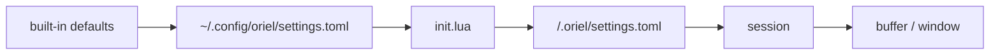

# Settings: storage and the settings page

Most people change settings in the GUI. Many also edit the file by hand and commit it to their dotfiles. Both edit the
same file, and neither clobbers the other.

## Storage

- **Settings are data, in TOML.** `~/.config/oriel/settings.toml`, and `<repo>/.oriel/settings.toml` per project.
- **Logic stays in Lua.** `init.lua` holds keymaps, hooks, commands and anything conditional (`scripting.md`).
- **Only non-defaults are written.** A fresh install has an empty file; resetting an option deletes its line.
- **The writer round-trips.** Comments, key order, blank lines and formatting you wrote by hand survive a GUI edit.
  A GUI change touches only the line it changes, so a dotfiles diff is one line.
- Sections in the file match sections on the page:

```toml
# ~/.config/oriel/settings.toml
[editor]
line_numbers = "relative"
tab_width = 4               # Go uses tabs anyway

[agent]
default_provider = "claude"
commit_gate = "soft"
```

### Precedence

Later layers win:



- `init.lua` beats the user file, so a value computed in Lua is never silently overridden by a GUI click.
- A window value beats a buffer value; an option is usually only one of the two.
- In code these are `registry.Layer`s, and a value is read at an `At{Project, Session, Buffer, Window}`: each layer
  applies only where its key matches. `Get` returns the value and the layer it came from, which is what the page shows.
- A project file is trusted on first open, the same way as `.oriel/` Lua (`plugins.md`).
- Session, buffer and window values are runtime only: `:set`, the page's session scope, or a plugin. They aren't
  written to disk unless you choose "save to user" or "save to project".

### Live reload

- The files are watched. A hand edit applies immediately, as a GUI change does.
- A parse error keeps the last good values and shows the error, with line and column, in the page and as a toast.
  Nothing is written back to a file that doesn't parse.

## The TOML module

- Our own `toml` module, no third-party code (`deps.md`). Themes use it too (`theming.md`).
- It covers TOML 1.0, tested against the `toml-test` suite vendored under `spec/`.
- It keeps a concrete syntax tree, so edits are surgical: set, add or delete a key in place and keep everything else
  byte for byte.

## Options (`OptionSpec`)

Every option is registered in the registry (`plugins.md`), by built-ins and plugins alike. The page, `:set`, Lua,
help and validation are all generated from the spec.

| Field | Meaning |
|---|---|
| `Name` | `editor.line_numbers`. The section is the prefix. |
| `Section` | title and order on the page, when it differs from the prefix |
| `Type` | bool, enum (with values), int or float (with range), string, colour, duration, key, list, map |
| `Default` | the built-in value |
| `Help` | one line; the long form links to `:help` |
| `Scopes` | which of user, project, session, buffer and window it can be set at |
| `Layer` | `input` (an input engine's behaviour) or `app` (display and app-wide) (`editor.md`) |
| `Aliases` | vim names, e.g. `number`, `relativenumber` → `editor.line_numbers` |
| `Resettable` | false where "default" means nothing, e.g. a path you picked |
| `Restart` | the change applies only after a restart |
| `Secret` | never written to settings files; kept in the secrets store (`security.md`) |

## The settings page (`:Settings`, ⌘,)

- **Sections** down the left, from the registry. Plugin options get their plugin's section.
- **Search** across names, help text, aliases and values. `@modified`, `@project` and `@plugin:linear` filter.
- **Typed controls**: toggle, dropdown, number with range, colour picker, key recorder, list editor.
- **Each row** shows the help line, the current value, and where it came from: default, user, project, session, or
  "set in `init.lua:12`". A value set in Lua is read-only on the page, with a jump to the line.
- **Scope switcher**: user, this project, this session. It edits that layer and shows the effective value under it.
- **Modified marker** on every non-default row. **Reset** per option, per section and for everything, with undo.
  Reset removes the line from the file.
- **Show as TOML / Lua** shows the line you would write by hand.
- Options that need a restart say so, and the page offers one.
- Every row has a help id (`help.md`).
