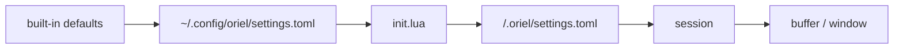

# Settings: storage and the settings page

Most people change settings in the GUI. Many also edit the file by hand and commit it to their dotfiles. Both edit the
same file, and neither clobbers the other.

## Storage

- **Settings are data, in TOML.** `~/.config/oriel/settings.toml`, and `<repo>/.oriel/settings.toml` per project.
- **Logic stays in Lua.** `init.lua` holds keymaps, hooks, commands and anything conditional (`scripting.md`).
- **Only non-defaults are written.** A fresh install has an empty file; resetting an option deletes its line.
- **The writer round-trips.** Comments, key order, blank lines and formatting you wrote by hand survive a GUI edit.
  A GUI change touches only the line it changes, so a dotfiles diff is one line.
- Sections in the file match sections on the page:

```toml
# ~/.config/oriel/settings.toml
[editor]
line_numbers = "relative"
tab_width = 4               # Go uses tabs anyway

[agent]
default_provider = "claude"

[ledger]
gate = "soft"
```

### Plugins

- `[plugins]` lists the installed plugins, `[plugin.<name>]` holds each plugin's options, and `[registry]` configures
  the plugin registries. Editing `[plugins]` by hand installs and uninstalls, just as the GUI does (`catalog.md`).

### Precedence

Later layers win:



- `init.lua` beats the user file, so a value computed in Lua is never silently overridden by a GUI click.
- A window value beats a buffer value; an option is usually only one of the two.
- In code these are `registry.Layer`s, and a value is read at an `At{Project, Session, Buffer, Window}`: each layer
  applies only where its key matches. `Get` returns the value and the layer it came from, which is what the page shows.
- A project file is trusted on first open, the same way as `.oriel/` Lua (`plugins.md`).
- Session, buffer and window values are runtime only: `:set`, the page's session scope, or a plugin. They aren't
  written to disk unless you choose "save to user" or "save to project".

- **File conventions** (ED-9) are a layer of their own, `file`, between the session and the buffer: a buffer's
  `.editorconfig`, `.gitattributes` and (when on) modeline values, each with its file and line as the source. `:set`
  and window values still win.

### Live reload

- The files are watched. A hand edit applies immediately, as a GUI change does.
- A parse error keeps the last good values and shows the error, with line and column, in the page and as a toast.
  Nothing is written back to a file that doesn't parse.

## The TOML module

- Our own `toml` module, no third-party code (`deps.md`). Themes use it too (`theming.md`).
- It covers TOML 1.0, tested against the `toml-test` suite vendored under `spec/`.
- It keeps a concrete syntax tree, so edits are surgical: set, add or delete a key in place and keep everything else
  byte for byte.
- `toml.Parse` returns a `Document`: `Value()`, `Get(path…)`, `Set(path, v)`, `Delete(path…)`, `Bytes()`. The tree is
  the source itself plus the span of every key, value and table header; an edit splices bytes and reparses, and an edit
  that would make the document invalid is refused with the document unchanged.
  - Setting an existing key replaces only its value's bytes.
  - A new key goes after the last key of the deepest `[table]` that holds it (with that key's indent), next to the
    dotted keys that define its table, or in a new `[table]` at the end. Line endings follow the file's.
  - Deleting a key removes its line (comment included); deleting a table removes its sections and everything under it.
- Parse errors carry a line and column. Spec: TOML 1.0.0 (https://toml.io/en/v1.0.0); suite: `spec/toml-test` (v1.5.0, the 1.0.0 file list).

## Options (`OptionSpec`)

Every option is registered in the registry (`plugins.md`), by built-ins and plugins alike. The page, `:set`, Lua,
help and validation are all generated from the spec.

| Field | Meaning |
|---|---|
| `Name` | `editor.line_numbers`. The section is the prefix. |
| `Section` | title and order on the page, when it differs from the prefix |
| `Type` | bool, enum (with values), int or float (with range), string, colour, duration, key, list (of strings), map (strings by name) |
| `Choices` | the values a string or a list's items suggest, worked out when asked; others are still allowed |
| `Validate` | refuses a value of the right type that's still wrong: a malformed rule in a list. `registry.ListOf` and `MapOf` make one an editor can ask about a single item or entry |
| `KeyLabel`, `ValueLabel` | a map's two sides, as the page names them: `name` and `server` |
| `Default` | the built-in value |
| `Help` | one line; the long form links to `:help` |
| `Scopes` | which of user, project, session, buffer and window it can be set at |
| `Layer` | `input` (an input engine's behaviour) or `app` (display and app-wide) (`editor.md`) |
| `Aliases` | vim names, e.g. `number`, `relativenumber` → `editor.line_numbers` |
| `Resettable` | false where "default" means nothing, e.g. a path you picked |
| `Restart` | the change applies only after a restart |
| `Secret` | never written to settings files; kept in the secrets store (`security.md`) |

## Option list

Every option Oriel registers, so there is one place to look. A test checks it against the registry (ED-13).

| Option | Default | Layer | Aliases | Added by |
|---|---|---|---|---|
| `editor.clipboard` | `system`: `y`, `d` and `p` use the system clipboard; `registers` keeps them in vim's registers | input | `clipboard` | ED-13 |
| `editor.shift_width` | 8 | input | `shiftwidth`, `sw` | ED-13 |
| `editor.tab_stop` | 8 | input | `tabstop`, `ts` | ED-9 |
| `editor.expand_tab` | false | input | `expandtab`, `et` | ED-13 |
| `editor.ignore_case` | false | input | `ignorecase`, `ic` | ED-13 |
| `editor.smart_case` | false | input | `smartcase`, `scs` | ED-13 |
| `editor.wrap_scan` | true | input | `wrapscan`, `ws` | ED-13 |
| `editor.magic` | true | input | `magic` | ED-13 |
| `editor.report` | 2 | input | `report` | ED-13 |
| `editor.number_formats` | `bin,hex` | input | `nrformats`, `nf` | ED-13 |
| `editor.hidden` | true | input | `hidden`, `hid` | ED-13 |
| `editor.font_size` | 13.5 | app | | – |
| `editor.line_height` | 1.55: a multiple of the font size | app | | – |
| `editor.end_of_line` | `keep`: the file's own; or `lf`, `crlf` | app | | ED-9 |
| `editor.charset` | `keep`; or `utf-8`, `utf-8-bom` | app | | ED-9 |
| `editor.trim_trailing_whitespace` | false | app | | ED-9 |
| `editor.insert_final_newline` | true | app | | ED-9 |
| `editor.max_line_length` | 0: none | app | | ED-9 |
| `editor.binary` | false | app | | ED-9 |
| `editor.modelines` | false | app | | ED-9 |
| `editor.threads` | `shown`: files open with their threads between the lines; `hidden`, behind gutter bubbles | app | | ED-15 |
| `files.generated` | false | app | | ED-9 |
| `git.blame.inline` | true: who last changed the cursor's line, after it | app | | FG-2 |
| `diff.layout` | `split`: the review diff's old and new side by side; `unified`, one above the other | app | | RV-1 |
| `ledger.gate` | `auto`: the commit gate by the session's kind (hard for work, plan and a new repo, soft for jobs, off for the rest); `hard`, `soft` or `off`; a project's `.oriel/settings.toml` overrides it for its repo | app | | RV-2 |
| `review.ai.provider` | the provider AI reviews run on; empty: one other than the session agent's, else the author's on another model | app | | RV-3 |
| `review.ai.model` | the model AI reviews run on; empty: the reviewer's default | app | | RV-3 |
| `github.trusted_orgs` | `[]`: GitHub orgs whose members' review comments the agent may read; empty means the repository's owner | app | | RV-4 |
| `github.trusted_users` | `[]`: GitHub logins whose review comments the agent may read, beside the trusted orgs' members | app | | RV-4 |
| `terminal.shell` | empty: your $SHELL | app | | FG-4 |
| `editor.input` | `vim`: the input engine a buffer is edited with | app | | ED-5 |
| `lsp.start` | `project`: a project's servers start when it opens; `file`: when one of their files does | app | | – |
| `keymap.leader` | Space | app | | FW-3 |
| `keymap.timeout` | true | app | `timeout`, `to` | FW-3 |
| `keymap.timeoutlen` | 1s | app | `timeoutlen`, `tm` | FW-3 |
| `ui.font_size` | 13: the UI's text size, which zooms the window (theming.md, "Sizes") | app | | – |
| `ui.statusline.font_size` | 0: follows `ui.font_size` | app | | – |
| `ui.hover.font_size` | 0: follows `ui.font_size`; hovers and signature help | app | | – |
| `ui.completion.font_size` | 0: follows `ui.font_size` | app | | – |
| `ui.tooltip.font_size` | 0: follows `ui.font_size` | app | | – |
| `sidebar.form` | auto: how a window's project sidebar starts, `wide`, `narrow`, or wide with 2+ projects; `«`/`»` set a window's own, kept with its layout (ui.md 01h) | app | | – |
| `ui.reduced_motion` | false | app | | FW-5 |
| `ui.scrollbars` | auto | app | | – |
| `ui.theme` | `oriel` | app | | FW-7 |
| `ui.variant` | `system`: follows the OS; or `dark`, `light` | app | | FW-7, SH-11 |
| `whichkey.enabled` | true | app | | SH-6 |
| `sandbox.default` | `sandbox`: a new session's agent runs in a container; or `host`, on the worker | app | | AI-11 |
| `sandbox.image` | empty: Oriel's base image; a project's applies to its repo | app | | AI-11 |
| `sandbox.claude_version` | empty: the host's Claude Code | app | | AI-11 |
| `sandbox.env` | empty: the default host variables a sandbox inherits; the page offers the host's | app | | AI-11 |
| `sandbox.egress` | empty: network rules, `allow\|deny host[:port] [private]`; a project's add to it | app | | AI-11 |
| `sandbox.rules` | empty: gateway rules, `allow\|ask\|deny tool`; a project's add to it | app | | AI-11 |
| `sandbox.approval_timeout` | 0: ten minutes | app | | AI-11 |
| `sandbox.auto_allow_read_only` | false | app | | AI-11 |
| `sandbox.hidden_servers` | empty; the page offers the servers the gateway finds | app | | AI-11 |
| `sandbox.servers` | empty: extra MCP servers for the gateway, name → an https URL or a command line | app | | AI-11 |
| `sandbox.egress_proxy` | true: off gives containers plain internet | app | | AI-11 |
| `sandbox.memory` | empty: 8g; `none` for no cap | app | | AI-11 |
| `sandbox.pids_limit` | 0: 4096; -1 for no cap | app | | AI-11 |
| `usage.accounts` | empty: names for the accounts plans belong to, account identity → label ("Work", "Personal"); unnamed, an account shows its email or organisation | app | | AI-12 |
| `stats.split_sessions` | true: a multi-repo session's cost splits over its repos by their share of its file work; off, each repo is charged the whole session. The Stats page's toggle and the session tab's "count whole session in each" both set it | app | | AI-12 |
| `workers.listen` | empty: Oriel doesn't listen for workers on other machines; an address, `:7437` or `10.0.0.2:7437`, listens there (pinned TLS, keys in `workers.json`; security.md, Remote workers). Add a worker sets it | app | | AI-15 |

## The settings page (`:Settings`, ⌘,)

- **Sections** down the left, from the registry. Plugin options get their plugin's section.
- **Search** across names, help text, aliases and values. `@modified`, `@project` and `@plugin:linear` filter.
- **Typed controls**: toggle, dropdown, number with range, colour picker, key recorder, list editor.
- **Each row** shows the help line, the current value, and where it came from: default, user, project, session, or
  "set in `init.lua:12`". A value set in Lua is read-only on the page, with a jump to the line.
- **Scope switcher**: user, this project, this session. It edits that layer and shows the effective value under it.
- **Modified marker** on every non-default row. **Reset** per option, per section and for everything, with undo.
  Reset removes the line from the file.
- **Show as TOML / Lua** shows the line you would write by hand.
- Options that need a restart say so, and the page offers one.
- Every row has a help id (`help.md`).

## As built (SH-12)

- `~/.config/oriel/settings.toml` is the user layer and `<work dir>/.oriel/settings.toml` the project's, read at start
  and every 250 ms after (by contents). A key is an option's name as tables: `[editor] tab_width = 4`, or a vim
  alias. A value of the wrong type is a warning; a key no option has is kept, listed on the page, and read again
  when more options register (a plugin's). A parse error keeps the last good values and gives its line and column.
- `Options.SetFrom` records where a value came from (a file's path, `init.lua:12`), `Source` gives it back for the
  value that wins, `Lookup` reads one layer and `Spec` finds an option by name or alias.
- The page writes through `toml.Document`: a change replaces the value's bytes, a new key goes after its table's
  last key, a reset deletes the line. Only the user and project files are written; the session scope never is.
  It edits at the key the file already uses (an alias, a dotted key). A file that doesn't parse is never written.
- A value set in Lua wins over the user file, so at the user scope the page shows it greyed out, read-only, with "init.lua
  wins over settings.toml" and a link to the line; `settings.set` refuses it there. The project file and the session
  come after init.lua, so at those scopes it's editable and what's set there wins. A row a later layer decides
  (project, a buffer's `:set`) says "overridden here by …".
- **Project trust**: a project file applies only once trusted (`settings.trust`, offered by a notice), recorded by
  its SHA-256 in `~/.config/oriel/trusted.toml`, so a change needs trusting again (security.md, direnv-style). An
  edit from the page re-trusts it.
- Controls: a toggle, choices (four or fewer inline, else a menu), a menu for a string with `Choices` (`ui.theme`:
  the registered themes; `editor.input`: the registered input engines), and a field for numbers, durations and other
  strings. A number's field takes only what a number is typed with; a field is checked as it's typed (its type, then
  `OptionSpec.Check`'s range), says why under it while it's wrong, sets on Enter, and Escape puts it back. "TOML" shows each row's line and its Lua. Undo is per change.
- A list (`registry.List`, held as `[]string`) is a TOML array of strings and a Lua table. `OptionSpec.Validate`
  refuses what the type allows but the option doesn't (a rule that doesn't parse); `Check` asks it, so the page,
  `:set`, Lua and the files all do. On the page, a list with `Choices` is a multi-select (`widget.MultiSelect`: a
  menu of checkable items that stays open, with a filter over a long one, and items set but not offered listed
  too); any other is a list editor (`widget.ListEditor`): a row per item edited in place (set on Enter) with ✕ to
  remove it, and a field that adds one. Each item is checked as it's typed by asking `Validate` about it alone, and
  says why on its row.
- A map (`registry.Map`, held as `map[string]string`) is a TOML table, inline (`servers = { docs = "…" }`) or its
  own `[sandbox.servers]`, and a Lua table (`oriel.option["sandbox.servers"] = { docs = "…" }`); a file's keys stop
  at a map option's name, so its table is its value. On the page its row says how many it has, counted in its
  `ValueLabel` ("3 servers"), with **Edit…** (`widget.MapField`), which opens a dialog over a scrim
  (`widget.MapEditor`): a row per entry, its `KeyLabel` and `ValueLabel` edited in place and ✕ to remove it, and a
  row that adds one. Each entry is checked by `Validate` alone (and for a repeated or missing key) and says why under
  it; Save waits until none is wrong. Escape, Cancel or a click outside discards; Save writes the inline table,
  replacing a hand-written `[table]`.
- The shared parts of reading settings files live in `registry/settingsfile`, so a worker reads them as the app
  does: `Trust` (trusted.toml), `Keys` (a file's keys as option names) and `Strings`/`StringMap`.
- Project files are read for the window's project and for every repo a session on this machine's worker works in
  (its `Project.Repo`), each trusted on its own, so a session's repo brings its project values even when the window
  is elsewhere. Only the window's project is edited from the page.
- Not yet: colour and key types; adding a value a multi-select doesn't offer (set it in the file or Lua);
  `Restart`, `Resettable` and `Secret`; undo for reset section and reset all as one step.

## Sandbox settings (`sandbox.*`)

The sandbox's settings (`sandbox.Config`, agents.md "Permissions: three layers") are ordinary options in a
`[sandbox]` table, on the page's sandbox section:

```toml
[sandbox]
default = "host"
memory = "16g"
egress = ["allow *.golang.org:443", "deny tracker.example.com"]
rules = ["deny oriel__push"]
approval_timeout = "5m"
servers = { docs = "https://docs.example.com/mcp", linear = "npx -y @linear/mcp --read-only" }
```

- A network rule is `allow|deny host[:port] [private]` (`private` lets an allow reach private and tailnet
  addresses), a gateway rule `allow|ask|deny tool` with the tool a name or a glob. They're strings in a list
  rather than tables because an option holds one typed value and the list type is general; `sandbox.ParseEgressRule`
  and `ParsePolicyRule` read them, and a value that doesn't parse is refused where it's set.
- The project layer is only for what a repo may decide about itself: `sandbox.egress`, `sandbox.rules` and
  `sandbox.image` in its `.oriel/settings.toml` add its own hosts and gateway rules, and its image, for sessions on
  that repo. The rest (memory, env, the proxy, hidden servers) are yours alone.
- `sandbox.default` is where the launcher's Sandbox toggle starts: on, unless it says `host`.
- `sandbox.servers` are extra MCP servers for the gateway, by name (lower case letters, digits, `-` and `_`). A server
  is an `http(s)://` URL, the HTTP transport, or a command line run over stdio, split as a shell would (quotes,
  backslashes) with `NAME=value` words before the command for its environment: `npx -y @foo/mcp --flag`.
  `sandbox.ParseServer` reads one into Claude's `mcpServers` form, which `Config.Servers` holds and the gateway's
  `Discover` adds after the servers Claude Code has installed (a name already taken there wins).
- On the page, `sandbox.env` offers the host's environment variables by name and `sandbox.hidden_servers` the servers
  the gateway finds on this machine, `sandbox.servers` among them; `sandbox.egress` and `sandbox.rules` are list
  editors that check each rule as it's typed.
- The worker is another process, so the app sends it the resolved `sandbox.Config` (`sandbox.config`, agents.md
  "Sandbox settings"): when it connects, and whenever a `sandbox.*` option changes at any layer.
- A worker on another machine has its repos at paths there, which the app can't read, so it gets your values with
  `Config.ReadProjects` and no `Projects`, and reads the project layer itself: as a session's sandbox opens, each of
  its repos' `.oriel/settings.toml` that's trusted on that machine (`registry/settingsfile.Trust`, the same rule as
  the app's: its SHA-256 in that machine's `~/.config/oriel/trusted.toml`) adds its `egress`, `rules` and `image`
  under your values. An untrusted one is left out, with a notice in the session whose Trust runs `settings.trust
  {path, worker}`, which trusts it on that worker (`settings.trust` there, for a registered repo's file only).

## As built (ED-9)

- `edit/editorconfig` is an EditorConfig core (spec/editorconfig): files from the buffer's directory up to
  `root = true`, the spec's globs (`*`, `**`, `?`, `[seq]`, `{a,b}`, `{n1..n2}`), later sections and closer files
  winning, keys and known values lowercased, `indent_size`/`tab_width` derived as the reference core does. It passes
  the vendored core-test suite (glob, properties, parser, file tree). Pairs carry their file and line; lines that
  are none of the line types are reported and skipped.
- `gitx/attr` reads gitattributes(5): `$GIT_DIR/info/attributes`, then `.gitattributes` from the path's directory
  up, gitignore(5) patterns (no negation, directory patterns never match files), `!` back to unspecified, macros
  from the top-level files and the built-in `binary`. It agrees with `git check-attr -a` on a fixture tree.
- Mapping: `indent_style` → `editor.expand_tab`, `indent_size` → `editor.shift_width`, `tab_width` →
  `editor.tab_stop` (now a real per-buffer option), `end_of_line`, `charset`, `trim_trailing_whitespace`,
  `insert_final_newline`, `max_line_length` → `editor.*` of the same name. From `.gitattributes`: `eol` (under
  `.editorconfig`'s), `-text`/`binary` → `editor.binary` (the file opens read-only), `working-tree-encoding` (under
  `charset`), `linguist-generated`/`linguist-vendored` → `files.generated`. `unset` and invalid values are ignored.
- Saving applies them through the engine's `BeforeWriter` host hook: trailing white space trimmed in the buffer (one
  undo step), line endings, byte-order mark, and no final newline when `insert_final_newline = false`.
- The files are read again every 500 ms while an editor is on screen, and when a file opens, so an edit applies live.
- Modelines (`editor.modelines`, off) read the first and last five lines in both of vim's forms, and only
  `tabstop`, `shiftwidth` and `expandtab`.
- Grep leaves generated and vendored files out unless the query starts `@all `.
- Not yet: charsets other than UTF-8 (a notice says so), `cr` line endings, a `max_line_length` guide in the
  editor, and generated files in the explorer, diffs and the review ledger (those come with their tickets).
  Other files (`.vscode/settings.json`, formatter configs) aren't read.
