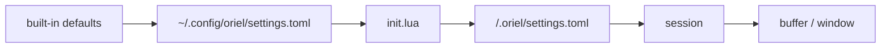

# Settings: storage and the settings page

Most people change settings in the GUI. Many also edit the file by hand and commit it to their dotfiles. Both edit the
same file, and neither clobbers the other.

## Storage

- **Settings are data, in TOML.** `~/.config/oriel/settings.toml`, and `<repo>/.oriel/settings.toml` per project.
- **Logic stays in Lua.** `init.lua` holds keymaps, hooks, commands and anything conditional (`scripting.md`).
- **Only non-defaults are written.** A fresh install has an empty file; resetting an option deletes its line.
- **The writer round-trips.** Comments, key order, blank lines and formatting you wrote by hand survive a GUI edit.
  A GUI change touches only the line it changes, so a dotfiles diff is one line.
- Sections in the file match sections on the page:

```toml
# ~/.config/oriel/settings.toml
[editor]
line_numbers = "relative"
tab_width = 4               # Go uses tabs anyway

[agent]
default_provider = "claude"
commit_gate = "soft"
```

### Precedence

Later layers win:



- `init.lua` beats the user file, so a value computed in Lua is never silently overridden by a GUI click.
- A window value beats a buffer value; an option is usually only one of the two.
- In code these are `registry.Layer`s, and a value is read at an `At{Project, Session, Buffer, Window}`: each layer
  applies only where its key matches. `Get` returns the value and the layer it came from, which is what the page shows.
- A project file is trusted on first open, the same way as `.oriel/` Lua (`plugins.md`).
- Session, buffer and window values are runtime only: `:set`, the page's session scope, or a plugin. They aren't
  written to disk unless you choose "save to user" or "save to project".

### Live reload

- The files are watched. A hand edit applies immediately, as a GUI change does.
- A parse error keeps the last good values and shows the error, with line and column, in the page and as a toast.
  Nothing is written back to a file that doesn't parse.

## The TOML module

- Our own `toml` module, no third-party code (`deps.md`). Themes use it too (`theming.md`).
- It covers TOML 1.0, tested against the `toml-test` suite vendored under `spec/`.
- It keeps a concrete syntax tree, so edits are surgical: set, add or delete a key in place and keep everything else
  byte for byte.
- `toml.Parse` returns a `Document`: `Value()`, `Get(path…)`, `Set(path, v)`, `Delete(path…)`, `Bytes()`. The tree is
  the source itself plus the span of every key, value and table header; an edit splices bytes and reparses, and an edit
  that would make the document invalid is refused with the document unchanged.
  - Setting an existing key replaces only its value's bytes.
  - A new key goes after the last key of the deepest `[table]` that holds it (with that key's indent), next to the
    dotted keys that define its table, or in a new `[table]` at the end. Line endings follow the file's.
  - Deleting a key removes its line (comment included); deleting a table removes its sections and everything under it.
- Parse errors carry a line and column. Spec: `spec/toml` (TOML 1.0.0); suite: `spec/toml-test` (v1.5.0, the 1.0.0 file list).

## Options (`OptionSpec`)

Every option is registered in the registry (`plugins.md`), by built-ins and plugins alike. The page, `:set`, Lua,
help and validation are all generated from the spec.

| Field | Meaning |
|---|---|
| `Name` | `editor.line_numbers`. The section is the prefix. |
| `Section` | title and order on the page, when it differs from the prefix |
| `Type` | bool, enum (with values), int or float (with range), string, colour, duration, key, list, map |
| `Default` | the built-in value |
| `Help` | one line; the long form links to `:help` |
| `Scopes` | which of user, project, session, buffer and window it can be set at |
| `Layer` | `input` (an input engine's behaviour) or `app` (display and app-wide) (`editor.md`) |
| `Aliases` | vim names, e.g. `number`, `relativenumber` → `editor.line_numbers` |
| `Resettable` | false where "default" means nothing, e.g. a path you picked |
| `Restart` | the change applies only after a restart |
| `Secret` | never written to settings files; kept in the secrets store (`security.md`) |

## Option list

Every option Oriel registers, so there is one place to look. A test checks it against the registry (ED-13).

| Option | Default | Layer | Aliases | Added by |
|---|---|---|---|---|
| `editor.clipboard` | `system`: `y`, `d` and `p` use the system clipboard; `registers` keeps them in vim's registers | input | `clipboard` | ED-13 |
| `editor.shift_width` | 8 | input | `shiftwidth`, `sw` | ED-13 |
| `editor.expand_tab` | false | input | `expandtab`, `et` | ED-13 |
| `editor.ignore_case` | false | input | `ignorecase`, `ic` | ED-13 |
| `editor.smart_case` | false | input | `smartcase`, `scs` | ED-13 |
| `editor.wrap_scan` | true | input | `wrapscan`, `ws` | ED-13 |
| `editor.magic` | true | input | `magic` | ED-13 |
| `editor.report` | 2 | input | `report` | ED-13 |
| `editor.number_formats` | `bin,hex` | input | `nrformats`, `nf` | ED-13 |
| `editor.hidden` | true | input | `hidden`, `hid` | ED-13 |
| `editor.input` | `vim`: the input engine a buffer is edited with | app | | ED-5 |
| `keymap.leader` | Space | app | | FW-3 |
| `keymap.timeout` | true | app | `timeout`, `to` | FW-3 |
| `keymap.timeoutlen` | 1s | app | `timeoutlen`, `tm` | FW-3 |
| `ui.reduced_motion` | false | app | | FW-5 |
| `ui.theme` | `oriel` | app | | FW-7 |
| `ui.variant` | `system`: follows the OS; or `dark`, `light` | app | | FW-7, SH-11 |
| `whichkey.enabled` | true | app | | SH-6 |

## The settings page (`:Settings`, ⌘,)

- **Sections** down the left, from the registry. Plugin options get their plugin's section.
- **Search** across names, help text, aliases and values. `@modified`, `@project` and `@plugin:linear` filter.
- **Typed controls**: toggle, dropdown, number with range, colour picker, key recorder, list editor.
- **Each row** shows the help line, the current value, and where it came from: default, user, project, session, or
  "set in `init.lua:12`". A value set in Lua is read-only on the page, with a jump to the line.
- **Scope switcher**: user, this project, this session. It edits that layer and shows the effective value under it.
- **Modified marker** on every non-default row. **Reset** per option, per section and for everything, with undo.
  Reset removes the line from the file.
- **Show as TOML / Lua** shows the line you would write by hand.
- Options that need a restart say so, and the page offers one.
- Every row has a help id (`help.md`).

## As built (SH-12)

- `~/.config/oriel/settings.toml` is the user layer and `<work dir>/.oriel/settings.toml` the project's, read at start
  and every 250 ms after (by contents). A key is an option's name as tables: `[editor] tab_width = 4`, or a vim
  alias. A value of the wrong type is a warning; a key no option has is kept, listed on the page, and read again
  when more options register (a plugin's). A parse error keeps the last good values and gives its line and column.
- `Options.SetFrom` records where a value came from (a file's path, `init.lua:12`), `Source` gives it back for the
  value that wins, `Lookup` reads one layer and `Spec` finds an option by name or alias.
- The page writes through `toml.Document`: a change replaces the value's bytes, a new key goes after its table's
  last key, a reset deletes the line. Only the user and project files are written; the session scope never is.
  It edits at the key the file already uses (an alias, a dotted key). A file that doesn't parse is never written.
- A value set in Lua wins over both files, so the page shows it read-only with its source; `settings.set` refuses it.
- **Project trust**: a project file applies only once trusted (`settings.trust`, offered by a notice), recorded by
  its SHA-256 in `~/.config/oriel/trusted.toml`, so a change needs trusting again (security.md, direnv-style). An
  edit from the page re-trusts it.
- Controls: a toggle, choices (four or fewer inline, else a menu), and a field for numbers, durations and
  strings, checked on Enter. "TOML" shows each row's line and its Lua. Undo is per change.
- Not yet: colour, key, list and map types; `Restart`, `Resettable` and `Secret`; a jump to the Lua line (Lua comes
  with the scripting ticket); undo for reset section and reset all as one step.
