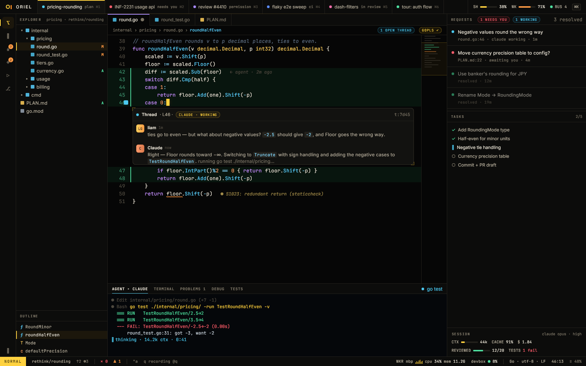
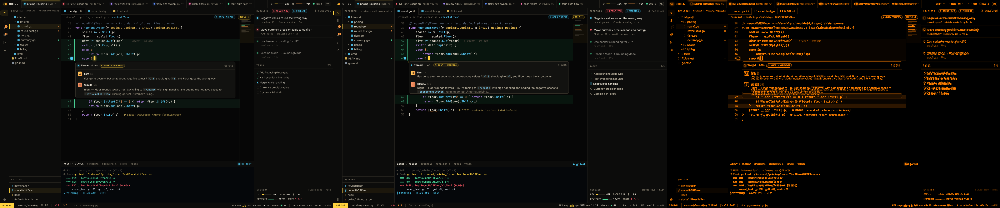
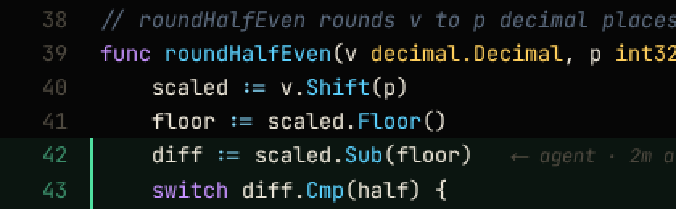
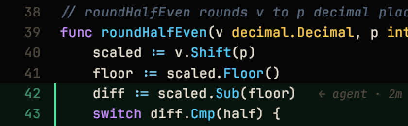
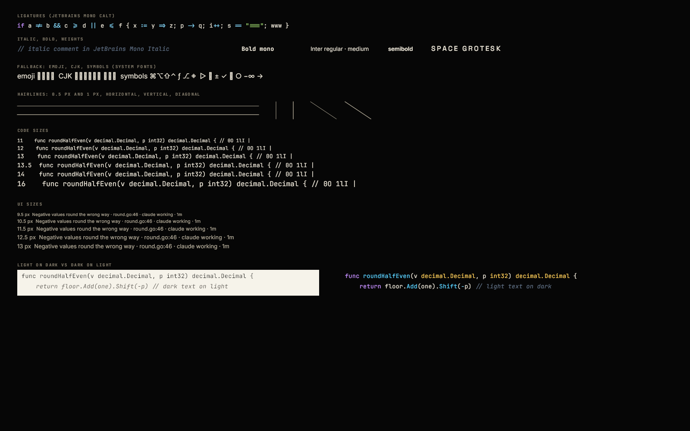
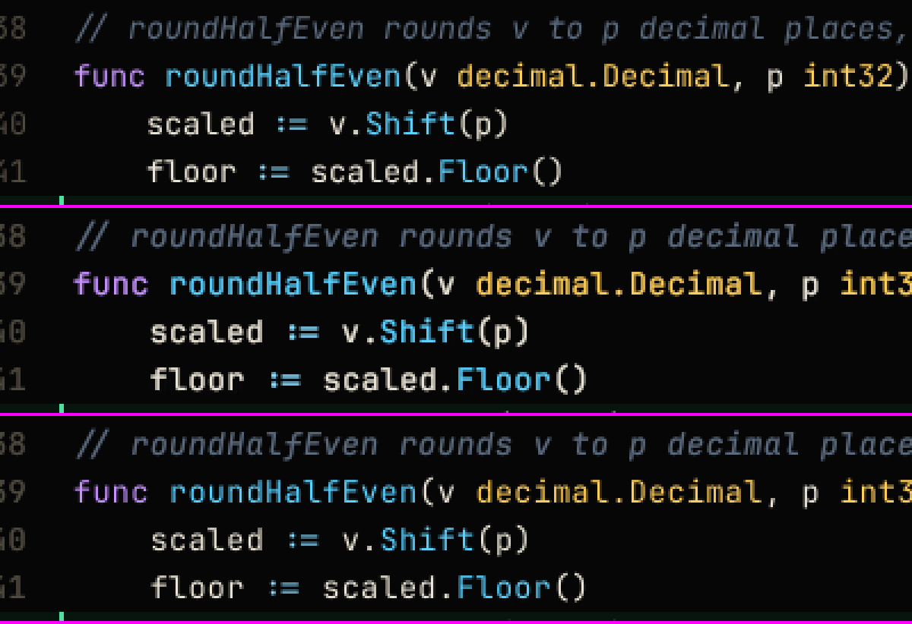
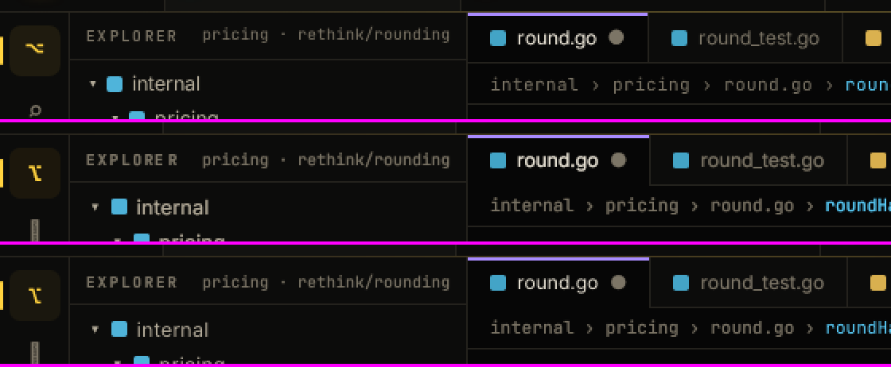

# P0-4 · Gio spike: go/no-go

**Verdict so far: provisional GO on Gio.** It reproduces `01-ide` closely, with no limit that rules out a mockup.
The budget numbers that decide it (frame time, keypress-to-photon, 1× text, idle RSS, Wayland scaling) have to come
from real GPUs on macOS and Linux. This sandbox only has software GL. **Status: review** until the macOS run below is in.
P0-6 (below) adds the glyph-atlas text path and baked shapes that the first macOS run called for; its macOS numbers
are outstanding.

Code: `cmd/oriel-spike` (its own module, build tag `spike`, so the rest of the workspace builds without Gio's
cgo headers). `scene/` holds the drawing in pure Go; `main` holds the window, headless, benchmark and compare
modes. Gio `v0.10.3`.



## What was done here (Linux sandbox, no GPU)

- Debian 12 container, i9-9880H (16 threads), no root, no display. Gio's Linux dev libraries and Mesa were
  extracted from the bookworm `.deb`s into a scratch prefix. **All GPU numbers below are from llvmpipe (Mesa's
  software rasteriser) over surfaceless EGL**: valid for correctness and for the CPU cost of building a frame,
  meaningless for GPU frame time.
- Xvfb couldn't start without root (its `xkbcomp` path is compiled in), so the **windowed** path (`-auto`) is
  built and vetted but was **not run** here. The new sandbox image (`.crit/sandbox.Dockerfile`) has Xvfb and Mesa
  installed properly, so it can be run there.
- `GOOS=darwin` can't be cross-built: `gioui.org/app` needs cgo against the macOS SDK. The `scene` package builds
  for darwin; the binary must be built on the Mac.

### 01-ide, side by side

`-compare` against `mockups/01-ide.png`, both 1600×1000 @1×: **mean absolute difference 7.2/255; 5.5% of pixels
differ by more than 32/255.** What makes up that 5.5%:

- Missing glyphs: the rail icons (`⌥ ⌕ ⎇ ⚙ ◈`), `◐` and the braille spinner `⠼`. The sandbox has no symbol
  fonts. Gio falls back to system fonts (go-text `fontscan`), so on macOS they come from Apple Symbols. Not a Gio limit.
- Code text runs about 0.1 px per character wider: Chrome rounds JetBrains Mono's 8.1 px advance to 8 px at 1×,
  and Gio keeps the fractional advance. That's about 5 px over a 50-column line.
- Ligatures in the terminal pane: `===` renders as a ligature because Gio's shaper can't turn features off
  (see the gaps below). The mockup uses `font-variant-ligatures: none` there.
- Everything else matches: layout, colours, chips, corner brackets, the thread card, squiggles, avatar
  gradients, glows, the titlebar's accent hairline.



Code at 13.5 px, 1×, zoomed 2× with nearest-neighbour. The mockup (Chrome/Skia, FreeType) is on top, Gio below:




At 1× Gio's unhinted, greyscale-AA text is about as sharp as Chrome's on Linux, and slightly heavier.
Renders at 1.25×, 1.5× and 2× (`-shot … -scales 1,1.25,1.5,2`) are crisp, because text is shaped at device
pixels, not scaled.

The text sampler (`-scene text`) covers ligatures, italics, weights, hairlines, code and UI sizes, and light on dark next to dark on light:



### Numbers measured here

`oriel-spike -bench`: 300 frames per scene at 1600×1000 @1×, headless.

| Scene | Build ops (CPU) p50 / p99 | llvmpipe draw p50 / p99 |
|---|---|---|
| `ide` (01-ide) | 0.55 / 0.78 ms | 36.9 / 40.8 ms |
| `scroll` (50k-line Go file, cursor +1 line per frame, diagnostics and virtual text) | 0.50 / 0.85 ms | 30.4 / 47.0 ms |
| `text` (sampler) | 0.28 / 0.38 ms | 17.3 / 18.9 ms |
| `glow` (ide + 50 pulsing 9-slice glows + opacity-layer modal) | 0.63 / 0.94 ms | 44.4 / 47.7 ms |
| `hud` (30 live panes) | 0.29 / 1.33 ms | 34.0 / 38.4 ms |
| `type` (empty buffer) | 0.03 / 0.04 ms | 2.5 / 3.1 ms |

- **Building a frame is cheap**: under 1.4 ms p99 for every scene, including shaping. The p99 tail is the first
  frame of a scene filling the shaper's caches.
- A CPU profile of the whole run: **87% of CPU time is inside cgo (llvmpipe rasterising)**. Gio's own Go
  renderer (op collection, path encoding, stencil setup) is roughly 2–3 ms a frame on top of building the ops.
  Most of the GPU work is `stencilClips`: **Gio redraws every glyph as a vector path, through a stencil, every
  frame**. On a real GPU that's cheap, but it is the cost the glyph atlas (`rendering.md`, way 1) removes.
- Startup: **~270 ms** from process start to the first `ide` frame drawn, headless. That includes parsing the
  bundled fonts, scanning system fonts and starting llvmpipe.
- RSS: **195 MB** peak after the first `ide` frame, and 423 MB after every scene. Both include llvmpipe's buffers,
  and the second includes the 50k-line file and its token cache. Not comparable with the 120 MB budget; the
  macOS run measures it.

## Budgets: status

Measured on Liam's Mac (go1.26.5 darwin/arm64, 120 Hz, 1600×1000 @1×), 2026-10-12. Raw output below.

| # | Check (`shell.md`) | Result | Status |
|---|---|---|---|
| 1 | Hold `j` in a 50k-line file: frame p99 < 8 ms at 120 Hz | interval p99 11.87 ms (p50 8.33); build p99 1.13 ms, `Frame()` p99 5.38 ms; headless GPU draw p99 11.67 ms | **fail**: GPU-bound, frames dropped |
| 2 | Keypress-to-photon < 8 ms | in-app part, typing by hand in `-scene type`: n=199 p50 1.45 ms, p99 3.88 ms, max 5.53 ms | **accepted** on the in-app number; end-to-end not measured, by Liam's decision (2026-10-12) |
| 3 | Glow on 50 elements at 120 Hz | interval p99 16.75 ms; GPU draw p99 12.6 ms | **fail** (same cause as 1) |
| 3 | Emoji, CJK, 13 px at 1× by eye | not reported | **open** |
| 4 | 30-pane HUD at 4 Hz < 3% CPU | 7.46% | **fail** |
| 5 | Wayland 1.25× / 1.5× | not run | **open** |
| 6 | Idle RSS < 120 MB | 146 MB after the first frame (headless), 212 MB after every scene, 279 MB peak windowed | **fail** |
| – | Startup | 648 ms to first presented frame (windowed), 221 ms headless | no budget |
| – | Idle CPU | 2.9% with 2 frames in 5 s | should be ~0: investigate |

**Reading.** The CPU side is well inside budget everywhere (build p99 ≤ 1.15 ms). The GPU side is not: 5–7 ms p50 and
~12 ms p99 for scenes that are mostly text, which is Gio stenciling every glyph as a vector path each frame. That is the
cost the glyph atlas removes, so 1, 3 and probably 4 hinge on it. Memory is partly fixed overhead we chose (the Go
fonts, glyph path caches) and needs a profile before it's judged.

Per `shell.md`, a failure of 1 or 2 gets one focused round of renderer work before falling back. Next: **P0-6**, a
glyph-atlas prototype in the spike, then re-run the same commands.

<details><summary>Raw macOS output</summary>

```
startup: first frame presented 648ms after start
ide     build ops n=120 p50=1.52ms p99=2.36ms max=2.40ms
        frame()   n=120 p50=2.67ms p99=6.65ms max=6.74ms
        interval  n=120 p50=8.33ms p99=16.84ms max=574.37ms
scroll  build ops n=1200 p50=0.59ms p99=1.13ms max=4.92ms
        frame()   n=1200 p50=2.58ms p99=5.38ms max=26.84ms
        interval  n=1200 p50=8.33ms p99=11.87ms max=3029.46ms
glow    build ops n=600 p50=2.71ms p99=3.63ms max=4.32ms
        frame()   n=600 p50=3.67ms p99=9.59ms max=10.26ms
        interval  n=600 p50=8.36ms p99=16.75ms max=29.20ms
text    build ops n=60 p50=0.33ms p99=0.68ms max=0.77ms
        frame()   n=60 p50=1.27ms p99=3.03ms max=3.68ms
        interval  n=60 p50=8.33ms p99=8.51ms max=18.44ms
hud     redrawing at 4 Hz over 10.033s: CPU 7.46% of one core (62 frames)
ide     idle over 5.025s: CPU 2.90% of one core (2 frames)
key event → frame presented (in-app part only): n=1 p50=3.65ms p99=3.65ms max=3.65ms
peak RSS: 279 MB
# -scene type, typing by hand, then Esc:
key event → frame presented (in-app part only): n=199 p50=1.45ms p99=3.88ms max=5.53ms
startup: first ide frame drawn 221ms after start (headless)
RSS after the first ide frame: 146 MB (peak so far)
go1.26.5 darwin/arm64, 300 frames per scene at 1600×1000 @1×
ide     build ops: n=300 p50=0.49ms p99=1.00ms max=1.16ms
        gpu draw:  n=300 p50=5.26ms p99=11.86ms max=13.41ms
scroll  build ops: n=300 p50=0.42ms p99=0.75ms max=3.97ms
        gpu draw:  n=300 p50=5.30ms p99=11.67ms max=12.69ms
text    build ops: n=300 p50=0.25ms p99=0.47ms max=7.57ms
        gpu draw:  n=300 p50=3.04ms p99=10.98ms max=11.53ms
glow    build ops: n=300 p50=0.52ms p99=1.15ms max=3.08ms
        gpu draw:  n=300 p50=7.20ms p99=12.60ms max=15.89ms
hud     build ops: n=300 p50=0.23ms p99=0.92ms max=1.62ms
        gpu draw:  n=300 p50=5.97ms p99=12.17ms max=13.05ms
type    build ops: n=300 p50=0.04ms p99=0.09ms max=0.23ms
        gpu draw:  n=300 p50=2.27ms p99=9.60ms max=10.15ms
peak RSS after every scene: 212 MB
```

</details>

## How to measure (macOS)

Run everything from the repo root. Close other heavy apps first, and keep the laptop on power.

### 0 · Once

1. Xcode command-line tools, needed for cgo: `xcode-select --install`.
2. Build the spike once so later runs don't include compile time: `go build -tags spike -o /tmp/oriel-spike ./cmd/oriel-spike`.

### 1 · Frame time, CPU and memory (budgets 1, 3, 4, 6)

```sh
/tmp/oriel-spike -auto -text atlas -shapes baked    # opens a 1600×1000 window and runs every scene; ~30 s. Don't touch it.
/tmp/oriel-spike -bench -text atlas -shapes baked   # headless (Metal): build time vs GPU time per scene
/tmp/oriel-spike -bench                             # the same with P0-4's paths, as the baseline
```

`-text` picks the text path (`paths`, `atlas` or `runs`) and `-shapes` the rounded rects and borders (`paths` or
`baked`); see P0-6 below. Paste the outputs into the thread. Run on the built-in Retina display. To also get 1× numbers, drag the `-auto` window to
the external 1× monitor as soon as it opens.

### 2 · Keypress-to-photon (budget 2)

**Accepted on the in-app number** (Liam, 2026-10-12): run `/tmp/oriel-spike -scene type`, type for about 20 s, press
**Esc**, and it prints key event → frame presented percentiles. End-to-end isn't measured; the camera method at the end
of this section is optional.

Typometer doesn't work on current macOS: tried on 2026-10-12, its pixel reads (Java's AWT robot) went stale. The spike
kept drawing every dot, but typometer only saw them after a screenshot forced a refresh, so it stalled at 13/100 and
reported 10–25 s "latencies". The typometer steps are kept for Linux, where it reads pixels through XLib. It needs Java
(`brew install openjdk` on a Mac, which is keg-only with no sudo; run it as `$(brew --prefix openjdk)/bin/java`) and the
jar from `https://github.com/pavelfatin/typometer/releases/download/v1.0.1/typometer-1.0.1-bin.zip`, unzipped to
`~/typometer`.

1. Start the target: `/tmp/oriel-spike -scene type`. It shows a solid background, a "TYPE HERE" label and an empty line
   with no caret, in a small 900×160 window, and a yellow bar that ends the line. Typometer types dots and deletes them with Backspace.
2. Start typometer (it predates Java's module system, so it needs `--add-opens`): `$(brew --prefix openjdk)/bin/java --add-opens java.desktop/java.awt=ALL-UNNAMED -jar ~/typometer/typometer-1.0.1/typometer-1.0.1.jar` (the exact jar name may differ; use the
   `.jar` in the unzipped folder).
3. macOS asks for two permissions for the app that launched Java (your terminal): **Accessibility**, so it can type,
   and **Screen Recording**, so it can read pixels. Grant them in System Settings → Privacy & Security, then restart
   typometer. Those grants cover everything run from that terminal, so **revoke them when you're done**.
   Typometer is an unsigned jar from an individual (Pavel Fatin); if that's not acceptable, use the camera method below.
4. In typometer, set **Chars** to 100, then click **Benchmark**. When it prompts you, click into the spike window within the countdown. It types
   `.....` to calibrate, then a run of dots, and measures each one. Leave the keyboard and mouse alone until it finishes.
   Clicking back on typometer stops it.
5. Run it again with a reference editor for comparison: a terminal running `nvim`, or Zed. Typometer goes through Java's
   AWT robot on macOS, which adds its own overhead, so the comparison matters more than the absolute number.
6. Paste the summary (min, avg, max, SD), or export the CSV, into the thread.

Optional, no software: film the keyboard and the screen together with an iPhone in 240 fps slow-mo, press a key in
`-scene type` about 20 times, and count frames from key-down to the dot appearing (each frame ≈ 4.2 ms). Do the same
with nvim in a terminal for comparison.

### 3 · Text quality by eye (budget 3)

1. `/tmp/oriel-spike -scene text`, then drag the window to the external 1× monitor.
2. Next to it, open a terminal (Terminal.app or Ghostty) showing the same code at 13 px in JetBrains Mono.
3. Compare sharpness, weight and spacing, plus emoji and CJK in the fallback rows. A screenshot of both side by side is
   enough. Repeat on the Retina display.

### 4 · Screenshots (optional)

`/tmp/oriel-spike -shot /tmp/spike -scales 1,2` writes PNGs of every scene. Compare `ide` with
`_design/mockups/01-ide.png`.

### 5 · Linux (budget 5)

The same commands in a **Wayland** session, with display scaling at 1.25× and then 1.5×, checking that text isn't blurry.
They need the libraries listed in `.crit/sandbox.Dockerfile` (`pkg-config libwayland-dev libxkbcommon-dev
libegl1-mesa-dev …`).

## What the spike found (gaps and what we do about them)

| Finding | Impact | Plan |
|---|---|---|
| **Gio blends in linear light; the mockups (CSS) blend in sRGB.** A 7% green row tint came out 3× too bright (`21,66,45` vs `11,21,16`). | Every translucent token (`accentBg`, diff rows, chips, scrims, glows, opacity layers) looks far stronger than designed. | The spike remaps alpha so blending over dark surfaces matches sRGB (`Canvas.SRGBBlend`, `srgbAlpha`). Then the same pixel is `8,21,14`. For real: `theme` resolves translucent component tokens to **opaque colours over their known surface**, and `render/gio` keeps the remap for overlays over unknown backdrops. Added to `rendering.md`. |
| **Dark text on light looks thin** (linear-light blending of glyph coverage). | The light theme (`17-light`) will look weak. | The glyph atlas with stem darkening and gamma (`rendering.md`) is needed before the light theme ships, not just for 1× sharpness. |
| **No letter-spacing** in Gio's text API. | Every cap micro-label (`.14em`) and the brand. | `typeset` owns tracking. Done in the spike's atlas path (P0-6): tracking goes after each cluster. |
| **No font-feature control** in Gio's shaper (go-text supports it; Gio doesn't pass it through). | Terminals and anything that sets `ligatures: none` or `ss01…`. | `typeset` shapes with go-text directly. The spike's atlas path does (P0-6); feature switches aren't wired to a scene yet. |
| **Glyphs are vector paths stenciled every frame.** | Most of the GPU time per frame; fine on a GPU, a ceiling for big scroll scenes. | Glyph atlas (way 1 in `shell.md`), built in P0-6. |
| **Rounded rects and borders are stenciled every frame too.** | After the atlas, the HUD's 30 panes cost more than its text. | Baked 9-slices (P0-6, `-shapes baked`). |
| **No blur.** Glows are baked Gaussian 9-slices (`scene/glow.go`). They look right, and are cached per size, blur and colour, so animate glows with an opacity layer, not by changing their colour. | As designed in `shell.md`. | Keep; move into `render/gio` as `Effect(glow)`. Images need no alpha remap (P0-6). |
| `gioui.org/app` pulls in the Go fonts and material icons (for fallback window decorations), and IBus over D-Bus on X11. | 32 MB `vendor/`, and `godbus` (approved). | Accept. |

Nothing found rules out a mockup. Glows, the opacity modal, hairlines, gradients, rounded and stroked shapes,
clipping, and fractional scaling all work through Gio's public API.

## P0-6 · Glyph atlas and baked shapes

The first macOS run missed budgets 1, 3, 4 and 6, with the GPU time going to stencilled vector glyphs. P0-6 adds two
switches to the spike, so every scene can be compared on the same build:

- **`-text atlas`**: shapes with go-text directly (features and tracking), rasterises each glyph once per (face, size,
  quarter-pixel x offset) with `x/image/vector`, and packs it, already tinted, into 1024² atlas pages with a shelf
  packer. Each glyph draws as one quad: an offset, a rect clip and the page's `ImageOp`. Glyphs added mid-frame
  join the page that frame. A page's `ImageOp` is replaced only after a change, so it's uploaded again only then. When
  four pages are full the atlas starts over with fresh pages, and pages already handed to the GPU are never written.
  Runes the bundled fonts lack (emoji, CJK, symbols) fall back to Gio's path text.
  `scene/atlas.go`, `scene/typeset.go`; tests in `scene/atlas_test.go`.
- **`-text runs`**: the same shaping and glyphs, composed into one cached image per run (a line of code, a label) and
  drawn as one quad. Runs unused for two frames are dropped.
- **`-shapes baked`**: rounded rects and borders as stretched 9-slices of a baked corner image (`scene/shapes.go`),
  the same way glows are drawn.

Text quality: atlas glyphs are slightly lighter than paths and closer to the mockup. Tracked caps now space evenly
("EXPLORER" was uneven with paths). Against `01-ide.png`, mean difference **6.48/255 with atlas + baked**, against 7.17 for
paths; pixels off by more than 32/255 drop from 5.47% to 5.04%. Rows: mockup, paths, atlas + baked; 1×, zoomed.




### Numbers here (llvmpipe, so relative only)

`-bench`, GPU draw p50 / p99 in ms, 300 frames per scene at 1600×1000 @1×. Building the ops stays at 1.4 ms p99 or
less in every mode.

| Scene | paths | atlas | runs | atlas + baked | runs + baked |
|---|---|---|---|---|---|
| `ide` | 36.5 / 41.6 | 17.4 / 25.5 | 16.5 / 23.9 | 19.5 / 24.9 | 18.6 / 25.5 |
| `scroll` | 29.6 / 37.0 | **9.2** / 18.1 | 12.3 / 21.4 | 9.3 / 18.0 | 11.7 / 18.8 |
| `text` | 17.2 / 19.4 | 7.0 / 9.9 | 3.3 / 4.7 | 5.8 / 7.8 | **3.0** / 4.3 |
| `glow` | 43.7 / 51.4 | 25.1 / 35.8 | 27.8 / 34.3 | 24.4 / 33.1 | 28.2 / 37.9 |
| `hud` | 33.0 / 36.4 | 27.7 / 38.4 | 27.9 / 37.9 | **15.7** / 22.8 | 18.8 / 25.0 |
| `type` | 2.4 / 3.3 | 0.4 / 0.5 | 0.2 / 0.3 | 0.3 / 0.5 | 0.2 / 0.3 |

- The atlas halves `ide` and cuts `scroll` by 69% and `text` by 59%. Baked shapes take the HUD from 28 to 16 ms.
- **runs** is best for static text, and worse for scrolling, because every line entering the view composes and uploads a
  new image. **atlas + baked** is the candidate: best or close on every scene.
- What remains, by CPU profile: stencilled paths that are still paths (strokes, rings, icons, squiggles) and one
  draw call per quad.

### Memory

`-bench` now reports RSS at each step (`ps`, so the same on macOS) and splits Go from the rest. Before anything is
drawn, RSS goes 13 MB at start → 34 MB with fonts loaded → 108 MB with the GPU context.

| | paths | atlas | runs | atlas + baked |
|---|---|---|---|---|
| after the first `ide` frame | 192 MB | 153 MB | 150 MB | 156 MB |
| after every scene, after returning free Go memory | 327 MB | 290 MB | 265 MB | 243 MB |
| Go heap in use / Go runtime total | 18 / 89 MB | 18 / 61 MB | 13 / 49 MB | 18 / 61 MB |

- Go's own heap is under 20 MB. Most of RSS is outside Go: here, 75 MB for creating the GL context alone, plus
  llvmpipe's buffers, which count as RAM because there's no GPU. Fonts (bundled plus the system font index) are ~20 MB.
- So the 120 MB budget is mostly a question of what Metal and AppKit cost on a Mac. The new `-bench` lines give that
  split there. The first macOS number (146 MB) was **peak** RSS from `getrusage`, not idle RSS; `-auto` and `-bench` now
  print the current RSS too.

### Fixes to the measurements

- **The windowed loop built a new canvas every frame**, so in `-auto` every glow was baked and uploaded again on every
  frame, and font metrics were re-measured. `-bench` didn't do this. That inflated the first macOS run's windowed `glow`
  and `hud` numbers and its 279 MB peak. The canvas now lives across frames (`Canvas.Begin`).
- **Idle and HUD CPU included the scene switch**: the first frame of a new scene, with its cache filling, inside a
  5 s window that only had two frames. Timed phases now start after the scene's first frame and a GC.
- **Images don't need the alpha remap.** Gio samples images as premultiplied sRGB, which already blends like CSS over a
  dark backdrop, so the remap made glows fainter than designed. Removed for glows, baked shapes and atlas glyphs. Only
  solid fills keep it. `rendering.md` updated.

### macOS run 1 (2026-10-12): `-text atlas -shapes baked`

| # | Budget | Result | Status |
|---|---|---|---|
| 1 | Scroll p99 < 8 ms at 120 Hz | `frame()` p99 7.83 ms. Interval p99 141.75 ms, but the run stalled (max 24.7 s: window hidden or display asleep) | **re-run** with the stall-proof `-auto` |
| 2 | Keypress-to-photon | in-app 2.70 ms (n=1) | accepted (above) |
| 3 | Glow at 120 Hz | `frame()` p99 7.38 ms, interval p99 16.95 ms | **re-run**: the headless p99 was the readback artifact (below) |
| 4 | HUD at 4 Hz < 3% CPU | 4.47% (45 frames) | **fail**, cut in the follow-ups |
| 6 | Idle RSS < 120 MB | 120 MB after the first `ide` frame headless (paths: 149). 215 MB now in the window | **fail**: fonts cost 68 MB of it, fixed in the follow-ups |
| – | Idle CPU | 0.60% with 2 frames in 5 s | fine |
| – | Startup | 333 ms windowed, 298 ms headless | no budget |

Headless GPU draw, p50 / p99 ms, atlas + baked against paths: `ide` 4.71 / 12.21 against 4.26 / 11.69,
`scroll` 3.68 / 10.72 against 5.10 / 11.94, `text` 2.09 / 10.18 against 2.52 / 11.61, `glow` 5.71 / 12.39 against
6.03 / 12.51, `hud` 2.80 / 10.25 against 5.51 / 12.34, `type` 0.77 / 7.30 against 1.43 / 10.04. Every scene's p99,
even the nearly empty `type`, sits at 10–12 ms. That is the per-frame readback and sync (and the GPU's clock dropping
between frames), not drawing.

<details><summary>Raw output</summary>

```
-auto text=atlas shapes=baked:
startup 333ms; ide build p50 0.66 p99 2.37; frame() p50 2.99 p99 7.52; interval p50 8.39 p99 231.29 max 45483
scroll build p50 0.45 p99 1.04; frame() p50 2.27 p99 7.83 max 42.31; interval p50 8.33 p99 141.75 max 24671
glow build p50 0.56 p99 1.22; frame() p50 3.17 p99 7.38; interval p50 8.34 p99 16.95 max 34604
text frame() p50 1.27 p99 5.61; interval p50 8.34 p99 366.68 max 135076
hud 4 Hz over 10.03 s: CPU 4.47% (45 frames); idle 5.02 s: CPU 0.60% (2 frames); key latency n=1 2.70 ms
peak RSS 268 MB; RSS now 215; go heap 21 MB, runtime total 195 (161 released)
-bench text=atlas shapes=baked: RSS start 14, fonts 82, GPU ctx 91, after first ide frame 120 (startup 298 ms)
ide build p50 .47 p99 .97 / gpu p50 4.71 p99 12.21; scroll .38/.87 / 3.68/10.72; text .21/.40 / 2.09/10.18; glow .55/1.11 / 5.71/12.39; hud .18/.59 / 2.80/10.25; type .01/.03 / .77/7.30; peak 203, now 202
-bench paths: RSS start 14, fonts 83, GPU 92, after first ide frame 149 (startup 204 ms)
ide .45/.66 / 4.26/11.69; scroll .46/.83 / 5.10/11.94; text .21/.34 / 2.52/11.61; glow .50/1.07 / 6.03/12.51; hud .24/1.16 / 5.51/12.34; type .02/.08 / 1.43/10.04; peak 225, now 221
```

</details>

### Follow-ups after run 1

- **Fonts (68 MB on macOS).** `NewShaper(false)` let Gio scan every system font into a package-global index that is
  never freed. Now only the bundled faces load (`text.NoSystemFonts`). A rune they lack loads one system face on first
  need (`scene/fallback.go`): fontconfig's match on Linux, then a short list of known macOS fonts (Apple Symbols, Menlo,
  Apple Braille, Apple Color Emoji, Hiragino, Apple SD Gothic Neo, STHeiti, Arial Unicode), then at most 8 others from
  the font directories. This stands in for the CoreText and fontconfig fallback that `rendering.md` specifies. The sandbox
  has almost no system fonts, so both versions cost 13 MB here (parsing the bundled TTFs into go-text's structures);
  the macOS saving shows in the next run's "RSS with fonts loaded" line. `-bench` lists which fallback fonts loaded.
- **The headless p99.** `-bench` now splits each frame into `frame()` (Gio's CPU work to collect, encode and submit),
  `sync` (a 1-pixel readback, which waits for the GPU and includes its wake-up) and `pipelined` (30 frames back to back
  with one sync per batch: GPU time per frame under load). It also prints RSS after each scene.
- **Stalls in `-auto`.** Intervals of 100 ms or more are reported as "stalls (window hidden?)" rather than mixed into the
  interval percentiles, with a warning to re-run. `-auto` tells you up front to keep the window visible and not touch
  anything. It also prints the window's pixel size and the size of one drawable, and the RSS after the first frame.
- **Where the windowed 215 MB goes** (arithmetic, to check against the next run): 120 MB headless after the first frame,
  plus the window's drawables at 2×. That's 3200×2000×4 B ≈ 24 MB each, and CAMetalLayer keeps up to three (73 MB).
  Add one more full-size offscreen buffer for the opacity layer (24 MB) and you get ≈ 217 MB.
- **HUD CPU.** The timed phases now print CPU per frame split into build ops, `frame()` and the rest (event loop,
  present, GC). A profile of the HUD showed two cheap wins, now in:
  - **Gio stencils any image drawn under a scale or a fractional offset** (`gpu.go`, `boundsForTransformedRect` adds a
    clip path). Every stretched 9-slice middle, for glows and baked shapes alike, was a stencilled path. 9-slices now
    never scale (`scene/nine.go`). Their corners and pre-stretched edge strips sit in the shared atlas and draw at
    integer offsets, and a uniform centre is a plain fill. Pills thinner than their corners (the HUD's 4 px bars) bake
    at their real height instead of falling back to a path.
  - **The HUD's 1,200 bars** are one image per pane, redrawn only when its data changes (`Canvas.Bars`).
  - Small images are one atlas texture now, not one texture each, which also stops the RSS growth they caused.
- **`-phases`** runs a subset (`-auto -phases hud`, `-bench -phases hud`), and `-cpuprofile` now works with `-auto`.

Here, after the follow-ups (llvmpipe, `frame()` p50, atlas + baked): `ide` 18.5 → 14.2 ms, `glow` 21.2 → 18.7 ms,
`hud` 12.0 → **6.3 ms**. RSS after the first `ide` frame went from 164 to 146 MB. Against the mockup, 6.48/255, as before.

### macOS run 3 (2026-10-12): after the follow-ups

With the coordinator's kick watchdog in `-auto`, which raises the window and invalidates when an expected frame is
more than 50 ms late.

| # | Budget | Result | Status |
|---|---|---|---|
| 1 | Scroll p99 < 8 ms at 120 Hz | **render fits**: `frame()` p99 5.53 ms, GPU 3.53 ms per frame pipelined. Interval p99 ~58 ms: frames were dropped and kicked (122 kicks) | **pacing bug, ours** (below) |
| 3 | Glow at 120 Hz | **render fits**: `frame()` p99 4.97 ms, GPU 5.41 ms per frame pipelined | pacing, as 1 |
| 4 | HUD at 4 Hz < 3% CPU | 4.00%: per frame 8.43 ms = build ops 2.00 + `frame()` 2.98 + the rest 3.46 | **fail**, cut below |
| 6 | Idle RSS < 120 MB | **65 MB** headless after the first `ide` frame (fonts 30 MB, was 82), 126 MB windowed at the first frame. Then 903–1105 MB once fallback fonts loaded | **fallback memory**, fixed below |
| – | Idle CPU | 0.42% | fine |
| – | Startup | 242 ms windowed | no budget |

Pipelined GPU time per frame (p50): `ide` 4.37, `scroll` 3.53, `text` 3.31, `glow` 5.41, `hud` 3.58, `type` 2.05 ms.
`sync` p99 is still ~10 ms: the GPU waking up after idling between single frames, which continuous drawing doesn't
pay. The fallback fonts loaded were Apple Symbols, Apple Color Emoji, Hiragino Sans GB and Apple SD Gothic Neo. The Go
runtime held 1114 MB, 1076 MB of it already released, which macOS keeps counted in RSS. The text scene's build ops max of
330 ms was those loads running on the frame.

### Follow-ups after run 3

**1 · Frame pacing: our bug, not Gio's.** `-auto` executed `op.InvalidateCmd` *after* `e.Frame()` returned. Gio reads
it in only one place, while processing that frame:

- `FrameEvent.Frame` (`app/os.go:260`) returns as soon as the main thread acks it. `validateAndProcess` acks
  (`app/window.go:200`, `signal()`) *before* `Present` and before `processFrame` calls `updateState()`
  (`app/window.go:238`).
- `updateState()` is where a pending `InvalidateCmd` (stored by `io/input/router.go:567`) becomes the next frame
  (`app/window.go:270`, `q.WakeupTime()`). Then `updateAnimation` stops the display link when no frame is due
  (`app/window.go:354` → `os_macos.go:569` → `os_darwin.go:160`, `running = 0`, which `os_darwin.go:203` checks
  on every tick).
- So our `Execute` raced the main thread's `Present` + `updateState`. When it won, the next frame came on time. When
  it lost, the wakeup sat unread in the router until something else made Gio look: an input event, a `ConfigEvent`,
  or the kick's `Invalidate`. That's the 1-in-15 drop. Executing a command on the router from the client goroutine
  after `Frame` is also a data race.
- **Fix (ours, no fork):** the next frame is requested before `e.Frame`, as Gio's own examples do. In `-auto` the
  phase bookkeeping now decides before the frame whether the phase ends. The kick stays as a watchdog and now reports
  how many frames it rescued and how late they came. Run 4 should show `no late frames to kick`.
- **Upstream (optional):** Gio could make a post-`Frame` `InvalidateCmd` safe, for example by having `Source.Execute`
  wake the window when it lands outside a frame. That's worth an issue, but nothing here needs it.

**2 · Fallback fonts never hit the heap whole.** `scene/fallback.go`:

- Each candidate file is mmapped (`scene/mmap_unix.go`, `x/sys/unix` on both OSes; a read fallback elsewhere).
- Each face's `cmap` is read alone, and only the face that covers the rune is parsed (`gtfont.NewFont` on that one
  loader). The file is unmapped afterwards, since go-text copies what it keeps.
- Loads run on a worker goroutine, never on the frame. A rune draws as tofu until its face lands, then the window is
  invalidated (`Fonts.OnLoad`) and the next frame takes the face in (`typesetter.beginFrame`).
- **Apple Color Emoji is left out.** go-text copies its whole colour-bitmap table onto the heap, and the atlas only
  rasterises outlines anyway. Colour emoji need CoreText, or a reader that maps one strike entry at a time.
- Fallback faces go to the atlas path only. Gio's shaper can't take a go-text face, so the `-text paths` baseline
  shows tofu for them.
- Can't be measured here: the sandbox has no system fonts that cover the scenes' symbols, so nothing loads. Run 4's
  `RSS now` after `text` gives the number.

**3 · HUD CPU.** The headless bench ticked the HUD's data only every 30th frame, but in the window every 4 Hz frame is
a tick. With every frame a tick, build ops were 4.8 ms here, and most of that was the per-pane bar images: `draw.Draw`
into `NRGBA`, then `NewImageOp` copying to `RGBA`. Now the bars fill premultiplied `RGBA` row by row, which `NewImageOp`
keeps without copying: **4.77 → 0.75 ms** per tick here. That should take the Mac's 2.0 ms build to a few tenths. The
bench's HUD now ticks every frame.

- Caching unchanged panes as `op.CallOp` macros wouldn't help. At 4 Hz every pane's data changes each tick, and a macro
  only saves our build. Gio collects and encodes every op on every frame regardless (there's no retained tree or
  damage tracking), so `frame()` (2.98 ms on the Mac) is the floor for redrawing 30 panes.
- The rest, 3.46 ms of the Mac's 8.43 ms (41%), is present, AppKit, the event loop and GC: fixed per frame, and not ours
  to cut. Estimate for run 4: (0.3 + 3.0 + 3.5) ms × 4 Hz ≈ **2.7%**, just inside 3%. If it isn't, the remaining lever
  is redrawing less: a HUD that updates panes on separate ticks, or at 2 Hz.

Here, now (llvmpipe, atlas + baked): HUD `frame()` 6.8 ms against 22.9 ms with path shapes; text scene build max 8 ms.

### For Liam (macOS), run 4

Keep the window visible and in front, and don't touch anything while `-auto` runs.

```sh
go build -tags spike -o /tmp/oriel-spike ./cmd/oriel-spike
/tmp/oriel-spike -auto -text atlas -shapes baked
/tmp/oriel-spike -bench -text atlas -shapes baked
```

Look for: `no late frames to kick` and interval p99 under 8.4 ms (budget 1); HUD CPU under 3% (budget 4); `RSS now`
after `text` and `glow` well under the old 900 MB, and the fallback fonts listed (budget 6).

**Status: review**, waiting on run 4.

### macOS run 4 (2026-10-12): after the run 3 follow-ups

Window 1600×1000 px at 1×, `-text atlas -shapes baked`, window in front and untouched.

| # | Budget | Result | |
|---|---|---|---|
| 1 | scroll p99 < 8 ms @120 Hz | `frame()` p99 **3.54 ms**; interval p50 8.33, p99 **8.63**, max 9.81 (one vsync, no drops) | ✓ |
| 2 | key → photon < 8 ms | in-app p99 3.88 ms (accepted, end-to-end not measured) | ✓ |
| 3 | glow at 120 Hz | `frame()` p99 6.19 ms; interval p99 9.36, max 13.42; GPU pipelined 4.67 ms | ✓ |
| 4 | HUD 4 Hz < 5% CPU (raised from 3% by Liam) | **4.57%**: 9.47 ms CPU per frame = build 0.98 + `frame()` 4.10 + rest 4.39 | ✓ |
| 6 | idle RSS < 120 MB | 125 MB windowed at the first frame; 66 MB headless; 159–203 MB after every scene's caches | ≈ |
| – | pacing | 2 late frames at startup only (103 and 198 ms after due); none in steady state | SH-1 |
| – | fallback fonts | Apple Symbols, Hiragino Sans GB, Apple SD Gothic Neo loaded; RSS after the text scene 109 MB (was 903) | ✓ |
| – | idle CPU | 0.18% | ✓ |

- **HUD:** our code is 1 ms of the 9.5 ms. The rest is Gio's `frame()` and AppKit's present on a CPU that has clocked
  down between 4 Hz frames; the idle scene's single frame costs the same 9 ms. So any full-window redraw at 4 Hz costs
  about 3.5–4.5% on this Mac, whatever it draws. 3% at 4 Hz isn't reachable by drawing less.
- **RSS:** the first frame sits at the budget. Growth after that is caches (atlas pages, baked glows, fallback faces)
  with no limits yet, which `render/gio` gets.

## Recommendation

**What's proven on the Mac:** rendering fits the budgets. GPU time per frame under load is 2–5.4 ms in every scene,
`frame()` p99 is 5–6 ms, building ops is about 1 ms, idle CPU is 0.4%, and headless RSS after the first frame is 65 MB.
Text matches the mockup more closely than before.

**What's left, none of it Gio's limit:**
- **Pacing** was our misuse of `InvalidateCmd` (fixed; run 4 confirms).
- **Fallback memory** was loading whole font collections (fixed; run 4 measures).
- **HUD CPU** is close to the line. About 41% of each frame is fixed AppKit and present cost, so it depends on how
  often the HUD redraws, not on Gio.

**Nothing found argues against Gio.** The two costs that are Gio's, stencilling every path and every scaled image, have
clean workarounds (the atlas and integer-offset 9-slices). They belong in `render/gio` from the start. Run 4 confirms:
**go**. SH-1 starts on Gio, carrying the startup pacing and cache limits. Budget 4 is now 5% at 4 Hz (Liam, 2026-10-12).

- Build `typeset` (go-text shaping with features and tracking, then a glyph atlas with stem darkening) early in
  phase 1, from the spike's `scene/atlas.go` and `scene/typeset.go`. `render/gio` draws rounded rects and borders as
  baked 9-slices from the same atlas, and never draws an image under a scale.
- Font fallback goes through CoreText and fontconfig, one face at a time, mapped and off the frame path.
- Every `InvalidateCmd` is executed before `Frame`; `ui` owns the frame loop, so this is one place to get right.
- Theme tokens resolve to opaque colours where the surface is known (`theming.md` already derives with `mix()`).
