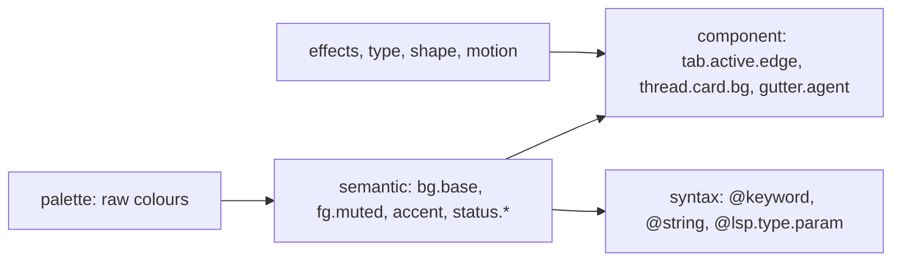

# Theming

Writing a theme should take five minutes. Tweaking one should take five seconds:
click the thing, change the colour, done. The file stays the source of truth.

## Token layers



- **Palette**: a few named colours (`ink`, `paper`, `cyan`, `ember`, …). Most themes change only this.
- **Default theme**: black, yellow and orange. Accent `#ffd23f`, orange `#ff8a1f` used sparingly. The status colours
  (working cyan, reviewer pink, quiet green) are kept clear of both.
- **Semantic**: about 60 tokens with meaning: surfaces, text levels, lines, the accent, the seven
  **status** colours, diff add/del, and selection. Every component reads these.
- **Component**: about 300 tokens, each defaulting to a semantic one. You override them only to be precise.
- **Syntax**: tree-sitter capture names (`@keyword.return`) and LSP semantic tokens (`@lsp.mod.readonly`),
  with fallback along the dotted path, the way neovim does it.
- **Non-colour**: fonts and features (ligatures, `ss02`), sizes and line height, radii, hairline width,
  and effect strengths (glow, grid, scanline, corner brackets, blur). Motion too, including off.
- The status colours are semantic tokens like any other, so colour-blind-safe variants are just a theme.

## Files

```toml
# ~/.config/oriel/themes/graphite-warm.toml
name    = "Graphite Warm"
extends = "graphite"            # a built-in or another theme file
variant = "dark"

[palette]
cyan  = "oklch(0.80 0.12 220)"
ember = "#ff9b45"

[semantic]
accent  = "ember"               # names a palette colour
bg.base = "mix(ink, ember, 3%)" # derived values: mix, lighten, darken, alpha, contrast()

[component]
"tab.active.edge" = "accent"

[syntax]
"@comment" = { fg = "fg.faint", italic = true }

[effects]
glow = 0.4                      # 0 turns the sci-fi off entirely
grid = 0
```

- **Only overrides.** A theme that `extends` another holds just what differs, usually 5–20 lines.
- Colours can be hex, `oklch()` or `rgb()`. Derivation is done in OKLCH, so `mix` and `lighten` look even.
- **One file can carry both variants**: `[dark]` and `[light]` tables over shared defaults, which follow the OS.
- **Scopes stack**: built-in → user theme → per-project `.oriel/theme.toml` → per-session tint.
  - Per project: a red edge on anything running against prod.
  - Per session: the tab colour you picked, which also tints that session's chrome.
- Hot reload: saving the file repaints in under one frame.

## The theme editor (`:Theme`, or Settings → Theme)


- **Pick mode**: click anything in the live UI (or `:Inspect` it) to see its token chain:
  `thread.card.bg ← surface.raised ← mix(ink, cyan, 4%)`. Choose which link to override.
- The colour picker works in OKLCH, with sliders for lightness, chroma and hue and a hex field.
  - It shows **contrast** against what it sits on (APCA Lc and WCAG ratio), with a warning under the threshold.
- **Edits are overrides**: the editor writes the smallest diff into your theme file. A strip at the
  bottom shows the TOML being written, so you learn the format as you click.
- **New theme from…** a built-in, the current one, a single accent colour (generates a full palette),
  or an import.
- Previews: a fixture workspace (every component, every status, a diff, a debugger) shown live beside your real UI.
- **Lint**: unreadable pairs, status colours too close together, and syntax groups that fall back too far.
- Undo and redo per edit. Reset a token to inherited. Compare against the base theme in a split view.

## Import and export

- **Import**: VS Code themes (`colors` + `tokenColors`), base16 and base24, neovim colorschemes
  (from a `:highlight` dump), and terminal palettes (iTerm, Ghostty, Alacritty).
  The importer maps them onto semantic tokens and shows what it guessed.
- **Export**: the theme as TOML, plus a terminal palette and a VS Code theme for the people who'll ask.
- Vim habits work: `:hi Comment gui=italic guifg=#5c6b7e` is a live, session-scoped override,
  and `:Theme save` keeps it.

## Scripting

```lua
L.theme.use("graphite-warm")
L.theme.set("accent", "oklch(0.78 0.14 60)")           -- live override
L.on("SessionFocus", function(s)
  if s.project == "infra-prod" then L.theme.tint("status.edge", "red") end
end)
```

## Themes are plugins

- A theme is a plugin like any other (`plugins.md`): installed, pinned and lazy-loaded by the same plugin manager.
- The simplest one is just a theme TOML in a repo. A full one ships a manifest:

```toml
id = "graphite-warm"
contributes.themes = ["themes/graphite-warm.toml", "themes/graphite-warm-light.toml"]
contributes.fonts  = ["fonts/Berkeley Mono.ttf"]
contributes.icons  = "icons/"                     # file and kind icon set
run = { lua = "init.lua" }                        # optional: dynamic themes
```

- Data-only themes need no permissions and run no code.
- An optional Lua part makes a theme dynamic: shifting with the time of day, tinting by session
  status, or reacting to events. That code gets the same declared-permission model as any plugin.
- Your own overrides (from the editor) live in a local theme that `extends` the installed one,
  so updating the plugin never clobbers your tweaks.
- `:Theme publish` writes the manifest and turns your local theme into a shareable plugin repo.

## Implementation notes

- The `ui` module resolves tokens at theme-load time into a flat table of IDs. Widgets read by ID, so lookups are free per frame.
- Changing a token re-resolves only its dependants: the dependency graph is built from the `extends` and derive references.
- The fixture workspace doubles as the screenshot test for themes: CI renders every built-in theme.

## Go interfaces

```go
// package theme
type Source interface {                            // a TOML file, a plugin, a Lua-generated theme
    Name() string
    Load() (*Spec, error)
    Watch(fn func()) (cancel func())
}

type Spec struct {                                 // what a TOML file decodes into
    Extends  string
    Variant  Variant
    Palette  map[string]Expr                       // Expr: literal colour or mix()/lighten()/…
    Semantic map[Token]Expr
    Component map[Token]Expr
    Syntax   map[string]Style
    Effects  Effects
    Type     Typography
}

type Resolver interface {
    Resolve(stack []*Spec) (*Resolved, error)      // built-in → user → project → session
    Chain(t Token) []Link                          // for the editor's pick mode
}

type Resolved struct{ /* flat []Color/[]Style indexed by TokenID — no map lookups per frame */ }
func (r *Resolved) C(id TokenID) Color
```
