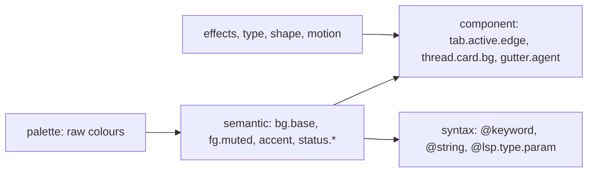
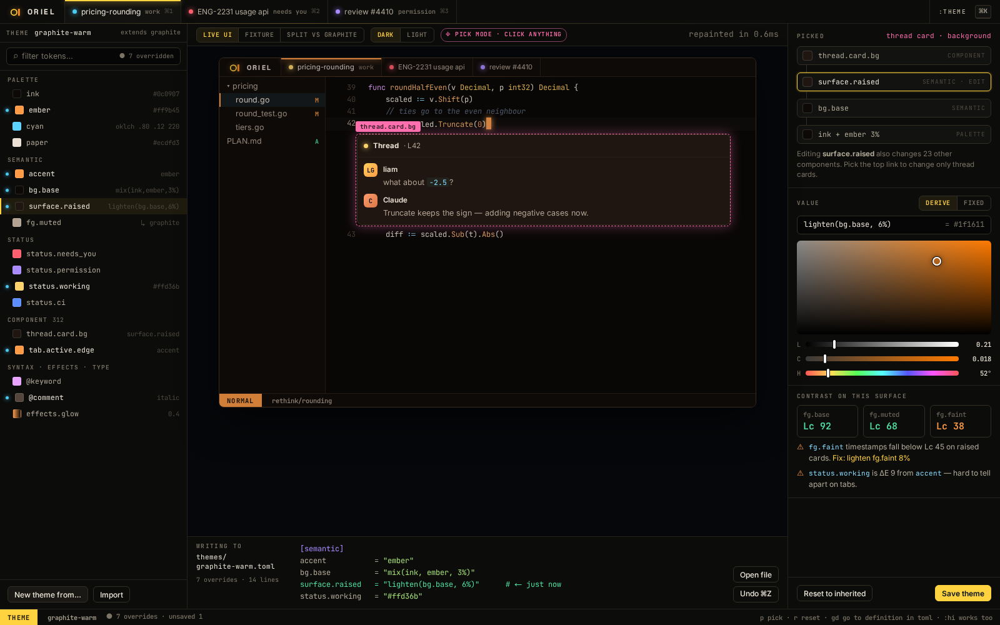

# Theming

Writing a theme should take five minutes. Tweaking one should take five seconds:
click the thing, change the colour, done. The file stays the source of truth.

## Token layers



- **Palette**: a few named colours (`ink`, `paper`, `cyan`, `ember`, …). Most themes change only this.
- **Default theme**: black, yellow and orange. Accent `#ffd23f`, orange `#ff8a1f` used sparingly. The status colours
  (working cyan, reviewer pink, quiet green) are kept clear of both.
- **Semantic**: about 60 tokens with meaning: surfaces, text levels, lines, the accent, the seven
  **status** colours, diff add/del, and selection. Every component reads these.
- **Component**: about 300 tokens, each defaulting to a semantic one. You override them only to be precise.
- **Syntax**: tree-sitter capture names (`@keyword.return`) and LSP semantic tokens (`@lsp.mod.readonly`),
  with fallback along the dotted path, the way neovim does it.
- **Non-colour**: fonts and features (ligatures, `ss02`), sizes and line height, radii, hairline width,
  and effect strengths (glow, grid, scanline, corner brackets, blur). Motion too, including off.
- The status colours are semantic tokens like any other, so colour-blind-safe variants are just a theme.

## Files

```toml
# ~/.config/oriel/themes/graphite-warm.toml
name    = "Graphite Warm"
extends = "graphite"            # a built-in or another theme file
variant = "dark"

[palette]
cyan  = "oklch(0.80 0.12 220)"
ember = "#ff9b45"

[semantic]
accent  = "ember"               # names a palette colour
bg.base = "mix(ink, ember, 3%)" # derived values: mix, lighten, darken, alpha, contrast()

[component]
"tab.active.edge" = "accent"

[syntax]
"@comment" = { fg = "fg.faint", italic = true }

[effects]
glow = 0.4                      # 0 turns the sci-fi off entirely
grid = 0
```

- **Only overrides.** A theme that `extends` another holds just what differs, usually 5–20 lines.
- Colours can be hex, `oklch()` or `rgb()`. Derivation is done in OKLCH, so `mix` and `lighten` look even.
- **One file can carry both variants**: `[dark]` and `[light]` tables over shared defaults, which follow the OS.
- **Scopes stack**: built-in → user theme → per-project `.oriel/theme.toml` → per-session tint.
  - Per project: a red edge on anything running against prod.
  - Per session: the tab colour you picked, which also tints that session's chrome.
- Hot reload: saving the file repaints in under one frame.

## The theme editor (`:Theme`, or Settings → Theme)



- **Pick mode**: click anything in the live UI (or `:Inspect` it) to see its token chain:
  `thread.card.bg ← surface.raised ← mix(ink, cyan, 4%)`. Choose which link to override.
- The colour picker works in OKLCH, with sliders for lightness, chroma and hue and a hex field.
  - It shows **contrast** against what it sits on (the WCAG ratio; see SH-11 below on APCA), with a warning under the threshold.
- **Edits are overrides**: the editor writes the smallest diff into your theme file. A strip at the
  bottom shows the TOML being written, so you learn the format as you click.
- **New theme from…** a built-in, the current one, a single accent colour (generates a full palette),
  or an import.
- Previews: a fixture workspace (every component, every status, a diff, a debugger) shown live beside your real UI.
- **Lint**: unreadable pairs, status colours too close together, and syntax groups that fall back too far.
- Undo and redo per edit. Reset a token to inherited. Compare against the base theme in a split view.

## Import and export

- **Import**: VS Code themes (`colors` + `tokenColors`), base16 and base24, neovim colorschemes
  (from a `:highlight` dump), and terminal palettes (iTerm, Ghostty, Alacritty).
  The importer maps them onto semantic tokens and shows what it guessed.
- **Export**: the theme as TOML, plus a terminal palette and a VS Code theme for the people who'll ask.
- Vim habits work: `:hi Comment gui=italic guifg=#5c6b7e` is a live, session-scoped override,
  and `:Theme save` keeps it.

## Scripting

```lua
L.theme.use("graphite-warm")
L.theme.set("accent", "oklch(0.78 0.14 60)")           -- live override
L.on("SessionFocus", function(s)
  if s.project == "infra-prod" then L.theme.tint("status.edge", "red") end
end)
```

## Themes are plugins

- A theme is a plugin like any other (`plugins.md`): installed, pinned and lazy-loaded by the same plugin manager.
- The simplest one is just a theme TOML in a repo. A full one ships a manifest:

```toml
id = "graphite-warm"
contributes.themes = ["themes/graphite-warm.toml", "themes/graphite-warm-light.toml"]
contributes.fonts  = ["fonts/Berkeley Mono.ttf"]
contributes.icons  = "icons/"                     # file and kind icon set
# an init.lua next to it, if present, makes the theme dynamic
```

- Data-only themes need no permissions and run no code.
- An optional Lua part makes a theme dynamic: shifting with the time of day, tinting by session
  status, or reacting to events. That code gets the same declared-permission model as any plugin.
- Your own overrides (from the editor) live in a local theme that `extends` the installed one,
  so updating the plugin never clobbers your tweaks.
- `:Theme publish` writes the manifest and turns your local theme into a shareable plugin repo.

## As built (FW-7)

- The `theme` module. A theme file has `name`, `extends`, `variant`, and `[palette]`, `[semantic]`, `[component]`,
  `[syntax]` and `[effects]` tables, shared or under `[dark]` and `[light]`. Token keys may be dotted (`bg.base = …`)
  or quoted.
- Expressions: hex, `rgb()`, `oklch()`, a name, or `mix(a, b, p)` (CSS `color-mix` in OkLCh: shorter hue, premultiplied
  alpha), `lighten(c, p)`, `darken(c, p)` (OkLCh lightness), `alpha(c, p)` and `over(fg, bg)` (sRGB compositing). Out
  of gamut results are mapped as CSS Color 4 does (binary search with local MINDE). Tests cite the vendored spec
  (`spec/css-color-4`). A `contrast()` function isn't built yet; the theme editor's lint measures contrast (SH-11).
- A name in a token's expression is a token unless it's the token's own name (that's the palette colour of that
  name), and falls back to the palette. Cycles and unknown names are errors that name the chain.
- **Tokens are declared** by whoever paints with them: `theme.Declare("tab.active.edge", "accent")`, in Go or by a
  plugin. Semantic tokens are declared by `theme` itself. `DeclareOn(name, expr, "bg.surface")` (or `{ color, on }`
  in a file) makes a translucent value opaque over the token it sits on, which is how `accent.bg` stays faithful in
  both variants (`rendering.md`, "Blending").
- `Resolved.C(id)` is an index into a flat slice. `Syntax("@keyword.return")` falls back along the dotted path, then to
  `fg`. `Chain(name)` gives the editor's pick mode its links, each with the theme that set it.
- The built-in theme is `oriel`, one file with `[dark]` (base.css) and `[light]` (17-light). Light turns glows off.
  The reference fixture (`render/scenes`) renders in both, each against its mockup within 8/255 and 6.5%.
- The app takes `ui.theme` (a name) and `ui.variant` (system, dark or light). User themes
  are `*.toml` in `~/.config/oriel/themes`, and any plugin can register a `theme.Source`. Files are polled every
  250 ms, so a save shows within that; a theme that fails to resolve leaves the last good one showing and logs why.

## As built (SH-11)

- **The built-in theme passes its own lint** (`theme.TestBuiltinPassesLint`), so five colours differ from the
  mockups' `base.css`, each the same hue nudged:
  - dark pink `#ff6fae` → `#ff7ad6` and violet `#a98bff` → `#b98aff`, so the reviewer and permission dots stand
    apart from needs-you red and CI blue;
  - light accent `#0a84b8` → `#0a78a8`, so white text on it reaches 4.5:1;
  - light blue `#5c8dff` → `#3f72e6`, so the CI dot reaches 3:1 on surfaces, and light violet `#6b4fd6` → `#8645c9`
    to stay apart from it.

- `:Theme` (or `theme.edit`) opens the editor over the window: tokens on the left (palette, semantic, status,
  component, syntax; a dot on your overrides; a filter), the fixture workspace in the middle (or split against the
  theme yours extends), and the picked token on the right: its chain, its value, contrast and lint. The theme file
  shows at the bottom as it's written, the line just written lit. `:Theme pick` (`p`) is pick mode; `:Theme {name}`
  switches theme.
- **Pick mode** hides the editor and reads the live window: `Host.Shot` draws it again in `theme.Probe`, where every
  token and syntax group is an opaque colour of its own (a hash, so an antialiased blend of two is rarely a third),
  and the pixel under the pointer names what painted it. It works for anything any plugin paints with a token,
  editor text included (`@keyword`). Clicking the preview picks the same way from the fixture.
- The chain follows an expression's first reference, so a derived token leads on: `bg.raised ← lighten(bg.base, 6%)
  ← bg.base ← bg0`. Choose a link to edit; the panel says how many other tokens that one changes.
- **Edits are overrides** (`theme.Override`, `theme.Reset`): a value changes in place, a new key goes after its
  table's last key, and only a missing table is added. Keys are quoted (`"bg.raised"`), since a bare dotted key
  can't sit beside a token that's its prefix. A theme with `[dark]`/`[light]` tables is edited under the variant
  showing. A built-in (or a plugin's) theme isn't edited: the first edit writes `<name>-local.toml` in the themes
  directory, extending it, and makes it the current theme. The editor's own writes repaint at once; undo is per
  edit (a slider's drag is one).
- Value: derive (an expression, checked before it's written) or fixed (OKLCH sliders and a hex field, written as
  `oklch(L C H)`).
- **Contrast is WCAG 2's ratio** (`spec/wcag`): 4.5:1 for text, 3:1 for large text and non-text marks. APCA isn't
  used: its licence allows it only in tools for web content. A selection (`selection`, the editor's and the terminal's;
  `text.selection`; `input.selection`) needs 1.5:1 on what it's on, with text still 4.5:1 on it: our floor, not WCAG's,
  so a selection reads at a glance; the light variant takes 36% of the accent for them, the dark 28%. Pairs are declared by whoever draws them
  (`theme.Readable`), and a translucent token is judged as it shows, over what it's on; the lint lists pairs under their ratio, with the smallest lightness step that fixes them, and
  status colours under ΔE OK 0.1 (five JNDs) apart. The built-in theme's light variant has several statuses under
  3:1 on surfaces; the lint shows them.
- `ui.variant` is `system` by default: it follows the OS (the portal's or GNOME's `color-scheme` on Linux,
  `AppleInterfaceStyle` on macOS), read every 3 s, dark until the window says otherwise.
- The fixture renders in every built-in theme and variant, against goldens (`render/scenes`).
- Effects include `motion` (FW-13): the speed of every animation, 1 by default, 0 for none.
- Not yet: new theme from…, import and export, `:hi`, effects and type in the editor, syntax groups that fall back
  too far, and the live UI inside the preview (pick mode reads the real window instead).

## As built (more built-in themes)

- Ten more built-ins in `theme/themes/`, each one TOML file: `catppuccin` (Mocha), `tokyonight` (Night), `gruvbox`
  (dark, medium), `nord`, `dracula`, `rose-pine` (main), `kanagawa` (wave), `one-dark`, `everforest` (dark, medium)
  and `solarized` (dark). Each has `variant = "dark"`, `extends = "oriel"` (for its `[syntax]` map), a top-level
  `[palette]` that sets every colour `oriel` sets, and `glow = 0`. Credit and licence are in each file's first line.
- **A theme is one variant unless it has `[dark]`/`[light]` tables.** `theme.Effective(stack, want)` is the variant a
  stack resolves at: the topmost theme's `variant`, or `want` when that theme has variant tables or sets no `variant`.
  The window, the picker preview and the editor's split all use it, so Nord picked in a light window shows dark, and
  the preview reads "NORD · dark". `oriel` is the one built-in with both.
- Every built-in passes the lint at each variant it has (`TestBuiltinPassesLint`), and sets the whole palette
  (`TestBuiltinsSetTheWholePalette`). The fixture renders in each (`render/scenes`, one golden per theme).
- Upstream colours that failed the lint, each the same hue with its OkLCh lightness nudged:
  - catppuccin: blue `#89b4fa` → `#7da7ec` (apart from violet).
  - dracula: fg3 (comment) `#6272a4` → `#6878aa` (3:1 on raised).
  - everforest: fg2 `#9da9a0` → `#a0aca3`; red `#e67e80` → `#d87274`, aqua `#83c092` → `#64a074`, green
    `#a7c080` → `#bad393`, and pink (Everforest has none; from purple `#d699b6`) `#e6a0c4` → `#ffb9de`.
  - gruvbox: aqua `#8ec07c` → `#a7da95` (apart from green and blue).
  - kanagawa: fg3 `#727169` → `#75746c`; violet `#957fb8` → `#8973ab`, cyan `#7fb4ca` → `#8bc1d7`, pink
    `#d27e99` → `#ed97b2`.
  - nord: cyan `#88c0d0` → `#95cddd`, blue `#81a1c1` → `#6989a8`, pink (Nord has none; from `#b48ead`) `#d39cc0` →
    `#e7afd3`.
  - one-dark: cyan `#56b6c2` → `#71d0dc`, pink (One Dark has none; from red) `#e06cb0` → `#fc85ca`.
  - rose-pine: muted `#6e6a86` → `#716d89`; leaf `#95b1ac` → `#8faba6`.
  - solarized: base0 `#839496` → `#8c9d9f`, base00 `#657b83` → `#687e86`, blue `#268bd2` → `#3698df`; ink is
    base03 darkened (`#00212b`), as base3 on blue is under 4.5:1.
  - tokyonight: purple `#9d7cd8` → `#9776d1`, magenta `#bb9af7` → `#c8a7ff`.
- Not yet: light flavours (Latte, Day, Dawn…), each its own file with `variant = "light"`.

## Sizes: UI zoom and the code size

One mechanism scales the whole UI, so no view handles font size itself and nothing clips when text grows.

- **`ui.font_size`** (default 13, 8–32) is the UI's base text size, and it sets the window's **zoom**:
  `ui.font_size / 13`. The zoom multiplies the backend's device scale (`render.Zoomer`), so every logical pixel grows
  together: text, paddings, row heights, icons, dock and pane sizes. Layout runs at the zoomed size, so panels hold
  their larger text the way they do on a smaller window, and scroll where they overflow. A view keeps writing its
  sizes in the mockups' pixels; there is nothing to apply in each view.
- `⌘=` / `⌘-` / `⌘0` (`ui.zoom.in`, `ui.zoom.out`, `ui.zoom.reset`) step `ui.font_size` by 1 and back to its
  default, at the user layer, as browsers and editors do.
- **`editor.font_size`** (default 13.5) and **`editor.line_height`** (default 1.55, a multiple of the size) are the
  code's own, inside the zoom: the editor's rows, gutter and character cells are measured from them, so the code can be
  larger or smaller than the UI around it. Code shown outside the editor (help, search) stays at the default size.
- **Parts with their own size**: `ui.statusline.font_size`, `ui.hover.font_size` (hovers and signature help),
  `ui.completion.font_size` and `ui.tooltip.font_size` (6–32), each following `ui.font_size` until it's set
  (`OptionSpec.Follows`): it reads as the UI's size, and zooming still grows the part with the window. A part is drawn at its
  size over the UI's with `ui.Style.Scale`, which scales a box's whole subtree (sizes, padding, gaps, radii, text) as
  the zoom does the window, so a bigger part holds its text too. Another part is one option and one `Scale`.
- The 1.5× goldens (`ide-zoom`) check the main screen holds at a large size.

## Implementation notes

- The `ui` module resolves tokens at theme-load time into a flat table of IDs. Widgets read by ID, so lookups are free per frame.
- Changing a token re-resolves only its dependants: the dependency graph is built from the `extends` and derive references.
- The fixture workspace doubles as the screenshot test for themes: CI renders every built-in theme.

## Go interfaces

```go
// package theme
type Source interface {                            // a TOML file, a plugin, a Lua-generated theme
    Name() string
    Load() (*Spec, error)
    Watch(fn func()) (cancel func())
}

type Spec struct {                                 // what a TOML file decodes into
    Extends  string
    Variant  Variant
    Palette  map[string]Expr                       // Expr: literal colour or mix()/lighten()/…
    Semantic map[Token]Expr
    Component map[Token]Expr
    Syntax   map[string]Style
    Effects  Effects
    Type     Typography
}

type Resolver interface {
    Resolve(stack []*Spec) (*Resolved, error)      // built-in → user → project → session
    Chain(t Token) []Link                          // for the editor's pick mode
}

type Resolved struct{ /* flat []Color/[]Style indexed by TokenID — no map lookups per frame */ }
func (r *Resolved) C(id TokenID) Color
```
