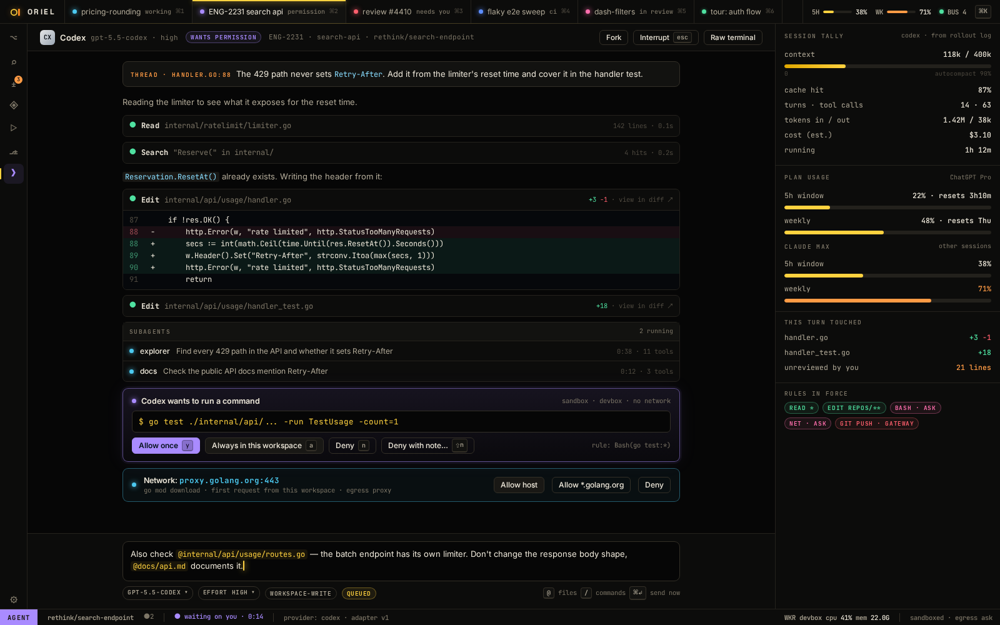
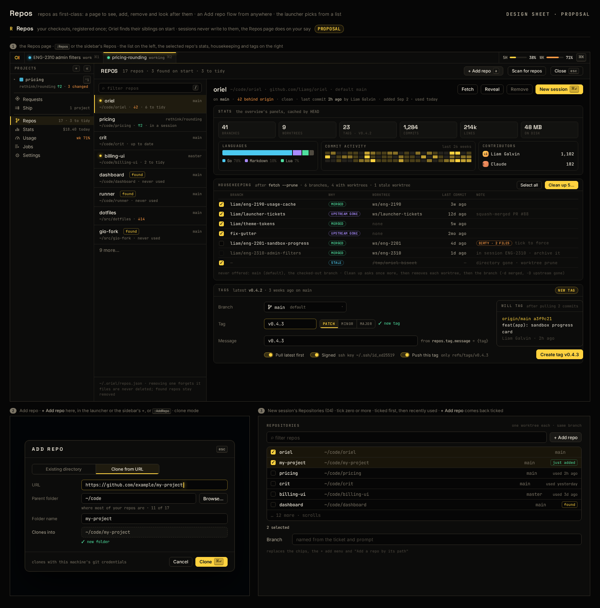
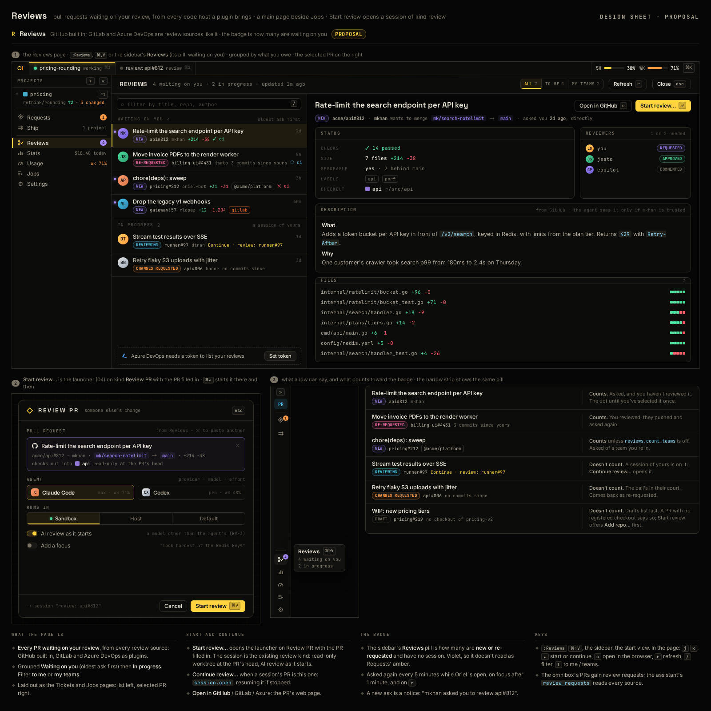

# UI: the screens

Sources live in `mockups/src/*.html` (one shared `base.css` of theme tokens),
and `mockups/render.sh` turns them into the PNGs below.
They are design sketches, not the implementation: the app draws natively (see `shell.md`).

## Design language

- **Black, yellow and a little orange** (the default theme; any theme can change it). Warm near-black surfaces, a signal-yellow
  accent `#ffd23f` for focus and primary actions, and orange `#ff8a1f` used sparingly (the logo's cursor, debug mode, warnings).
  Colour means status, never decoration.
- **Status colours**, the same everywhere (tabs, cards, gutters, threads), chosen to stay clear of the brand colours:
  red = needs you · violet = wants permission · cyan = working · blue = CI running · pink = with a reviewer ·
  green = quiet · grey = off.
- **Sci-fi through restraint**: hairline frames, corner brackets, mono
  micro-labels in caps, faint grid backdrops, a soft glow on live things.
  No 3D, no skeuomorphism, no motion that isn't telling you something.
- **Type**: JetBrains Mono for code and readouts, Inter for UI and prose,
  Space Grotesk for display headings.
- **Indicators**: tiny live readouts (label, bar or value, sparkline) placed in fixed
  slots: titlebar right, statusline, session footer, mission-control strip.
  Hold `⌥` to pull the full HUD down over anything.
- **Annotation house style** (explain, `:Inspect`): numbered diamond,
  angled leader line, clipped-corner card.

## Loading (FW-14)

No screen looks empty, broken or finished while its data is on the way. Each waiting section picks a policy by asking
what goes wrong if the user acts before the data arrives (rendering.md, "Loading", has the toolkit):

| Policy | When | What shows | Can the user act? |
|---|---|---|---|
| **Block** | the form means nothing without the data | a centred loading panel in its place | only Cancel / Esc |
| **Gate** | other fields can be filled in, but submitting early would be wrong | the form, the section loading, submit busy with the reason | fill in, not submit |
| **Optional** | missing data falls back to a sensible default | the section says what's used if they go on now | yes |
| **Inline** | a page or panel, not a submit flow | skeleton rows or a busy line in that section | yes |

- No indicator for the first 150 ms; once shown it stays 300 ms. After 3 s the elapsed time shows.
- A failure shows the error and **Retry**; nothing sits on "Reading…" forever. Empty ("No jobs yet") only once loaded.
- A refresh keeps the old data, with a thin moving bar along the section's top edge.
- Which screen uses which: the launcher's agents, the Add repo check, the Job form's agent, the Merge dialog and
  Ship's step actions are **Gate**; Start work's models are **Optional**; the diff view, the Raise PR tab and the
  stats session tab are **Block** within their pane; pages and panels (Ship columns, Git and PR panels, Jobs,
  Tickets, Reviews, Stats, Repos, Plugins' registry, the diff view, changed units, explorer, tests) are **Inline**.
  Waits of minutes (explain, walkthrough, verify) are Inline with the elapsed time always shown.

## Logo: **o▌** (decided): a yellow o with an orange block cursor, in the default theme

- **R1 chosen**: the original proportions, all green. It's in every mockup's titlebar (`base.css` `.brand i`). Final pass in
  phase 1 (framework): per-size stroke tuning, a 16 px cut, and SVG/PNG/ICNS exports. Source: `mockups/o12.py`.
- As built: the logo is drawn in code (`app/titlebar.go` `logo`). The app icon (`app.Icon`) is it on a rounded square
  (`icon.bg`, `icon.edge`); `oriel dev icon DIR` renders the macOS iconset, which `make app` turns into the `.icns`
  (distribution.md). Still to do: the per-size tuning and the 16 px cut.

- Twelve O concepts in the same neon style. Source: `mockups/ologos.py`.
- The fly concepts below are kept for reference only.

- Chosen: F2, the low-poly face (see Finalists below). Still to do: a final pass with stroke weights tuned per size, a
  hand-tuned 16 px cut, and SVG/PNG/ICNS exports (phase 1, along with the framework). The mockups' titlebar
  diamond becomes F2.
- The concept rounds below are kept for reference.

- House-fly anatomy: huge compound eyes, a stout striped thorax, a short round abdomen, two clear wings folded in a V,
  and six bent legs. Neon `#39ff88` hairlines with a glow.
- 1–5 are line marks. 6 is the solid silhouette the line marks fall back to at 16 px (favicon, dock).
  Each is shown at 230, 64, 32 and 16 px, in the titlebar, and on light.
- The first round (`mockups/30-logos.png`) read as bees and wasps, and was dropped.
- Open question: keep cyan as the UI accent with green for the brand only, or go green throughout (a theme token change).
- Source: `mockups/flies.py`.

**Face variants**

- A front view: two huge compound eyes (mesh, low-poly or glossy), antennae in the facial groove, and the sponge-tipped mouthparts.
  F5 rubs its hands. F6 is the badge for the app icon.
- Source: `mockups/faces.py`.

**Finalists in context**

- 6, F6, F2, and F2 in F6's ring, each shown as app icon, browser tab, 32/16 px, titlebar, wordmark and on light. Source: `mockups/finalists.py`.

## 01 · The IDE

- Session tabs across the top, each with a status dot, kind and `⌘N`. The status reads at a glance. A **+** after the
  last tab starts a new session (`session.new`, ⌘N), so it's a click away with sessions open.
- Threads open **between the lines** they belong to, with the agent's live state in the header.
- Agent-written lines carry a gutter mark and an "agent · 2m" ghost until you've read them.
- Right: a **summary** of requests (threads), the task rail, and the session stats (context, cache, cost, review ledger, tests).
  The full conversation view is 01b.
- Built in AI-5/AI-9: the summary is the `requests.summary` view (`requests.summary` toggles it in the right dock):
  the requests with their counts, the tasks rail (`Session.Tasks`: ✓ done, ◐ in progress, ○ to do, drawn, not
  glyphs) and the session stats at its foot (CTX meter, CACHE, $, TASKS, the latest run's TESTS). The agent console's side has
  the same tasks rail. The title bar's usage windows (`titlebar.right.40-usage`) are the plan of the session in front's
  provider (`State.Usage`): `5H` and `WK` meters with their share; since AI-12 one button that opens Usage, with a
  hover card (43). Since RV-2 the stats show REVIEWED (read / agent-written lines of the session's
  projects, from `registry.LedgerOf`) once there are any. Not yet: opening the summary by default with a session.
- Bottom: the agent pane, terminal, problems, debug and tests. The orange tab dot means something's running.
- Built in ED-15: a window can show its buffer through a presenter instead of as text (`editor.present`): a markdown
  file's **Preview** button (it reads **Edit** while previewing; `:MarkdownPreview`) draws it as plan mode draws a doc,
  its threads in a margin beside their blocks, a click or `c` commenting on a block's lines; `o` goes to a block's
  source. The status line's mode reads the presenter's label (PREVIEW). Each window has its own: one window can preview
  a file while another edits it, the preview following the edits. The window's top line follows the preview's scroll,
  so Edit comes back where you were reading, and the presenter comes back after a restart.
- Statusline: vim mode, branch, diagnostics, macro recording, this machine's CPU. Built in SH-8: the
  status line's and the title bar's slots draw the indicators in them (`statusline.right.70-machine.status`: CPU
  and this machine's load, amber with a dot from 80%) beside the views named for the slot.

## 01b · Requests: the main conversation view

- A main view at the same level as Explorer: rail icon, `g r` or `⌘⇧R`. The right panel in 01 is only its summary.
- Left: every request, grouped Working / Needs you / Open / Resolved, with a preview of the last reply.
  Filters and search. **New request** (`⌘N`) starts one that isn't anchored to a line.
- Centre: one request at a readable width.
  - The anchored code at the top, which follows edits.
  - Your long prompt with markdown, lists and pasted images.
  - The agent's reply rendered in full: prose, diffs, an activity block (edits, LSP lookups, test runs, each linking to the diff or log), and evidence chips.
- A large composer: `@file`, `#symbol`, image paste, dictation, **urgent** (interrupts the turn), **btw** (a side question answered by a fork).
- Right: what this request changed (with its own read/unread ledger), what it spawned (tasks, new requests), and related requests.
- Keyboard: `j`/`k` between requests, `⏎` to the composer, `o` jumps to the anchor in the editor, `R` resolves.
- Inline threads in the editor (01) and this view are two views of the same thread: reply in either.
- Built in AI-5 (`app/requests*.go`, `app/threadsinline.go`): the `requests` view is the list (the rail's Requests,
  `⌘⇧R`, left dock), with filter chips, search and **New request**; selecting one opens the `request` view (a main tab)
  for the selected request: the anchored code read from the open buffer or the file, re-found by its text when the line
  moved; each comment with its markdown (paragraphs, lists, headings, inline code and bold, fenced code: `widget.Rich`; tables: `widget.Table`),
  pasted images by name, the agent's model chip, its **activity** block (`Comment.Activity`: edits with their diff stat
  and **view**, lookups, runs) and **evidence** chips (`Comment.Evidence`; a click runs `test.run.show`, TR-5), and an
  unbacked claim flagged ⚠. The composer is a message's field (`widget.Input` with `Lines` and `EnterSubmits`, key mode
  `request.composer`), as are a thread's reply field and the composer under a line: `⏎` sends, `⇧⏎` starts a new line
  and the field grows to eight lines, then scrolls. Attachments
  as chips, **@ FILE** and **# SYMBOL** open the files and symbols pickers (whose `⌃a` attaches), URGENT and BTW
  toggle, `⌘⏎` sends urgent. Right: this request, what it changed (`Thread.Touched`), spawned (tasks whose
  `Thread` it is, threads whose `Origin` it is) and related (the same file). Keys in mode `requests` (list and
  conversation): `j`/`k`, `⏎` the composer, `o` the anchor, `R` resolve, `⌘N` new request. Commands: `request.comment`
  (fires `CommentSend`, then `host.Host.Comment`), `request.resolve`, `request.reopen`, `request.new {text, context,
  file, line}` (the tests' "ask agent to fix"), `request.open {thread}`, `request.attach {items | text, title}` (the
  pickers' `⌃a`, the terminal's "send last output"), `request.send`, `request.next`/`prev`/`compose`/`anchor`.
- Threads between the editor's lines are a decoration provider (`threads`): each open thread anchored in the buffer's
  file is a Block under its line (a buffer anchor keeps it with its text as you edit) with a sign in the gutter that
  opens it, the agent's state in its header and a reply field. **Ask about this…** in the editor's right-click menu, or
  `thread.new`, opens a composer under the cursor's line. A block's controls keep focus: the editor no longer takes
  focus back from something inside its code column, and blocks are keyed by their place among the line's blocks.
- Built in ED-15: a window shows or hides its file's threads (`threads.toggle`, `␣R`, or the **💬 n** button in the
  breadcrumb, lit while they show; `editor.threads = "hidden"` opens files that way). Hidden, a line with threads has
  a speech bubble in the gutter in its first thread's colour (with a count for several); hovering it shows a popover of
  them (title, state, the last messages as markdown) that stays while the pointer moves into it and goes when it leaves
  both, never taking focus or keys; a click, or `⏎` on the line, shows the threads again at that one, its reply field
  focused. A presentation has the same bubbles beside its blocks. The toggle is `␣R` beside the picker's `␣r`, as `␣T`
  is beside `␣t`, so `␣r` stays a key of its own.
- Not yet: `@file`/`#symbol` completion as you type, image paste and dictation (the chips
  aren't there), `g r` (vim's `gr`), and turn cost per request. Since RV-2 each file the request changed shows its
  read bar and read/total, the file's whole ledger rather than only the lines that request wrote.

## 01e · Start view: nothing open

What the window shows with no directory and no session open: at launch (plain `oriel`), and when the last one closes.

- Two columns. **Start**: New Session (`⌘N`), Resume a Session (`⌘O`), Open Directory (`⌘⇧O`), Settings (`⌘,`), each
  with a description and the key bound now. **Recent**: sessions, then directories, newest first; with none, the big `o▌`.
- Entries are a contribution point. An entry whose command isn't available is dimmed with a `soon` tag; New Session and
  Resume a Session are, while the app has no session host.
- Recent lists the sessions first (not archived, newest first: kind, projects, branch, a diamond in the status
  colour), and opening one runs `session.open`. The start view shows only when there are no sessions: otherwise the app
  lands on a session with mission control over it (03), so the start view has no link to mission control; `⌘⇧K` (an `Unlisted` start entry) and the
  omnibox reach it.
- `j`/`k` or arrows move, `⏎` runs, `⌫` (or the `✕` on a recent under the pointer) forgets a recent, until it's opened again. The same actions are commands, so they're in the omnibox too.
- The pointer moving onto a row selects it, as `j`/`k` do.
- It fits the window: the columns shrink to fit, and below 760 wide Start and Recent become tabs. Taller than the window, it
  scrolls from the top.
- **Open Directory** opens a directory as it is, git repo or not: no worktree, no branch. It's a picker over typed paths
  and directories under `~`, with a **Browse…** row for the OS's folder chooser. The window reopens on it: every
  plugin starts again there. `oriel <dir>` does the same. With a session host it's the directory's **direct** session
  with no agent (`sessions.md`), the same one each time it's opened, so the Git panel, Pull request and Ship work there
  as in any session; Recent lists it as that session, not as the directory too. With no session host it's the
  directory alone.
- Keys: the empty main area has its own keymap mode, `empty`, before `n` and `global`. Over a directory's overview
  `␣␣` and the rest still work. The start view keeps to its own keys (the user's decision): its rows' `j`/`k`/`⏎`/`⌫`
  and the keys of its entries and links (⌘N, ⌘O, ⇧⌘O, ⌘,, and Stats', Usage's and Jobs' own); ⌘K, `:`, `␣␣`
  and other global or editor keys do nothing there, as they've nothing to act on yet (`registry.ExclusiveKeys`). No
  footer advertises them.

## 01f · The rail

Superseded by the project sidebar (01h, SH-17): the rail is the sidebar's narrow form. What follows still holds for it.

The icon strip on the far left of 01: Explorer `⌘⇧E`, Search `⌘⇧F`, Git `⌘⇧G`, Requests `⌘⇧R`, Debug `⌘⇧D`, Tests `⌘⇧T`,
with Settings pinned at the bottom.

- A contribution point: icon, title, badge, and the command it runs. Plugins add entries the same way, as a project's
  panel or the session's (01h).
- An entry whose command isn't available yet is dimmed. Clicking the active entry hides its dock.
- An available entry lights under the pointer.

## 01g · Project overview: a directory or session with nothing open

What an open directory or session shows with no buffer open: right after opening it, and when its last tab closes.

- One card per repo: name, path, branch and ahead/behind; then panels for languages, commit activity over the last
  year, and contributors (or largest files). A plain directory gets languages, size and largest files only.
- Panels are contributions. The view shows at once; panels fill in from the background and are cached per repo by HEAD.

## 01h · Project context: the project sidebar

**Decided: D, the project sidebar** (the user's choice). A session can hold several projects, but you work in one at a
time (admin-ui: its files, changes, PR and tests). The sidebar replaces the rail (01f), and the multi-project notes in
01c and `sessions.md` → In the editor.

- **Sidebar.** One accordion per project, in the session's order. Under the open project sit its panels: Explorer,
  Search, Git, Pull request, Tests. One project is open at a time. Clicking a header opens that project and folds the
  one that was open.
- **Headers show state.** Each header has the project's colour square, its name and `⌃n`, and under them its branch,
  ahead/behind, changed files, PR number and a CI dot ("rate-limits · #790 ● CI failing"). Folded projects keep their
  header, so a failing project is visible while you work in another.
- **Switching.** `⌃1–9` open the nth project (`⌥1–3` stay Explorer scopes). In the focused sidebar, `j`/`k` move over
  headers and entries and `⏎` opens a header or an entry.
- **Panels belong to a project.** An entry opens that project's panel in the dock, and the dock header names both
  ("admin-ui · Explorer"). Each project remembers the last panel it had open and reopens it when you switch back.
  `⌘⇧E`, `⌘⇧F`, `⌘⇧G` and `⌘⇧T` open Explorer, Search, Git and Tests for the open project. Clicking the open entry
  hides the dock.
- **Search is per project.** It searches the open project. An **All projects** toggle in the panel widens it to the
  session, with results grouped by project. `⌘⇧F` opens the open project's Search. `⌘K` (the omnibox) stays global.
- **Session-wide entries,** below a divider: Requests (with its count, `⌘⇧R`), Ship. Below a second divider, the
  pages every session shares (AI-12, 43): Stats, Usage, Jobs and Settings, each with a live figure. Past ~8 projects the
  list scrolls and these stay pinned.
- **Adding a project.** A `+` in the PROJECTS header (in the narrow form, under the project initials) opens a picker
  of the registered repos the session hasn't got, and the checkout path typed. Choosing one adds it to the
  session (`session.add-repo`), and it opens. There's no `+` for a directory (a direct session), or while the app has
  no session host.
- **Wide and narrow.** `«`/`»` at the top switch forms, remembered per window. Wide is ~225px. Narrow is an icon
  strip at the rail's width: each project is a two-letter initial in its colour with a status dot, the open project's
  panel icons sit under it, and the session's entries follow. Hovering an initial shows its header line.
- **One project, or a directory.** There is no project header. The sidebar is a labelled list under the project's
  name or the directory's path, with the same entries. Pull request appears only with a remote. Ship appears whenever
  any of the session's projects has a remote, one project included: then it's 18 with one column (that project's
  checklist, "before this ships", the ticket and Push + raise PR). A plain directory without a remote has no Ship.
- **One tab strip for the session.** Tabs aren't split by project: a proto file from api can sit beside code in
  admin-ui.
  - With 2+ projects, each editor tab leads with a small square in its project's colour (the header's colour), and
    its tooltip names the project and path. With one project, tabs keep their file icon.
  - The breadcrumb starts with the project's name: `api › proto › usage.proto`.
  - Opening a file from another project doesn't change the sidebar's open project.
- **Pull request** in the dock is a compact checklist: committed → up to date → pushed → PR → checks, with the PR's
  title and the failing check's log line. **Raise PR** (or **Edit PR** once it exists) opens a full-width **main tab**,
  `Raise PR · admin-ui`, in 18's style. It has the title, the body editor (template-filled, drafted by the agent),
  reviewers, cross-linked PRs with their merge order, and on the right the "before this ships" gates and the ticket.
  It closes like any tab.
- **Ship** (session-wide) is 18's full page: every project's checklist side by side, cross-linked PRs, the merge
  order, and "push + raise all".
- Built in SH-17 (`app/rail.go`, `app/projects.go`): the sidebar is the `app.rail` view over the rail entries
  (`registry.RailEntry` with a `Scope`, plugins.md), drawn with `widget.Rows` (rows of their own heights, `j`/`k`/`⏎`,
  key mode `sidebar`). Explorer, Search, Git, Pull request and Tests are project entries; Requests, Plan docs (while the
  session in front is planning), Debug, Ship and Settings session entries; Pull request and Ship are dimmed until FG-6 registers the `pull-request` and `ship` views.
  `⌃1–9` run `project.open {index}`; `⌘⇧E/F/G/T` run `project.panel {name}` for the open project; `⌘⇧R` and `⌘⇧D` stay
  `view.toggle`. Opening a project closes the docked panels of the others and reopens its last panel
  (`SessionState.ProjectUI`), or the one that was showing. A header's line is the branch, ahead/behind and changed files
  from its own work tree (for a project the session only reads, a plan's checkouts or a review's, "read-only" in place
  of changed files, and Git's entry has no count: that work isn't the session's), then what `ProjectState` contributions add (FG-6: the PR and CI). The form is the window's,
  kept in its state file beside the layout (`sidebar-<hash>.json`); until it's set, the `sidebar.form` option decides,
  `auto` being wide with 2+ projects and narrow otherwise (so a directory keeps the old rail's strip). Wide is 224px
  with projects, 150px for one. Views carry their project (`layout.ViewRef.Project`), which their dock tab names
  ("admin-ui · Explorer"). Search searches its project's directory, or with **All projects** each project's, grouped
  under a heading per project. With 2+ projects tabs lead with their project's square (`layout.Panes.Lead`), their
  tooltip names it (`Panes.Tip`), and the breadcrumb starts with it.
- Built in FG-6: Pull request and Ship are lit. A header's line gets the PR's number and a CI dot (`ProjectState`
  "ship": "#790 ● CI failing", "CI running", "CI passing", "merged", or "no PR" with commits and none raised), and the
  Pull request entry's note says "#790", "drafting" or "not raised". The `pull-request` view is the dock's checklist
  (its PR's title or "Not raised", `branch → base · n commits`, then Committed, Up to date, Pushed, PR, Checks with the
  failing line; Raise PR and Ship ⇉, or Edit PR and Fix CI with agent). Raise PR / Edit PR is the `pr` view, a main
  tab per project (`ship.pr.open {project}`): title, body (Write or Preview; the agent's `pr_draft`, else the open
  PR's, else the repo's template with the first commit's subject as the title), REVIEWERS (CODEOWNERS', added ones,
  each removable), CROSS-LINKED PRS, and at the right the gates and the ticket; Save draft, Raise as draft and Push +
  raise PR, or Update PR once it's open. A `ShipRaise` veto shows its reason there.
- Not yet: the session entries pinned while the projects scroll (the whole sidebar scrolls), hovering an initial
  shows its header line as a tooltip rather than 42's card, the Tests panel runs in the window's directory whatever
  its project, and with one project or a directory the breadcrumb doesn't start with its name (42's panels 4 and 5 do).

Superseded alternatives (41-project-context.png):

- **A · Switcher chip on the rail.** The rail picks the panel and a chip picks the project. Dropped because the
  project becomes a hidden mode. D keeps A's model and puts the projects in view.
- **B · Project sections in the dock.** One collapsible section per project, each with its own tabs. Dropped as the
  biggest change, with no home for what spans projects.
- **C · Project tabs above the panel.** A row of project tabs over whichever panel is open. Dropped because it costs a
  row and scrolls with many projects.

## 01c · Explorer scopes: Changed · Uncommitted · All

- A segmented control on top of the Explorer, with counts. `⌥1` `⌥2` `⌥3` switch scopes; the choice is remembered per session.
- **Changed**: every file the branch changes against its base (merge-base), uncommitted work included.
  - Opening a file here opens its **branch diff**, not the plain file. This is the review surface.
  - Each file has a dot: uncommitted, committed with more on top, or committed only.
  - Each file has a **read bar** (the review ledger per file). Sort by tree, flat, or "by review" (unread first).
- **Uncommitted**: working tree against HEAD, split into Staged, Unstaged and Untracked.
  - Stage or unstage whole files or single hunks with fugitive-style keys (`s`, `u`, `x`, `=`). Commit from here.
- **All**: the whole worktree, like any IDE. Changes are marked by columns you can toggle from the cog at the top right of
  the Explorer (a `widget.ToggleMenu`, beside the scopes), which also holds changed-only and **Hidden files**:
  - **status** letter (M A D R ? and U for conflicts), and the filename tinted to match.
  - **± lines**, with a tiny add/delete bar for the size of the change.
  - **agent**: an orange diamond where agent-written lines are unread, hollow once you've read them.
  - **threads**: the open-thread count, coloured by status. **diag**: error and warning counts.
  - Folders roll up (a dot plus the count of changed files beneath). Ignored files are dimmed; clean files show nothing.
  - `⌥C` toggles "changed only", which filters All down to Changed without leaving the tree.
  - Dot files and what's under dot directories are left out of All unless they've changed, until **Hidden files**
    (`explorer.hidden`) shows them.
- Multi-project sessions: each project has its own Explorer, opened from the project sidebar (01h) with the project's
  branch and ahead/behind on its root; there's no Explorer of every project at once.
- The same markers appear on editor tabs and in the omnibox file results.
- Built in FG-1: the `explorer` view (the rail's Explorer lights up), `explorer.scope {scope}` on `⌥1–3`,
  `explorer.changed-only` on `⌥C`, and in its own key mode `explorer` the keys `s` (stage, or unstage a staged file),
  `u`, `x` (asks first; an untracked file is deleted) and `=`. They run the general `git.stage`, `git.unstage` and
  `git.discard {path}`. Rows are `widget.Tree` rows (a note, a tint, a strike-through, a leading glyph, trailing
  content, sections, items open by default) with `widget.DiffStat` and `widget.ToggleChip`. Changed opens a file
  with `diff.open` (RV-1, 06), the file if it isn't registered. Tabs carry the letter through the
  `registry.Marked` view interface; the files picker ranks changed files up and notes their letter. Not yet: the
  threads column (P5). Built in RV-2: Changed's files have a read bar (read, then skimmed, of their agent-written
  lines) and a third layout, **by review** (flat, the most lines not read first; outside a session, of the files
  opened so far, as only those have diffs); All has the **agent** column (◆
  lines to read, ◇ all read); Uncommitted has **Commit…**, `c` (what's staged) and `C` (everything), through
  `git.commit`. SH-17: the Explorer reads its
  project from its view instance (`ViewCtx.Project`), each project's work tree read on its own (`gitExt.tree`).

## 01d · Layout: any pane, anywhere

One layout model for every view. The terminal isn't special, and neither are
Requests, the agent console, Problems, Tests, Debug, a diff, or the Explorer.

- **Five placements** for any view:
  - **Docked**: bottom, left or right edges, each with its own tabs. `⌃J` toggles the bottom dock. A dock showing
    one view heads it instead of a strip of one tab: its project, its title in capitals and a ✕; a second view
    there brings the tabs back. The sidebar's panels open alone and fixed (`view.open {alone, fixed}`), so its dock is never a tab group
    and a panel's header can't be dragged out of it: any rail entry whose `view.*` command docks on the left gets
    both, Requests and Plan docs as much as a project's panels.
  - **Split in main**: a window in the vim window tree, next to your code.
  - **Tab in main**: a full main view among your file tabs.
  - **Float**: a movable overlay window.
  - **Drop-down**: a quake-style slide from the top, `` ⌃` ``.
- **Zoom** is separate from placement: `⌃W Z` makes the focused pane fill the window, and
  pressing it again restores the exact layout (tmux's `prefix z`). It works from any placement.
- **Moving a pane**: `⌃W M` opens the move menu, or use the direct keys: `⌃W J` dock bottom, `⌃W L` split right,
  `⌃W T` tab in main, `⌃W F` float. Dragging a tab onto any edge works too, and the drop targets glow,
  labelled with what the drop does ("Split right", "Tab with main.go", "Dock bottom", "Float"). A drop into a pane's
  middle lights its tab strip with a slot for the new tab; a float is a dashed outline, since it snaps to nothing.
- **Docks are the edges of the same window tree**, not a separate system. So `⌃W h/j/k/l` moves
  focus between code, a split terminal and the dock without thinking about which is which.
- **Terminals behave like nvim's**: insert mode types into the shell. `⌃\ ⌃N` switches to terminal-normal
  mode, where you scroll, search and yank the scrollback with vim motions. The mode shows in the statusline.
- **Opening one**: `:term` follows your default placement (bottom dock out of the box). `:term!` opens in main,
  and `:vterm`/`:sterm` split. A session's agent PTY (Claude) is just another terminal view.
- **Layouts are saved per session** and restored on switch. Named layouts (`:Layout save review`) can be
  bound to keys, so one key flips the whole screen between "write" and "review" arrangements.
- Plugins and Lua set placement too: `oriel.view.open("requests", { place = "main", split = "right" })`.

## 01i · Back and forward: the mouse's side buttons

The window keeps a history like a browser's: each stop is the session in front plus the full page showing over it
(mission control, Stats, Usage, Jobs, Prompts, Plugins, Reviews, Tickets, Repos, Settings, the theme editor). Dock
panels and file tabs aren't stops: they'd make it too chatty.

- `nav.back` / `nav.forward` put the stop before or after up again, session and page together (a session in another
  directory opens the window there first, then the page). Somewhere new after going back drops what was forward; a
  session gone or archived since is passed over. 100 stops deep, per window, kept across the plugins starting again
  on another session's directory.
- The mouse's side buttons are the keys `<X1Mouse>` and `<X2Mouse>` (Vim's names, term.txt), so each key mode
  decides what back means and they map like any key:
  - the editor (`n`): `editor.back` / `editor.forward`, the jumplist first (`⌃o` / `⌃i`, vim normal mode), then the
    window's history once it has nowhere to go (`vim.Engine.CanJump`);
  - help: `help.back` / `help.forward`;
  - everywhere else (`global`, and the view and empty modes ahead of the editor's): `nav.back` / `nav.forward`.
- Pages join the history as places (`registry.Place`, `oriel.place.add`; plugins.md), so a plugin's page works the
  same as a built-in's.
- Backends: Gio reports the side buttons on Wayland and Windows; on macOS it drops them, so `render/gio` takes them
  first with an `NSEvent` local monitor (`side_darwin.go`). X11 drops buttons 8 and 9 inside Gio, so they don't work
  there yet; that needs a Gio change.

## 02 · ⌘K omnibox

- One ranked list: sessions, commands, files, symbols, tickets and PRs.
- Prefixes narrow the scope: `@` files, `#` symbols, `>` commands, `!` tickets.
- Preview pane: the highlighted session's waiting question, tasks and last moves, so you can answer without switching.
- Built from SH-4: `⌘K` opens it; `⇥` steps through the scopes; each source is a registry picker source, so its
  preview is the source's own. Symbols come from the open buffers' outlines until LSP's workspace symbols (LS-2);
  tickets from every ticket tracker a plugin brings (the app's `tickets`, `!`: plugins.md, "As built (tickets)")
  and PRs from the GitHub integration. The session preview grows its question, tasks
  and moves as the AI tickets add them.

## 02b · Pickers: files, grep, keymaps, and the rest

The centred fuzzy-finder boxes you know from snacks.nvim (`Snacks.picker`), telescope and fzf-lua.

- **One picker UI, many sources.** An input with live fuzzy matching, a results list, and a preview of the selection.
  `⇥` cycles source without losing the query.
- **Default keys** (all rebindable):

  | Key | Source |
  |---|---|
  | `␣␣` | files (the quick jump) |
  | `␣/` | live grep (ripgrep in the session host, regex, streamed as you type) |
  | `␣*` | grep the word under the cursor |
  | `␣,` | open buffers |
  | `␣s` / `␣S` | symbols in this file / workspace (LSP) |
  | `␣k` | **keymaps**: every mapping with its mode, description and source; `⏎` runs it, `⌃e` jumps to where it's defined |
  | `␣:` | commands |
  | `␣r` | threads/requests |
  | `␣gl` / `␣gs` | git log / git status |
  | `␣h` | help (Oriel's docs and `:help`) |
  | `␣'` | resume the last picker exactly where you left it |

- **Ranking**: fuzzy score first, then changed on this branch, recently opened, already open, and shallower paths.
  fzf query syntax works: `'exact`, `!not`, `^prefix`, `suffix$`.
- **Actions on results**: open, vsplit (`⌃v`), split (`⌃s`), tab (`⌃t`), send to quickfix (`⌃q`), and
  **attach to a request** (`⌃a`, which gives a file or grep hit to the agent as context). `⇥` multi-selects.
- **Scope** follows the session: every project in the workspace, or narrowed with `@project`.
- **The omnibox (`⌘K`) is the same engine with every source merged.** Pickers are one source, centred, with preview.
- **The matcher is our own**, a Go implementation of fzf-style scoring (per `deps.md`), and runs on the app for
  file and buffer lists. Grep and workspace symbols stream from the session host.
- **Pickers are a plugin API**: `oriel.picker.source{ name, items = fn, preview = fn, actions = {…} }`.
  Tickets, PRs, sessions and themes are all sources. The themes picker (`␣T`, `:Themes`) shows each theme in the
  whole window as it's highlighted; `↵` keeps it in settings.toml, `esc` puts the old one back (a source's `Hover`
  and `Cancel`).
- Built in SH-5: `⇥` steps to the next source keeping the query, and `⌃␣` multi-selects (the mockup gives `⇥`
  both; the source strip keeps it). An item with a place (a path and line) gets open, `⌃v`, `⌃s`, `⌃t`, `⌃q` and
  `⌃a` from the picker; `⌃a` runs `request.attach`, which the requests (AI-5) provide. Sources today: files,
  grep (ripgrep, streamed, on FG-3's search engine), buffers (`:ls`), symbols
  here and in the open buffers, keymaps (`⌃e` to the definition), commands, sessions and quickfix (`:copen`).
  Ranking is the fuzzy score, then open buffers and shallower paths; "changed on this branch" and "recently
  opened" join with FG-1 and the session's history. Threads, git log and status, and help come with their tickets.
- Threads came with AI-5: the `threads` source lists the session in front's requests (`␣r`), and `⏎` opens one.
  `␣t` is the tests' group (`␣tt`, `␣tf`…, TR-1); rename is vim's `grn`.

## 02c · Which-key: the next keys, as you type

- Press a prefix (leader, `g`, `z`, `]`, `⌃W`…) and pause: after **300 ms** a panel lists every key that can
  come next, with its **description**. Groups (`+agent`, `+git`) show in violet with their size.
- `⌫` backs up one key and `esc` cancels. `?` opens the keymaps picker filtered to this prefix.
- Descriptions come from each mapping's `desc` (`oriel.keymap.set("n", "<leader>al", fn, { desc = "Staging logs tool" })`).
  Your own maps show their source file.
- It's driven by the input engine's `Pending()` and `Keymaps()` (see `editor.md`), so it works for vim, plain,
  emacs or any engine, and inside panels (Requests, Explorer, the picker itself) with their own keymaps.
- It ships as a **built-in plugin** using only the public API. You can turn it off, restyle it, or replace it.
- Built in SH-6: `Host.Pending()` gives it the keys waiting for more (a mapping's, or the focused editor engine's)
  and the engine's own next keys, which the vim engine gives in Oriel's words for `g`, `z`, `[`, `]` and `⌃W`. A
  keymap with no command names a group (`{Keys = "<leader>a", desc = "+agent"}`). `⌫` and `esc` act on a
  mapping's keys, not an engine's half-typed command (which `esc` cancels in the engine). `?` to the keymaps
  picker comes with Lua's keymap API (PL-1). `whichkey.enabled` turns it off.
- Keys that are a mapping of their own as well as the start of longer ones (a plugin's `␣x` beside its `␣xx`) wait while which-key
  shows them; it lists `⏎` with that mapping's description, and `⏎` runs it (`Resolver.Complete`/`Accept`,
  `plugin.Pending.Runs`), unless a mapping goes on with `⏎`.

## 03 · Mission control (`⌘⇧K`)

- Every session as a card, grouped by status or repo. The border colour is the status.
- **Working** cards show the agent's live terminal. Every other status shows a
  structured "ask": permission with Allow/Deny inline, the CI failure, the
  question it's waiting on.
- Left: the **needs you** queue, oldest first, plus agentbus questions with their auto-answer countdowns.
- Bottom strip: usage per provider, this machine's CPU sparkline, agentbus presence.
- Fully keyboard-driven: `hjkl`, `⏎` opens, `a` allows, `x` stops.
- Built in SH-7 (`app/mission.go`, `app/missionview.go`): `⌘⇧K` or `mission.toggle` shows it under the title bar
  (`widget.Page`, key mode `mission`; Escape goes back). Header: the counts by status, BY
  STATUS / BY REPO (`mission.group {by}`, status by default), a filter (`/`). Cards are grouped, most urgent first, as
  many to a row as fit; the border is
  the status colour, the selected card's the accent; heading: name (a click opens it), kind, PR, provider, and while the pointer is on the card an Open button (Resume
  while its agent is stopped); a click on a card selects it, a double-click (`ui.Interaction.DoubleClicked`) opens it; foot:
  tasks, context, the change, how long. A **working** card's body is a terminal: the agent's recent activity (each
  tool call with a dot, cyan running, red failed, and the end of its output with its colours; prose in cyan) written
  into a Ghostty VT the size of the box, so it streams as the transcript grows. A card with a waiting **inbox card**
  for its session shows that card, the same one the inbox draws (`registry.InboxCard.Draw`), answered the same way
  (`ask.answer`); while mission control is up those cards aren't stacked over the window too. Otherwise a box says
  what the status is about (replied and awaiting you, with a reviewer, CI running, stopped). Left: the queue,
  every waiting card and every session needing you with none (its last words), oldest first; agentbus's apart with
  their auto-answer countdowns. Bottom: the `mission` indicator slot (usage per account, this machine's CPU over 15
  minutes, `machine.mission`), then the keys and where Escape goes. Keys: `hjkl`/arrows, `⏎` (`session.open`), `a` (allows the
  selected card's first ask), `x` (`session.stop`), `r` (renames on the card), `n` (`mission.new`: the launcher), `/`. Every action is a
  `mission.*` command, and the assistant reads or opens it with `mission_control`. The app opens on it at launch
  (`mission.at_launch`), over the session that was in front, if it started with nothing open and there are sessions.
- Decided in SH-7 (the design was silent): the live terminal shows the agent's activity from its transcript rather
  than mirroring the raw PTY (Claude's full-screen TUI doesn't read at a card's size, and Codex has none), with
  `agent.terminal` a command away; a tool's cursor moves and clears are dropped so it can't wipe the card. Cards sort
  by urgency within a group. Opening at launch waits for the sessions there were at launch, since the session host may
  load them after the window opens; with none the start view stays, and a session started after launch
  doesn't open it.
- Not yet: the title bar's `⌘⇧K` chip, CI check rows on a CI card. Since PL-5 the strip has agentbus's presence, from the agentbus plugin's `mission` indicator.

## 04 · New session

- Loading (FW-14): the kinds are local and show at once; the agent cards wait on the providers' probe (each provider
  asked at once), as skeleton cards with "Checking which agents are installed…" and the elapsed time. Nothing is
  picked while it runs: No agent is a choice, never a default. Start is busy ("Checking agents…") until the probe
  answers, and ⌘↵ says why; a probe that finds none says so, with Retry.

- Prompt first. A pasted ticket ID expands into a card.
- Mode: **Work** (the default) · Plan · Review PR (`sessions.md`): the kinds marked `Launcher`. Provider: Claude or Codex, with model, effort and remaining usage.
- Repos on one shared branch, a sandbox and network policy.
- **Repositories** is a checklist of the registered repos (zero or more ticked; ticked first, then the most recently
  used, then by name), with a filter past 8 and a list that scrolls past 6, each row its path, default branch and
  when it was used (`found` for one discovery added, `just added`). **+ Add repo** opens the Add repo dialog over the
  launcher, and the repo it adds comes back ticked (`launcher.pick-repo`). `session.new {repos}` still takes paths.
- Pre-flight: what will be fetched and built, and which LSPs will start.
- As built (AI-4): `⌘N` or `session.new` (whose args fill it in: kind, prompt, ticket, pr, dir, repos, provider)
  opens it over a scrim; `⌘↵` or **Start** runs `session.start`, `esc`, the close button or a click outside
  closes it. The modes are the session host's kinds marked `Launcher` (`widget.Choices`), and a plugin's kind that
  sets it joins them; Job, New repo and Direct start from the Jobs page or `session.start`, and a kind
  `session.new {kind}` names shows too. A mode asks for what its kind starts from: a PR URL, a new repo's name,
  template and parent, or a directory. A pull request's link pasted alone into the prompt picks Review PR (the first
  kind from a PR) with the link moved to its field. Work and Plan start with no repos ticked. The right column is recent prompts (choosing one fills it in again) and the pre-flight: when worktrees
  are made, repos to fetch, the agent and its prompt pack, where it runs (**Runs in**) and its network. The Sandbox
  toggle starts from `sandbox.default`, on unless it says `host`; under it, when this machine offers more than one
  sandbox backend (`MachineState.Sandboxes`), a Sandbox type picker that starts at `sandbox.backend` and goes to
  `session.start` as `{backend}`. Start closes the launcher as soon as the session exists, and the window comes up
  on its first request while the agent starts (sessions.md, "Starting one"); there `⌘N` is a new request, as in
  Requests. **Save as job** (SE-4) hands the
  prompt, agent and sandbox to the New job dialog (`jobs.new`) and closes the launcher. The prompt takes several
  lines (SE-5, `widget.Input` with `Lines`): ⏎ a new line, ⌘↵ starts. Since PL-8 a ticket expands into a card (plugins.md, "As built (PL-8)"), from whichever tracker takes its key
  ("As built (tickets)"); a ticket that already has a session says "Continue · <session name>", and Start continues it. Not yet:
  templates, toolchains and LSPs in the pre-flight.

## 05 · Plan mode

- Plan docs render as documents, with threads in the margin anchored to lines.
- The agent's live edits show as an inline diff block ("agent edited 4s ago").
- **Readiness**: Start work unlocks when every thread is resolved or deferred.
- As built (AI-8): the `plan` view (main area) and `plan.docs` (docked left) open by themselves when the window is on
  a session that's planning, and with `plan.open {doc}`. Since ED-15 the doc is the built-in `markdown` presenter's
  drawing (`registry.BufferPresenter`), and its margin, line numbers, edges and the agent's edit come from the
  presentation host every presenter gets, from the threads' and the agent edits' decorations. The docs are the `*.md`
  files at the workspace root, PLAN.md
  first, each with its threads that need you, are worked on or are open; below them the ticket and prompt, the repos
  and their branch, and readiness (open threads, a bar, and what unlocks Start work). The doc is drawn from the shared
  markdown renderer's blocks (`mdParse`, which keeps each block's source lines), with a line number and a coloured edge
  where a thread is; a click, or `j`/`k` then `c`/`⏎`, opens a thread on a block's lines. Threads sit in the margin
  level with their block (or under the card before), as the same card that sits between the editor's lines, with
  **defer** while planning; a closed one folds to a line with **reopen**, and a click on the line unfolds it to read
  (its card, with a chevron to collapse it and **reopen**, no reply field) without changing its state. The agent's latest edit to the
  doc shows for ten minutes as green blocks labelled "agent edited 4s ago", a one-line change as its old words struck through
  (`widget.Span.Strike`) and its new ones. The header has the doc's title, the agent and "drafting rev N" (its edits to
  the doc), "agent editing PLAN.md" during a turn that edits a doc, **Preview diff** (lit when something registers
  `diff.open`) and **Start work**, which opens the Start work dialog (`plan.start-work`, a `widget.Scrim` on the
  dialog layer): clear the plan's threads (resolved go, open and deferred carried into the prompt), restart the
  agent with a fresh context on the work pack, a branch per project, the sandbox and network toggles and the model and
  effort menus shared with the launcher (`sandboxToggles`, `modelSelects`), and **Start work** (⌘↵) and Cancel (Esc),
  which run `session.start-work` with them (sessions.md, Plan → Start work). The status line's mode chip says PLAN
  while the doc has focus. A mermaid fence is drawn as its diagram (editor.md, "Diagrams"). Not yet: the inline diff is
  word-level for one-line blocks only.

## 06 · Review, and the review ledger

- Split diff with intraline highlights. Each hunk has a "reviewed" toggle. Explain works per **code unit**, not per hunk (see 07b).
- **Review ledger** bar: agent-written lines read, skimmed and unread. Commit is gated until you've read them (configurable).
- Authorship breakdown: Claude, you, gofmt.
- **Cross-model AI review**: Codex reviews Claude's work (or the other way round), with findings sorted by severity.
- GitHub threads mirrored inline. The agent drafts a reply, and **you** forward it.
- Built in RV-1 (`app/diff*.go`, `gitx/diff.go`): `diff.open {path}` opens the `diff` view, a main tab per repo
  (its root is the instance), for a file (opened, selected and scrolled to) or a repo's whole change (a session's
  workspace means its primary project); the Explorer's Changed, the agent console's "view in diff", plan's
  **Preview diff** and the request's **View diff** reach it. It's the branch against the merge-base with its base
  (`gitx.State.BaseHash`), uncommitted work and unsaved buffers included, in git's `-U3` hunks (`gitx.Unified`, held
  to `git diff`). Up front there's only git's status, name-status and numstat (each file's size); a file's diff is
  made when it's open or selected in the view, off the loop, in stages each shown as it lands: plain, then styled
  (highlights, each hunk's function), then blamed. It's made again when its revision, size, mtime or buffer changes,
  but no more than twice a second however fast it's written to; `--debug` logs each one with why. The base is the
  later merge-base of origin's base branch and the local one of its name, so a stale origin doesn't put others'
  work in Changed. Both columns are `ui.Items`, built only in view, so a branch of thousands of files draws as
  quickly as one of five. The ledger is made again when the git reading, a diff, or the store changes, not on every frame that asks;
  while a file's diff is older than the file it isn't Ready, so the commit gate waits rather than judging the old
  one. Left: **CHANGES**, each file with a reviewed box (`widget.Check`: ticked when every hunk is
  marked, half when some are; a click marks or unmarks the file) and its size; then the `diff.side.*` views
  (Authorship is the built-in `diff.side.50-authorship`: added lines of the files opened by blame, an agent's, yours, others', and lines
  not committed by the open buffer's authors, else "uncommitted"); then the keys. Middle: the `diff.header.*` views
  (RV-2's ledger goes here), then each file's header (path, size, "n/m hunks reviewed" or **reviewed**, **⌄ expand**
  to open it, SPLIT / UNIFIED while open) and its hunks: a `?` (explain), the `@@` line with the smallest function,
  method or type around the change from tree-sitter (`func roundHalfEven`; git's default funcname line without a
  grammar), and **MARK REVIEWED** / **✓ REVIEWED**; lines highlighted by the editor's grammars, changed words marked
  (`gitx.Intraline`: a word diff that matches git's `--word-diff`, none for lines with under a third in common).
  Every decoration provider's Blocks sit under the new line they're on (`DecorationCtx.Presenter` is `diff`), so
  threads open and show between the diff's lines. Right: a column of the `diff.right.*` views when any is
  registered (RV-3's findings). `diff.layout` (`split`, `unified`) remembers the toggle. Keys (mode `diff`): `]h`
  `[h` hunks, `j` `k` lines, `r` marks the hunk reviewed, `gc` opens a thread on the line or the hunk's changed lines
  (`thread.new`), `?` runs `explain.unit {path, line}` (RV-5's; the `?` is dimmed until it's registered), `o` opens
  the line in the editor, `⏎` shows or folds the file, `q` closes. A mark is per change (`gitx.Hunk.ID`, a hash of
  what it removes and adds), so it survives edits to other hunks; a hunk is reviewed when all its changes are. In a
  session they're `core.HunksReviewed` events the session host keeps (`review.set`, `SessionState.Reviews`); outside one
  they last as long as the window. Not yet: more context between hunks, and per-line marks inside a hunk.
- Built in RV-2 (`app/ledger.go`, `app/commit.go`): the REVIEW LEDGER bar is the `diff.header.10-ledger` view: "You
  have read 142 / 310 agent-written lines", a stacked `widget.Meter` (read, then skimmed; `MeterOpts.Then`), "28
  skimmed", the gate's chip (⏻ COMMIT GATED UNTIL 100% for hard, COMMIT ASKS FIRST for soft, ✓ ALL READ) and
  **Commit**. A folded file shows UNREAD · n LINES. Lines on screen count as skimmed, then read (agents.md,
  "Guardrails"). Not yet: the status line's read/skimmed/unread counts in REVIEW mode.
- Built in RV-3 (`app/aireview.go`, `host/aireview.go`, `core/aireview.go`): the right column is the AI review
  (`diff.right.50-ai-review`, the session whose project the diff's repo is). Its header names the reviewer
  (provider · model) and the commit the change was read from ("since a3f9e1"); a toned chip per severity counts the
  findings not dismissed (critical, high, med, low, nit), and a click shows only those; "n dismissed" shows the
  dismissed ones too, with **Restore**. Cards sit worst first, then by file and line: a coloured edge, severity and
  category chips, the title, `file:line` (a click selects that line in the diff, `diff.open {path, line}`) and the
  body. **→ Thread** and **Fix** open a thread on the finding's line for the session's agent, rated as the finding
  (asking whether it's right, or to fix it), and the card then shows **Thread · open** (or its status), which opens
  it; a finding about a repo the session hasn't got offers **Add project** (`session.add-repo`) instead; **Dismiss**.
  The REVIEWER foot says "different model from the author" (or "same model as the author" when it fell back that
  far), **Review changes** / **Re-review changes** (`review.ai.run`; what changed since the last review) and
  **Prompt…**, which opens the user's `agents/ai-review.md`, made from the built-in pack the first time. While a
  review runs the column says so and the button waits. Not yet: the status line's GH and review counts; findings as
  decorations between the diff's lines (they're in the column only). The "before this ships" row "AI review" is the
  `ai-review` ship gate, from `SessionState.AIReviewGate`.
- Built in RV-4 (`gh/review.go`, `gh/guard.go`, `host/github.go`, `app/github.go`): the session host mirrors each
  project's PR (`github.sync`, every 30 s for the session in front and on demand) into threads with `Origin: github`
  and `Thread.GitHub` (repo, PR, the review thread's first comment, the reviewer and where their review stands,
  resolved on GitHub, outdated): one per review comment thread, anchored to its file and line (the old side for a
  LEFT comment), and one for the PR's conversation (its comments and reviews' summaries). Their comments are
  `AuthorGitHub` with the login and `GitHubID`; they reach the agent like yours. The card between the diff's (and the
  editor's) lines and the request show them through the `github` `registry.ThreadSource`: **GitHub review · L80 ·
  @reviewer · changes requested · synced 30s ago**, avatars of the login's initials, the agent's reply as a
  `Comment.Draft` in a violet box ("draft · not sent") with **↗ Forward to GitHub** (`github.forward`, posted from
  the session host with the user's gh, once; then "sent to github") and **Edit** (`github.edit`, then **Save draft** or
  ⌘⏎: `github.draft.save`), and "<agent> never posts to GitHub. You do." Echoes are matched by GitHub ID; an edit on
  GitHub changes the comment (marked edited, given to the agent again), a deleted one goes, a resolution on GitHub
  resolves the thread and an unresolve reopens it; a review thread whose first comment is gone is dismissed. The status
  line's `statusline.left.70-github` says "GH 1 changes requested" (and approvals). Text by authors outside
  `github.trusted_orgs` (the repo's owner when empty) and `github.trusted_users` is withheld from the agent
  (`Comment.Redacted`, "hidden from the agent"). Not yet: the PR's body isn't mirrored (so isn't redacted); the
  host syncs only while a window asks; review comments past GitHub's first 100 aren't read; a draft's border is
  solid, not dashed.

## 07 · Explain this change

- A step dock with ← → across files and repos. Code outside the step dims.
- Notes pinned to ranges with leader lines: the annotation house style.
- Built in RV-6 (`app/walkthrough*.go`, the `explain.change` built-in): **Explain this change** (`explain.change`: the
  omnibox, `␣E`, and the Changed units panel's link) reads every project's changed and untracked files against its
  branch's base (else HEAD), open buffers standing for their files, and asks the first explainer (the session's
  agent, forked) for a walkthrough, with each file's diff numbered as the file is now. It answers in JSON steps in a
  fenced block (`walkFormat`: title, project, file, lines, prose, and notes with title, lines, an optional `mark` to
  highlight and text), read leniently: the first fenced block or object that has steps, lines as `[a, b]`, `a`,
  `"a-b"` or `"La–b"`, trailing commas forgiven, a file found by the end of its path; an answer without steps is an
  error with **Try again**. The view (a tab, mode EXPLAIN) has the EXPLAIN THIS CHANGE header (project / file,
  lines, "throwaway · discarded if the code changes", Discard); the step's file from three lines above it, the
  lines its notes are on lit in their colours with a gutter edge and the rest dimmed, each note an annotation
  (`widget.Annotation`) beside its first line with a leader line, kept from overlapping, lettered A, B, C in its
  diamond (the user's decision after RV-6: numbers read as the steps' in the dock, as the mockup's do); and the dock: step chips
  across files and repos (a summary step is "— summary"), STEP 03/07, the title and markdown prose, **Ask about this
  step** (`request.new` with the step and its code), **Comment on L<n>** (opens the file at the line and
  `thread.new`; `j`/`k` pick the line, as does a click on the code), the explainer's byline, and ← →. The status
  line says `step 3/7 · invoice.go · ←/→ step · c comment · q quit`. `q`/Escape close it and keep it; it's
  discarded, with a notice, once the text of any step's lines (its own and its notes') reads differently from when
  it was written, in an open buffer or on disk (looked at once a second while it's shown), so an edit that moves
  them counts too. Not yet: the diff view's header button (RV-1 wires `explain.change`); notes whose lines are
  scrolled out of view aren't shown; a step on a deleted file has no code.

## 07b · Explain by code unit, and "Explain this"

- **Units, not hunks.** A `?` sits on the smallest syntax node that owns a change: a function, a method,
  a `case`, an `if`, a loop, a closure, a type. One hunk can touch three units, and one unit can span two hunks.
- Units come from **tree-sitter** (blocks, conditions, loops: every language, offline).
  **LSP** adds symbol names and kinds (`documentSymbol`) and `selectionRange` where the server has it.
- **`[` / `]` widen and narrow** along the syntax tree. The breadcrumb in the card
  (`func roundHalfEven › switch diff › case 0`) shows where you are, and each crumb is clickable.
- **Explain this, anywhere**: select code in any file (not only diffs), terminal output, or a
  debugger frame, then right-click → **Explain this**, or `␣ e`. In normal mode `␣ e` explains the unit under the
  cursor, and pressing it again widens. The same menu has *Ask about this…* (opens a request
  anchored to the selection), *Review this*, *Write tests for this*, *Refactor this…*, and LSP code actions.
- **Depth**: *brief* by default, *detailed* on demand, and *why · history*, which pulls in git blame, the commit,
  the PR and any plan or threads that touched it.
- **Who answers**: a fork of the session's agent (`$.model.fork`), so it knows why the code is the
  way it is. Outside a session, the resident utility session answers. It never joins the main conversation.
- **Cached per unit**, keyed by the unit's content hash. An edit *inside* the unit marks it "changed since"
  and offers a refresh. Edits elsewhere don't invalidate it.
- *Pin as note* turns an explanation into a resolved thread on that range. *Ask a follow-up* turns it into a request.
- The **Changed units** panel lists every unit the branch touched, with its explain status. Explaining
  by unit doubles as a review checklist that follows the code's structure rather than the diff's.
- Built in RV-5 (`app/explain*.go`, the `explain` built-in; `text.Unit` helpers `Innermost`, `UnitPath`, `Owners`,
  `Label`): units are the tree-sitter `units.scm` captures except a plain `block` (the body of the unit around it),
  with fixtures in Go, Python, TypeScript and Rust. A change is the buffer (as it would be written) against the branch's
  merge-base, else HEAD (`gitx.State.BaseHash`, `Repo.FileAt`); each changed line belongs to the smallest unit holding
  it, and a deletion to the end of the line before it. The `?` marks, the unit's lines and the card are decorations
  (`explain` provider), so they show wherever the buffer is drawn. `␣e` (`explain.unit`; again widens), `␣e` in Visual
  mode (`explain.selection`), a `?` click and the Changed units panel open the card; crumbs are toggle chips, and `[`
  / `]` / Escape are the `explain` key layer (`Nowait`), active while the editor is in normal mode with the cursor in
  the outermost crumb. Narrowing past the innermost crumb goes into the child unit holding the cursor. Answers are
  cached by `(kind, text)` hash and depth; an explained unit is tracked by an anchor at its start, so an edit inside
  it shows "changed since it was explained" and **refresh**, even after closing and reopening. Why · history adds
  the blame's commits of those lines, the session's PR and the session's threads on them. Pin as note is
  `request.comment {status: resolved}`; Ask a follow-up is `request.new {context}`; Review this, Write tests for this
  and Refactor this… are `request.this` menu items next to Explain this and Ask about this…. The panel
  (`explain.units`, also the **explain by unit · n changed units · n hunks** editor action) is the `explain.units`
  view: a tree per changed file of the owning units and the units around them.
  Not yet: LSP `documentSymbol`/`selectionRange` (tree-sitter only); outside a session nothing answers (the resident
  utility session is PL-4); Explain this on terminal output and debugger frames; LSP code actions in the menu; the
  status line's explain hints; the mockup's leader lines into the margin.

## 08 · Debugging

- DAP (delve here): breakpoints, conditional breakpoints, inline values, call stack, variables, watch, REPL.
- **Ask about this frame**: the agent reads the paused frames through debugger tools, with scoped access shown as chips.

## 09 · LSP and vim

- Completion with docs, signature help, hover, inlay hints, diagnostics.
- Code actions include an **Agent** group ("ask Claude to fix in a thread").
  Built in TR-6: "Ask the agent to fix in a thread" and, beside it, "Ask the agent to explain" (the explain card
  between the diagnostic's lines), on any line with diagnostics; every other "ask to fix" has the same twin
  (`ide.md`, "Explain sits next to fix everywhere").
- References peek inline, as an embedded editor.
- Vim `:s` with live match highlights, offering "use LSP rename" instead.

## 10 · HUD (hold `⌥`)

- The control room as an instrument cluster: usage with **burn-rate projection**,
  this machine, sessions by status, today's stats, the log tail, agentbus, the CI queue.
- Release to hide, click to pin. Nothing here is a separate screen.
- Built in SH-8 (`app/hud.go`, `app/hudpanels.go`, `ui/widget/hud.go`): the backend sends `render.ModsEvent` (the
  modifiers held, as one goes down or up, none when the window loses focus); `ui.Ctx.HeldAlone` is a modifier held
  with no key or press since (`UI.Chord` ends it). Holding `⌥` alone for `hud.hold_delay` (250 ms, so `⌥O` doesn't
  flash it) brings the HUD down under the title bar (`app.overlay.hud`, `widget.Drawer` on the dialog layer: over
  pages, under an omnibox opened after it); letting go puts it away. A click on it, or the title bar's **⌥ HUD**
  (`titlebar.right.90-hud`) or `hud.toggle`, pins it: it takes focus (key mode `hud`), and `Esc`, its tab ("PINNED ·
  ESC OR CLICK TO PUT AWAY") or **⌥ HUD** put it away. `hud.hold` picks the key (alt, ctrl, shift, super, off).
- Its panels are indicators in the `hud` slot (`registry.Indicator` with `Title`, `Note`, `Span`), four columns to a
  row, each contributed by the plugin that owns the data and drawn in `widget.Panel`: Plan usage (stats: each
  account's 5-hour and weekly windows, the meter hatched on to the share at the reset with a tick, `MeterOpts.To`),
  This machine (`machine`: the host name, cores, CPU and MEM meters, its CPU over 15 minutes from the
  `MachineChanged` events, the session count), Sessions
  (open and need-you counts, the status strip, the five most urgent with why; a click focuses one), Today (since
  midnight: tokens, cost, cache share, requests opened, ledger reviewed and unread, then the `hud.today` slot), Logs
  (span 2: the log ring's tail, info and up, newest first; **Open the log**) and CI queue (ship: the PRs the Ship
  page has read, failing first). Panels read the store as they're drawn and redraw on its events; what the store
  doesn't keep, owners gather from events: the machine's load, plan readings since the history was fetched
  (`UsageSampled`), and today's totals, asked again 10 s after an agent event.
- The next meeting under Today isn't built: the calendar isn't carried over (crit-reference.md). A plugin can put a
  line there through the `hud.today` slot.
- Built in PL-5, drawn by the agentbus plugin (`github.com/liamg/oriel-agentbus`, through the `hud` slot): the agentbus panel (span 2): the connection, presence chips, what waits, and the log's tail, newest
  first ("14:02  bob · answered: yes"); and the title bar's **● BUS 4** (its dot the presence, its count who's online).
- Not yet: the merge train, the session footer slot (the mission-control slot came with
  SH-7), dimming what's under the drawer, and the burn's projection in a help page's "Right now".

## 11 · Comms (the assistant)

- The room's assistant, Ori: "what needs me?", "review this PR", "where's that test I was working on?".
- Answers come back as actionable rows (number keys pick one). Every action has an undo with a countdown.
- It shows what it's allowed to do, and its data sources with how fresh each is.
- Built in PL-4 (`app/assistant*.go`, module `assistant`), and since named **Ori**: a floating window
  (`widget.Window`, `LayerWindow`) kept over the IDE, its toasts included, until it's minimised. Ori's face (
  the logo's O with two of its cursor bars as eyes: they blink now and then like a caret (unevenly, sometimes twice), glance about while it works, and a dot lights while
  something it said is unread; with `ui.reduced_motion` it keeps still) is a rail entry at the foot of the rail, over Settings, with a badge counting its
  answers, questions and failures since the window last showed them; a click, or `⌘/` (`assistant.toggle`), opens
  or minimises it. It opens beside the rail, its title bar drags it, its edges and bottom corners resize it, and its
  place is kept between runs (`assistant-window.json` in the state dir). It doesn't trap focus: the editor under it
  still takes clicks and keys; `esc` in it or its **–** minimises it and the conversation waits. Opening a session,
  a file or settings for you leaves it up, so it can ask whether that's the one. Title bar: Ori's face, ORI, the
  model it runs on, what it reads, **New**. The conversation:
  your turns as bubbles at the right; its turns with the tools it used as ✓ chips, its answer in markdown, the rows
  its `reply` tool offers (a status dot, title, text, meta, `⌘1`–`⌘9`; a row opens its session, link or file, else asks
  about it), a confirmation card for each act (`widget.ActionCard`: what will happen as facts, the prompt or tasks, a
  note; **Yes** `y`, **No** `n`, the seconds left; it takes focus as it comes), and a card for what its tools did
  (**Open** `o`, **Undo** `u` with a 10 s countdown). The composer: ⏎ sends, **dictate** (`voice.dictate`), **Stop**
  `⌘.` while it answers. Dragged wider than 760, the side comes beside it, scrolling: WHAT IT CAN DO (each acting
  tool, ✓ or **asks first**, and "edit code, run commands, post anywhere · never"), SOURCES (each `Reads` of its
  tools, with how long ago a tool last read it, and
  web search on or off), RECENT ACTIONS, and the wake word and spoken replies. Its confirmations are also an
  `InboxSource` ("assistant"): with the window minimised they stack over the IDE like any ask, and what it did is
  history in the Inbox panel.
- It steers the window too: `where` (the session in front, its projects and the open one, and the editor's file and
  line), `changed_files` (what the session changed, on its branch, uncommitted or new, newest-modified first, each marked
  a test or not by the test adapters' `TestFile`), `open_project` and `focus_file` (a file at a line, its session and
  project brought to the front first; the assistant stays up). "Where's that test I was working on?" is the newest
  changed test shown in the editor and "Is this it?", the other candidates as rows (a row's `file`, `line` and
  `project` open it). The help viewer gives it `help_search` (`help.Index.Search`: the sections whose headings and
  text, with their `{{keys}}` and `{{options}}` expanded, have most of the question's words, each with the line that
  matched), `help_read` (a section as markdown) and `open_help`: "how do I…?" is answered from the pages.
- Decided in PL-4: "every action has an undo" applies to what can be taken back: a session or review it started, or
  a job's run, is deleted; a rename goes back; a stopped session resumes; a resumed one stops. Opening something
  (a session, the launcher, settings) has nothing to undo. Acts that start or stop an agent confirm first (crit's
  rule), and the undo follows.

## 12 · Inbox and interrupts

- Cards stack bottom-right: agentbus questions (countdown ring), review
  requests, network and gateway approvals, security-key touch.
- Tabs carry badge counts. The Inbox panel shows the full history.
- Approvals show the review state ("0 unreviewed lines ✓") right where you approve a push.
- Built in AI-7 (the UI half): each `core.Ask` is a `widget.ActionCard` (a general card: kicker, title, code box,
  detail, body, actions with their keys, a note; its actions wrap to the card's width), drawn by `app/askcards.go`.
  Cards stack at the window's bottom right (`app.overlay.asks`, up to four, then "+N more waiting") for every session,
  with its name as the kicker; the session in front's move into its console while that shows. Permission: Allow once
  `y`, Always in this workspace `a` (the rule it makes at the right), Deny `n`, Deny with note… `⇧n` (an input; the
  note goes to the agent). Network: Allow host, Allow \*.domain (as `scope`), Once, Deny. Gateway: Allow, Always (when
  it has a rule), Deny. Question: options as buttons (one click answers a single question; several, or multi-select,
  are picked then answered), and a typed answer. Login (AI-13): "Claude needs you to log in", Log in `l`
  (`agent.login {provider}`: the agent's terminal with `/login` typed) or, with no login in its terminal, what to run
  in one ("run codex login in a terminal"), and Check again
  `c` (`decision: recheck`). All answer through `ask.answer {id, ask, decision, note, scope,
  answers}`; `ask.deny-note` opens the note. Session tabs count their asks. The Inbox panel and its history, the
  countdown ring, review requests and the security-key card came with SH-9 (below). Since RV-2 a gateway card for
  `commit`, `push` or `pr_create` notes the project's ledger: "21 agent lines unread" or "0 unreviewed lines ✓".
- Built in SH-9 (`app/inbox.go`, `registry.InboxSource`): every card comes from an inbox source, the asks of every
  session being one (`app/askcards.go`), so a plugin's card type (agentbus's questions and review requests with PL-5,
  `oriel.inbox.add` from Lua) stacks, counts and lists like the built-ins. The stack (`app.overlay.inbox`, up to four,
  then "+N more waiting" and **Open the inbox**) sits beside the Inbox panel while that's open. Each card has a ✕, and
  Escape while it has focus, that dismisses it: off the stack, it waits on in the panel and on its tab's badge. A card
  that `Expires` shows a countdown ring (m:ss) at its top right. **Security key** (crit's touch prompt): a commit,
  push, pull, fetch or rebase the session host runs for a session (the Ship page's and the gateway's) that has run
  five seconds (`host.KeyWait`, `host.Options.KeyWait`) asks the session with a `core.AskKey` ask until it ends, drawn
  as a banner at the window's top centre ("Touch your security key", what's waiting, the session) with **Cancel**
  `c`, which stops the operation (`host.ErrKeyCancelled`); it makes the session needs-you. The Inbox panel (`inbox`,
  docked right, ⌘⇧I or `<Leader>i`, or the title bar's **INBOX** with its count): "N waiting", the filters **All**,
  **Me**, **Agents**, **Bus**, **GitHub**, **Sandbox**, then a row per card (icon, title, what it's about, how long
  ago), those waiting first, then those answered (dimmed, ✓), each newest first; a click (or `j`/`k`) on a waiting
  one opens its card under it to answer there; Escape closes the panel. Session tabs count their waiting cards in
  the first one's tone.
- Decided in SH-9 (the design was silent): the panel's count says "N waiting" rather than the mockup's "6 NEW",
  since nothing tracks which cards were seen; the Inbox opens with ⌘⇧I and `<Leader>i`, not the mockup's `g i`,
  which is vim's (insert where insert last stopped); a security-key card's only action is Cancel (crit's modal had
  none); the key wait covers the host's git operations for a session, not a worktree cut before the session exists.
- Built in PL-5 (plugins.md, "As built (PL-5)"), drawn by the agentbus plugin (`github.com/liamg/oriel-agentbus`): its question and review-request cards, and at the panel's
  foot (`inbox.foot`) presence, **ACTIVE**, **IDLE**, **DND**, and the bus's name. A question's options are its
  numbered actions rather than the mockup's rows, and its row's second line has no "auto in" (a row's text isn't
  redrawn on the clock; the card's ring counts down).

## 13 · Verify

- A quiz about the change, as a chat. Each answer gets a verdict, and a partial one points at the file to read.
- Optional (the user's decision after RV-7): you take it when you want to; a PR never waits for it, so there's no skip.
  The mockup's "Verify & raise PR" and "Skip verification (logged)" are superseded.
- Built in RV-7 (`app/verify.go`, `app/verifyview.go`): **Verify…** on the "Verify quiz" row of "before this ships"
  (the Ship page and the Raise PR tab; `verify.open`) opens VERIFY THIS CHANGE over the page (`widget.Scrim` on the
  dialog layer; Escape, ✕ or a click outside closes it and the quiz waits where it was, **Resume** on the row brings it
  back). The header has who asks ("claude · fork, no tools"),
  "Can you explain this change?", a progress mark per question in its verdict's colour (right green, partly amber,
  wrong red, the one being asked yellow) and "2/4". The fork is asked once for four questions as JSON
  (`{"questions": [{question, file, line}]}`) and once per answer for a grade (`{verdict, note, file, line}`); a
  reply that isn't JSON is read as a numbered list or questions, and a grade from its first word or glyph (unread:
  partly, its text the note); a file named in the note is pointed at. Questions and verdicts show as a chat with
  inline code, a typing indicator while the fork thinks. The composer is `widget.Input` (⌘↵ or Send); ⌥O
  (`verify.open-file`) or the verdict's file link opens the file it's asking about, closing the quiz until it's
  resumed. The foot says "optional: a raise never waits for it". At the end: "Verified · 3 right · 1 partly" with
  **Add the answers to the PR as reviewer notes** (on by default; a block between `<!-- oriel:verify -->` markers,
  added to the next PR raised by a `ShipRaise` rewrite) and **Done**; with a wrong answer, **Ask again**.
- Decided in RV-7: a passed quiz stands for the session's later raises; editing an open PR adds no notes; partly
  right passes.
- Not yet: asking again when the change moves on after a pass, the VERIFY mode chip in the status line, italics in
  the fork's prose, and the diff itself in the question prompt (the fork already knows the session).

## 14 · Tours

Removed (the user's decision): there is no tour kind, reader or export.

## 15 · Agent console (Codex here)

- Structured transcript: tool calls as blocks, edits as mini-diffs, shell output folded.
- Subagents box, permission card (and the rule "Always" would create), network approval.
- Composer with `@file`, model and effort chips, queued messages.
- Built in AI-6: the `agent.console` view (bottom dock by default, any placement; `⌘⇧A`, command `agent.console`,
  and a rail entry `❯` while there's a session host, badged with the asks waiting). Header: provider, a
  status chip, ticket · session · branch, Fork (a btw side question to a tool-less fork; its answer shows as a block),
  Interrupt (`session.interrupt`), Raw terminal (the agent's PTY from the session host, through `term.open {source}`).
  Transcript from `SessionState.Transcript` (only the blocks in view are built, `Ctx.Items` following its end, so a
  long session costs what its screenful does), with the busy thread's anchor and your comment pinned above it: prose as
  markdown, prompts (long ones folded), thinking dimmed and folded, tool calls with a status dot, title and summary
  (lines, hits, duration), edits as mini-diffs with "view in diff" (`diff.open`, else the file), shell output folded,
  errors red, the SUBAGENTS box, and asks' cards where they arose. Keys in mode `agent`: `j`/`k` between blocks, `⏎`
  folds, `i` the composer, `y`/`a`/`n`/`⇧n` answer the selected or first ask, `Esc` interrupts (closes when idle).
  Composer (mode `composer`): `⏎` sends with `agent.send` (queued as QUEUED while the agent works), `⌘⏎` sends now
  (urgent). Under it, the model and effort menus (the launcher's `modelSelects`) switch the agent with
  `session.configure {id, model, effort}`, its conversation kept; they're off while it works ("switch when the agent is
  idle"), since a restart would cut the turn off. Beside them, where it runs: `gate <policy>` outside a sandbox, and
  inside one the sandbox and its network ("container · net ask"), since a sandboxed agent runs past the gate. Right: session stats from `AgentState.Stats` (its cost opens the session stats tab, 43), plan usage from `State.Usage` (this provider first), this turn's
  touched files, rules in force (the gate, the sandbox's, and `SessionState.Rules`). Not yet: `@file` completion (an
  `@path` goes to the agent as written), and a multi-line composer.
- A card stacked away from its session's console (permission, network, gateway, question) has **Console** (`g`):
  `agent.console.show {id}` brings the session to the front and opens its console (`session.open` with `then`
  `view.open`), where the card waits with the transcript around it.
- **Permissions** (`agent.permissions`, `app/permissions.go`): crit's Permissions and Network pages as one view,
  for the session in front's sandboxed agent. It's the Workspace page's Permissions tab (15b): the command and
  **Permissions and connections ›** under the console's rules in force open it there, and `agent.permissions.dock`
  docks the same view at the bottom beside the console. RULES: the network and gateway asks waiting (answered as on their cards), the
  network rules in force with their source (this session, project settings, your settings, always on this machine,
  the sandbox's environment, the built-in list folded to one row) and "anything else asks you", a host field to allow
  or block one for the session, and a session rule's Remove; then the gateway's tools by server, each with what a
  call meets, its source, and a menu for the session's own rule (none where a deny in settings or a fixed ask holds).
  CONNECTIONS: the egress log, grouped by destination (busiest first) or one row each (the newest 300), filtered by
  text and "blocked only", each with its verdict, reason, sizes and Allow/Block for the session. It reads
  `Host.Permissions` every 2s while shown; changes go through `permissions.tool` and `permissions.net`.

## 15b · Workspace

Crit's per-session Settings page, grown: where the session in front's agent works, the sandbox it runs in, and what
it may do. A full page (`workspace.open {tab}`, `app/workspace.go`), from **Workspace** in the sidebar's session
entries (while there's a session host). Tabs:

- **Overview.** The session and its kind, the workspace root; the sandbox's backend, container (running or stopped)
  and image with where it comes from; then every directory the session uses, each with where the agent finds it
  when that's elsewhere ("in the sandbox: /tmp/claude-501"), a note, **Browse** (into Files) and **Copy**: each
  project's checkout (branch, and the checkout it's a worktree of), the session's state, the scratchpad, the
  sandbox's directory, the agent's home, Claude's config, the transcripts and the shared Go cache. A running
  container's mounts follow, read-only or read-write. **Rebuild image**, **Restart sandbox**, **Sandbox terminal**
  and **Host terminal** (a terminal on this machine in the workspace, `term.host`; ide.md "Where a terminal runs")
  sit under the sandbox.
- **Files.** A tree of the scratchpad (first) or any of those directories but the Go cache, folders first, read as
  they're opened (500 entries a folder at most), with sizes; dotfiles dimmed. Opening a file opens it in the editor.
- **Image.** The tag, its source, whether it's built, the actions, and the Dockerfile with line numbers. A repo's
  Dockerfile comes from its default branch (the page says so: an agent's change to it applies once merged); an image
  named in settings isn't Oriel's to build.
- **Build log.** The last 256 KB of the image's last build, as a list, refreshed every second while a rebuild runs.
- **Permissions.** The Permissions view (15).

The header names the session and has a chip: "on your machine" for an unsandboxed agent, else the backend and
"running" or "stopped". A session that isn't sandboxed has its directories only. **Rebuild image**
(`workspace.rebuild {id}`) builds the image again without the cache in the background (the button busy, the log
following) and restarts the agent on it once its turn ends, resumed; **Restart sandbox** (`workspace.restart {id}`)
does the restart alone. The page reads `Host.Workspace` every 3 seconds while it's up. Not yet: a combined Dockerfile
of several repos (sandbox-approval, 47) and approving a repo's Dockerfile from here.

## 16 · Plugins

- The page is **Plugins**, the file is `settings.toml`, and badges are reviewed, trusted or unverified (`catalog.md`).
- The REGISTRY tab browses the plugin registries. Installing writes a line to `[plugins]`.
- Every plugin shows what it contributes, the permissions it holds, how it runs (in-process, process or wasm) and live resource use.
- Built in PL-21 (`app/pluginspage.go`): `:Plugins {tab}` or `plugins.open {tab}`, and a Start entry. It's a page with
  INSTALLED, UPDATES and REGISTRY tabs and a filter over name, badge, kind and permissions.
  - **Installed** lists the built-ins, then every `[plugins]` entry. Each row has its badge, its state (loaded,
    waiting for consent, disabled, failed, revoked), what it contributes (counted from the registry by source, plus
    its `[contributes]`), its locked capabilities, and how it runs (BUILT-IN, NATIVE, LUA, PROCESS, WASM, DATA).
  - The side panel shows the manifest, what's granted, the provenance and warning, and Review, Update and
    Uninstall.
  - **Updates** is what has an update or waits for consent.
  - **Registry** fetches the indexes when it's first opened. It lists every plugin, each from the first registry
    that has it ("also in" the others), with its badge, newest version and Install, which runs `plugins.install`:
    one line in `[plugins]`. A registry whose index failed says why.
  - Not yet: live CPU and memory, the activity log, and Reload.

## 17 · Light theme

- The same screen as 01, with only the theme tokens changed. That proves the tokens are complete.

## 18 · Ship (Git + PR)

- A flight checklist per project: uncommitted → behind base → unpushed → PR → checks → merge.
- Multiple projects side by side, with cross-linked PRs and a merge order.
- "Before this ships" lists the gates: plan, threads, ledger, tests, verify, AI review.
- Built in FG-6 (`app/ship.go`, `app/shipview.go`, `app/prtab.go`; `host/ship.go`, `gitx/flight.go`, `gh`): the
  `ship` view is the page (the sidebar's Ship, `ship.open`), one column per project in the session's order: its colour,
  name, `branch ← base` and a chip (needs you, CI running, CI failing, ready, merged); then four numbered steps on a
  rail, the first not done open and amber, done ones ticked and folded to a line. **Uncommitted**: each file with a
  checkbox (ticked files go in the commit; `widget.Check` with `Plain`) and its ±, then the commit box, filled with the agent's
  `commit_draft` and marked "drafted by <provider>" until you type; Commit, Redraft (asks the agent to draft again),
  and after a `ShipCommit` veto its reason and **Commit anyway…**. **Behind main**: the count from origin's base, and
  conflicts predicted with `git merge-tree`; Rebase (`ship.sync`: fetch, rebase `--autostash`, undone on a conflict
  that names the files); "Up to date with main · rebased 6m ago" after. **Unpushed**: each commit's hash and subject;
  Push (the session's branch only). **Pull request**: not raised, its reviewers (CODEOWNERS of the branch's change)
  and how it links to the others, Raise PR…; raised, `#n · title` with its state, the checks (`CHECKS · 5 OF 7`, each
  with its time, running or queued), the first failing Actions job's failing log line, reviewers, links, Ready for
  review, Fix CI with agent (`agent.fix` with the failing checks and the line attached; its twin Explain with agent,
  TR-6), Edit PR, Open on GitHub ↗. At the right: "before
  this ships" (`registry.ShipGates`), MERGE ORDER (the session's project order, with each PR's number) and the
  ticket. The header has Sync all, Commit all and Push + raise both PRs (`ship.raise-all`: push and raise each in
  merge order). The session is read from the session host (`ship.read`) when it comes to the front, every 10 s while it's
  there, and fresh (fetching, and asking GitHub again) after each step and on `ship.refresh`.
- Built in AI-10: drafts appear without asking (agents.md, "Drafts when the agent goes idle"). The commit box's and the
  Raise PR tab's chip says who wrote the draft and whether the code moved on since: "drafted by codex", "drafted by
  codex · stale" (warn), "written by you"; the PR step's note says "draft stale". Typing into either keeps the text in
  the session host as the user's draft (`ship.draft.save`'s `DraftReq`, By "you"): at once on the first key, then a second
  after the typing rests. Redraft drops the user's draft (`DraftReq.Drop`) before asking the agent.
- Decided in FG-6: the merge order is the session's project order; a cross-linked PR's description gets a block
  between `<!-- oriel:linked-prs -->` markers listing every PR of the session in that order, rewritten as each is
  raised or edited. The file checkboxes pick what's committed (18 draws them as the ledger's; RV-2 adds its column).
- With RV-2: the commit box runs the commit gates (`registry.CheckCommit`, the same as `git.commit`) before the
  `ShipCommit` hook. A hard gate holds the commit with its reason and its review button ("Review 21 lines", the gate's
  `ReviewLabel`); **Commit anyway…** commits with the gates' trailers (`ShipCommitReq.Trailers`) and records the
  override in the session (`core.CommitGateOverridden`), as `git.commit` does. Each file shows its uncommitted
  agent-written lines read ("0 / 18", "reviewed ✓"), the step "21 LINES UNREVIEWED" (`registry.LedgerOf`), and
  "review gate on" while a gate is hard or soft. "Agent lines reviewed 38 / 59" is the ledger's `ShipGate`, its `All`
  over the session's projects.
- Built in RV-7: the "Verify quiz" gate (order 50): "optional" with **Verify…** until it's taken, "2/4" with
  **Resume** while it's going, "3/4 right" passed, "1 wrong" (warn) with **Again**. A gate's `Action` is a button
  under its row; AI review's is **Review** until one has run.
- Built in PL-9: plugins' PR actions (`registry.PRAction`) sit after Edit PR on a raised PR and on the Pull request
  panel.
- A project's **Git** panel (the `git` view, in the dock) is the same reading as the Ship page: the branch with
  `→ base · n commits · n behind`, **Rebase on main** (`ship.sync`), **Push**, **Rename…** (`ship.rename`: `git branch
  -m`, its upstream unset so the next push makes the new name; refused while the branch's PR is open), ↻
  (`ship.refresh`); then CHANGES, the Uncommitted step's files (each with ↺, `git.discard`) and commit box; then TO
  PUSH. **Redraft** shows only where the session has an agent.
- Built in RV-13: the PR step is the project's code host's (`registry.CodeHost`, found by origin's URL), in its words:
  **Raise MR…**, **Edit MR**, "!57", **Open on GitLab ↗** (`ship.browse`). A project whose origin is on no known host
  says so in place of the step.
- Built in RV-13: **Merge…** on an open PR (`ship.merge`) is a dialog, "MERGE #790" and the title: a lead line
  counting what's unresolved by whose ("2 reviewer comments, 1 Oriel thread unresolved", else "Nothing stands in the
  way."), a row per blocker (warn `!`, or error `✗` where the host would refuse, with "GitHub won't merge it until
  that's fixed."), **Show** on those with somewhere to look (the PR's page; the threads picker for Oriel's), the
  method as a segmented strip (preselected by `ship.merge_method`, else the repo's default, else squash), **Delete
  <branch> after merging**, then **Cancel** (`esc`) and **Continue** (`↵`), or **Merge** with nothing in the way.
  Continue is off while a hard blocker stands. Agents get no merge tool.
- Not yet: the ticket's state moving (Linear), the status bar's CI chip.

## 19 · Your config, live

## 20 · `:Inspect`

## 21 · Theme editor (`:Theme`)

- Pick mode: click anything and see its token chain (component ← semantic ← palette), then choose which link to edit.
- An OKLCH picker, derived or fixed values, and contrast and distinguishability lint on the spot.
- Every edit is a minimal override written to your theme TOML, shown live at the bottom. Details are in `theming.md`.

## 22 · Errors and the log (`:Log`)

- Error and warning toasts at the top right, with actions; the ✕/⚠ counts in the status line.
- A config error marks its line in the file, and the toast's **Edit init.lua** link goes there; saving reloads.
- The Log tab: Oriel, Session and All scopes, level chips, a filter, and an entry open on its traceback with the
  failing source highlighted. Details are in `errors.md`.

- After a crash, the next launch shows the report with **Copy report** and a link to a new GitHub issue. Nothing is sent.

## 43 · Stats and Usage

Built in AI-12 (`app/stats*.go`, `app/usage.go`, `host/stats`). Every cost is **est.**: tokens × the price table
(`agent/price`). Repos, not working directories, are the unit; a repo keeps its project colour from the session in
front (42), and the other repos take the palette's colours it leaves, by name.

- **Session stats** is a main tab (`stats.session {id}`, view `stats.session`, its instance the session; `:Stats
  session`, or the session stats box's cost, in the agent console and the summary, whose hover card says so): the
  tiles (cost and per active hour, tokens and cache hit, requests per turn, turns and subagents, tool calls and errors,
  active of span, peak context of the window and compactions); cost (or tokens, `$ COST`/`TOKENS`) over the session per
  five minutes by token kind, with idle stretches of 20 minutes or more hatched, compactions marked and a strip of
  turns; cost per repo with **count whole session in each**; models; tools (calls, errors, a strip of timings
  `.1s 1s 10s 1m 1m+`, p50); hours of the day; effort. The header names its account (a session runs on one). A long session's steps widen to keep 150 at most.
- **Stats** (`:Stats`, `⌘⇧S`, `stats.open {group, range, repo, provider, account, session, kind, model, origin}`) is a page over
  the main area beside the sidebar (`widget.Page` with `Over`), key mode `stats`: 7/30/90 days or custom (AI-14:
  CUSTOM, `c` or `stats.custom` opens a `widget.DatePicker` under the range, which opens on the range shown; once
  custom, a ▾ beside it opens it again; `:Stats 2026-09-01..2026-09-30` and `stats.custom {range}` set one); group by
  repo (default), session, kind, model, provider, account or day (`g` then `r s k m p a d`); filter chips (repo,
  provider, account with menus, all accounts by default since cost adds up; session, kind, model through **+ filter**; `✕` takes one off); the split toggle; tiles
  against the period before; cost per group per day stacked (the top 6, the rest as other); the group table with
  share bars, last active and a 30-day sparkline (grouped by session: its repos and days, chart and table side by
  side, "N more", "n of m span several repos"); tokens by kind, models, tools by error rate (≥ 100 calls; only the
  calls made in the range, AI-14), hours. The Active tile reads "of Nh": the wall-clock of the range's sessions, on
  each day a session worked its first record to its last, added up (a session's nights aren't in it, so it never
  passes 24h per session-day).
  Hovering a row or a bar picks its series out; `j`/`k`, `⏎` or a click drills in (the row's filter chip, regrouped:
  repo → session → model; a day becomes the range), `⌫` backs out, `[`/`]` step the range, **Copy as CSV**. The
  header says when it was scanned.
- **Oriel and outside it.** The stats count every transcript the providers keep on this machine, so Claude
  Code or Codex run in a terminal or another tool count too (`agents.md`, Stats). The header's **ALL / ORIEL /
  OUTSIDE** strip (`stats.origin`, `:Stats origin=outside`) keeps the page to one side, beside the scan time: the
  toolbar has no room left. `g o` (`stats.group {by=origin}`) stacks Oriel against outside day by day, Oriel in the
  accent and outside in the "other" grey; ORIGIN shows in the group strip only while it's the grouping, for the same
  reason. The Tokens tile adds "N% outside" when there is any. Grouped by session, an outside session reads by its
  first prompt and is marked **outside**. With the page filtered to one session, **Session stats** in the header opens
  its tab, an outside one's too (the header says "outside Oriel" and names its provider and account from the
  stats). The start view's and the sidebar's figures count everything.
- **Plan usage is per account** (the user's decision after 43): a plan belongs to an account (provider and login:
  Claude's account and organisation, Codex's email), not to a provider. A work login on a company Claude
  subscription and a personal one on Claude Max are separate limits and are never added up (`State.Usage` keys by
  provider and account). Accounts
  are named in `usage.accounts`, else shown by email or organisation.
- **Usage** (`:Usage`, `⌘⇧U`, `usage.open`, key mode `usage`, `r` or **Refresh** runs `usage.refresh`): an
  **account switcher** at the top ("Work · Claude Max", "ada@example.com · ChatGPT Pro": label · plan; no "all"),
  each with its plan's tier as a badge, starting on the session in front's account, else the first; the
  account's header names its plan with the tier as a chip after it ("Claude Max MAX 20×"; AI-14,
  `ProviderUsage.Tier`), and an account whose tier isn't known shows none; then that account's windows, each as a card (share used, when it opened, the reset, a meter hatched on to where the burn takes it, the burn
  over the last 30 minutes for a 5-hour window or 24 hours for a weekly one, and the verdict: "≈ 71% at the reset ·
  won't run out", tight past 90%, or "at this rate the weekly window runs out Thu 14:38 · 18h 21m before the reset" in
  red); the account's week hour by hour (the 5-hour window's peak per window as bars, the weekly ones as lines dashed on at
  their burn, the opening and "full" marked, 5-hour resets as ticks); and what burned a window by repo (sessions,
  points, est. cost; outside Oriel as its own row), all of them the account's own. Points: each rise between two readings goes to the repos by
  their tokens in the hours it happened, Oriel's sessions by repo and the sessions outside Oriel as one row; a rise with
  no tokens behind it (claude.ai, another machine) goes to that row too.
- **Entry points.** The sidebar's global group (Stats with today's cost, Usage with the weekly window, Jobs with its
  runs going (SE-4), Settings), below a second divider, at the foot in the narrow form, the figure in the tooltip there; the
  title bar's indicators as one button opening Usage, showing the account the session in front runs on (the
  first with no session), with a hover card of every account's windows, resets, burn and
  a red line for one that runs out; the session stats cost; the start view's links (Stats with this week's cost,
  Usage); the omnibox's **Pages** (every global sidebar entry, with its figure and key).
- A session's history stays with the account it ran on at the time (AI-14): a later login moves only
  what comes after, in Stats' account group and filter and in Usage's "what burned the window".

## 44 · Jobs

Built in SE-4 (`host/jobs.go`, `app/jobs.go`, `app/jobspage.go`, `app/jobform.go`). A job is a saved prompt with
pins; each run is a session of kind job (`sessions.md` → Jobs).

- **The Jobs page** (`:Jobs {job}`, `⌘⇧J`, `jobs.open {job}`, the sidebar's Jobs with "1 running", the start view's
  link with the job count, the omnibox's Pages) is a page over the main area (`widget.Page` with `Over`), key mode
  `jobs`. The header counts jobs, runs going and runs; **+ New job** (`n`), **Stats**
  (`kind=job`: `stats.open {kind = "job"}`) and **Close** (`esc`).
- **The list** (`widget.Rows`, `j`/`k`): every job (its key is its name), the one that ran last first and the never-run
  ones last, each with its last run's status chip and when ("started 4m ago", "today 07:14", "Oct 11 · 3d ago",
  "never run · saved Oct 12"), its pin (sandbox, host or default) and its schedule; a filter over title and prompt;
  the foot says where they live ("~/.oriel/jobs · one file per job").
- **The selected job**: its title and slug, **Edit** (`e`), **Duplicate**, **Delete** (asks "Sure?" once; its runs
  stay), **▶ Run** (`⌘↵`); a meta line (pin, agent, runs by status, total cost, average time of the done ones);
  the prompt (`JOB.md for each run`) with the registered repos it names picked out in their colours
  (`widget.Span.Tone`) and listed at the card's right; the schedule as a strip (MANUAL, EVERY WEEKDAY 07:00, WEEKLY MON
  07:00, CUSTOM… which opens the dialog; "runs while Oriel is open") that saves at once; the runs card.
- **Runs**: newest first, filtered ALL, RUNNING, DONE, BLOCKED, STOPPED; status chips in `jobs.run.running` (the
  working colour), `jobs.run.done`, `jobs.run.blocked` and `jobs.run.stopped`; started, repos in their colours, the
  agent's summary (its progress note while it runs; "Stopped after 3m"), cost est. over a strip of its split by repo
  (a click opens its session stats, the pointer shows the split), how long it took; **Open** (agent live) or
  **Resume** (`session.open`, which resumes), **Delete** (`session.delete`, asks once, not while it runs). Past six,
  "N more · since Aug 26 · 5 done, 1 blocked · $13.60". `⏎` or a click on a row opens it.
- **New job** (`jobs.new`, `n`; Edit and Duplicate open it on a job): title (the prompt's first line when empty),
  prompt, runs in (Sandbox, Host, Default), agent (this machine's providers as `widget.Choices`, model and
  effort), schedule (manual, weekdays, weekly on a day, custom days by `widget.MultiSelect`, at a time checked as
  HH:MM; "runs while Oriel is open"), the file it'll be; **Cancel**, **Save**, **Save and run** (`⌘↵`). It goes through `jobs.save`.
- **A run's console** (panel 3) has the job beside it: a `agent.console.side.10-job` section with the job and **Jobs ›**,
  the run's status, start and time, the last run's outcome; the repos touched with their cost so far and the ones the
  prompt names but the agent hasn't added ("not yet"); and what happens when it ends.
- **SE-5:** the page is one of the pages that replace each other (`widget.Page`: Jobs, Stats, Usage, Settings, one
  up at a time). The dialog's prompt takes several lines (⏎ a new line, ⌘↵ saves and runs). A click on a run row
  selects it (`widget.Rows` with `ClickSelects`); **Open** or **Resume** opens it, as `⏎` does: `session.open` with
  `then` (sessions.md) opens the console as the main tab and makes the sidebar narrow (`sidebar.form`, kept for that
  run's directory), panel 3. Run tabs read "job: sweep stale deps" (`SessionSpec.Title`, the job's first three words).
  A stopped run says who stopped it: "Stopped by you after 3m", "by the agent", "as Oriel quit" (a
  hand-over), "when Oriel ended" (a crash) (`AgentState.StoppedBy`). A scheduled run that was skipped is a row of its own, status `skipped` (`jobs.run.skipped`,
  dimmed, nothing to open): "skipped (last run still going)".

## Tickets page

Laid out as Jobs (mockup 44's panel 1), with no mockup of its own. Built in `app/ticketspage.go`, on every
`registry.TicketTracker` (plugins.md, "As built (tickets page)").

- **Opening it**: `tickets.open {tracker}`, `:Tickets [tracker]`, a tracker's own rail and start view entries
  (Linear's "Linear tickets", shown once its key is set). Its title is "<Tracker> tickets" for one tracker, else
  "Tickets". It's a page over the main area (`widget.Page` with `Over`), key mode `tickets`, one of the pages that
  replace each other.
- **The header**: the title, "12 assigned · updated 3m ago", **Refresh** (`r`) and **✕** (`esc`).
- **The list** (`widget.Rows`, `j`/`k`; a click selects): the omnibox's rows (`ticketsPlugin.rows`), so the cache,
  refresh and order are shared. A tracker without its key is a row "Set your Linear API key" with **Set key**
  (`secrets.set`); one that failed is its error with **Retry**. A ticket's row: key (mono), title, state chip (by
  stage), then priority · project · PR #n, "blocked", "Continue · session"; with more than one tracker listed, the
  tracker's icon first. `/` focuses the filter, over key, title and project. "Asking Linear…" while it hasn't
  answered; "Nothing assigned to you in Linear" when it has, with nothing.
- **The selected ticket**: key and state, title, **Plan** (`↵`: `session.new {kind = "plan", ticket}`; "Continue ·
  session" when it has one: `session.open`), **Work** (`w`: `session.new {kind = "work", ticket}`), **Open in
  Linear** (`o`: `system.open {url}`); tracker, project, priority, PR, blocked by, session; then, from the tracker's
  `Lookup` (off the loop, once per key), the facts ("4 comments · 2 attachments") and the summary. Plan, Work and
  Continue close the page as the launcher or the session comes up.

## 45 · Repos

Built in SE-6 to SE-8 (`app/repos.go`, `app/repospage.go`, `app/reposnew.go`, `host/repos.go`, `host/repoops.go`,
`host/repodiscover.go`).

- **The Repos page** (`:Repos {repo}`, `repos.open {repo}`, the sidebar's Repos, the start view's link with the
  count) is a page over the main area, key mode `repos`. The header counts repos, the ones found and the ones to
  tidy; **+ Add repo** (`a`), **Scan for repos** and **Close** (`esc`).
- **The list**: name, default branch, path, a `found` chip until a session uses it, a dot and "N to tidy" once
  housekeeping has read something to clean; found ones last; a filter over name and path.
- **The selected repo**: name, path, remote and default branch; **Fetch** (`f`, `fetch --prune`), **Reveal** (the
  OS file manager), **Remove** (asks once), **New session** (`session.new {repos}`); a line with the branch,
  ahead/behind, the last commit, when it was added and used.
- **Stats**: branches, worktrees, tags with the latest, size on disk (`host.RepoFacts`), over the overview's panels
  (`OverviewPanelsView`, the same cache by HEAD).
- **Housekeeping** (`sessions.md`): a table of branch, why (`merged`, `upstream gone`), worktree, last commit and a
  note (`dirty · tick to force`, `in session … · archive it`), stale worktrees as `stale` rows; **Fetch and read
  again**, **Select all**, **Clean up N…** which asks once more. Results show per branch.
- **Tags** (**New tag…**): branch (the default), the tag (the latest semver tag's next patch; **patch · minor ·
  major** bump it), the message (`repos.tag.message`), **Pull latest first**, **Signed** (off and disabled with "no
  signing key configured" unless `repos.tag.sign` is `always`), **Push this tag** (only `refs/tags/<tag>`); a card
  with the commit it will tag. Always annotated. A failed push keeps the tag and offers **Push again**.
- **Add repo** (`repos.new {mode, path, url, parent, name, then}`, key mode `repos.new`, `⌘↵` adds): Existing
  directory (completed as Open Directory, **Browse…**, a live check: a repo, a worktree and the clone it adds, already
  added, not a repo) or Clone from URL (URL; parent folder, where most of your repos are; folder name from the URL;
  **Clones into**, read only, with new folder / already a clone / taken; a hint when the parent looks like a URL or
  already ends in the name). A clone shows git's progress; `esc` stops it and takes away what it made. Once added,
  `{then}` runs with `{repo}`. The sidebar's `+` picker ends with "Add a new repo…".
## 46 · Reviews

Built in `app/reviewspage.go`, on every `registry.ReviewSource` (plugins.md, "As built (reviews)"), laid
out as the Tickets page.

- **Opening it**: `reviews.open {source}`, `:Reviews [source]`, `⌘⇧V`, the sidebar's **Reviews** (a global entry,
  after Repos) and the start view's Reviews link. "<Source> reviews" for one source, else "Reviews". A page
  over the main area, key mode `reviews`. It asks each source again as it opens if its list is a minute old.
- **The header**: the title, "4 waiting on you · 2 in progress · updated 1m ago", **all / to me / my teams** (`t`,
  `reviews.scope`), **Refresh** (`r`) and **✕** (`esc`).
- **The list**: **Waiting on you** (oldest ask first), then **In progress** (a session of yours has it, or it's their
  move), drafts last in each. A row: the author's initials, title, the ask's age; the state chip, `repo#n` · author ·
  +/− · commits since, CI, the team asked, the source when more than one is listed, "Continue · session". `/`
  filters over title, repo and author. A source without its token is a row at the foot with **Set token**
  (`secrets.set`); one that failed, its error with **Retry**.
- **States and the pill**: `new` (asked, no review from you) and `re-requested` (you reviewed, they asked again)
  count; a team's ask counts unless `reviews.count_teams` is off; `reviewing` (a session has it), `changes
  requested` and `commented` (their move) and drafts don't. Approved ones aren't listed. The pill is violet
  (`rail.badge.review`), so it doesn't read as Requests' amber.
- **The selected PR**: title, **Open in <source>** (`o`), **Start review…** (`↵`: `session.new {kind = "review",
  pr}`) or **Continue review…** (`session.open`, the session whose PR is this URL: live first, then newest); the
  state, `repo#n`, "author wants to merge head → base", who was asked and when. Status (checks, size, mergeable,
  labels, the registered checkout or that there's none), reviewers and their states, the description (shown to the
  user only) and the files, from the source's `Lookup`, off the loop, once per URL until the list is asked again.
  Start and Continue close the page as the launcher or session comes up.
- **Refresh**: each source every `reviews.poll` (5m) while Oriel is open, as the page opens (a minute), and on `r`.
  A request that counts and wasn't in the source's last answer, or came back re-requested, is a notice ("mkhan asked
  you to review api#812"), unless `reviews.notify` is off. Requests asked longer ago than `reviews.max_age` (30d) are
  left out everywhere.
- **Elsewhere**: the omnibox lists the same rows (source `reviews`); the assistant's `review_requests` reads them.
- **No checkout**: the detail says so, and **Add repo…** opens the Add repo dialog (`repos.new`) on the detail's clone
  URL; Start review still works, the launcher picking the repo.
- **Not built** from the mockup: refresh on window focus (there's no window-focus event yet).
