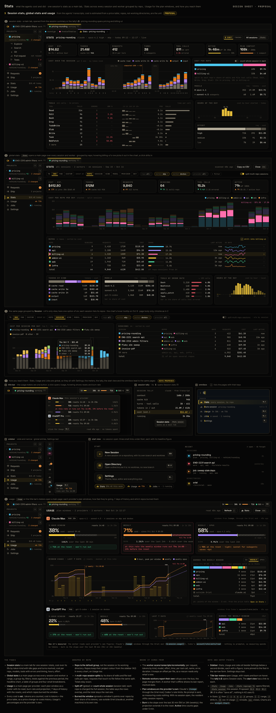

# AI-12 · Stats and Usage: session stats, global stats grouped by repo, plan usage, and how you reach them

**Phase** 5 · AI (follow-up) · **After** [AI-1](AI-1-worker-wire-sessions-workspaces-with-multi-repo-.md), [AI-2](AI-2-claude-provider-interactive-pty-plus-mod-hooks-n.md), [AI-3](AI-3-codex-provider-app-server-billing-checked-in-p0.md), [AI-9](AI-9-tasks-rail-session-tally-usage-windows.md), [SH-17](SH-17-project-sidebar-per-project-panels-and-shared-tabs.md) · **Unblocks** [SE-4](SE-4-jobs-page-saved-prompts-runs-and-schedules.md)

Added after P5 from review: crit's stats, but grouped by **repo** rather than by working directory (which came out as
session names), plus a Usage page for the plan windows. Mockup 43 was signed off.

## Design

- `_design/mockups/43-stats.png` (source `src/43-stats.html`): all five panels and the notes are the spec.
- `_design/crit-reference.md` (crit's `internal/stats`: incremental scans, the price table, the report shape)
- `_design/agents.md` (usage windows: Claude's through the Oriel mod, Codex's `account/rateLimits/read`)
- `_design/ui.md` 01h (the sidebar's global entries)

## Mockups

## What it is

- **Data, on the worker:** a port of crit's `stats` (incremental, offset-resumed transcript scans, Claude's JSONL and
  Codex's events; the price table) per session, kept in a stats file; `stats.query {group, from, to, filters, split}`
  answers by repo (default), session, kind, model, provider or day. The app merges every worker's answer; an offline
  worker's last report shows marked stale.
- **Multi-repo sessions split** by each repo's share of edits and file tool calls (Read, Edit, Write, Grep, Glob);
  requests touching no file follow the same split; one with no file work splits evenly. One setting,
  `stats.split_sessions` (default on), drives both the global toggle and the session tab's "count whole session in each".
- **Session stats** (a main tab, from the session stats box's cost, the summary, `:Stats session`): totals, cost over
  the session by token kind (idle gaps, turns, compactions), cost per repo, models, tools (calls, errors, timing
  buckets, p50), hours, effort.
- **Global Stats** (a main page, `:Stats`, `⌘⇧S`): range, group by, filter chips, the split toggle, totals against
  the previous period, cost per group per day stacked in project colours, the group table with share bars and
  sparklines, tokens by kind, models, tools by error rate, hours. Hover picks a series out; ⏎ or a click drills in
  (a filter chip, regrouped); ⌫ backs out. `g` then r/s/k/m/p/d groups; `[` `]` step the range; Copy as CSV;
  `:Stats repo=api 7d`.
- **Usage** (a main page, `:Usage`, `⌘⇧U`, the title bar's meters): each provider's windows as meters with reset,
  burn rate and projection, 7 days of history with resets, what used the current window grouped by repo (outside
  Oriel as its own row), and how it's measured.
- **Entry points:** the sidebar's global group (Stats, Usage, Jobs, Settings, below a second divider; icons in the
  narrow form) with live figures; the title bar meters as one button with a hover card; the session stats box's
  cost; the start view's links; the omnibox.
- **Charts** are a general `widget.Chart` (stacked bars, area, line, sparkline, strip; hover, legend, a table view),
  usable by any plugin and from Lua.

## Decided after the mockup

- **Plan usage belongs to an account**, not a provider or a worker: (provider, account identity), Claude's login
  account and organisation, Codex's account. Each worker reports its account with its readings; two workers on one
  account are one plan, deduplicated by identity; different accounts are separate limits, never merged.
- `usage.accounts` (a map setting: identity → "Work", "Personal") names them; unnamed, the email or organisation shows.
- Usage has an account switcher ("Work · Claude Team · mbp-work" | "Personal · Claude Max · mbp-home" | Codex …),
  starting on the session in front's account, else the local worker's; each account's meters, projections, history
  and what burned its window are its own. There's no "all accounts" for windows.
- The title bar's meters show the session in front's account (the local worker's with none); the hover card lists every
  account's windows.
- Stats groups and filters by **account** too; cost adds up, so all accounts stays the default.
- Session stats names its account in the header.

- **Everything they can find** (after review): the stats read every transcript the providers keep on the machine,
  not only Oriel's sessions' (`agent.Discovered`: Claude's config directory, Codex's rollouts), each classified by
  origin: an Oriel session's own stays that session, any other is a session outside Oriel. The page filters
  ALL / ORIEL / OUTSIDE and groups by origin; Usage's outside row counts them (`_design/agents.md`, `_design/ui.md` 43).

## Done when

- A worker with fixture transcripts for two multi-repo sessions answers `stats.query` grouped by repo with the
  split rule, and by session; a rescan reads only what was appended.
- The global page matches 43's panel 2 from that data; grouping by session matches panel 3; drilling into a repo adds
  its chip and regroups by session.
- Session stats matches panel 1; the split toggle and the setting agree.
- Usage shows a window's projection ("runs out … before the reset") from fixture readings.
- Two fake workers on different accounts (and one sharing an account) show separate plans, the shared one deduplicated.
- Each entry point opens its page: sidebar entries, the title bar meters, the session stats cost, the start view
  links, `:Stats`/`:Usage`, `⌘⇧S`/`⌘⇧U`.

## Rules

- Start only when everything in **After** is `done`.
- No special cases: build on the general plugin APIs, and extend them generally if they're missing something (`_design/plugins.md`).
- Test-first, with verified spec references (`_design/testing.md`).
- No new dependency without approval (`_design/deps.md`).
- Update the design doc in the same PR if behaviour differs from it.
