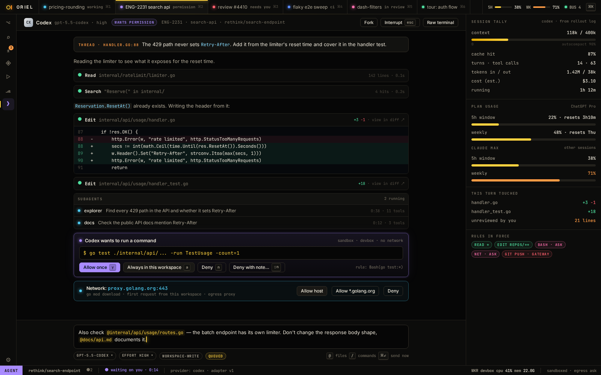

# AI-2 · Claude provider: interactive PTY plus mod hooks (no -p)

**Phase** 5 · AI · **After** [AI-1](AI-1-worker-wire-sessions-workspaces-with-multi-repo-.md) · **Unblocks** [AI-10](AI-10-commit-and-pr-drafts-when-the-agent-goes-idle.md), [AI-5](AI-5-requests-inline-threads-plus-the-main-requests-v.md), [AI-6](AI-6-agent-console-structured-transcript-subagents-co.md), [AI-7](AI-7-permissions-three-layers-network-and-gateway-app.md), [AI-9](AI-9-tasks-rail-session-tally-usage-windows.md), [DB-3](DB-3-agent-debugger-tools-with-scoped-access.md), [LS-3](LS-3-agent-lsp-tools-over-mcp.md), [PL-11](PL-11-prompts-page-editable-prompt-packs-coding-style-.md), [PL-4](PL-4-comms-assistant-drawer-utility-session-no-p.md), [RV-5](RV-5-explain-by-code-unit-widen-and-narrow-explain-th.md), [TR-5](TR-5-agent-test-runs-as-evidence.md)

## Design

- `_design/agents.md`
- `_design/crit-reference.md`
- `_design/features.md` (this row)

## Mockups

## Done when

conformance suite against a fake `claude` and a live smoke run

## Rules

- Start only when everything in **After** is `done`.
- No special cases: build on the general plugin APIs, and extend them generally if they're missing something (`_design/plugins.md`).
- Test-first, with verified spec references (`_design/testing.md`).
- No new dependency without approval (`_design/deps.md`).
- Update the design doc in the same PR if behaviour differs from it.
