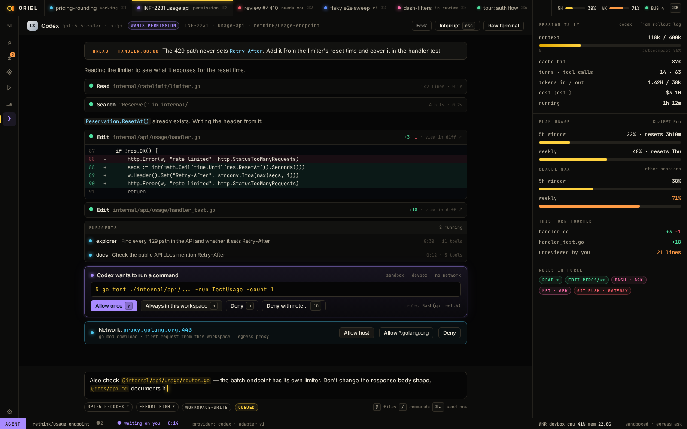

# AI-3 · Codex provider: app-server (billing checked in P0)

**Phase** 5 · AI · **After** [AI-1](AI-1-worker-wire-sessions-workspaces-with-multi-repo-.md) · **Unblocks** [RV-3](RV-3-cross-model-ai-review-findings.md)

## Design

- `_design/agents.md`
- `_design/sessions.md`
- `_design/architecture.md`
- `_design/ui.md`
- `_design/features.md` (this row)

## Mockups

## Done when

the same

## Rules

- Start only when everything in **After** is `done`.
- No special cases: build on the general plugin APIs, and extend them generally if they're missing something (`_design/plugins.md`).
- Test-first, with verified spec references (`_design/testing.md`).
- No new dependency without approval (`_design/deps.md`).
- Update the design doc in the same PR if behaviour differs from it.
