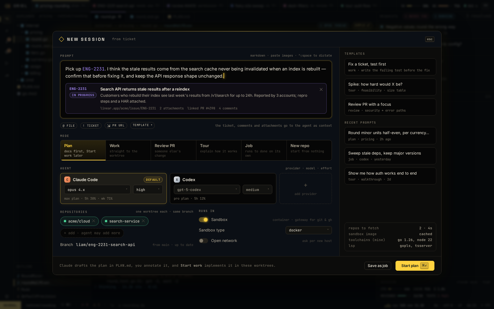

# AI-4 · New-session launcher: modes, provider, repos, worker, sandbox

**Phase** 5 · AI · **After** [AI-1](AI-1-worker-wire-sessions-workspaces-with-multi-repo-.md), [FW-6](FW-6-widgets-buttons-chips-inputs-virtual-lists-trees.md) · **Unblocks** nothing yet

## Design

- `_design/agents.md`
- `_design/sessions.md`
- `_design/architecture.md`
- `_design/ui.md`
- `_design/features.md` (this row)

## Mockups

## Done when

each mode starts the right prompt pack

## Rules

- Start only when everything in **After** is `done`.
- No special cases: build on the general plugin APIs, and extend them generally if they're missing something (`_design/plugins.md`).
- Test-first, with verified spec references (`_design/testing.md`).
- No new dependency without approval (`_design/deps.md`).
- Update the design doc in the same PR if behaviour differs from it.
