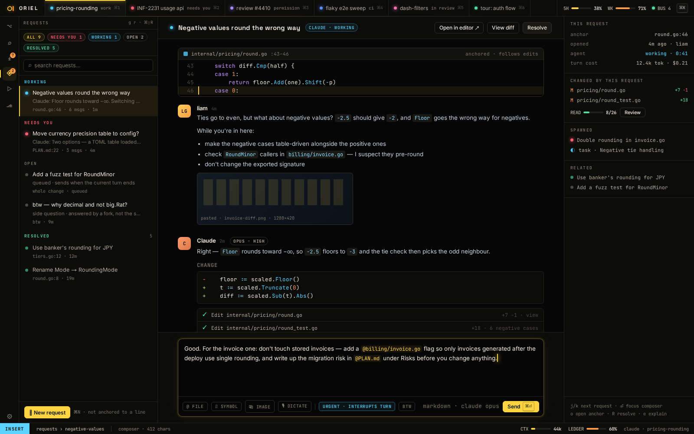

# AI-5 · Requests: inline threads plus the main Requests view, composer, urgent, btw

**Phase** 5 · AI · **After** [AI-2](AI-2-claude-provider-interactive-pty-plus-mod-hooks-n.md), [ED-7](ED-7-decorations-between-lines-threads-explain-cards-.md) · **Unblocks** [AI-8](AI-8-plan-mode-rendered-docs-margin-threads-readiness.md), [RV-7](RV-7-verify-raise-quiz.md)

## Design

- `_design/agents.md`
- `_design/sessions.md`
- `_design/architecture.md`
- `_design/ui.md`
- `_design/features.md` (this row)

## Mockups

## Done when

a comment reaches the agent within 1 s; replies render as markdown with activity blocks

## From SH-5

- The pickers' `⌃a` runs `request.attach {items: [{path, line, text}]}`: register it. Threads are a picker source too (`␣t`).

## Rules

- Start only when everything in **After** is `done`.
- No special cases: build on the general plugin APIs, and extend them generally if they're missing something (`_design/plugins.md`).
- Test-first, with verified spec references (`_design/testing.md`).
- No new dependency without approval (`_design/deps.md`).
- Update the design doc in the same PR if behaviour differs from it.

## From SH-16

- The rail already has an entry for this view, greyed until the view is registered; registering it lights the entry up.
