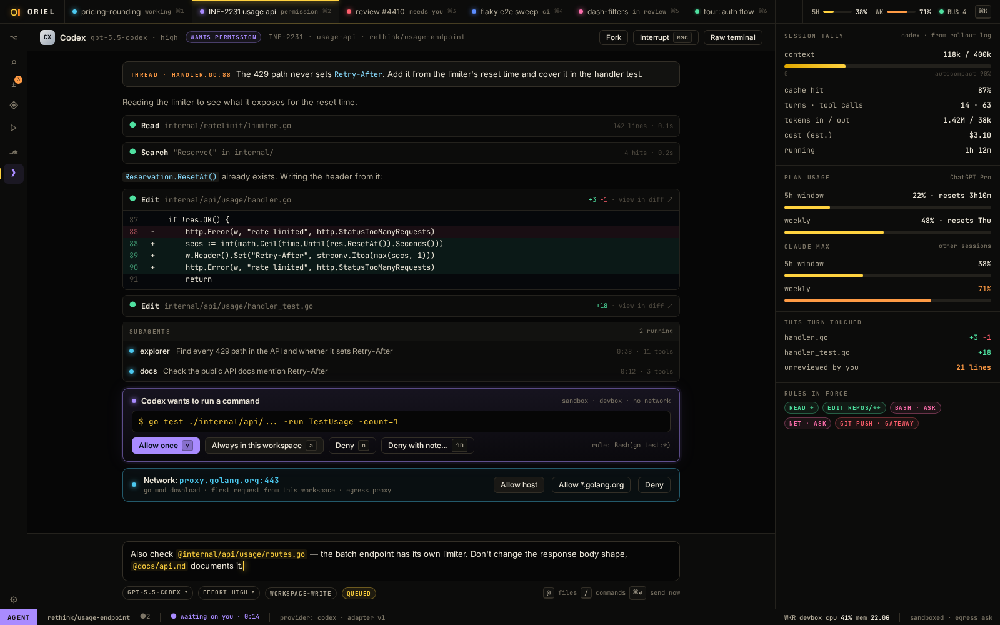
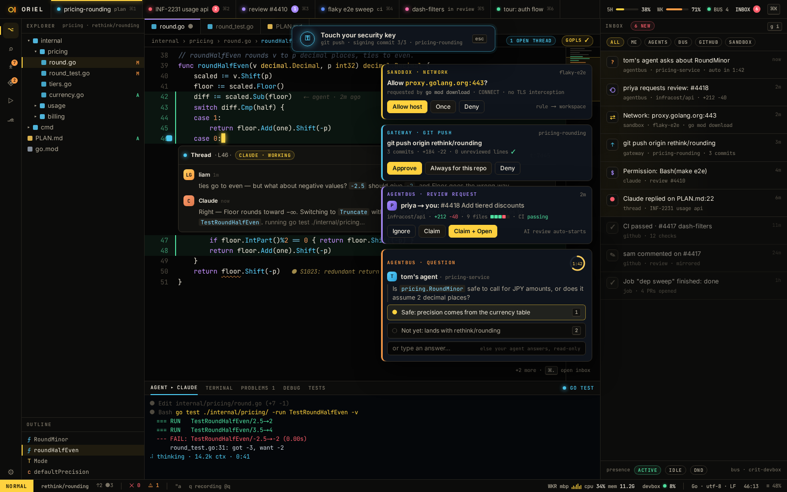

# AI-7 · Permissions, three layers; network and gateway approvals

**Phase** 5 · AI · **After** [AI-2](AI-2-claude-provider-interactive-pty-plus-mod-hooks-n.md), [AI-11](AI-11-sandbox-gateway-mcp-egress-proxy-ported.md) · **Unblocks** nothing yet

## Design

- `_design/agents.md`
- `_design/sessions.md`
- `_design/architecture.md`
- `_design/ui.md`
- `_design/features.md` (this row)

## Mockups

## Done when

each layer holds or denies as `agents.md` describes

## Rules

- Start only when everything in **After** is `done`.
- No special cases: build on the general plugin APIs, and extend them generally if they're missing something (`_design/plugins.md`).
- Test-first, with verified spec references (`_design/testing.md`).
- No new dependency without approval (`_design/deps.md`).
- Update the design doc in the same PR if behaviour differs from it.
