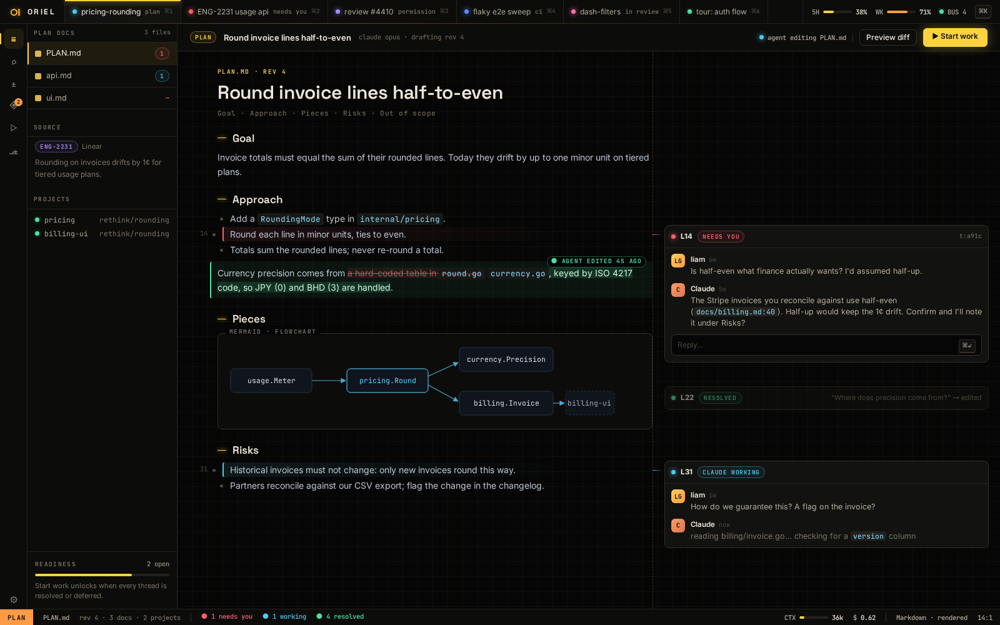

# AI-8 · Plan mode: rendered docs, margin threads, readiness, Start work

**Phase** 5 · AI · **After** [AI-5](AI-5-requests-inline-threads-plus-the-main-requests-v.md) · **Unblocks** nothing yet

## Design

- `_design/agents.md`
- `_design/sessions.md`
- `_design/crit-reference.md`
- `_design/ui.md`
- `_design/features.md` (this row)

## Mockups

## Done when

the crit plan flow works end to end

## Rules

- Start only when everything in **After** is `done`.
- No special cases: build on the general plugin APIs, and extend them generally if they're missing something (`_design/plugins.md`).
- Test-first, with verified spec references (`_design/testing.md`).
- No new dependency without approval (`_design/deps.md`).
- Update the design doc in the same PR if behaviour differs from it.
