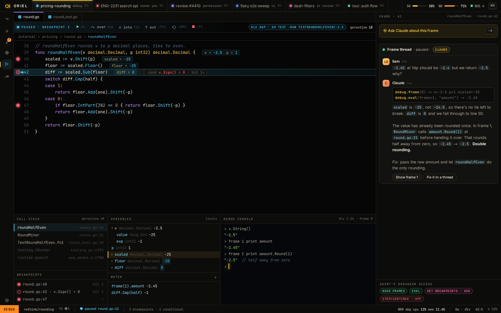

# DB-1 · DAP: breakpoints (conditional, logpoints), stepping, stack, variables, watch, REPL

**Phase** 7 · the rest · **After** [ED-7](ED-7-decorations-between-lines-threads-explain-cards-.md), [FW-9](FW-9-layout-tree-and-tab-groups-drag-any-pane-to-any-.md) · **Unblocks** [DB-2](DB-2-inline-values-while-stopped-debug-a-single-test-.md), [DB-3](DB-3-agent-debugger-tools-with-scoped-access.md)

## Design

- `_design/ide.md`
- `_design/features.md` (this row)

## Mockups

## Done when

dlv and debugpy recorded sessions plus live CI runs

## From SH-13

- Capture the child's stderr with `logs.Lines` (a `slog` source per server or plugin), so it shows in the log panel (`errors.md`).

## Rules

- Start only when everything in **After** is `done`.
- No special cases: build on the general plugin APIs, and extend them generally if they're missing something (`_design/plugins.md`).
- Test-first, with verified spec references (`_design/testing.md`).
- No new dependency without approval (`_design/deps.md`).
- Update the design doc in the same PR if behaviour differs from it.

## From SH-16

- The rail already has an entry for this view, greyed until the view is registered; registering it lights the entry up.
