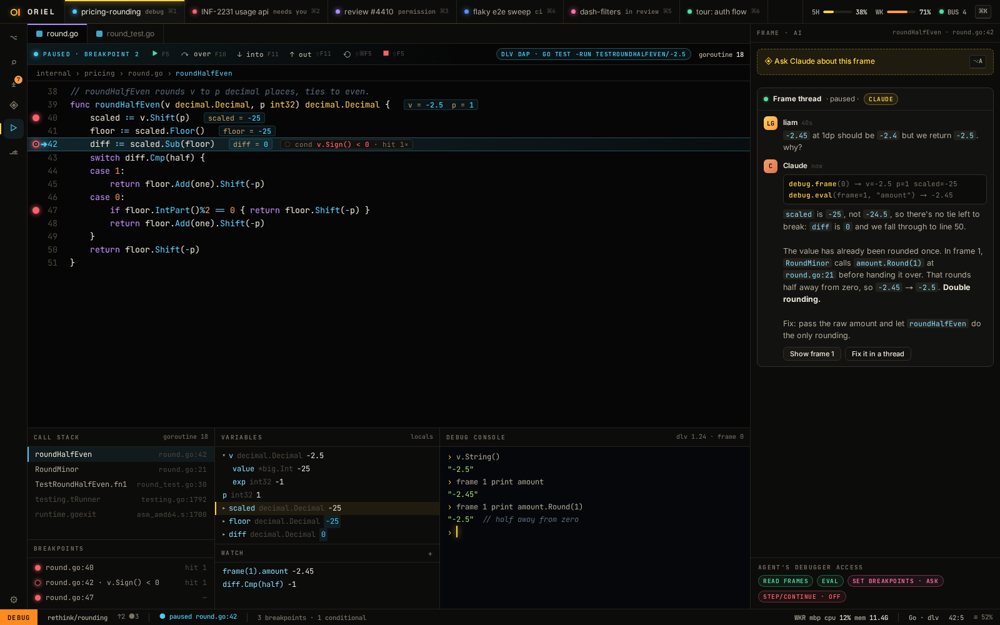

# DB-2 · Inline values while stopped; debug a single test case

**Phase** 7 · the rest · **After** [DB-1](DB-1-dap-breakpoints-conditional-logpoints-stepping-s.md), [TR-1](TR-1-gutter-run-for-tests-subtests-and-table-rows-inl.md) · **Unblocks** nothing yet

## Design

- `_design/ide.md`
- `_design/features.md` (this row)

## Mockups

## Done when

Acceptance tests derived from the design docs above, written first, all passing in CI on macOS and Linux.

## Rules

- Start only when everything in **After** is `done`.
- No special cases: build on the general plugin APIs, and extend them generally if they're missing something (`_design/plugins.md`).
- Test-first, with verified spec references (`_design/testing.md`).
- No new dependency without approval (`_design/deps.md`).
- Update the design doc in the same PR if behaviour differs from it.
