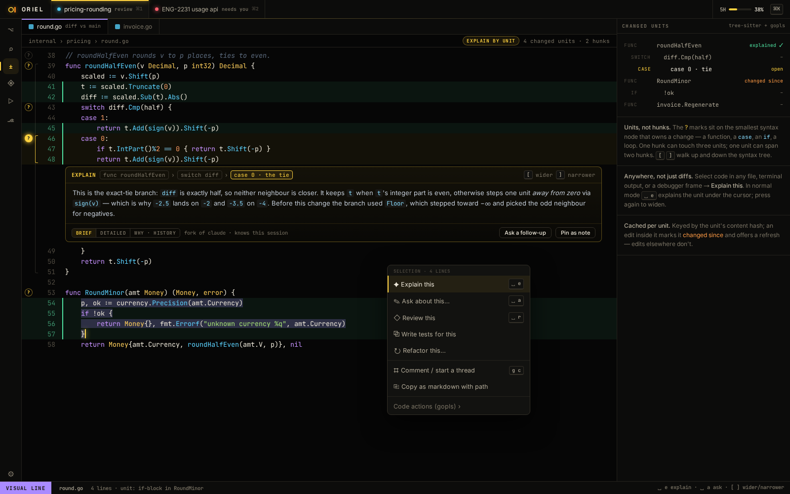

# ED-6 · Tree-sitter highlighting, folds, outline, code units

**Phase** 2 · editor core · **After** [ED-1](ED-1-rope-snapshots-anchors-authorship-undo-tree.md) · **Unblocks** [FG-1](FG-1-explorer-scopes-changed-uncommitted-all-with-mar.md), [RV-5](RV-5-explain-by-code-unit-widen-and-narrow-explain-th.md), [TR-1](TR-1-gutter-run-for-tests-subtests-and-table-rows-inl.md)

## Design

- `_design/editor.md`
- `_design/testing.md`
- `_design/features.md` (this row)

## Mockups

## Done when

highlight snapshots for Go/TS/Py/Rust/Lua/MD; edits re-parse incrementally in under 1 ms in a 600-line file, and
no keystroke waits on a parse at any size (`syntax.Document` parses in the background; decided with Liam,
2026-10-12, after measuring 2.7 ms at 2,000 lines under wazero against 0.75 ms native)

## Rules

- Start only when everything in **After** is `done`.
- No special cases: build on the general plugin APIs, and extend them generally if they're missing something (`_design/plugins.md`).
- Test-first, with verified spec references (`_design/testing.md`).
- No new dependency without approval (`_design/deps.md`).
- Update the design doc in the same PR if behaviour differs from it.
