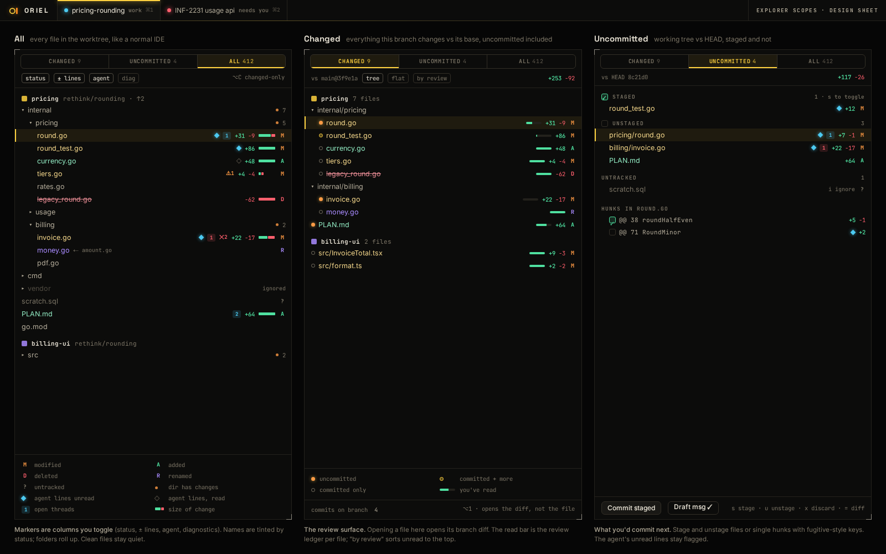

# FG-1 · Explorer scopes: Changed, Uncommitted, All, with markers

**Phase** 4 · IDE · **After** [FW-6](FW-6-widgets-buttons-chips-inputs-virtual-lists-trees.md), [ED-6](ED-6-tree-sitter-highlighting-folds-outline-code-unit.md) · **Unblocks** nothing yet

## Design

- `_design/ide.md`
- `_design/ui.md`
- `_design/features.md` (this row)

## Mockups

## Done when

fixture repos produce the expected markers; `⌥1–3` switch scopes

## Rules

- Start only when everything in **After** is `done`.
- No special cases: build on the general plugin APIs, and extend them generally if they're missing something (`_design/plugins.md`).
- Test-first, with verified spec references (`_design/testing.md`).
- No new dependency without approval (`_design/deps.md`).
- Update the design doc in the same PR if behaviour differs from it.
