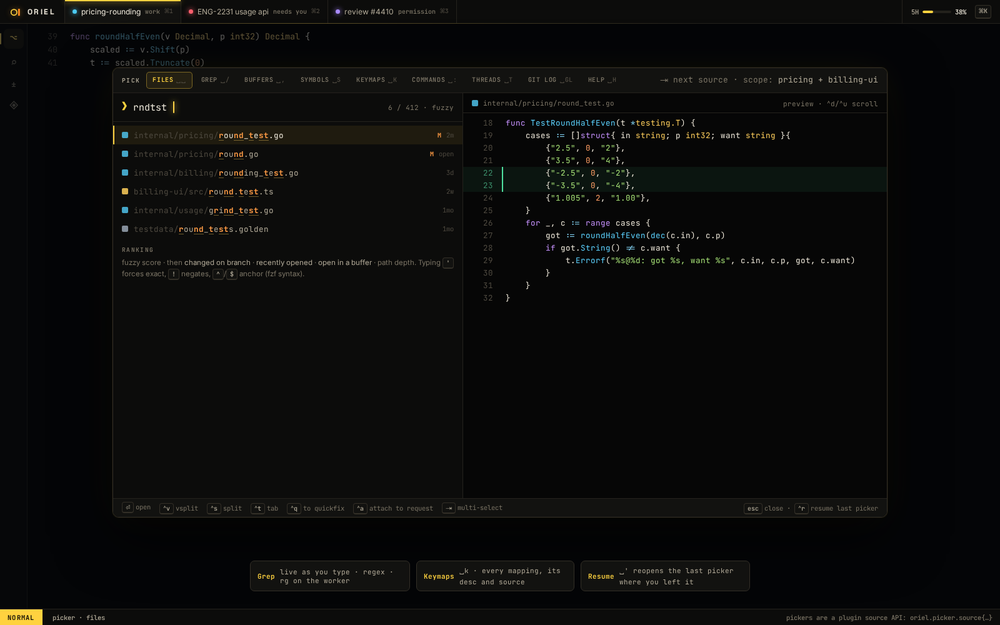

# FG-3 · Project search and replace preview

**Phase** 4 · IDE · **After** [SH-5](SH-5-pickers-files-grep-k-keymaps-with-preview-and-ac.md) · **Unblocks** nothing yet

## Design

- `_design/ide.md`
- `_design/ui.md`
- `_design/features.md` (this row)

## Mockups

## Notes

- Patterns are PCRE2 (ED-10). If the search runs on ripgrep, use its PCRE2 mode (`-P`) so both agree, or our own matcher.

## Done when

ripgrep on the worker streams results; replace shows a diff before applying

## From SH-5

- The grep source searches in the app with Go's regexp; move it to ripgrep on the worker, streamed as you type.

## From ED-9

- Grep already leaves out files `.gitattributes` marks generated or vendored (`conventions.searchable`) unless the
  query starts `@all `; keep that in project search and replace.

## From ED-10

- Use `regex` for the search and `Regex.ReplaceAll` (PCRE2's `$n`, `${name}`, `$$`) for the replace preview; grep
  already takes PCRE2.

## Rules

- Start only when everything in **After** is `done`.
- No special cases: build on the general plugin APIs, and extend them generally if they're missing something (`_design/plugins.md`).
- Test-first, with verified spec references (`_design/testing.md`).
- No new dependency without approval (`_design/deps.md`).
- Update the design doc in the same PR if behaviour differs from it.
