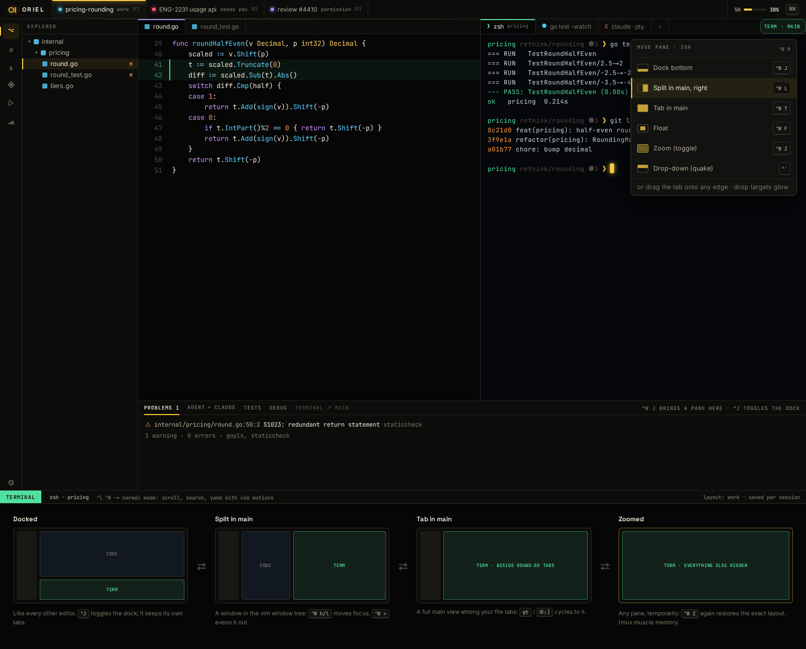

# FG-4 · Terminals: Ghostty VT under wazero, our renderer, placements, terminal-normal mode

**Phase** 4 · IDE · **After** [FW-9](FW-9-layout-tree-and-tab-groups-drag-any-pane-to-any-.md) · **Unblocks** [FG-5](FG-5-shell-integration-osc-133-7-prompt-jumps-exit-do.md)

## Design

- `_design/ide.md`
- `_design/ui.md`
- `_design/features.md` (this row)

## Mockups

## Done when

vttest-style suite; parse throughput ≥ 200 MB/s; snapshot on reconnect

## Rules

- Start only when everything in **After** is `done`.
- No special cases: build on the general plugin APIs, and extend them generally if they're missing something (`_design/plugins.md`).
- Test-first, with verified spec references (`_design/testing.md`).
- No new dependency without approval (`_design/deps.md`).
- Update the design doc in the same PR if behaviour differs from it.
