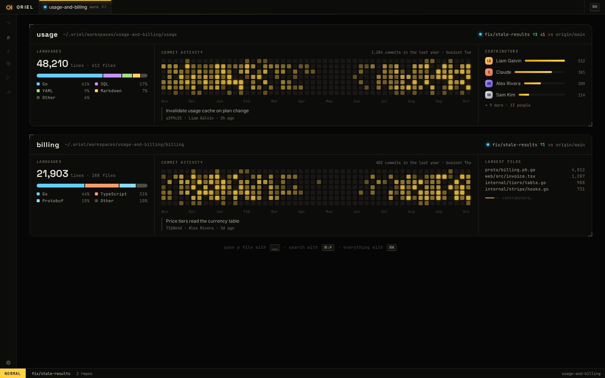

# FG-7 · Project overview: stats for each repo or directory, shown with nothing open

**Phase** 3 · shell · **After** [SH-15](SH-15-start-view-what-the-window-shows-with-nothing-open.md), [ED-11](ED-11-languages-as-plugins-core-grammar-set-and-local-packs.md) · **Unblocks** nothing yet

## Design

- `_design/ui.md` (01g · Project overview)
- `_design/theming.md` (chart colours are theme tokens)
- `_design/plugins.md` (the view and its panels are contributions)
- `_design/features.md` (this row)

## Mockups

## What

- A registry `View` shown when a directory (or, later, a session) is open but **no buffer is**: right after it opens,
  and again when its last tab closes. The start view (SH-15) is for when nothing is open at all.
- **One section per repo** (a session can hold several, SE-1); a plain directory gets the same, minus the git panels.
- **Panels**, each its own contribution (`registry.OverviewPanel`, `oriel.overview.add`) so plugins add more:
  - **Languages**: share of lines by language, as a bar or donut, using the language registry (ED-11) and honouring `.gitignore`.
  - **Size** and **largest files**, on a plain directory's card.
  - **Commit activity**: a contribution-style heatmap or sparkline of commits over the last year.
  - **Contributors**: top authors by commits, with a small bar each.
  - **Branch** (in the card's header): current branch and ahead/behind its upstream; the last commit is under the activity.
- **Fast, and never blocks**: the view shows at once and panels fill in as they finish, in the background,
  with a time budget (5 s a panel; lines are counted for 3 s, then estimated from bytes); results are kept per repo
  until HEAD moves. Git is read through `gitx` (`ls-files`, `log`, `shortlog`, `rev-list`).
- Looks like the mockups: theme tokens only, the HUD's indicators style for numbers.

## Done when

snapshot of the overview for a fixture repo and a fixture plain directory, both variants; on a 100k-file repo the view
shows in one frame and every panel fills within its budget without dropping frames; closing the last tab returns to it;
a plugin-added panel appears

## Rules

- Start only when everything in **After** is `done`.
- No special cases: build on the general plugin APIs, and extend them generally if they're missing something (`_design/plugins.md`).
- Test-first, with verified spec references (`_design/testing.md`).
- No new dependency without approval (`_design/deps.md`).
- Update the design doc in the same PR if behaviour differs from it.
