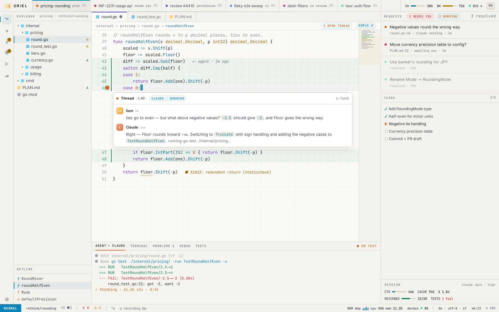
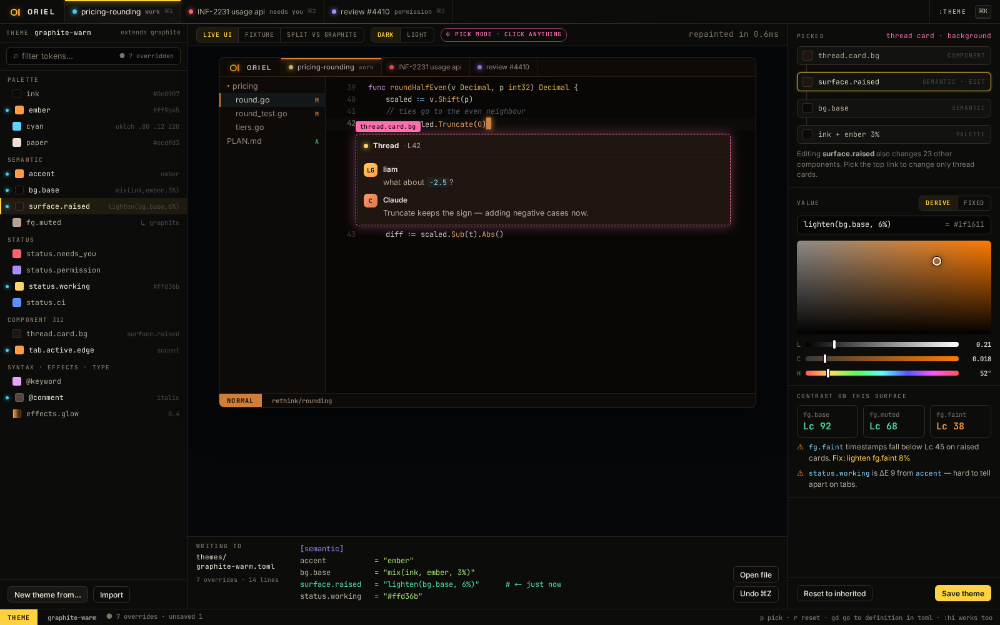

# FW-7 · Theme tokens: layered resolution, live reload, the default black/yellow/orange theme

**Phase** 1 · framework · **After** [FW-4](FW-4-ui-toolkit-core-ctx-ids-flex-layout-anchors-scro.md) · **Unblocks** [FW-6](FW-6-widgets-buttons-chips-inputs-virtual-lists-trees.md), [SH-11](SH-11-light-dark-and-theme-editor-theme-pick-mode.md)

## Design

- `_design/theming.md`
- `_design/ui.md`
- `_design/features.md` (this row)

## Mockups

## Done when

token resolution tables; the fixture renders in every built-in theme

## Rules

- Start only when everything in **After** is `done`.
- No special cases: build on the general plugin APIs, and extend them generally if they're missing something (`_design/plugins.md`).
- Test-first, with verified spec references (`_design/testing.md`).
- No new dependency without approval (`_design/deps.md`).
- Update the design doc in the same PR if behaviour differs from it.
