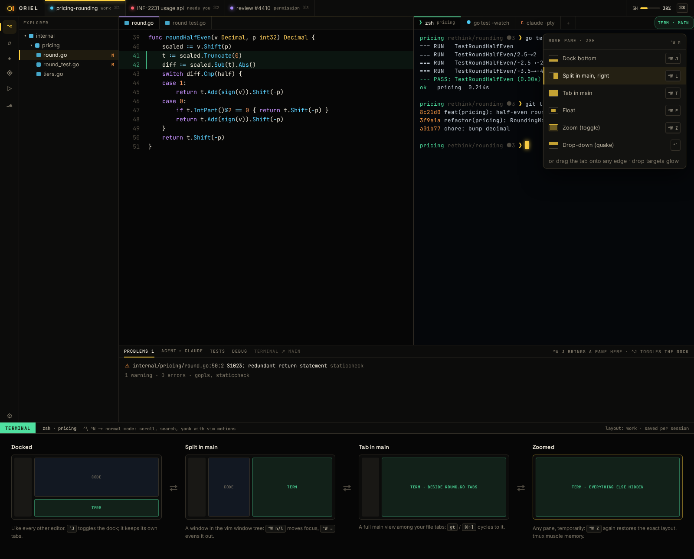

# FW-9 · Layout tree and tab groups: drag any pane to any tab group, dock, split or float, animated drop targets, zoom, ⌃W keys

**Phase** 1 · framework · **After** [FW-6](FW-6-widgets-buttons-chips-inputs-virtual-lists-trees.md), [FW-8](FW-8-headless-backend-display-list-snapshots-plus-per.md) · **Unblocks** [DB-1](DB-1-dap-breakpoints-conditional-logpoints-stepping-s.md), [ED-4](ED-4-macros-folds-splits-buffers-quickfix.md), [FG-4](FG-4-terminals-ghostty-vt-under-wazero-our-renderer-p.md)

## Design

- `_design/ui.md`
- `_design/rendering.md`
- `_design/features.md` (this row)

## Mockups

## Done when

snapshot tests for every move and drop target; drag and drop scripted in tests; layouts saved and restored

## Rules

- Start only when everything in **After** is `done`.
- No special cases: build on the general plugin APIs, and extend them generally if they're missing something (`_design/plugins.md`).
- Test-first, with verified spec references (`_design/testing.md`).
- No new dependency without approval (`_design/deps.md`).
- Update the design doc in the same PR if behaviour differs from it.
