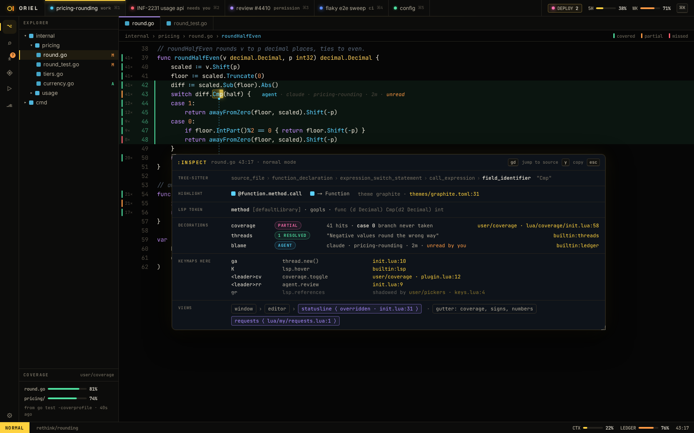

# PL-1 · Lua config and plugins, :Hooks, :Inspect, LuaLS types

**Phase** 3 · shell · **After** [FW-3](FW-3-registries-commands-keymaps-modes-chords-panel-l.md) · **Unblocks** [PL-2](PL-2-process-plugins-with-an-os-sandbox-wasm-plugins-.md)

## Design

- `_design/plugins.md`
- `_design/scripting.md`
- `_design/security.md`
- `_design/distribution.md`
- `_design/features.md` (this row)

## Mockups

## Done when

the `scripting.md` sample `init.lua` runs as written

## From SH-13

- Hooks run under `registry.Call`, and a panicking hook calls `TurnOff(registry.KindHook, …)` so it becomes an error
  notice with "Turn back on", as commands and views already do (`errors.md`). The SH-13 "done when" for hooks lands here.

## Rules

- Start only when everything in **After** is `done`.
- No special cases: build on the general plugin APIs, and extend them generally if they're missing something (`_design/plugins.md`).
- Test-first, with verified spec references (`_design/testing.md`).
- No new dependency without approval (`_design/deps.md`).
- Update the design doc in the same PR if behaviour differs from it.
