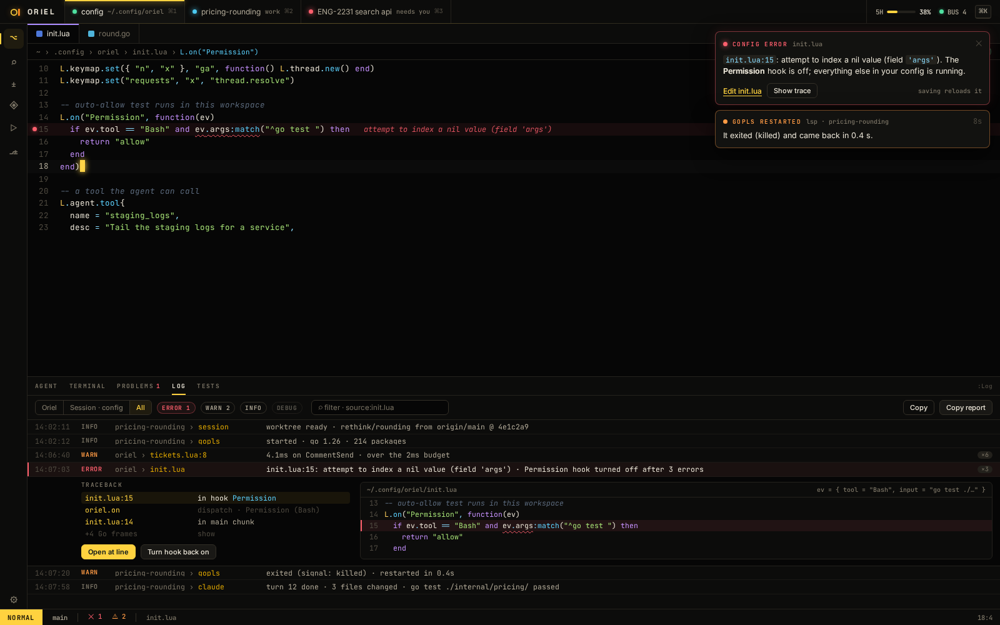

# PL-12 · Lua errors: tracebacks, diagnostics in the file, turning off failing hooks

**Phase** 3 · shell · **After** [PL-1](PL-1-lua-config-and-plugins-hooks-inspect-luals-types.md), [SH-13](SH-13-errors-notifications-and-the-log-panel.md) · **Unblocks** nothing yet

## Design

- `_design/errors.md` (Lua errors)
- `_design/scripting.md`, `_design/plugins.md` (`:Hooks`, budgets)
- `_design/testing.md`
- `_design/features.md` (this row)

## Mockups

The `:Hooks` budget warning ("4.1 ms on CommentSend · over the 2 ms budget").

## What

- Chunks load with their source name, so errors say `init.lua:14`.
- Lua errors carry the traceback, with `oriel` API frames shown as the API call and Go frames hidden by default.
- An error is a notice with "Open at line" and "Show trace", a diagnostic on the line in the open file and in
  Problems, and inline in the `:lua` REPL.
- A config that fails to load keeps the last good one running. At startup Oriel opens without the failing part and
  shows the error with an **Edit init.lua** link to the line; saving reloads it, and the toast clears on success.
- A hook or view erroring 3 times in a row is turned off, with a notice and "Turn back on"; `:Hooks` shows it off with
  its last error. Over-budget hooks are warnings.

## Done when

- Fixture configs with a syntax error, a runtime error in a hook, an error inside a nested `require`, and an error
  raised through an `oriel` API call each give the right `file:line`, traceback frames and diagnostic location.
- A failing `init.lua` on reload leaves the previous keymaps and hooks working; at startup Oriel opens, the toast's
  link opens the file at the line, and saving a fix reloads it and clears the toast.
- A hook failing three times is off, shown in `:Hooks`, and back on after "Turn back on".
- `:lua error("x")` shows the error and trace under the input.

## From PL-1

- Lua errors are `script.Error{Message, Traceback}`; load errors are notices with `Location` (`init.lua:12`), and a
  Lua view or decoration that errors is turned off through the registry's fault path. Hooks report errors from
  `Fire`, and the editor notifies them.
- `:Hooks` shows p99s and marks hooks past 2 ms; the VM's `OnSlow` only logs today.

## Rules

- Start only when everything in **After** is `done`.
- No special cases: build on the general plugin APIs, and extend them generally if they're missing something (`_design/plugins.md`).
- Test-first, with verified spec references (`_design/testing.md`).
- No new dependency without approval (`_design/deps.md`).
- Update the design doc in the same PR if behaviour differs from it.

## As built

- `script.Error` gives `Where()`, `Frames()` and `Trace()`; `require` names chunks by their path from the config
  directory; API frames are named and their Go stack follows. Tests: `script/error_test.go` and
  `app/luaerrors_test.go` (the four fixtures, a broken reload, a broken startup, a hook and a view turned off, the
  REPL, Problems, and the `lua-errors` snapshot of 37-errors).
- General pieces added on the way: `Registry.Report` / `OnFailure` / `FailLimit` (3 in a row turn any hook, view
  or decoration off), `Registry.SetDiagnostics` / `Diagnostics` / `DiagnosticsFor` with the built-in `problems`
  extension (editor marks, `:Problems`), `DecorationCtx.Path`, `Host.Dismiss`, `L.diagnostics`. The log panel's
  frame links now use `editor.open`, which nothing named `file.open` was registered for.
- Hook errors are notified once, through `OnFailure`; the editor no longer notifies the errors `Fire` returns.
- Not yet: runtime errors have no column (gopher-lua gives none), so the whole line is underlined.
