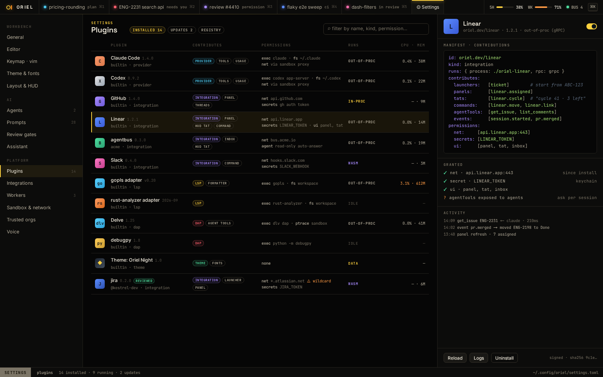

# PL-2 · Process plugins with an OS sandbox; WASM plugins; oriel build --with

**Phase** 7 · the rest · **After** [PL-1](PL-1-lua-config-and-plugins-hooks-inspect-luals-types.md) · **Unblocks** [PL-10](PL-10-calendar-next-meeting-tat-ical-url-or-macos-even.md), [PL-3](PL-3-all-or-nothing-install-consent-update-capability.md), [PL-8](PL-8-linear-assigned-tickets-start-work-from-a-ticket.md), [PL-9](PL-9-slack-ptal-via-webhook.md)

## Design

- `_design/plugins.md`
- `_design/scripting.md`
- `_design/security.md`
- `_design/distribution.md`
- `_design/features.md` (this row)

## Mockups

## Done when

the capability guard rejects undeclared calls; Landlock/sandbox-exec profiles applied

## From SH-13

- Capture the child's stderr with `logs.Lines` (a `slog` source per server or plugin), so it shows in the log panel (`errors.md`).

## Rules

- Start only when everything in **After** is `done`.
- No special cases: build on the general plugin APIs, and extend them generally if they're missing something (`_design/plugins.md`).
- Test-first, with verified spec references (`_design/testing.md`).
- No new dependency without approval (`_design/deps.md`).
- Update the design doc in the same PR if behaviour differs from it.
